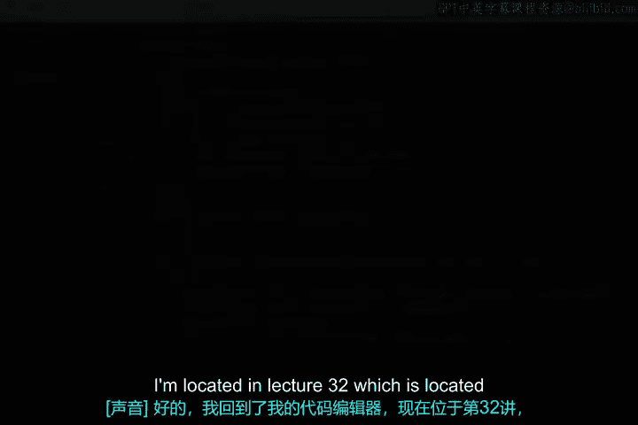
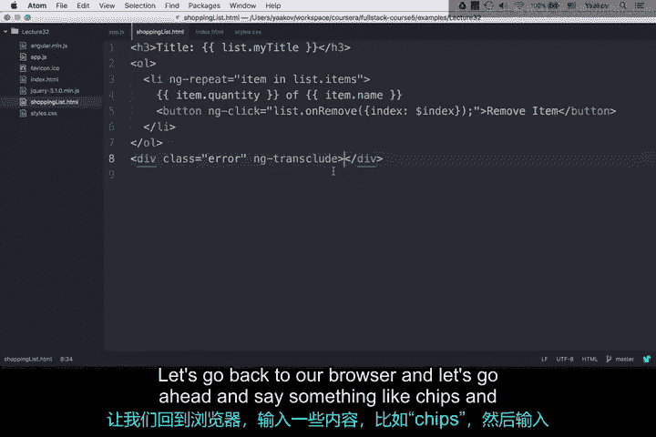
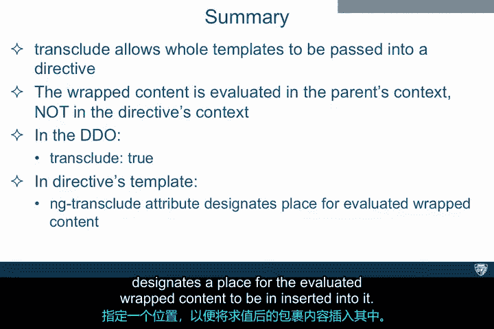

# 约翰霍普金斯大学《使用 AngularJS 开发单页 Web 应用｜Single Page Web Applications with AngularJS》中英 - P64：63_第32讲（第2部分）：使用指令的transclude包装其他元素.zh_en - GPT中英字幕课程资源 - BV1dsFDeZEQr

🎼。

Okay I'm back in my code editor and I'm located in lecture 32 which is located in full stack Cose 5 examples folder and yet again I'm back in my shopping list directive app and what we would like to do now is actually provide two separate shopping lists side by side except the warning that's going to be displayed by the shopping directive is something that we would like to provide ourselves instead of having the directive decide what the warning should be so first things first。

 we're going to give separate ID for shopping list with ID list one and the other one shopping list with ID list2 and the way we're going to have them side by side is simply floating both of them to the left and having a margin left on the second one so we could separated to a little bit。

😊，Let's go back to Intex at HTML and take a look。 The first one has the span with a class warning and says warning warning and says they list that warning and list that warning is yet another property that we defined on our shopping list controller。

 the main parent controller and we could see that if we scroll down all the way to the shopping list controller and it's right there the shopping list controller and you see we defined another property or initialize another property called cookies detect it。

 So that we know we just don't know what kind of warning we want and that warning we're going to customize depending on which directive we use So the first one we're going to use the span with a warning if we look at our styles that css warning just makes the font style ital really nothing more。

The second shopping list that is going to sit side by side is going to have a little bit of a more of an involved type of display for the warning。

 First it' going to have this title called or the horrorrr and then it's going to display the list that warning in a separate div and again the title here。

 the class title is defined in styles css and it just gives this kind of a dark gray background to it。

 So in Abt js， obviously we need to turn on our transclusion。

 So if we go to our directive if we curl up here we'll see that transc has already been specified to true Now all we need to do is to tell our directive where in the shopping list that htl template that is responsible for our shopping list directive where we want that rat content to appear。

 So we go to shopping list ht and we see here that error message we have here with an error class and we stick n transclude right on it which means that when the。

😊，Content of the parent that's going to get evaluated is going to get inserted right here as the body of this div。

 Let's go ahead and save that。 Let's go back to our browser and let's go ahead and say something like chips and say two bags of chips and edit and you see they're being added on both sides and we say cookies。

If could say cookies， let's get five bags of cookies。When we enter that。

 the first list gives us this eicize the warning saying warning warnings cookies detected and the second one has this whole setup here where there's a title or the horror and cookies detected is the body of this warning and if we remove the cookies。

 it will get removed from both sides and you could see our jQury effects are still working from the previous lecture。

So the main point to notice here is that even though we have interpolation going on directly inside of a directive with isolate scope。

 since the content of our directive is being inserted through transclusion。

 the interpolation and in general resolution of scope and properties of the transcluded content does not look at the directive's isolate scope。

 but instead uses the scope from its original place。

 so in this case even though the warning property was declared on the parent controller。

 it could still be viewed inside of our directive because we're not simply placing it there。

 we're using the transclusion to place it there that means Angular will resolve the warning property against the parent controller instead of the isolate scope of the directive so that's how you use transclude with custom directives。

😊，So let's summarize the translude mechanism allows whole temps to be passed into the directive。

 not just a string or an object。However， the big thing about transclude is that the wrapped content is evaluated in the parent's context。

 not in the directive's context， the way you declare the transclude is in the directive definition object。

 you include a transclude property and set it to true。In the Directives template， however。

 you use the Nng transc attribute that designates a place for the evaluate wrapped content to be inserted into。

