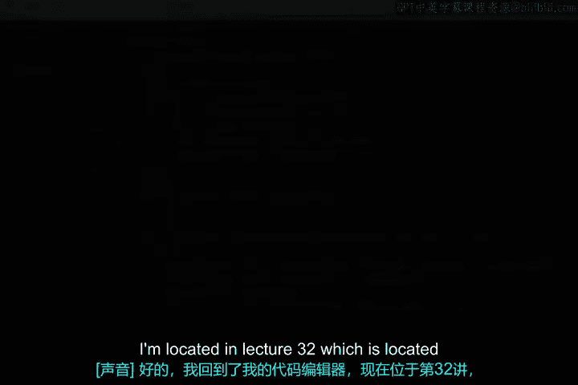
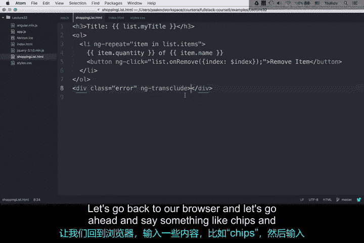
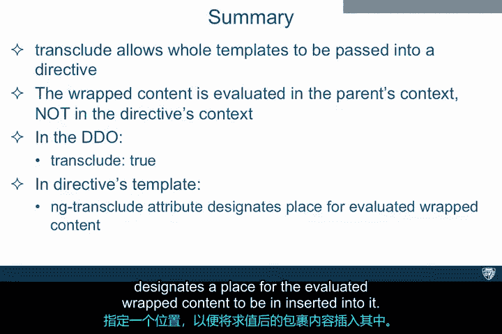
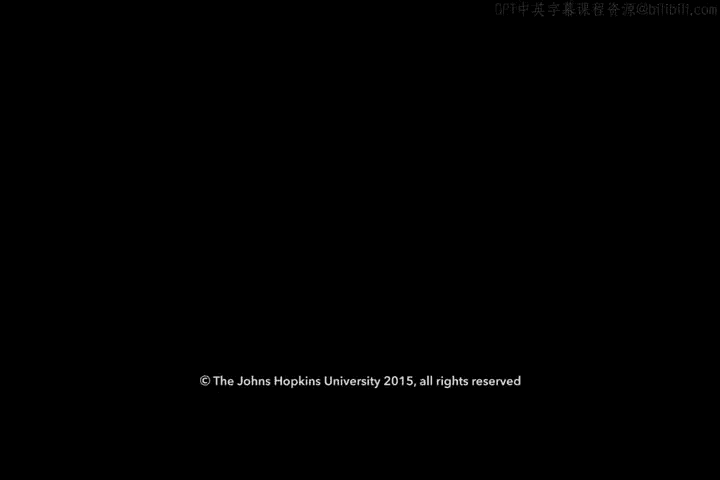

# AngularJS 单页应用开发：P64：使用指令的 transclude 包装其他元素




## 概述
在本节课中，我们将学习 AngularJS 指令中一个强大的功能：`transclude`。我们将了解如何使用 `transclude` 来包装和插入父作用域中的内容到指令模板中，同时保持内容在原始父作用域上下文中的绑定和解析。

---

## 项目背景与目标
上一节我们介绍了指令的隔离作用域。本节中，我们来看看如何让指令能够灵活地包装来自父模板的任意内容，而不仅仅是处理简单的字符串或对象。

我们的目标是修改现有的购物清单应用，创建两个并排显示的购物清单。关键区别在于，每个清单显示的警告信息将由使用指令的父模板自定义提供，而不是由指令内部硬编码决定。

## 步骤一：准备 HTML 结构
首先，我们需要在 `index.html` 中设置两个并排的购物清单指令实例。

以下是具体的 HTML 代码修改：

```html
<!-- 第一个购物清单 -->
<shopping-list list-id="list1">
    <span class="warning">Warning: {{listThatWarning}}</span>
</shopping-list>

<!-- 第二个购物清单 -->
<shopping-list list-id="list2">
    <div class="title">OH NO!</div>
    <div>{{listThatWarning}}</div>
</shopping-list>
```

*   **`list-id` 属性**：我们为每个指令实例指定了唯一的ID（`list1` 和 `list2`），以便区分。
*   **自定义警告内容**：每个 `<shopping-list>` 标签内部的内容就是我们希望“透传”到指令内部的内容。第一个使用简单的 `<span>`，第二个使用了更复杂的结构，包含标题和内容。
*   **`{{listThatWarning}}`**：这是一个绑定到父控制器 `ShoppingListController` 中 `listThatWarning` 属性的表达式。

为了并排显示，我们添加了简单的 CSS 样式，将两个元素浮动到左侧，并为第二个元素添加左边距以分隔开。

## 步骤二：理解父控制器数据
让我们回到 `index.html`，查看数据来源。`{{listThatWarning}}` 绑定的是定义在主父控制器 `ShoppingListController` 上的一个属性。

在 `app.js` 中找到 `ShoppingListController`，可以看到我们初始化了一个名为 `listThatWarning` 的属性。这样，指令本身并不知道要显示什么警告信息，警告内容将根据我们使用指令的方式（即上面HTML中定义的内容）进行自定义。

## 步骤三：启用并配置指令的 Transclude 功能
现在，我们需要修改指令定义，使其能够接收并放置这些自定义内容。

1.  **在指令定义对象中启用 `transclude`**：
    在 `app.js` 中找到 `shoppingList` 指令的定义。我们需要设置 `transclude: true`。

    ```javascript
    .directive('shoppingList', function () {
      return {
        templateUrl: 'shoppingList.html',
        scope: {
          list: '=',
          title: '@title',
          listId: '@'
        },
        controller: 'ShoppingListDirectiveController',
        controllerAs: 'list',
        bindToController: true,
        transclude: true // 启用内容透传功能
      };
    })
    ```



2.  **在指令模板中指定插入点**：
    接下来，我们需要告诉 Angular，透传过来的内容应该放在指令模板 `shoppingList.html` 的哪个位置。我们使用 `ng-transclude` 指令来标记这个插入点。

    找到模板中用于显示错误信息的部分，将 `ng-transclude` 属性添加进去。

    ```html
    <!-- shoppingList.html 片段 -->
    <div class="error" ng-show="list.cookiesInList()" ng-transclude>
        <!-- 透传的内容将出现在这里 -->
    </div>
    ```

    这意味着，父模板中 `<shopping-list>` 标签内的所有内容（即我们自定义的警告信息），在求值后将被插入到这个 `div` 的内部。

## 步骤四：查看运行结果
保存所有修改并刷新浏览器页面。现在，当我们尝试添加“cookies”时，两个购物清单会并排显示，并且警告信息各不相同：
*   第一个清单显示简单的斜体警告：“Warning: cookies detected”。
*   第二个清单显示一个带有“OH NO!”标题和“cookies detected”正文的警告框。

如果我们移除“cookies”，警告会从两边同时消失。同时，之前课程中实现的 jQuery 动画效果仍然正常工作。

## 核心概念与总结
本节课中我们一起学习了 `transclude` 机制的核心要点。

**`transclude` 的核心行为是：被包装的内容在其原始的父作用域上下文中求值，而不是在指令的隔离作用域中。**

以下是使用 `transclude` 的关键步骤总结：

1.  **在指令定义对象中声明**：包含一个 `transclude` 属性并将其设置为 `true`。
    ```javascript
    transclude: true
    ```

2.  **在指令模板中标记插入点**：使用 `ng-transclude` 属性来指定透传内容在模板中的放置位置。
    ```html
    <div ng-transclude></div>
    ```

3.  **在父模板中提供内容**：在自定义指令的标签内部编写需要透传的 HTML 和表达式。

**`transclude` 的强大之处在于**：即使指令使用了隔离作用域，通过 `transclude` 插入的内容中的表达式（如 `{{listThatWarning}}`），Angular 在解析时也会忽略指令的隔离作用域，转而向上查找其原始的父作用域（本例中是 `ShoppingListController`）。这使得指令能够封装结构，同时允许父模板灵活控制部分内容。





通过这种方式，我们创建了高度可重用且结构清晰的指令，它既能管理复杂的内部逻辑和视图，又能为外部调用者提供定制特定区域内容的能力。