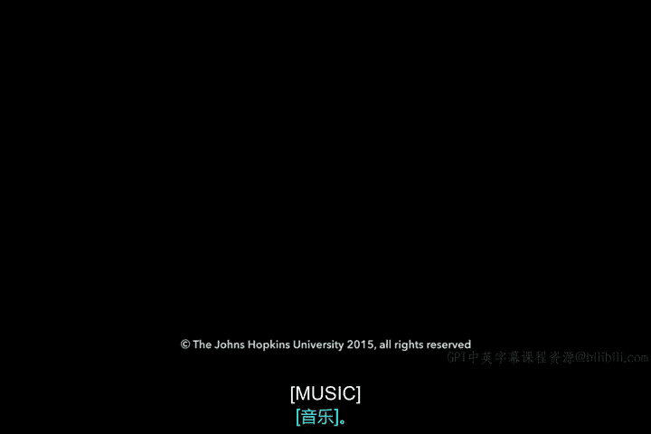

# 约翰霍普金斯大学《使用 AngularJS 开发单页 Web 应用｜Single Page Web Applications with AngularJS》中英 - P65：64_模块3总结.zh_en - GPT中英字幕课程资源 - BV1dsFDeZEQr

🎼。

🎼The。🎼Yeah。🎼，Congratulations on finishing module 3 armedmed with directives， promises and so on。

 you're now well on your way to Angular JS mastery。

 but don't stop here the topics in the next module will truly complete the Angular JS picture for you。

Besides， you're just one more module away from gaining enough skills to sit right next to me as I code an entire real web application for a real client that will definitely be a lot of fun。

 but you do need the skills taught in the next module to truly understand what we're going to be doing。

You're now more than halfway through the course another couple of weeks and you're done to stay in touch and get some more optional material I'll be putting out。

 be sure to go to Facebook。com/ courseserawebdeev and like our page。Also。

 follow me on Twitter and LinkedIn， the links to my profiles on those networks are below the video。

See on the next module。what my。う嗯嗯嗯。😊，What that's okay。🎼妈。

