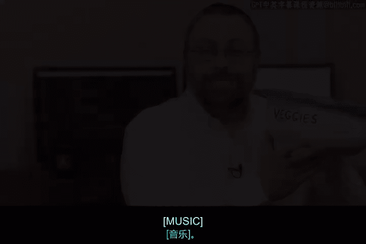

# 约翰霍普金斯大学《使用 AngularJS 开发单页 Web 应用｜Single Page Web Applications with AngularJS》中英 - P66：65_欢迎进入模块4.zh_en - GPT中英字幕课程资源 - BV1dsFDeZEQr

🎼。

🎼The。🎼We。🎼う。🎼The。Welcome to Module4。🎼In this module。

 we start by introducing the idea of component based architecture。

We will then delve into the Angular JS component API The component API is something that was just recently added into Angular1 and it's not only supposed to improve your application through the use of component based architecture but also prepare you for an upgrade to Angular version2 which uses components almost exclusively。

We will then learn about the AngularGS event system and how to split up our application into smaller modules that can then be glued together to produce our final application。

We'll finish off the module by diving fairly deep into routing between views in your application and specifically into the use of the UI router module。

 which is one of the most popular open source routing solutions within the Angular JS ecosystem In fact。

 it's so popular that even the main Google documentation for routing and Angular links to UI router。

Routing is a very important topic Without it， your single page application is stuck displaying just one view without an elegant way to display other views。

Now， as a side note， I know that by now a lot of you are wondering about all this talk about cookies。

 chips， sugary drinks。But fear not， I actually like vegetables as well， in fact。

 I'll be finishing this bowl of vegetables by the end of this module。See on the module。

 Here's the rabbit food。 I mean healthy food。🎼。

