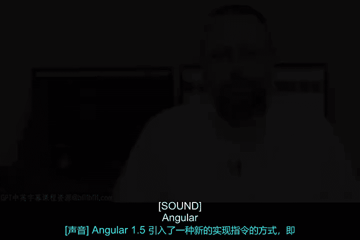
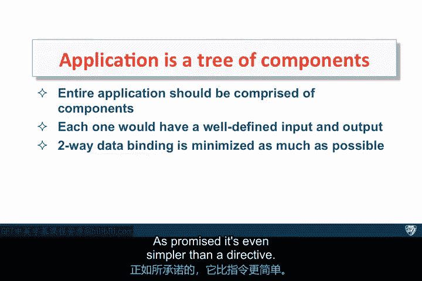
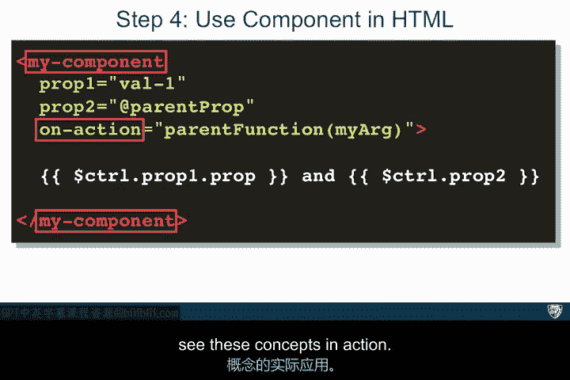

# 约翰霍普金斯大学《使用 AngularJS 开发单页 Web 应用｜Single Page Web Applications with AngularJS》中英 - P67：66_第33讲（第1部分）：组件：基于组件的架构.zh_en - GPT中英字幕课程资源 - BV1dsFDeZEQr

🎼。

Angular 1。5 introduced a new way of implementing directives components。

 a component is a special kind of directive that uses a simplified configuration that assumes some defaults which are best practices anyway while components don't restrict you to component based architecture。

 using components makes it easier and more natural to structure your application code that way。

Writing your application using components also brings you closer to the style of programming that Angular version 2 uses。

First， let's go over the principles of component based architecture and how it expresses itself through angular components。

The first principle is is that components only control their own view and data。

 they never modify data or dam outside of their own scope。Because of protopal inheritance。

 it's possible for your code to modify data pretty much anywhere in your application。😊。

While that can seem like a really convenient thing at times。

 it very quickly leads to chaos as no piece of your code in your application can be assured that its data is safe from side effects。

 it knows nothing about， and it doesn't even control this is the reason why angular components always use isolate scope。

The second principle is the components have well defined public API。

That is data inputs into the component and data outputs from the component in order to carry out this principle to be true to the component based architecture。

 component code should follow some simple conventions these conventions are designed to further discourage manipulation of data that doesn't directly belong to the component which can happen even with isolate scope。

 for example， if you pass a value using the equal sign by directionional binding。

 any changes you make to the data in the component will reflect in the parent as well that's why the inputs so to speak into the component should be defined only with one way binding and dumb attribute value binding。

Even with one directional binding， if the bound value is an object changing that object's property values will impact that object outside of the component。

 this is simply because objects in ja are pass by reference and while you' are not modifying the actual reference to the object you would be modifying the value attached to that reference and that's why another convention is for you to never change the property value of a past an object or an array and that's why we really said the words well definedfined API API is a contract you expect to give a certain input and you expect to receive a certain output in a case of componentbased architecture。

 if I am a user of a component with an API， I have to give the API certain data。

 be guaranteed that my data is safe from being modified and then expect the API to produce some defined output the output of the component is defined with the Emperserson sign as coalbes to the。

😊，Events。The data is passed back to the color through the key value map object that maps the colorer's argument name with the key in the map we have seen this before with directives。

Another principle is that components have well definedfined lifecycle That means they have a number of predefined methods that we could tap into at different times of the life cyclee of the component What are the methods is dollar sign on knit that method is used for you to initialize things for your controller's functionality。

Another method is called Dowa sign O Changes that gets a change object passed into it。

 and that method is called wheneverever One Way bindings are updated。

The change object itself has a current value and a previous value among other things。

 and you're able to see how the value changed and respond accordingly。

Yet another method is called Doign post link， and that method is very similar to the link method we had in the directive。

Another method is called Dooc sign on destroy， and that method is called when scope is about to be destroyed。

 meaning when it's getting unloaded from memory， you can use this hook to release external resources。

 watches and event handlers that were set up in the other methods There are a couple of mo methods that I'm not showing in this list。

 so feel free to go online and look at the documentation for the component API lifecycle methods。

Another principle in the component based architecture is that application is really should be viewed as a tree of components。

 so it means that the entire application should be comprised of components。And as we said。

 each one would have a well definedfin input and output with the two way data binding minimized。

 it's easier to predict when and where the data changes so you can be confident what the state of your component is。

😊，Okay， so let's go over these steps in creating a component in angular， as promised。

 it's even simpler than a directive。😊。

Step one is to register the component with the module， you will notice that the format is very。

 very similar， the first thing you do is you give it the name of your component。

 and that's the normalized form， which means in this case my component in HTML will be seen as my dash component。

However， instead of providing a function or factory function as the implementation of your component。

 you provide a simple object， in this case it's a simple object literal。

 This is a typical configuration object， it just has properties and values to those properties。

 That's it。😊，The next step obviously is to configure the actual component one of the most common properties of a component is template or template URL this is because most components have a template that is associated with them。

😊，You're not required to provide a controller for the component。

 you only specify one here if you actually have some functionality to add otherwise Anggle will provide an empty object automatically and will also automatically place the instance of this component onto the isolate scope with the label of Dasan CTRL。

Speaking of scope， you don't see definediant here at all。

 that's because in a component the scope is always isolate with no ability for us to change it instead we have a property called bindings bindings object is the isolate scope parameter mapping definition it's actually exactly the same thing we used before。

 but the property name before used to be scope and now it bindings because we are assuming isolate scope all the time。

In our component template， we'll use the properties that were passed into the component。

 note that we're using the angular automatically generated label Doar Science CTRL。

 which refers to the controller configured for the component。In the HTML that uses the component。

 in this case MyDash component， its use is exactly as you would use the custom directives that we've coded before。

 again note that the Caml case naming of the tag name and the attribute name declared in the bindings should now convert into all lowercase with the dash in between。

Okay， in part two of this lecture， we're going to go to the code editor and see these concepts in action。

😊。

