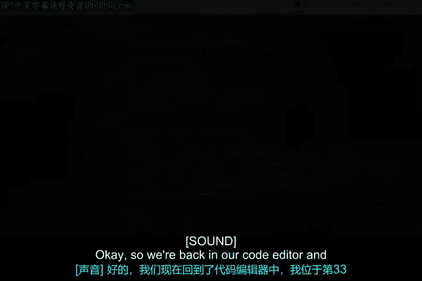
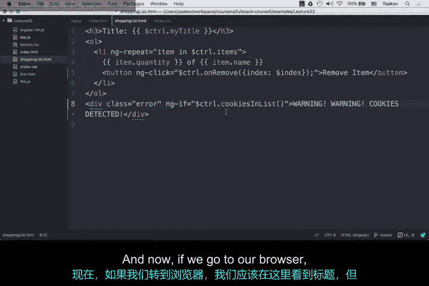
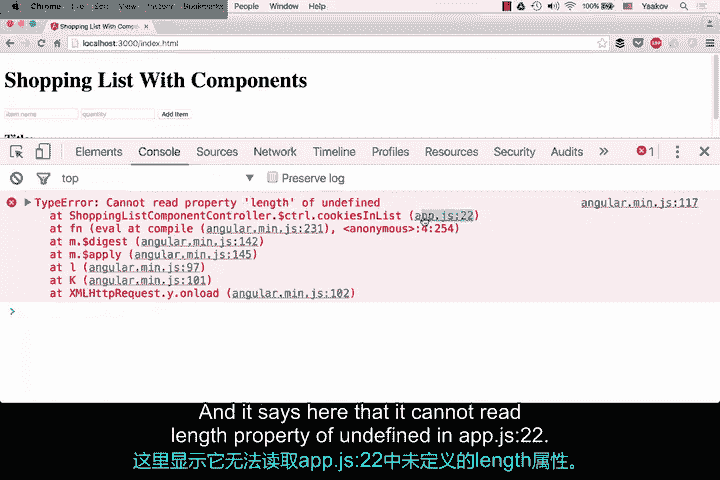
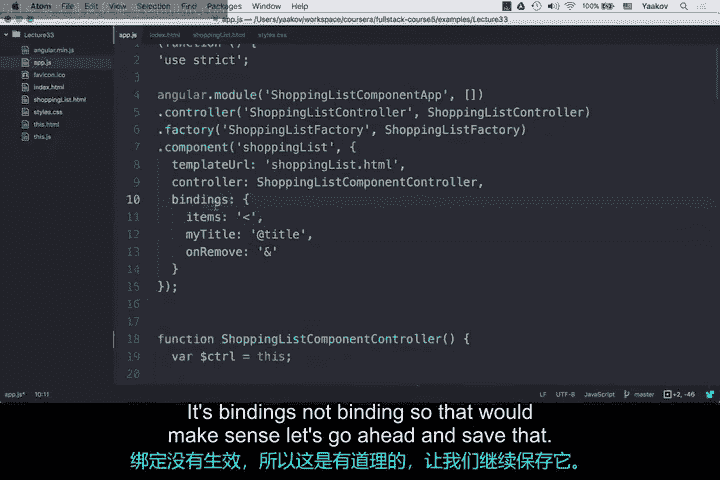
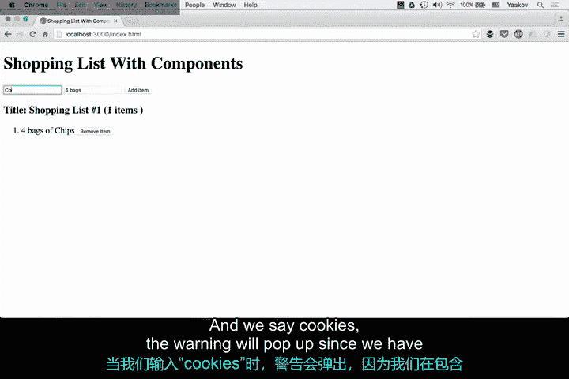
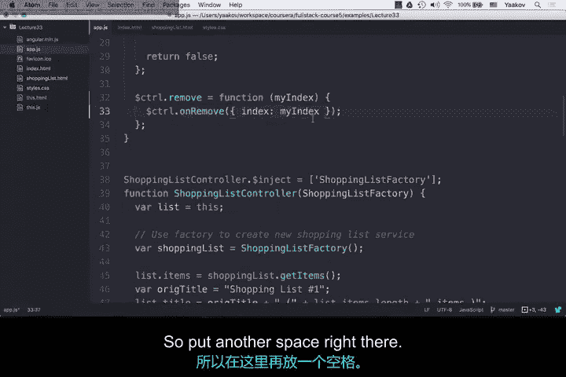
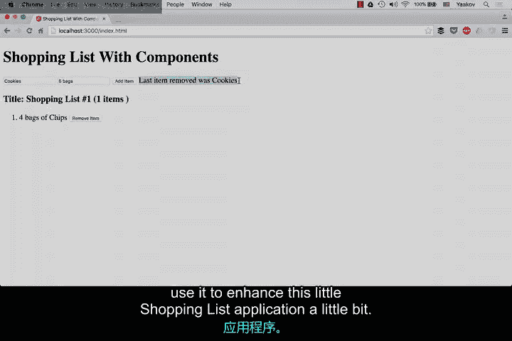

# 约翰霍普金斯大学《使用 AngularJS 开发单页 Web 应用｜Single Page Web Applications with AngularJS》中英 - P68：67_第33讲（第2部分）：组件：基于组件的架构.zh_en - GPT中英字幕课程资源 - BV1dsFDeZEQr

🎼。

Okay， so we're back in our code editor and I'm located in Le 33。

 which is located in Full Staag D Course 5 Exles folder。

And this is basically a copy of lecture 30 but with some cleanedup code。

 so we named this one shopping list component app and you can see it's pretty much the same as before we have our controller。

 we have this list that last removed which is something that the controller will display once something gets removed from list Now things get removed from a list using this shopping list directive or at least it's a directive for now we're going take that shopping list and turn it into a component and you can see we're passing in items passing in the title and passing in unremove and we'll discuss that this looks exactly the same as we actually did before where index is something that is an output from the component or from the directive in this case。

😊，Let's go ahead and go to Abda JS， and the first thing you see is that we forgot to change this into component。

It's a component shopping list component app Okay， so first thing we want to do is we want to change the shopping list from being a directive to being a component Well let's go ahead and change this out to component。

😊，Component and now instead of having a function as the definition for our shopping list。

 we're going to have a simple configuration object so make it much easier and we could even do this straight in line since it's just bunch of configuration properties and that's about it。

Okay， so the first thing our component will have is a shopping list dot Hml。

 which is going to be our template。 So that stays exactly the same。

 We'll also need a controller because we're going to put some behavior into it。

 And let's call it shopping。😊，List。Component， let's say component app component controller。

 So we have our cha list component controller。 We're not going to define the controller ads and we'll let Angular just define the D sign CTtRl for us automatically as the label that's going to reference our controller instance and the next thing we need to do is what are inputs and outputs which are called bindings instead of scope and this is all sitting on the IL scope and really all we need to do is copy these three things because it's exactly the same as before So we have the items which is a one-way binding object we have a title that is going be mapped to my title and you can see since the add sign it means it's a dom attribute value binding and we also have onremove which is going to get mapped to unremove or on dash removed in the parent HTMLml and it's going to be a reference function So this is going to be a callback back to the parent controller and that's pretty much it we can actually take this function right here。

😊，And we could comment it out because we don't need it anymore for now。 In fact。

 we could just actually just simply erase it。 We don't need that anymore。

 and we need to define this shopping list component controller and in fact what we're gonna do is we're gonna just copy some code here this used to be a shopping list directive controller we'll make it into a shopping list component controller except this time instead of calling it a list since we know that it's a dollar sign CTtRl let's go ahead and call it dollar sign CTtRl equals this now make sure you don't make a mistake this is just a local variable I could call it whatever I want it doesn't make any difference but since it's named exactly the same as the one that we're gonna be using in our shopping list that HTML template we might as well call it the same So we'll know it's referring to the same thing which is this the instance of our component controller The only thing is is we need to change that now everywhere it says list it should now become dollar sign ctRl and I believe。

😊，That's pretty much it so let's save that and we see that our component controller has that same method we used before called cookies and list and what it's doing is it's looping through all the items that are attached on our bindings and looking that any name of any item has the word cookie in it it will signal this to true and a warning message will pop up on the screen and will slide out or something like that okay so let's go to the shopping list at HTML which is our component template and we know that we don't have list pointing to the instance of the controller for the component we now have dollar sign CTtRl pointing to that so let's go ahead and copy that and substitute anywhere we see list with dollar sign CTRl and I believe that pretty much it these two things right here and we could save that and now if we go to our browser we should see the title right here and we don't so we messed up somehow or I should say I messed up somehow and it says。

Here that it cannot read length property of undefined in Abdags 22。 Well。

 let's go back to our code editor。 Abdags 22 is right here。

 so it says it cannot read the length property of this item。

 somehow the items array is not really being passed in。

 even though we passed it in right here is a one way binding。 Oh， well， what do you know。

 It's binding， not binding。 So that would make sense， Let's go ahead and save that。 let's go back。

 no errors。 So that's good。 It's always good not to have errors。 Okay。

 So now we could start entering things in chips。 or bags of chips。 and there is one。

 if we say cookies。

When we say cookies the warning will pop up since we have an NG if statement right on the div that has the warning in it。

 Okay so let's take a look at this button here it says controller on remove and it's passing this thing right here it looks a little bit ugly for the HTML template to have stuff like that So instead why don't we go ahead and change that andll say control remove and actually just past the index in it instead of having all that and we'll actually write the control the remove method on our controller so let's go ahead and save that let's go back to Abdojs。

 let's find our controller that's shopping list component controller So where do have one method called cookies andlist let's go ahead and put a couple of spaces here and we'll say dollar sign controller and we'll say remove and that's gonna be a function we don't need the name let's put the semie here and this function has to call whatever function that we define on our binding So on remove。

😊，Therefore， it's going to call Do sign controller on remove。And we need to provide it the index。

 well forget actually to put the index in here。 So that's what's getting passed in from the template。

 And instead of just saying index here， that wouldn't really work。 we actually to give it an object。

 the key value key value here。 whose key has to match whatever it is the name that we used in the binding unremove binding of our shopping list component。

 So this case is just index。 So let's go back to Abda Gs。 And actually。

 let's call it something else is call it my index that way at least it will be a little bit more understandable。

 So this index， the key comes from index that HTML， that's that index right here。

 that's the name that we're mapping。😊，And the value is going to be my index。Okay。

 so now we have it a little bit cleaner in the shopping list that HTML。

 the button just calls onclick and it calls a method on the controller directly passing it the dollar sign index that is provided by the NG repeat directive which then gets passed into my remove function that I defined here right on the controller which calls the reference function that was passed in from the parent controller with a map of key value let's say put another space right there let's say that let's go back to our browser and let's say chips。

Four bags of chips， we'll add that。 and when we say cookies。

Let's make five bags of cookies and add once we had you see that the warning shows up immediately and when we remove cookies。

 the warning disappears and the cookies， the cookies item gets passed to our parent controller and that is why we're able to display as our parent controller that the last item removed was cookies Okay so that's how simple it is to create a component In part3 of this lecture。

 we're going to look at the lifecycle methods that the component API provides and use it to enhance this little shopping list application a little bit。

😊。

