# 约翰霍普金斯大学《使用 AngularJS 开发单页 Web 应用｜Single Page Web Applications with AngularJS》中英 - P69：68_第33讲（第3部分）：组件：基于组件的架构.zh_en - GPT中英字幕课程资源 - BV1dsFDeZEQr

🎼。

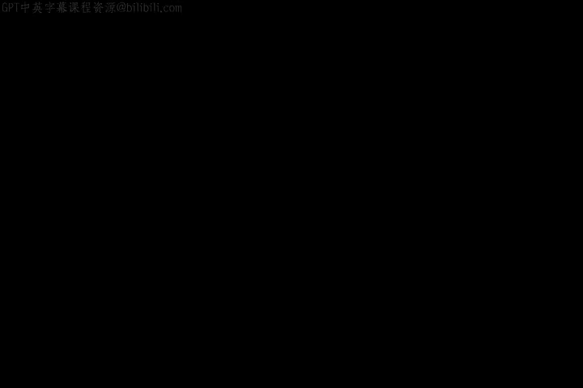

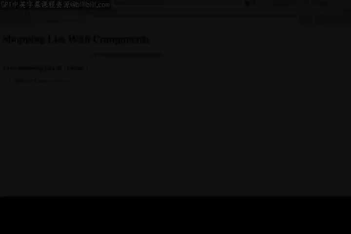

In part two of this lecture we converted a directive that we previously have written into a component and we saw how much simpler the whole component is。

 there's no function， there's just a configuration object and so on but the controller of the component is now enhanced with some lifecycle methods and we're going to use them right now let's go back to our code editor。

😊。

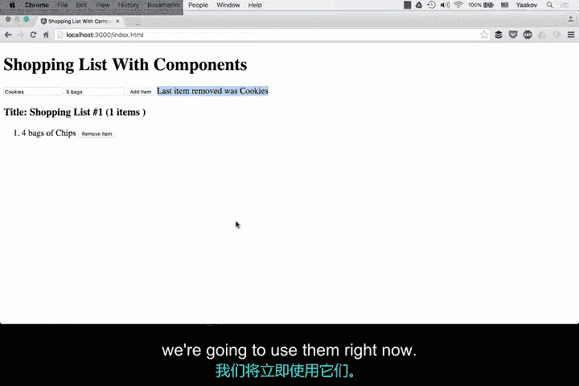

And let's go to this shopping list component controller and add a couple more methods that Angular knows about。

 We add those methods again directly on the controller's instance。

 So one of them is that we discussed was on a knit and on a knit is a function。 Again。

 we don't need the function name。 And in this case， we're just going ahead and log that we are。😊。

In Do sign on init。 So that way we could see that it's getting executed。

 let's go to our browser and let's open up the console and you'll see that it is in fact being executed right here。

 This is only going to get executed once when the controller gets instantiated。

 Let's go back to the code editor and let's add one more method called Do sign control that Do sign on changes and that's also a function。

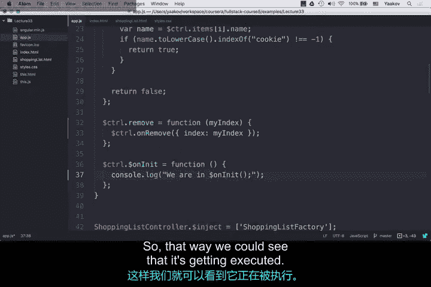

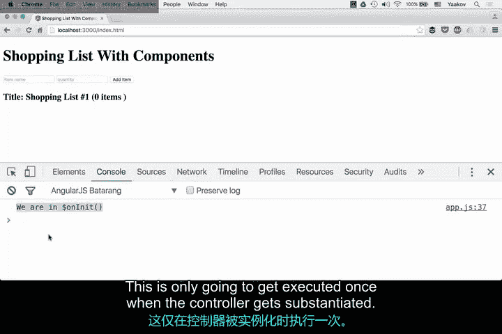

And that is a function that' is going to have a change object that is going to get passed into us by the angular framework。

 Let's go ahead and console that log what that change object is。

 Let's go ahead and console that log that and we'll save that let's go back to our browser and you see up front here it has a couple of things in it has my items or my title and items。

 Those are the things that actually first arrived， so to speak when the whole thing got initialized。

 Well let's actually take a look at this object as we keep changing stuff。

 let's go ahead and put chips in here put three bags three bags and we'll add the item we see it got fired again so what got fired was the changes right we could actually go back and actually put the word changes here so we can see what's going on a little bit better。

😊。

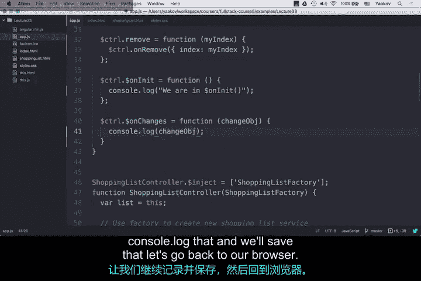

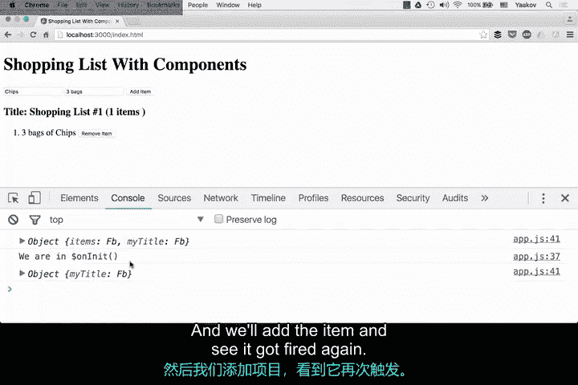

Okay， let's go back to the browser and we see now it says changes。 So now when we put chips。

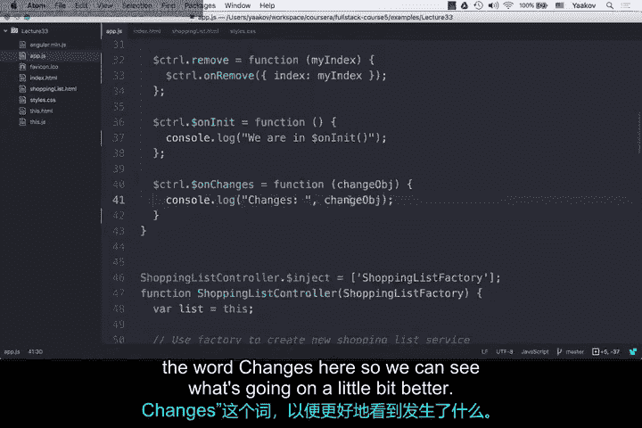

And we'll put three bags of chips and we add the changes fires again。

 the Dallasll anon changes fires again， and if we open it up。

 you'll see that my title is the thing that changed。 let's open that up a little bit more。

 so we could see it a little bit better and the current value is shopping list number one one items that's right there。

 the previous value was shopping list number one zero items Now what happened to our items array Why didn't that get changed Why didn't that get passed in here Well the reason it didn't get changed or it didn't get detected here is because the only thing that is being watched the items array let's go back to the definition of our component is the reference to that items array and the reference no matter what items we add into the array。

 the reference to the entire array stays the same If we were to change the reference of the array。

 not inside of our component， but outside of our component that on changes would fire。

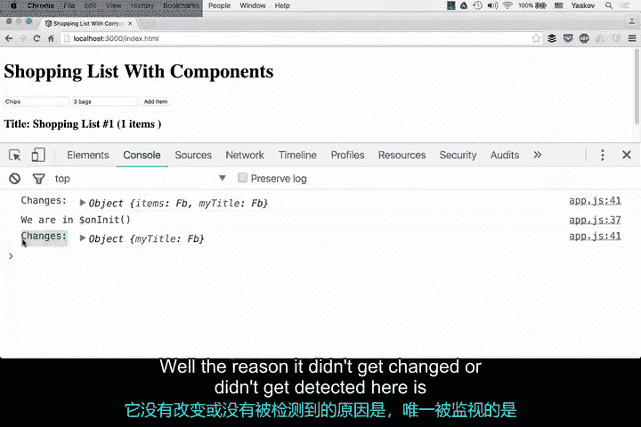

And would include my items， but since the only thing that changed outside that it's actually watching very closely。

 so to speak is the title or my title， that's the thing that fired and that's the thing that got included in the changes object that were looking at right here。

😊，Okay let's go to yet another lifecycle function called control putting it to control and it's called doas sign post link and I told you the Dasign post link is basically the same thing as the link function that we've used before So let's go ahead and use it in the same way we used it before and that is we're going to make the shopping list that HTML have the error message slide out and slide up to disappear In other words。

 this is the place where we're going to manipulate the dom Now please note this is not necessarily the best way to have animations in your template HTML。

 however， my only purpose in showing this to you is to show you that you can manipulate the DOm from the dollar sign post link you might not necessarily want to manipulate it in the way I am doing it right now might want to have something much more complicated before you go to manipulateulating the DOm in this way so what we're gonna do is we're going to display the warning message when somebody uses。

😊，is part of their shopping list The first thing we need to do is we want to make sure that this div is actually not visible to begin with and then it's going to slide out so what we need to do is we need to remove this NG if。

😊，Right here and save that and then go to our styles that CSss and add one more property here called display none。

 So it will not get displayed up front。 Only we're going display through the code。

 Then we're going go to our app do Gs and we're going set up a watch on the cookies inlist function and the way we would do that is we need the scope variable because we need the scope that watch is the function。

 The only problem is we don't really have a scope variable here。 we haven't really inject it yet。

 So we're just going go ahead and create an injector array dollar sign injector array and so we could protect it from imization and we'll say scope here。

 that's what we need to inject and obviously inject scope right here into the actual shopping list component controller so now the scope is available we can actually call the watch function。

 and what we need to watch for is dollar sign controller that's the label that cookies in list。😊。

We need the parents to make sure it understands that this is not just a property。

 this is a method that we'll need to get executed。And we're going to watch it。

With new value and old value， that's going to be passed into us。 Okay。

 so if new value is equals true。If that's the case， then we need to do something else。

 We need to do something else。 So here we need to basically show warning。

And here we need to hide warning。Okay， oops， we don't need it our case。 Here we go。 Now。

 the problem is that this function doesn't actually have， you know， the scope element。

 it's not exactly the same as link。 So how do we get at the actual element， that is our component。

 Well， there's yet another service called dollar sign element。 And in order to get that。

 we need to inject it。 So let's go back and put a comma here and say dollar sign element and we'll put dollar sign element here as well。

 and we'll go back to our dollar sign post link and let's go ahead and first of all。

 we'll go and just log it so you could see what that is， we'll say dollar sign element。😊，Okay。

 so let's save that， let's go back to our browser and you could see what it outputted and output it the shopping list that ngi soscope。

 That's our item right here and that is coming from the dollar sign post link So that's how we get at the parent item or the top item of our component Let's go ahead and use jQury to slide it down to show it and then slide it up to make it disappear We need one more thing in order to use jQury。

 You guessed that we actually need to download jQury and put it in our folder and then reference it as part of our libraries that we reference here with a script tag Okay so I'm gonna to post the video for a second get the jQury and we'll continue in a second。

😊。

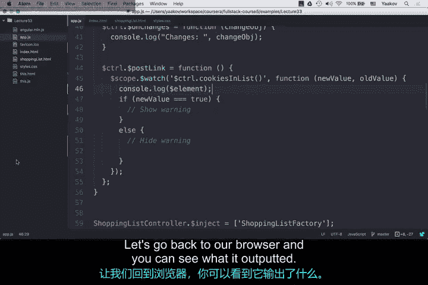

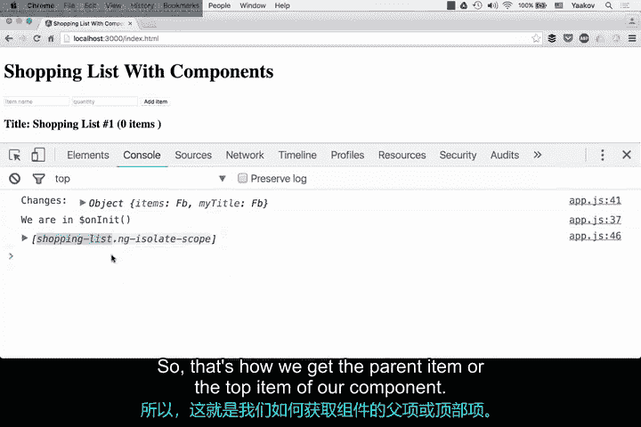

voila magic jQury 3。1。0min dotjs。 we don't need to look at that code。's ugly anyway。 one more thing。

 let's delete these couple of things that we don't really need here。

 It's from the previous lecture let's move into trash okay so we have the jQury file here All we need to do now is reference it and we need to make sure to reference it above our angular import So we'll say script we'll say source equal and here it's jQury dash 3。

1。0 that min do js Okay we did that Okay so now jQury is available for us。

 we'll go back to our app do js and we could show the warning by saying v warning element is equal to and again。

 we're back to jQury。 So dollar sign element actually represents an element as a jQury object So we could say that find and we could say div do error So it's going to again look only in the template of our component It's not going to look through the entire HTML of R。

😊，Page， which is really good because it's going to be much， much faster。

 And then we need to say warning element dot slide down。

 We'll give it 900 milliseconds to slide down。 so it'll be a little bit slower。 So that's to show it。

 And we could copy this over to hide warning。😊，And we need to get the element again。

 except this time we're going to slide up to make it disappear。 Okay， let's save it。

 Let's go back to our browser。 We can make this minimized。

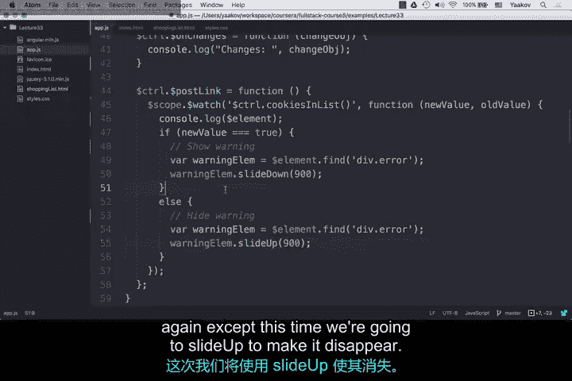

And we'll say chips。Three bags of chips and you see that's fine and if we add cookies in here。

We'll give it three bags of cookies when we do that you see it slides out or slides down to show us the warning。

 warning warning is cookie detected cookies is detected， and if we remove the cookies。

 it will slide back up and remove the warning from our HTML so this is how you use the lifecycle methods inside of your component controller。

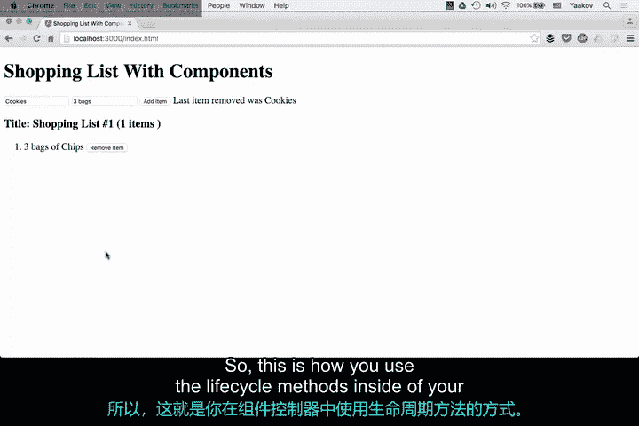

