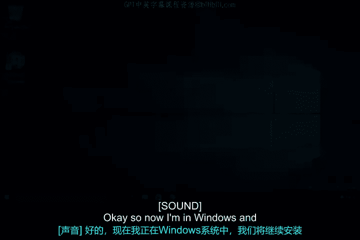
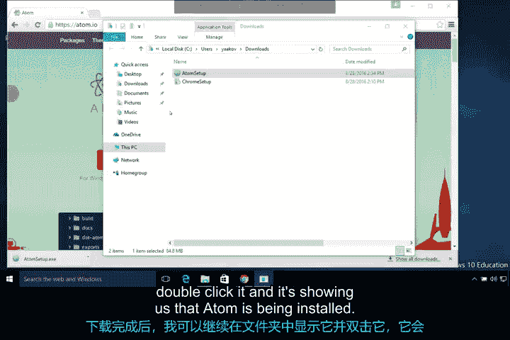
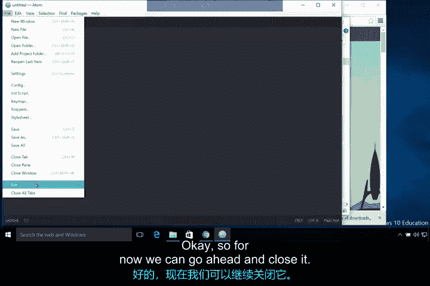
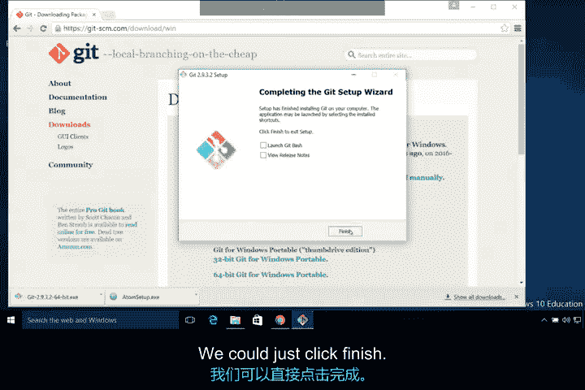
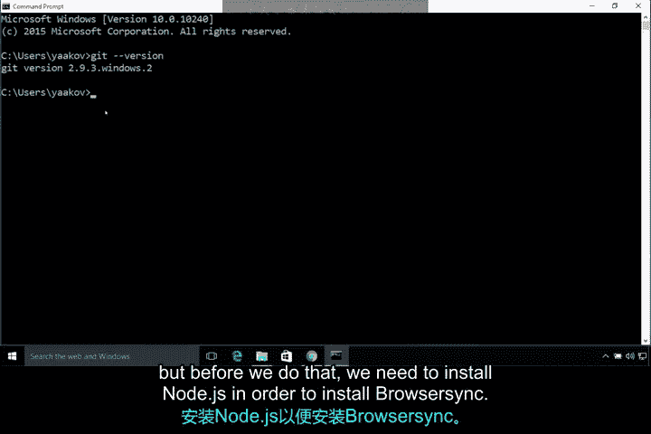
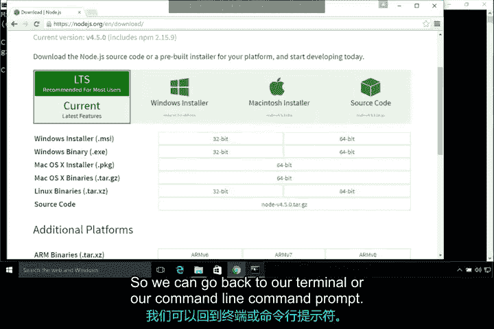
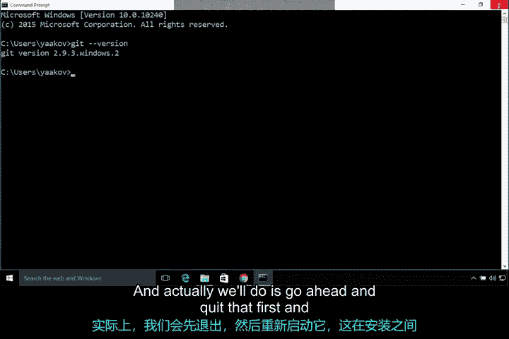
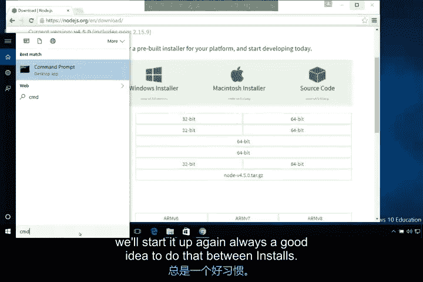
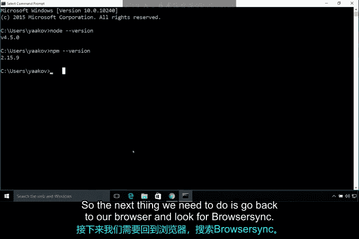
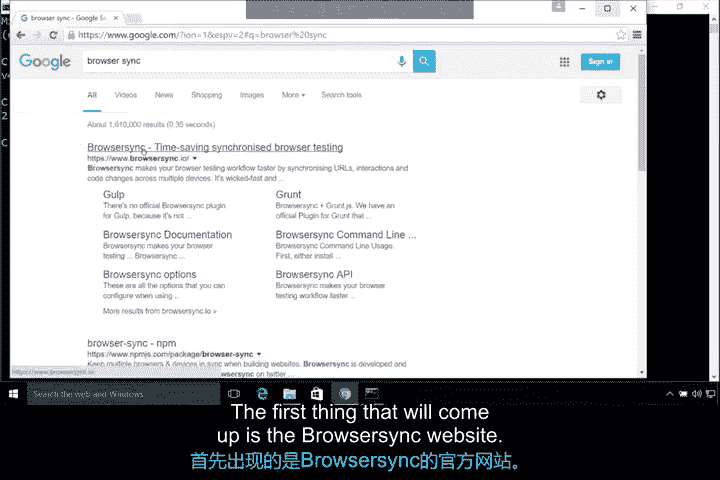

# 约翰霍普金斯大学《使用 AngularJS 开发单页 Web 应用｜Single Page Web Applications with AngularJS》中英 - P6：5_Windows开发环境设置（第1部分）.zh_en - GPT中英字幕课程资源 - BV1dsFDeZEQr

🎼。

Okay so now I'm in Windows and we're going to go ahead and install the required tools for this course So the first thing is we're gonna need a browser and if you want to just stick with internet Explorer you can but I would highly suggest you get another browser and for this course I highly recommend you get Google Chrome Now I'm not going to go over how to install Google Chrome I am going to assume that you know how to install it I already have it pre-installed here on my machine the first thing we need to do is install the Adam editor or whatever editor you want but I'll show you how to install Adam and the way you install it is to download it from Adam。

 o make the screen a little bigger and we'll go ahead and click download。And once it's downloaded。

 I can go ahead and show it in folder and double click it。

 and it's showing us that at is being installed。😊。

And once it gets installed， it shows us the welcome screen， we'll go ahead and close that。

 we don't need that right now， so that's working。Okay， so for now we could go ahead and close it。

 we'll close exit。

And the next thing we need to do is install Git， so let's go to the browser and type in download Git。

 and we could go to this very first website it shows up and we'll click the latest download for Windows。

Which it will go ahead and download for us。And we can actually just click it directly to start installing and say yes。

 we want to continue。And we'll press next again next。

 and we'll go ahead and click add an additional icon on the desktop。 We'll click next again。

 This will create an item in the start menu。 or okay with that。 we'll press next。

And the safest option here is already chosen for us。

 which is to use Git from the Windows command prompt。

 let's go ahead and click next and we'll keep the default that it's giving us and we'll keep that default as well。

We'll keep the default for that too， and we'll click install。Once it's done。

 we don't want to see the view release notes， we don't want that。

 we could just click finish and then we could go to the bar here and start searching for CMD which stands for command prompt and we'll open that up we can even make it full screen and now we want to make sure that Git got installed properly so we could say git space dash dash version and we'll press enter and you could see that we have Git installed 2。

9。3 which is fine。

The next thing we need to install is browsing， but before we do that we need to install no JS in order to install browser sync。

 so let's go back to our browser and we'll type in download node JS and it will take us straight to the download page we'll click that and we have a couple of options here we can have the installer or the binary we want the installer one and since I'm running the 64 bit version of Windows I want the installer 64 bit so I'll click that it'll get downloaded and I can just click it right here to install。

And the install screen finally pops up and we could click next that we accept the conditions next。

 next， and again next， and finally just click install。And we want to allow。

 go ahead and allow it to install it。😊，And once it's done。

 we could click finish and now we need to verify that node GS actually was installed so we could go back to our terminal or our command line command prompt and actually we'll do isll go ahead and quit that first and we'll start it up again always a good idea to do that between installs so here's our command prompt we'll start it up again and this time let's make it full screen this time we'll say node space dash version and sure enough we have node version 4。

5。0 but what we're really after is the node package manager that's the thing that is going to allow us to install other packages like browser syncnc So the way we check that that install correctly is NPpm node package manager space dash dash version。

Enter and you see that it is， in fact， installed properly。 It's giving us the version number for it。

 So the next thing we need to do is go back to our browser and look for browser sync so we could say browser sync and just Google it。

😊。

The first thing all comes up。And the first thing that will come up is the browser syncnc website and as you can see it's a very simple command that it's telling us that we to install it with is just NPpM which is node package manager installg browser dash syncnc and DG is just there to say that I want to install it for all users on the computer let's copy that let's go back to our command prompt and let's go and paste that command right here we'll press enter and the node package manager should download things for us and install it for us automatically。

Once it's done， it usually does come with some sort of warnings and if you take a look here。

 there were a couple of warnings here but as long as it finishes properly， you're okay。

 we clear the screen with a command CLS。We'll try the browser sync command， we'll say browser。

 dash sync space dash dash version， we'll press enter。

 and you can see that it's telling us the version number which means it installed properly。

 so at this point we verified that we installed Adam。

 we verify that we installed No GS and therefore we also were able to install browser sync。

