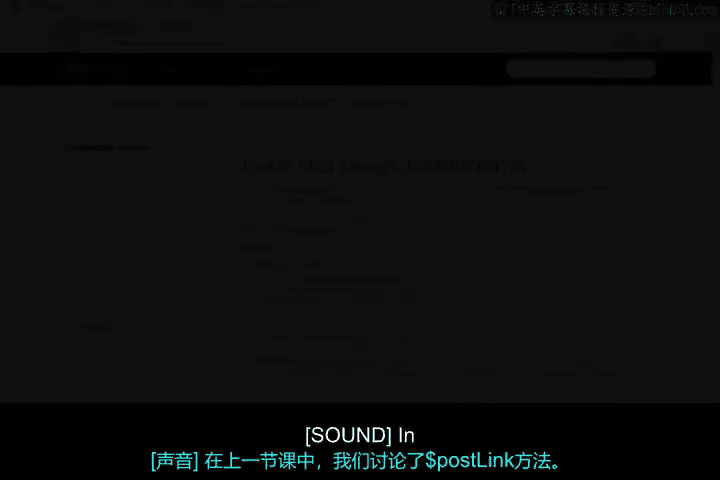
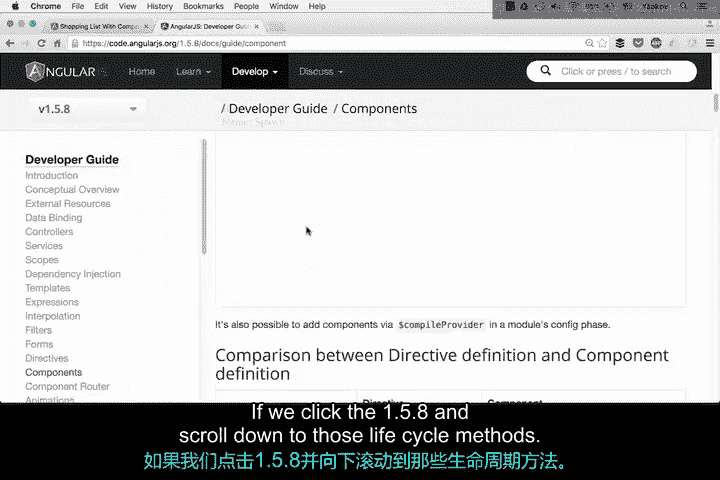
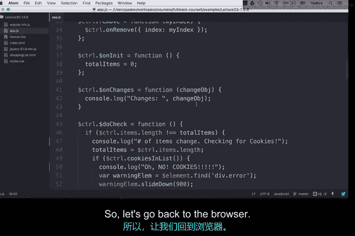
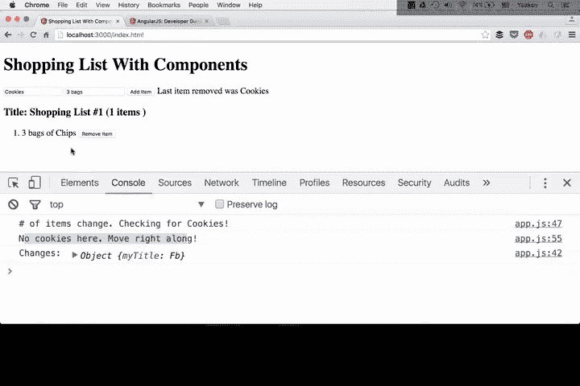
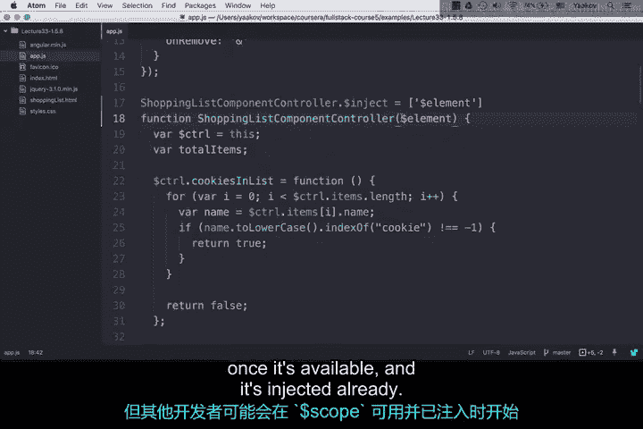
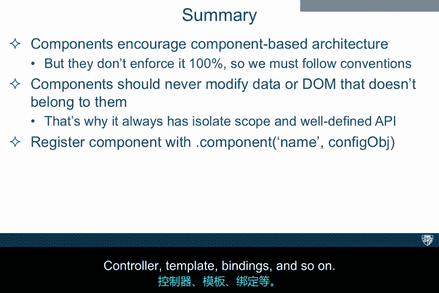

# 约翰霍普金斯大学《使用 AngularJS 开发单页 Web 应用｜Single Page Web Applications with AngularJS》中英 - P70：69_第33讲（第4部分）：组件：基于组件的架构.zh_en - GPT中英字幕课程资源 - BV1dsFDeZEQr

🎼。

In the previous lecture， we spoke about Doar Sign post Li。

 and you saw how we were able to set up a watch for is cookies and list and then use JQury in order to output a message an error message on the screen。

The reason we had to set up a watch in postlink is because our dollar sign on changes。

 our changes object did not include any changes to the array。

 even though we put more things into the array because onchan does not watch when elements are added to the array it's only watching the actual reference to the array itself Now as I was coding that example I myself did not realize that I was using a little bit of an older version of Angular 1 I was using Angular version 1。

5。7 Now there's something that happened in 1。5。8 and that is that they put in one more lifecycle method as part of the component lifecycle methods So right now I'm located in the documentation for Angular 1 and it's docs。

angngularjs。 org s guide s component。😊，And just to make it more fun for us if we click to 1。5。

8 and we scroll down to those lifecycle methods， let's take a look。

 you'll see that there is the on init， the on changes on destroy and postlink。

 but we're missing another method that actually works in 1。5。8。

 but it's not listed in the documentation， so let's go back to the default one。

 unfortunately the snapshot documentation and we'll scroll down to those lifecycle methods and we'll take a look because there's yet another method that they released called dollar sign do check。

And that's a method that gets cold on each turn of the digest cycle。 So as the digest cycle executes。

 it will call this method with no arguments。 And it tells you it this hook is involved invoked no arguments。

 And if you detecting changes， you must store the previous values for comparison to the current values。

 So basically， you have to check them yourself。 Okay so that's what we're going to do。

 we're going to drop trying to set up our own watch， which just hooks in into the digest cycle。

 And instead we'll use the standard lifecycl method called do check。

 So let's go back to our code editor。 And if you see here I created a new lecture。

 And right now I'm located in lecture 33 1。5。8。 And again。

 even though documentation says this method doesn't exist。 I tested it and actually work。

 So it certainly does exist。 And this is the exact same application with so before。

 the only difference is is that I edit a couple of things and remove the couple of things as well。

 N one is I edit this local variable to the。😊，Shopping list component controller called total items and that local variable total items is going to get initialized in the dollar sign on an knit。

 So the total items I'm speaking of is the total items in our shopping list So it's gonna on in it get initialized to0 Now we'll leave this dollar sign on changes even though it's not really gonna be useful for us just to see the console log of it that it's happening and what we did here if you take a look is we removed the dollar sign post link we actually remove the dollar sign on destroy as well because we're need right now。

 and instead of setting up a watch， we know that this gets called every time the digest cycle runs and every time the digest loop is looping So what means what we could do is we could ask if the control that items that length that array because our bindings watch only is looking at the items reference itself it's not looking at the items of the actual array So if we could take a look and see is the length of the array the same or。

😊，The same as the number of total items。 If it's not the same。

 we need to remember the number of total items that is contained in the array right now。

 And since it changed， obviously， because it's not the same。

 we're going to go ahead and invoke this is or cookies cookies andlist method。

 And if cookies ist list。 that's going return true。

 we're gonna have those same jquery methods that we're going to call in order to basically slide down an error message and if total number of items is equal to the length of the array。

 which means nothing's changed in the list。 we're going go ahead and make sure that the error message slides up and goes away。

 and just to for our own sanity， let's put a couple of console log statements right here。

 So the first one we log， we're gonna to log inside of this if statement。

 which means that the total number of items is not equal to the length of the array。

 It means that the number of items changed in our shopping list， either it went up or went down。

 So let's log and say something like number。Of items changed， checking for cookies。Okay。

 so that's going to be one plug statement， another statement， if the cookies are indeed in the list。

 besides the error message， let's go ahead and log this。All no cookies。 And if there are no cookies。

 we'll log this here and we'll say。No cookies， no cookies here。 move right along。Okay。

 so now we have a couple of console statements of three console statements in here。

 let's say that and one more thing。 if we take a look here。

 we are not any longer using the dollar s scope and that's kind of a good thing because we really want to get away from using dollar sign scope and according to the component architecture which is what actually is Angular 2 is all about and components are part of kind of Angular 2 vision。

 scope isn't something we want to depend on， so we're gonna remove that from here。

 So by having this do check method， we're able to eliminate our injection of the dollar s scope it's not the end of the world。

 certainly we're not in Angular 2 with Angular 1 but if you inject the dollar s scope and start attaching properties to it which is a bad practice this is kind of opens up the window for that if you inject it So if it's not even there then you stay away from it so let's go back to the browser and let's go to our already have my browser link working so let's go ahead right。

😊。

Here you see it's going to print out our changes to begin with。

 but if we put chips and we'll do three bags of chips when we add it。

 it says number of items changed I misspell changed。

 but doesn't matter checking for cookies says no cookies did here move right along so we're good So if we put in cookies in here keep it three bags and put the cookies in it's going say。

 oh no cookies and we need to scroll this down a little bit we could see that the warning is there So if I remove the cookies let me clear that if I remove the cookies again it goes away。

 number of items changed no cookies here move right along and cookies are no longer part of our shopping list。

Okay so just to summarize， this is just another way to hook into some lifecycle events that are happening around the component and one of them is do check。

 which is what we used here， which gets fired every time through the digest loop。

 which gives you a chance to look into your bound items a little bit deeper or bound objects a little bit deeper such that you could do kind of a much deeper check on things without having to set up your own watch which might actually slow things down a little bit more in terms of performance。

 but either way it's certainly a better practice since we can get away from injecting dollarci scope。

 which is prone to errors because somebody or some other developer obviously not you because you know better。

 but some other developer might start attaching properties on the dollar science scope once it's available and it's injected already。

Okay， let's summarize。Components in Angular JS encourage component based architecture。

 but they don't enforce it 100% so we must follow conventions such that our architecture stays a component based architecture one of the main things in the component based architecture is that components should never modify data or dam that does not belong to them。

That's why it always has isolate scope and well definedfin API to give us the inputs into the component and the outputs that lets the component return the data to the outside world。

😊，The way you register component is very similar to how you register controller services and so on you provided the name except the differences the second argument into the component function is not a factory function but just a configuration object usually we just provide an object literal with properties controller。

 template bindings and so on one of the properties called controller is for you to specify what controller you want to use as the components controller only provide that if you are actually adding extra functionality otherwise Angular already provides an empty function for us that is used as kind of an empty controller。

