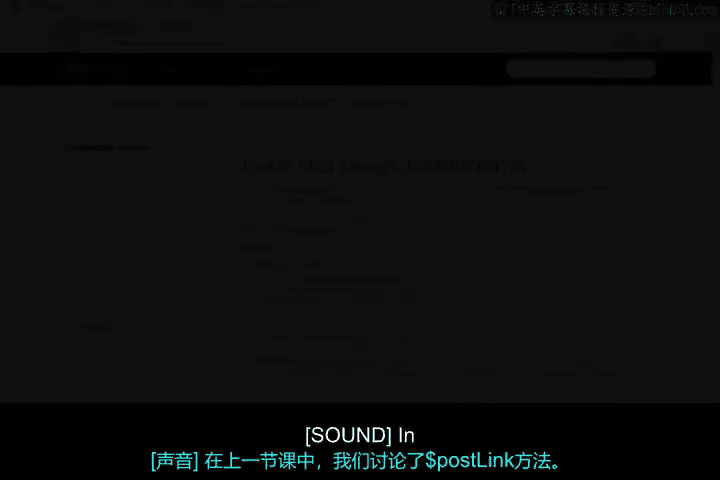
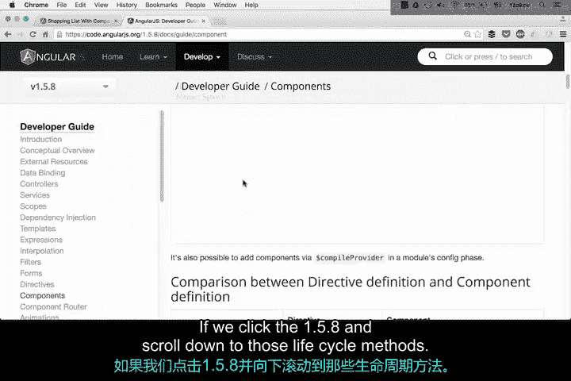
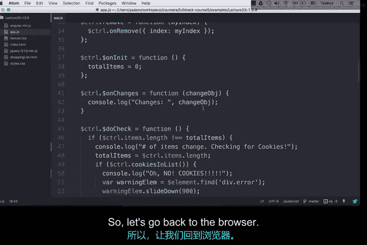
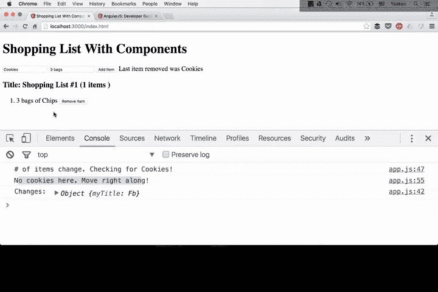
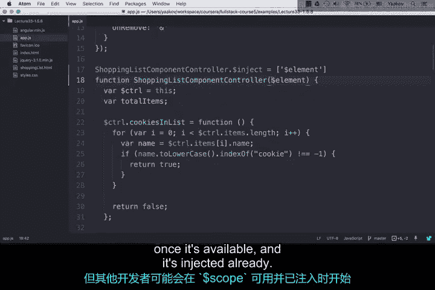
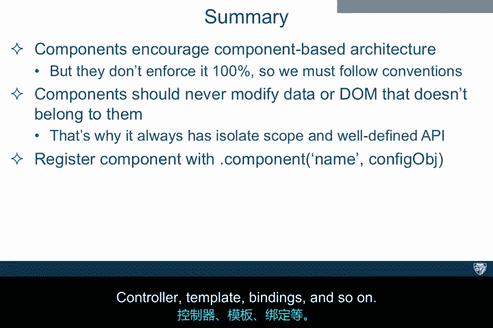
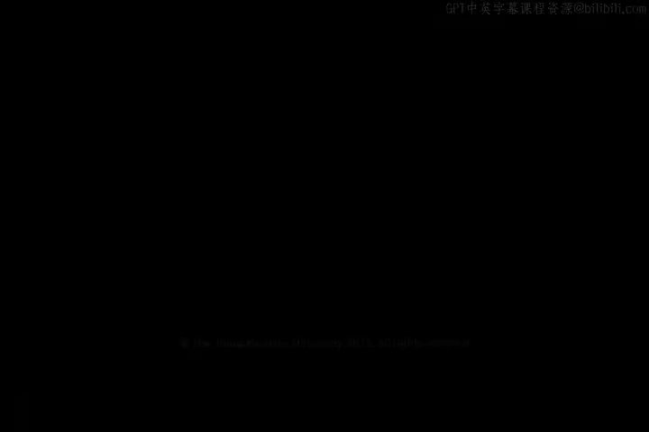

# 使用 AngularJS 开发单页 Web 应用：P70：组件：基于组件的架构

## 概述
在本节课中，我们将学习 AngularJS 组件的一个新生命周期方法 `$doCheck`，并了解如何使用它来替代手动设置 `$watch` 以监听数据变化。我们还将回顾基于组件的架构的核心原则。

---

在上一讲中，我们讨论了 `$postLink`，并看到了如何为购物清单设置一个监视器，然后使用 jQuery 在屏幕上输出错误信息。

我们必须在 `$postLink` 中设置监视器的原因是，我们的 `$onChanges` 对象不包含对数组的任何更改。即使我们向数组中添加了更多元素，因为 `$onChanges` 不会监视数组元素的添加，它只监视数组本身的引用。

当我编写那个示例时，我自己没有意识到我使用的是 Angular 1 的一个稍旧版本（1.5.7）。在 1.5.8 版本中，他们引入了另一个生命周期方法作为组件生命周期方法的一部分。

现在，我们位于 Angular 1 的文档中（`docs.angularjs.org/guide/component`）。为了更有趣，如果我们切换到 1.5.8 版本并向下滚动到那些生命周期方法，你会看到有 `$onInit`、`$onChanges`、`$onDestroy` 和 `$postLink`，但我们缺少了另一个在 1.5.8 中实际有效但未在文档中列出的方法。让我们回到默认的快照文档，向下滚动到生命周期方法，因为还有一个他们发布的方法叫做 `$doCheck`。

这是一个在每次摘要循环（digest cycle）运行时被调用的方法。随着摘要循环的执行，它会无参数地调用此方法。文档说明，此钩子被调用时不带参数。如果你要检测变化，必须存储先前的值以便与当前值进行比较。基本上，你必须自己进行检查。

我们将放弃尝试设置自己的监视器（它只是挂钩到摘要循环中），转而使用标准的生命周期方法 `$doCheck`。

让我们回到代码编辑器。这里我创建了一个新讲座（lecture 33 1.5.8）。尽管文档说此方法不存在，但我测试过它确实有效。所以它肯定存在。这是与之前完全相同的应用程序，唯一的区别是我编辑并移除了一些东西。

首先，我编辑了购物清单组件控制器中的一个局部变量 `totalItems`。这个局部变量 `totalItems` 将在 `$onInit` 中初始化。我所说的 `totalItems` 是指我们购物清单中的总项目数。它将在 `$onInit` 中初始化为 0。

我们保留 `$onChanges`，即使它对我们来说不是真的有用，只是为了查看它的控制台日志输出。我们在这里所做的是移除了 `$postLink`，实际上也移除了 `$onDestroy`，因为我们现在不需要。我们不再设置监视器，而是知道 `$doCheck` 在每次摘要循环运行时都会被调用。

这意味着我们可以检查控制器中 `items` 数组的长度。因为我们的绑定监视器只关注 `items` 引用本身，而不关注实际数组的元素。我们可以查看数组的长度是否与总项目数相同。如果不同，我们需要记住数组中当前包含的总项目数。既然它改变了（显然，因为不相同），我们将继续调用 `this.isCookiesInList()` 方法。

如果 `isCookiesInList()` 返回 `true`，我们将调用相同的 jQuery 方法来向下滑动显示错误信息。如果总项目数等于数组的长度（意味着列表中没有变化），我们将确保错误信息向上滑动并消失。

为了清晰起见，让我们在这里添加几个控制台日志语句。第一个日志将在 `if` 语句内部，这意味着总项目数与数组长度不相等，表示我们购物清单中的项目数发生了变化（增加或减少）。让我们记录：“Number of items changed, checking for cookies.”

另一个语句是，如果确实在列表中找到饼干，除了显示错误信息，我们还将记录：“Oh no! Cookies!” 如果没有饼干，我们将在这里记录：“No cookies here. Move right along.”

现在，我们在这里有了三个控制台日志语句。还有一件事，我们不再使用 `$scope`，这很好，因为我们真的希望摆脱使用 `$scope`。根据组件架构（这也是 Angular 2 的核心），组件是 Angular 2 愿景的一部分，`$scope` 不是我们想要依赖的东西，所以我们将从这里移除它。

通过使用 `$doCheck` 方法，我们能够消除对 `$scope` 的注入。这并非世界末日，我们当然不是在用 Angular 1 做 Angular 2 的事情，但如果你注入 `$scope` 并开始向其附加属性（这是一种不好的做法），这可能会为错误打开窗口。如果它甚至不存在，那么你就会远离它。

让我们回到浏览器。我已经让浏览器链接正常工作了。在这里，你会看到它首先打印出我们的更改。但如果我们放入“Chips”（比如三袋薯片）并添加它，它会说：“Number of items changed, checking for cookies.” 然后说：“No cookies here. Move right along.” 所以没问题。

如果我们在这里放入“Cookies”（保持三袋并放入饼干），它会说：“Oh no! Cookies!” 我们需要稍微向下滚动一点才能看到警告在那里。如果我移除饼干（让我清除它），如果我再次移除饼干，警告就会消失：“Number of items changed, no cookies here move right along.” 饼干不再是我们购物清单的一部分。

## 总结
这只是挂钩到组件周围发生的某些生命周期事件的另一种方式，其中之一就是 `$doCheck`，我们在这里使用了它。它在每次摘要循环时触发，让你有机会更深入地检查绑定的项目或对象，从而可以对事物进行更深入的检查，而无需设置自己的监视器（这可能会在性能上稍微减慢速度）。但无论如何，这无疑是更好的实践，因为我们可以避免注入容易出错的 `$scope`（因为一旦它可用并被注入，其他开发人员可能会开始向 `$scope` 附加属性）。

AngularJS 中的组件鼓励基于组件的架构，但它们并不 100% 强制执行。因此，我们必须遵循约定，以使我们的架构保持基于组件的架构。基于组件架构的一个主要点是，组件永远不应修改不属于它们的数据或模型。这就是为什么它总是具有隔离作用域和明确定义的 API，为我们提供组件的输入和允许组件将数据返回给外部世界的输出。

注册组件的方式与注册控制器、服务等非常相似，你提供名称，但区别在于 `component` 函数的第二个参数不是一个工厂函数，而只是一个配置对象。通常，我们只提供一个包含 `controller`、`template`、`bindings` 等属性的对象字面量。其中一个名为 `controller` 的属性用于指定你希望用作组件控制器的控制器。只有在你确实要添加额外功能时才提供它，否则 Angular 已经为我们提供了一个空函数，用作一种空控制器。