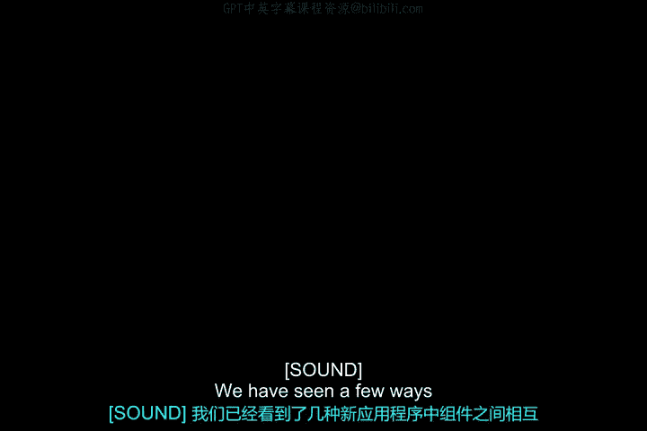
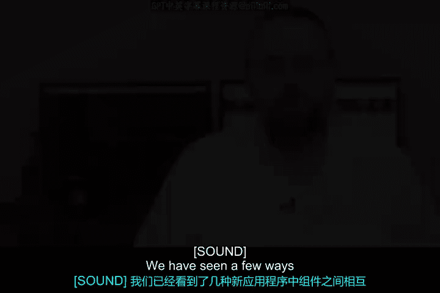
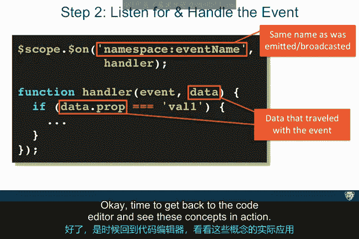

# 约翰霍普金斯大学《使用 AngularJS 开发单页 Web 应用｜Single Page Web Applications with AngularJS》中英 - P71：70_第34讲（第1部分）：AngularJS事件系统.zh_en - GPT中英字幕课程资源 - BV1dsFDeZEQr

🎼。

We have seen a few ways that components within your applications can communicate with each other。

 for example， through protopal inheritance child components can communicate with the parent components。

Note that I'm using the turn components here loosely， this obviously applies not only to components。

 but to directives， controllers and so on。Another way components can communicate is through shared singleton services。

Shared services that are created with the dot service method are singletons and therefore different components can share data between each other using that single instance of the service。

However， there are situations where such communications are just not elegant enough and create too many dependencies between different parts of your application。

Let's take a look at some illustrations。Take a look at this diagram S component two wanted to communicate some data to its parent component one。

 We have a couple of ways of achieving that First we can access component1 from component2 by simply going up the scope chain and accessing the parent controller Angular makes this easy for us with a dollar signed parent property on the dollar sign scope object This is obviously not the end since we still have to make sure that either we set up mechanisms in component one to react to the new data or somehow invoke something from component2 In other words。

 we still have to make sure that component one is aware of our communication we can also use the mpers method call back method binding and call the parent component method passing it some data So that's communicating with the parent。

In a flipped scenario， we want to communicate with the child component one quick way of doing this is for component2 to provide some way for us to send the data into it again。

 component2 would have to have some way to react to the new data。

Things get a bit more interesting if you wanted a component to communicate with its grandparent component。

 an elegant solution to this is a bit less obvious。

Should you use the downign parent property twice to curl up the scope chain to get to your destination。

 I don't know， look at the dependency we're creating with that move。

Another possibly more elegant solution is to use a singleton service and inject it into both components。

You would still need to set up some watch for the value stored in the shared service in component1。

 so you can react to any changes in the shared service value。When the target is reversed。

 we're faced with a similar dilemma， should we send the data into component 2 and have component 2 send data to component1。

 or should we use our shared service again， Not sure。

 but doesn't really feel elegant quite so much anymore。

And what about communicating with multiple components at once here。

 the components we want to communicate with seem scattered all over the dam Component 4， for example。

 is neither a descendant nor an ancestor of our component2 where we're sending the messages from。😊。

Yes， we could still use our shared single to service approach。

 but would have to use it everywhere and things are getting a bit messy。

A similar scenario is when multiple components want to communicate with one central component。

 but its location within the dam is not known to those components。Again。

 we could use the shared service approach， and again this would be a messy way to approach reacting to some data change or UI change that we need to respond to。

Luckily， there is actually a software design pattern that could solve all these issues in an elegant way and which Angular implements through its event system。

The design pattern is calledpublish subscribescribe design pattern and basically there are two components to the design pattern。

 publishers and subscribers publishers send messages to subscribers on some common channel so when we speak about publishers。

 publishers mark messages with some classification。

Publishers also don't know the subscribers of their messages。

 nor do they know if there are any subscribers out there at all。Subscribers， on the other hand。

 sign up to listen for messages with a particular classification they also don't know publishers or if there are any publishers for these particular messages at all。

In Angular， the common channel in which these messages communicate over is scope Mes that we're speaking about in this design pattern are called events that can hold data There are two types of publishers in Angular event handling。

The first one is called emit and emit goes up the chain scopepe。

 so if component three wanted to emit an event called greet with the data with message equals high。

 that event would keep going up the scope until it reached all the way the top scope in the application。

😊，The other way to publish messages in Angular is to broadcast them and that's done with the dollar sign broadcast method using that method。

 events go down the chaincope so for example， if the very top scope broadcast it an event with the name greet and the data with a message equals high。

 that event would propagate all the way down the chaincope to the very last sleeve in the scope chain the way you subscribe to an event in Angular is by calling a special method on the scope service called dollar sign on and you provided the name of the event you're subscribing to and some handler function that deals with what to do once you caught that event。

You might be wondering the following question， what happens when the target of your broadcast is not in the direct path of your broadcast call down the chain？

Or the other way around， if you're emitting an event。

 the target is not in the direct scope chain of your event going up the scope chain。

The answer is that you can broadcast your event from the parent scopepe of everything in your app。

 otherwise known as the rootcope you may not have realized up until now。

 but the NG app that we have declared on some top element like HTML and our HTML page it's actually the parent controller to all controller directives and component that live under it。

 Angular has a special service called Do sign rootcope that you can inject into anything in your application in order to refer to the highest scope in the chain possible。

 meaning the rootcope， therefore if your component3 is trying to reach component4 which is not in a direct scope chain up the chain tree。

 you can use the dollar sign rootcope Do sign broadcast inside of your component3 and what that will do is that will reach the very top of your scope chain and will propagate down reaching component for。

Note that when you broadcast from the rootcope， every single node in your application gets the event and has a chance to respond to it Okay。

 let's look at some syntax。😊，The call to emitmit and broadcast can be done from a controller。

 service， a component or anything really。Don't forget the dollar sign is part of the emitm method name。

 as we said， dollar sign emitm sends an event up the scope chain。Dcheim broadcast on the other hand。

 sends the event down the scope chain note that it's a best practice to name space the event name string This is useful for code readability down the line when you try to understand what part of the system the event is targeting in both cases you could send an object along with the event containing some data which can be unwrapped when the event arrives at its destination。

The last step is to register a listener for your event this is done with a Dasign on function that's executed on some Dasine scopepe or Dasign rootcope。

 which is really just the top scope in the application Obviously we need to use the same event name stringing we broadcasted or emitted the event with。

The handler function is automatically past two arguments。

 the event which holds the event information， including that event name string。

 and most importantly the data object， this data object is what contains the data that we wrapped together with the event when it was emitted or broadcasted。

😊，Okay， time to get back to the code editor and see these concepts in action。

