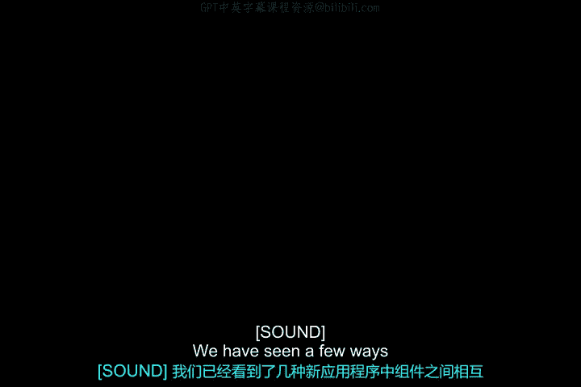
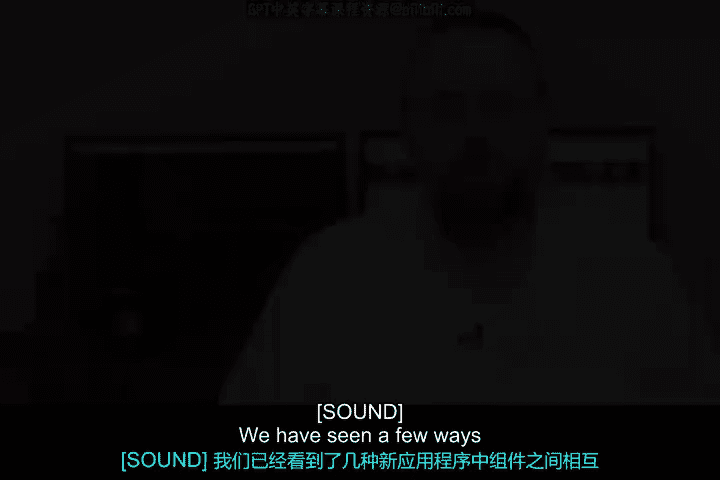
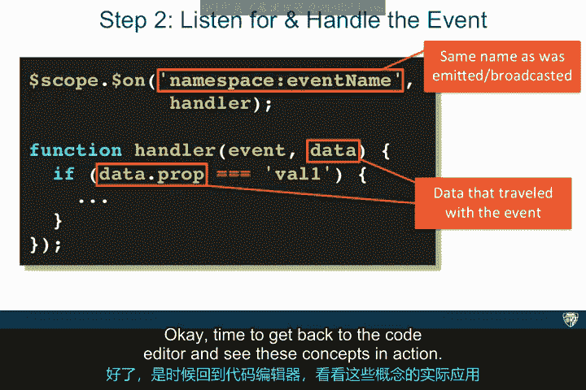

# 使用 AngularJS 开发单页 Web 应用：P71：第34讲（第1部分）：AngularJS事件系统 🎯






在本节课中，我们将要学习AngularJS中的事件系统。这是一种优雅的组件间通信方式，可以解决在复杂应用结构中数据传递的难题。我们将了解发布-订阅模式在Angular中的实现，以及如何使用`$emit`和`$broadcast`方法来发送事件。

## 组件通信的挑战

我们已经见过几种应用程序内部组件之间通信的方式。

例如，通过原型继承，子组件可以与父组件通信。

请注意，这里我宽泛地使用“组件”一词，这显然不仅适用于组件，也适用于指令、控制器等。

另一种组件通信方式是通过共享的单例服务。

使用`.service`方法创建的共享服务是单例的，因此不同的组件可以使用该服务的单一实例在彼此之间共享数据。

然而，在某些情况下，这种通信方式不够优雅，并且会在应用程序的不同部分之间创建过多的依赖关系。

让我们看一些图示。

请看这张图，组件2希望向其父组件1传递一些数据。

我们有两种方法可以实现这一点。首先，我们可以通过简单地向上遍历作用域链并访问父控制器来从组件2访问组件1。Angular通过`$scope`对象上的`$parent`属性使这变得容易。但这显然不是终点，因为我们仍然需要确保在组件1中设置机制来响应新数据，或者从组件2调用某些东西。换句话说，我们仍然需要确保组件1知道我们的通信。我们也可以使用回调方法绑定并调用父组件的方法，向其传递一些数据。这就是与父组件的通信。

在一个翻转的场景中，我们希望与子组件通信。一种快速的方法是让组件2提供某种方式让我们将数据发送给它。同样，组件2需要某种方式来响应新数据。

如果你想让一个组件与其祖父组件通信，事情会变得更有趣一些。一个优雅的解决方案不那么明显。

你应该使用两次`$parent`属性来向上遍历作用域链到达目的地吗？我不确定，看看这个操作所创建的依赖关系。

另一个可能更优雅的解决方案是使用单例服务并将其注入到两个组件中。

你仍然需要在组件1中为存储在共享服务中的值设置一些监视，以便你可以响应共享服务值中的任何更改。

当目标反转时，我们面临类似的困境。我们应该将数据发送到组件2，然后让组件2将数据发送到组件1吗？或者我们应该再次使用我们的共享服务？不确定，但这感觉不再那么优雅了。

那么，同时与多个组件通信呢？在这里，我们想要通信的组件似乎分散在各处。例如，组件4既不是我们发送消息的组件2的后代，也不是其祖先。

是的，我们仍然可以使用共享的单例服务方法，但必须在各处使用它，事情变得有点混乱。

一个类似的场景是，多个组件希望与一个中心组件通信，但这些组件不知道该组件在结构中的位置。同样，我们可以使用共享服务方法，但这将是一种混乱的方式来响应我们需要响应的某些数据更改或UI更改。

幸运的是，实际上有一个软件设计模式可以优雅地解决所有这些问题，Angular通过其事件系统实现了这一模式。

## 发布-订阅模式

该设计模式称为**发布-订阅设计模式**，基本上该设计模式有两个组成部分：**发布者**和**订阅者**。

发布者通过某个公共通道向订阅者发送消息。当我们谈论发布者时，发布者用某种分类标记消息。

发布者也不知道其消息的订阅者，也不知道是否存在任何订阅者。

另一方面，订阅者注册监听具有特定分类的消息。他们也不知道发布者，或者是否存在这些特定消息的任何发布者。

在Angular中，这些消息进行通信的公共通道是作用域。在这个设计模式中，我们谈论的消息被称为可以保存数据的**事件**。

## Angular中的事件处理

Angular事件处理中有两种类型的发布者。

第一种称为`$emit`。`$emit`沿着作用域链向上传播。

因此，如果组件3想要发出一个名为`greet`、数据为`{message: ‘hi’}`的事件，该事件将一直向上传播，直到到达应用程序中最顶层的作用域。

在Angular中发布消息的另一种方式是广播它们，这是通过`$broadcast`方法完成的。使用该方法，事件沿着作用域链向下传播。

例如，如果最顶层的作用域广播一个名为`greet`、数据为`{message: ‘hi’}`的事件，该事件将一直向下传播到作用域链中的最后一个作用域。

在Angular中订阅事件的方式是调用作用域服务上的一个特殊方法，称为`$on`。你需要提供你订阅的事件名称和一些处理函数，该函数定义在捕获到该事件后要做什么。

你可能会有以下疑问：当你的广播目标不在你广播调用向下传播的直接路径中时会发生什么？或者反过来，如果你正在发出一个事件，而目标不在你事件向上传播作用域链的直接作用域链中？

答案是，你可以从应用程序中所有内容的父作用域（也称为根作用域）广播你的事件。你可能直到现在才意识到，但我们在HTML页面中某个顶级元素（如`<html>`）上声明的`ng-app`，实际上是其下所有控制器、指令和组件的父控制器。

Angular有一个特殊的服务叫做`$rootScope`，你可以将其注入到应用程序中的任何地方，以引用作用域链中可能最高的作用域，即根作用域。

因此，如果你的组件3试图联系组件4，而组件4不在向上作用域树的直接作用域链中，你可以在组件3内部使用`$rootScope.$broadcast`。这样做将到达你作用域链的最顶端，并向下传播，到达组件4。

请注意，当你从根作用域广播时，应用程序中的每个节点都会收到该事件，并有机会响应它。

## 语法详解

让我们看一下具体的语法。

调用`$emit`和`$broadcast`可以从控制器、服务、组件或任何地方完成。不要忘记美元符号是方法名的一部分。

正如我们所说，`$emit`沿着作用域链向上发送事件。

另一方面，`$broadcast`沿着作用域链向下发送事件。请注意，最佳实践是对事件名称字符串进行命名空间划分。这有助于在以后理解事件针对系统的哪一部分时提高代码的可读性。

在这两种情况下，你都可以随事件发送一个包含一些数据的对象，这些数据可以在事件到达目的地时被解包。

最后一步是为你的事件注册一个监听器。这是通过在某个`$scope`或`$rootScope`（实际上就是应用程序中的顶级作用域）上执行`$on`函数来完成的。显然，我们需要使用与广播或发出事件时相同的事件名称字符串。

处理函数会自动接收两个参数：`event`（包含事件信息，包括事件名称字符串）和最重要的`data`对象。这个`data`对象包含了我们在发出或广播事件时与事件一起包装的数据。

**事件发射语法示例：**
```javascript
// 在某个组件/控制器中
$scope.$emit('namespace:eventName', { key: 'value' });
```

**事件广播语法示例：**
```javascript
// 在某个组件/控制器中，或从$rootScope
$scope.$broadcast('namespace:eventName', { key: 'value' });
// 或从根作用域广播到所有组件
$rootScope.$broadcast('namespace:globalEvent', { key: 'value' });
```

**事件监听语法示例：**
```javascript
// 在需要响应该事件的组件/控制器中
$scope.$on('namespace:eventName', function(event, data) {
    // 处理接收到的数据
    console.log(data.key); // 输出: 'value'
});
```

## 总结

本节课中我们一起学习了AngularJS的事件系统。我们探讨了传统组件通信方式（如作用域继承和共享服务）的局限性，并引入了发布-订阅模式作为更优雅的解决方案。

我们详细介绍了Angular中实现该模式的两个核心方法：`$emit`（向上传播事件）和`$broadcast`（向下传播事件），以及如何使用`$on`方法来监听事件。我们还了解了`$rootScope`的作用，它作为事件的全局通道，可以实现任意组件间的通信。

通过掌握事件系统，你可以构建出耦合度更低、更易于维护的AngularJS应用程序。




