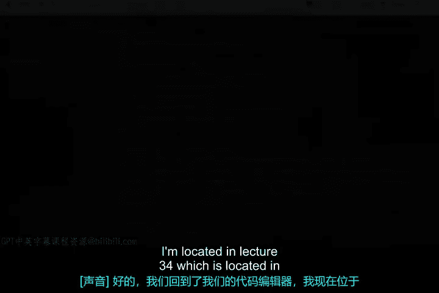
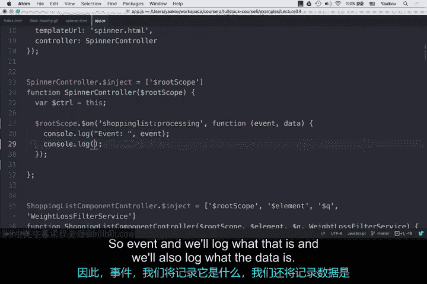
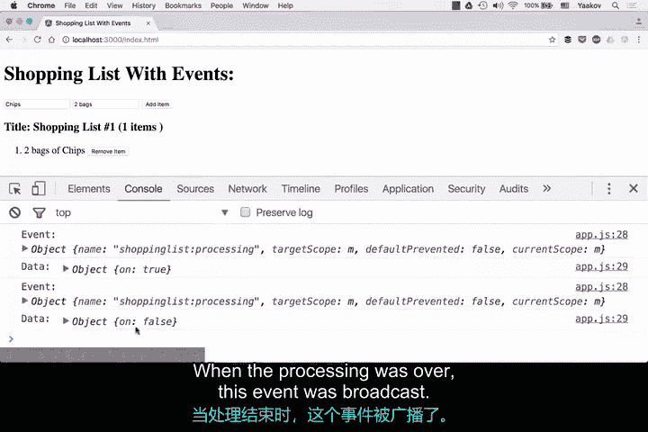
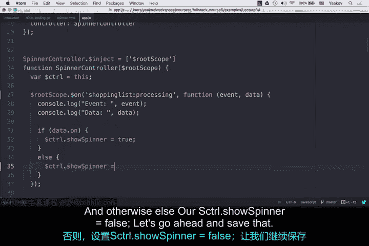
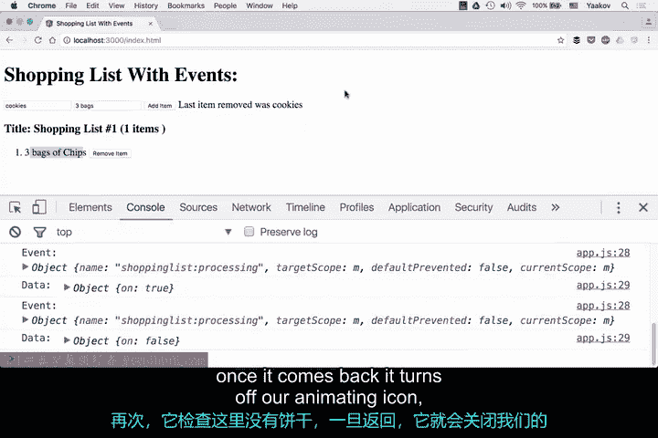
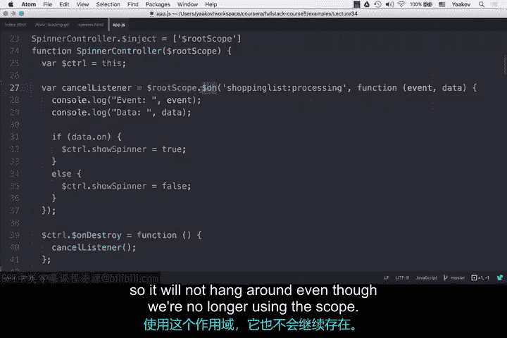
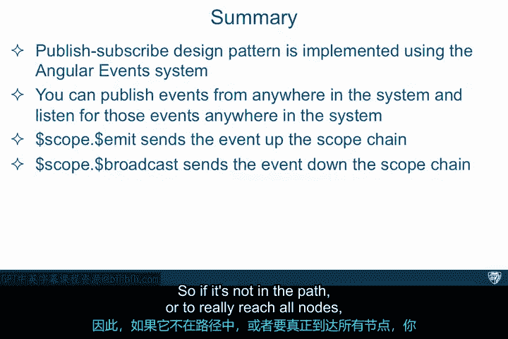

# 约翰霍普金斯大学《使用 AngularJS 开发单页 Web 应用｜Single Page Web Applications with AngularJS》中英 - P72：71_第34讲（第2部分）：AngularJS事件系统.zh_en - GPT中英字幕课程资源 - BV1dsFDeZEQr

🎼。

Okay， we're back to our code editor and I'm located in lecture 34。

 which is located in full stack dash course 5 examples folder and this is once again our shopping list application。

 which is now called shopping list events app there are many times in applications when theres some asynchronous communication going on and while that's taking place because usually that takes a little bit you need some sort of a spinner or some sort of graphic to tell the user that something is going on and he should wait。

 So what we're going to do is when a shopping list item is added to the shopping list we're going kick off a whole bunch of asynchronous actions。

 each of which will check whether or not a particular item in the list contains the word cookie or not Now since there could be more than one item in that list we're gonna have more than one asynchronous action being fired。

 However， while those asynchronous actions are being resolved we would like to show some sort of indication to the user that something is going on So we're going to display。

😊，Loading spinner that is actually going to be our flicker button。 And if you heard of flickickr co。

 this is what their loading icon is like。 And since we don't really know where this particular behavior is going to reside we're going to place our loading spinner component。

 yet another component we're gonna have an application we're going place it outside of our controller So it's not even inside of our shopping list controller is you can see the div ends right here it's actually sitting completely outside of it。

 but it is still sitting inside of the Nng app directive。

 which means it's inside of our angular application。

 So let's go to our appgs and take a look at the code let's actually minimize the file browser Soll be a more room here。

 So as you can see we have one more component called loading spinner and all the component has is a spinnerhtl template URL and a spinner controller Well the template URL for spinner html is very simple It's just an Ig tag and it has an Ng if in it meaning it will get。

😊，Shown this Ig will be part of the Dom If this dollar sign CtRl that shows spinner is true。

 otherwise it will say false and the entire imG tag will be pulled out from the Dm rendering going back to our appgs you'll see we have a starter here。

 we started our spinner controller and we already injected the rootcope and you'll see why in a minute and this is just a starter one we's take a look at a very important part of the code。

 which is inside the shopping list component controller。

 that's the thing that displays the shopping list。 and we injected a couple of things here。

 we injected our queue service。 if you remember from when we spoke about promises and we also injected this weight loss filter service that's an asynchronous service that checks for names of the shopping list to check to make sure there are no cookies in it and we're going to invoke that service inside the dollar sign do check again。

 Dallasas sign to check gets invoked every time。the digestig loop and therefore we could check whether or not our number of items in our items are right changed and if it did。

 it means it's time for us to check whether or not there are cookies inside of our shopping list before however we make that asynchronous call to our weight loss filter service we're going to broadcast an event and notice that we're broadcasting an event using the rootcope and the reason that is is because the component that needs to catch that is loading spinner and it's completely not in our path of up thecope chain so therefore we go back to Abdags' using the rootcope so we're starting from NGf starting from the very top component and we're broadcasting that event down and the event is called shopping list column processing and the only data we're passing really mostly for show here is on the property on in the object and its value is true so what this event should trigger somewhere somewhere in application。

We don't know where and we don't care is it should show some sort of a spinner to the user saying hey。

 we're processing or maybe do some other things as well。

 but in hour for our purposes all we needed to do is actually show this spinner so the user knows somethings going on and we're going to use our Q dollar sign Q all and the way we're gonna to do that is we're going to loop over every item inside of our items array and for every item we're going to call this weight loss filter service and call it method called check name which returns a promise and we're going push every single promise into this promises array and you can remember the Q service dollar sign Q service all takes an array of promises and then it can deal with them all at once and that's actually what we want we want them to be asynchronous and all of them to be parallel at the same time and the reason we want that is because even if one fails which means even if one fails it means that we detected a cookie in there and we're going go into this catch block。

😊，The rest of the promises will get canceled automatically right there in a spot So the first time it detects a cookie。

 the rest of them will get canceled and what's going to happen is it's going to do this jQury stop that we've seen before where it's going to find the element with that error message and go ahead and slide it down and if all of them come back with a positive result which means none of the items in the shopping list actually contain the word cookie then we're simply going to remove the error message if it's even there In either case however。

 whether it's good or not we have finally block that will broadcast yet another message using the dial sign Rocope service and it will broadcast shopping list processing and on with the value of false which means we've done with've completed all of our asynchronous communication nothing else is being processed so therefore go ahead and turn off that spinner so we've set up broadcasting the on event when the spinner should turn on and we've set up the broadcasting of the event that。

The spinner should turn off at the end of all this asynchronous processing Let's go to our actual spinner controller and implement the event listener to catch those events so the first thing we're going to do is we're going to go ahead and use our root scopepe that we inject it right here into our controller we're going to call this dollar sign on method and the dollar sign on method is going to look for shopping list a lowercase processing and that's the name of our event and we need the handler function we don't need the name and it's going to pass us event and data okay well put a semi on here and now we could actually log what the event is so event and we'll log what that is and let's go ahead and also log what the data is。

😊。

Okay now let's go to our browser and browser sync is already started。

 Let's go ahead and open up our console and let's go ahead and add something like chips two bags of chips and we'll click add when we do that you could see a couple of things happen number one is the first event gets fired and that event is an object you could see it has a name the name of the event is shopping list processing and you could see the data as well that was broadcast to the entire tree really which is this object with the value with a property on and a value of true but you could see that there is yet another event that got broadcast and another event that got broadcast was again shopping list processing except with the object that it broadcasted was on false So the first time when we started processing was this event when the processing was over this event was broadcast both of this event however were caught inside of our spinner controller right heres。

😊。

We printed that out The next step is fairly simple we just have to check if data do on because that's our on property。

 if it's true， it means were want to turn on the spinner and that's easy it's just controller controller that show spinner equals to true and otherwise else our controller。

😊，That shows spinner。Is equal to false。 Let's go ahead and save that。

 Let's go back to our browser and let's go ahead and try it。 let's say chips。

 three bags of chips we click add and we could see right there it's processing so it's showing us And once the second event comes in that icon disappears and if we say let's move this down a little bit。

 And if we say cookies。

The dreaded cookies。Three bags of the cookies and we click add。

 yet again it's processing now it's processing two events or two items in the shopping list and it comes back with cookies detected so if we remove that again。

 once I remove it it has to once again trigger the whole broadcasting which is what it does and again it's checking to see that there's no cookies in here and once it comes back it turns off our animating icon。

There's actually one more thing to do。 If you take a closer look。

 this spinner controller and this spinner component altogether。

 this loading spinner component will work very well in this view。

 But what happens if I switch views and come back to it and then switch and come back to it every time I come back to it。

 we're going have this dollar sign rootcope that on So which means every time we will register this event listener and there's really no code to go ahead and destroy this This would be different if I just said。

😊，Just said something like this scope why well because every time that this view gets destroyed。

 the scope gets destroyed with it and anything that's attached to it。 However。

 root scope is never destroyed until the entire application is destroyed and here we have a potential for a really nice memory leak because every time we come here this on is going to get executed。

 but nothing actually deregisters it。 Well， we' learned of this handy method in the controller nowadays and the components called controller that dollar sign on destroyed So when this is going to get destroyed when the scope of this controller gets destroyed。

 we want to trigger the destruction of this listener as well and the way we could do that is to say this is a function I need the name of it and what we need is we need to somehow get a hold of the function that registered this entire listener and the way we could do it is fairly simple the dollar sign on function actually returns a。

😊，Registration function。 So all we have to do is say var， cancel。Listener。

And we'll make that equal to that and in here since it's a local variable that we can access。

 we'll copy that， we'll just say cancel listener and now that we know that it's a function。

 all we need to do is put Pars behind it。😊，Put a semicolon and save that。

 And now every time this view gets destroyed and the scope。

 the dollar sign scope that belongs to this controller and belongs to this component gets destroyed will also at the same time。

 deregister our root scope that on。 So it will not hang around even though we're no longer using the scope。

 Let's go ahead and check it out to make sure things are working。 Let's put chips， chips。

 four bags of chips。 and add that that seems to be working and should turn off in a second。

 Yes it did。 And now we're gonna put cookies。

Let's make it five bags of cookies， we deserve it and there you go that's spinning and at the same time at the end bam it says cookies if we remove it。

 it will once again start spinning to check the items in the shopping list you will see that the cookies are not there anymore the spinner will stop and the warning will go away as well。

Let's summarize。In Angular the publish subscribescribe design pattern is implemented using the Angular events system you can publish events from anywhere in the system and likewise you could listen for those events and catch them anywhere in the system as well there's a couple of ways of publishing events one way is to use the dollar sign scope that dollar sign emitm that method sends the event up the scope chain the other way is to call dollar sign scope that dollar sign broadcast and that method sends the event down the scope chain obviously your message or event reachability of a particular node will depend on where it is located in the scope chain structure whether or not it's in the path of the broadcast or emitm methods so if it's not in the path or to really reach old nodes you use the dollar sign rootcope that dollar sign broadcast。

What that does is broadcasts the message from the very top where you declare AnG app。

 which is really the root controller of our entire application。

 and therefore everything in application inherits from its scope and therefore everything is on its scope chain path。

😊，To listen for an event you either use the dollar sign scope dollar sign on or the dollar sign root scopepe dollar sign on in either case what you pass into those methods is the name of the event you're listening for and you register a function that should be executed when that event gets triggered while if you listening for an event using the dollar sign scope that dollar sign on there's really nothing left to do because when you destroy the particular view。

 the dollar sign scope will get destroyed with it that is not the case with the dollar sign root scope because that always lives throughout your application so you must dereg the listener when using the dollar sign scope that dollar sign on the way you deregister the listener is simply capture the return value of the dollar sign on method which happens to be the deregistration function and then you hook that into the destroy method of your component and then。

That dereration function inside of that if you were to skip doing that。

 you would leave the listener function registered in memory basically for the rest of the life of this application and what's worse。

 as you keep coming back to this view， new listener functions would be registered and more and more of them would keep sitting in memory without any way to reach them and unload them from memory by deregistering their listening to the event。

