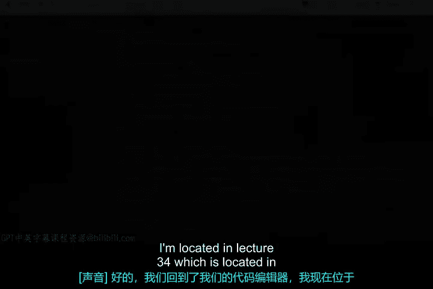
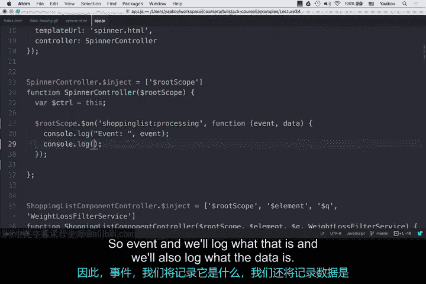
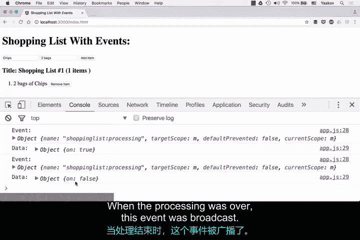
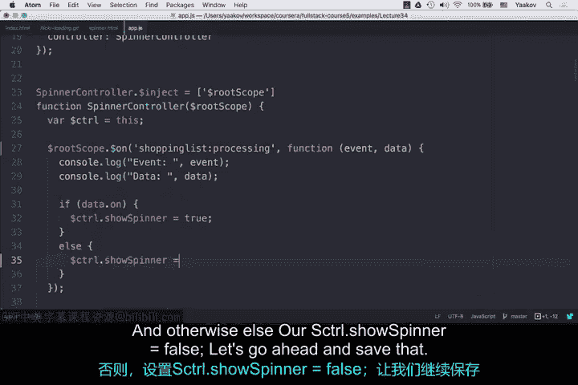
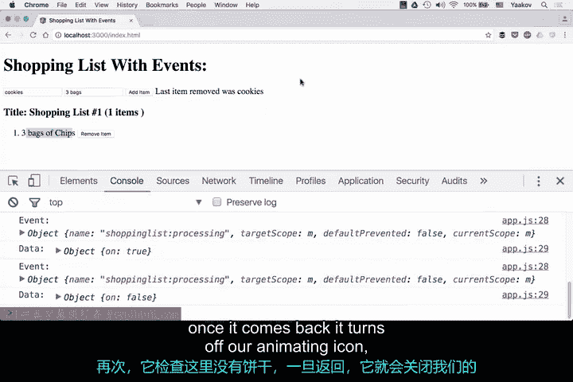
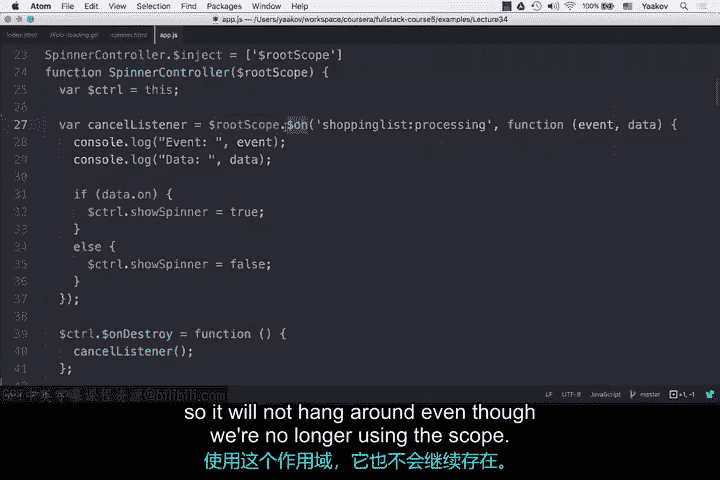
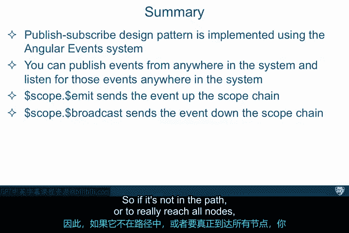

# AngularJS 单页应用开发：P72：AngularJS 事件系统

## 概述

在本节课中，我们将学习 AngularJS 的事件系统。我们将通过一个购物清单应用的例子，了解如何在应用的不同部分之间进行异步通信，并使用事件来显示和隐藏一个加载指示器（旋转图标）。你将学习到如何发布事件、监听事件，以及如何正确地管理事件监听器以避免内存泄漏。

---

## 代码结构与目标

我们回到代码编辑器，位于第 34 讲的示例文件夹中。这是一个名为 `shopping list events app` 的购物清单应用。

在许多应用中，当发生异步通信时，由于通信通常需要一些时间，我们需要向用户显示某种指示器（如旋转图标），告知用户正在处理中，请等待。

我们的目标是：当向购物清单中添加一个物品时，我们将触发一系列异步操作。每个操作都会检查清单中的某个物品是否包含单词“cookie”。由于清单中可能有多个物品，因此会触发多个异步操作。在这些异步操作进行期间，我们希望向用户显示一个指示器。我们将显示一个加载旋转图标（这里使用 Flickr 风格的按钮图标）。

由于不确定这个行为应该放在哪里，我们将把加载旋转图标组件放在控制器之外。它不在购物清单控制器内部（你可以看到 `div` 在这里结束），而是完全位于其外部，但它仍然位于 `ng-app` 指令内部，这意味着它在 Angular 应用范围内。

---

## 加载旋转图标组件

让我们查看 `app.js` 中的代码。我们有一个名为 `loadingSpinner` 的组件。该组件有一个 `spinner.html` 模板 URL 和一个 `SpinnerController`。

`spinner.html` 模板非常简单，只是一个 `img` 标签，其中包含一个 `ng-if` 指令。这意味着只有当 `$ctrl.showSpinner` 为 `true` 时，这个 `img` 标签才会成为 DOM 的一部分并显示；否则，整个 `img` 标签将从 DOM 中移除。

回到 `app.js`，我们定义了 `SpinnerController`，并注入了 `$rootScope`（稍后会解释原因）。现在，让我们看看代码中一个非常重要的部分，它位于购物清单组件的控制器中。

---

## 购物清单组件控制器

购物清单组件控制器注入了 `$q` 服务（关于 Promise 的部分提到过）和 `WeightLossFilterService`。这是一个异步服务，用于检查购物清单中的物品名称，确保没有包含“cookie”。

我们将在 `$doCheck` 函数中调用该服务。`$doCheck` 在每次摘要循环时被调用，因此我们可以检查物品数组中的项目数量是否发生变化。如果发生变化，就意味着是时候检查购物清单中是否包含“cookie”了。

然而，在调用 `WeightLossFilterService` 进行异步检查之前，我们将广播一个事件。注意，我们使用 `$rootScope` 来广播事件。原因是需要捕获此事件的组件是 `loadingSpinner`，而它完全不在我们当前作用域链的路径上。因此，我们使用 `$rootScope` 从最顶层的 `ng-app` 开始广播事件。

我们广播的事件名为 `shoppingList.processing`，传递的数据对象中有一个属性 `on`，其值为 `true`。这个事件应该在应用的某个地方被触发，我们不知道具体在哪里，也不关心。它应该向用户显示某种旋转图标，表明“正在处理”。在我们的例子中，我们只需要显示这个旋转图标，让用户知道有事情正在发生。

我们使用 `$q.all` 方法。我们将遍历 `items` 数组中的每个物品，对每个物品调用 `WeightLossFilterService` 的 `checkName` 方法（该方法返回一个 Promise），并将每个 Promise 推入 `promises` 数组。`$q.all` 方法接收一个 Promise 数组，然后可以同时处理它们。这正是我们想要的：我们希望它们是异步的，并且全部并行执行。

这样做的原因是，即使其中一个 Promise 失败（意味着检测到“cookie”），我们也会进入 `catch` 块，其余的 Promise 会自动被取消。一旦检测到“cookie”，其余的检查将被取消。

接下来，我们会执行之前见过的 jQuery `stop` 和 `slideDown` 操作，找到错误消息元素并将其滑下显示。如果所有 Promise 都返回成功结果（意味着购物清单中没有物品包含“cookie”），那么我们将简单地移除错误消息（如果存在的话）。

无论结果如何（成功或失败），在 `finally` 块中，我们将使用 `$rootScope` 广播另一个消息。事件名同样是 `shoppingList.processing`，但这次 `on` 属性的值为 `false`。这意味着我们已经完成了所有异步通信，没有其他处理正在进行，因此应该关闭旋转图标。

这样，我们就设置了在应该打开旋转图标时广播“开启”事件，并在所有异步处理结束时广播“关闭”事件。

---

## 实现事件监听器

现在，让我们转到实际的 `SpinnerController` 并实现事件监听器来捕获这些事件。

首先，我们使用注入到控制器中的 `$rootScope`，调用 `$on` 方法。`$on` 方法将监听名为 `shoppingList.processing` 的事件。我们需要一个处理函数，它会接收 `event` 和 `data` 参数。

我们可以先记录一下事件和数据，以便观察。现在，让我们打开浏览器，启动 BrowserSync，并打开控制台。

当我们添加一个物品（例如“chips, two bags of chips”）并点击“Add”时，可以看到几件事情发生：第一个事件被触发，它是一个对象，事件名是 `shoppingList.processing`，广播的数据是 `{on: true}`。随后，另一个事件被广播，同样是 `shoppingList.processing`，但数据是 `{on: false}`。

第一个事件在开始处理时广播，第二个事件在处理完成时广播。这两个事件都在我们的 `SpinnerController` 中被捕获并打印出来。

---

## 控制旋转图标的显示

下一步很简单：我们只需要检查 `data.on` 的值。如果为 `true`，意味着我们应该打开旋转图标，只需设置 `$ctrl.showSpinner = true`。否则，设置 `$ctrl.showSpinner = false`。

保存更改，回到浏览器尝试一下。输入“chips, three bags of chips”，点击“Add”，可以看到旋转图标出现并显示“正在处理”。当第二个事件到来时，图标消失。

如果我们输入“cookies, three bags of cookies”并点击“Add”，旋转图标会再次出现，处理两个物品，然后返回“cookies detected”的错误。当我们移除该物品时，整个广播过程会再次触发，检查购物清单中没有“cookie”后，旋转图标停止，警告信息也消失。

---

## 防止内存泄漏

还有一件事需要注意。仔细观察，这个 `SpinnerController` 和 `loadingSpinner` 组件在当前视图中工作得很好。但是，如果我切换视图再返回，每次返回时，`$rootScope.$on` 都会注册这个事件监听器，并且没有代码来销毁它。

如果我们在控制器中使用 `$scope`（而不是 `$rootScope`），情况会不同。因为每次视图被销毁时，其关联的 `$scope` 也会被销毁，附加在其上的任何东西也会被清理。然而，`$rootScope` 在整个应用销毁之前永远不会被销毁。这里存在潜在的内存泄漏风险，因为每次进入这个视图，`$on` 都会执行，但没有任何东西注销它。

幸运的是，在组件控制器中有一个方便的方法叫 `$onDestroy`。当控制器的 `$scope` 被销毁时，我们希望触发这个监听器的销毁。我们可以通过保存 `$on` 方法返回的注销函数来实现。

`$on` 方法实际上返回一个注销函数。我们只需将其赋值给一个变量（例如 `cancelListener`），然后在 `$onDestroy` 方法中调用这个函数。这样，每次视图被销毁，该控制器所属的 `$scope` 被销毁时，我们也会同时注销在 `$rootScope` 上注册的监听器，防止它一直驻留在内存中。

让我们检查一下是否一切正常。添加“chips, four bags of chips”，旋转图标正常工作并关闭。再添加“cookies, five bags of cookies”，旋转图标出现，最后提示检测到“cookie”。移除后，旋转图标再次启动检查，确认没有“cookie”后停止，警告也消失。

---

## 总结

本节课中，我们一起学习了 AngularJS 的事件系统。

在 Angular 中，发布-订阅设计模式是通过 Angular 事件系统实现的。你可以在系统中的任何地方发布事件，同样，也可以在系统中的任何地方监听并捕获这些事件。

发布事件有两种主要方式：
*   使用 `$scope.$emit` 方法，它沿着作用域链向上发送事件。
*   使用 `$scope.$broadcast` 方法，它沿着作用域链向下发送事件。

显然，你的消息或事件能否到达特定节点，取决于该节点在作用域链结构中的位置，以及它是否在 `$broadcast` 或 `$emit` 方法的传播路径上。如果不在路径上，或者为了真正到达所有节点，你可以使用 `$rootScope.$broadcast`。这会从声明 `ng-app` 的最顶层（即我们整个应用的根控制器）开始广播消息，因此应用中的所有东西都继承自它的作用域，所有东西都在其作用域链的路径上。

监听事件可以使用 `$scope.$on` 或 `$rootScope.$on`。无论哪种情况，你都需要传入要监听的事件名称，并注册一个在该事件触发时应执行的函数。

需要注意的是，如果你使用 `$scope.$on` 监听事件，当特定视图被销毁时，其关联的 `$scope` 也会被销毁，监听器会自动清理，通常无需额外操作。但使用 `$rootScope.$on` 则不同，因为 `$rootScope` 在整个应用生命周期中都存在。因此，你必须在使用 `$rootScope.$on` 时手动注销监听器。

注销监听器的方法是：捕获 `$on` 方法的返回值（它恰好就是注销函数），然后将其挂钩到组件的 `$onDestroy` 方法中。在这个注销函数内部，如果你跳过这一步，监听器函数将在内存中保持注册状态，基本上持续整个应用的生命周期。更糟糕的是，每次返回到这个视图，新的监听器函数都会被注册，越来越多的函数会驻留在内存中，无法访问也无法从内存中卸载。通过注销对事件的监听，我们可以避免这种内存泄漏问题。