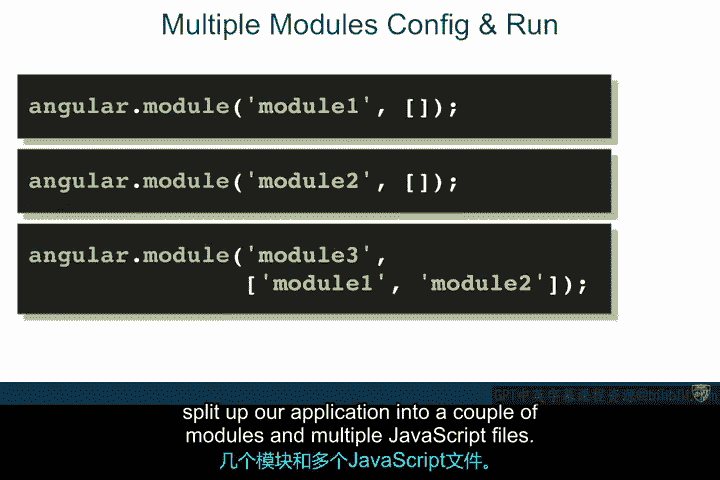

# 约翰霍普金斯大学《使用 AngularJS 开发单页 Web 应用｜Single Page Web Applications with AngularJS》中英 - P73：72_第35讲（第1部分）：模块.zh_en - GPT中英字幕课程资源 - BV1dsFDeZEQr

🎼。

Whether you realize it or not， we've actually been using modules pretty much from the beginning of the course。

 however we haven't really talked about them and therefore haven't really used their power by far the biggest advantage of using modules is the fact that they allow us to modularize our application In other words。

 modules allow us to split up our application into smaller parts that can then be glued together this is a huge advantage because it allows us to work on different parts of our application independently。

😊，It also drives our thinking towards approaching our software projects as smaller parts of the bigger hole。

 it's always easier to code up something small and simple than to attack an entire development effort all at once。

😊，Using modules we can also wrap up our controllers， components， directives， or whatever。

 and offer it up to the world for others to use in their applications。Now。

 unlike regular applications that have a main method from which everything starts in Angular。

 there is no main method。Instead， we use the module API to declare artifacts of our application。

 components， controllers and so on， let's take a look at the syntax of declaring modules。

The first step is for us to declare or create a module you declare a module by calling the method module on the angular object itself the string name you give to the module should be unique across your entire application Another important note to make is that if you specify a second argument in the module method you're actually creating the module instead of simply retrieving an existing one。

Note that you can create a module without any dependencies on any other modules。

 like in the case of module 1 and module 2， or you could declare that a module depends on one or more modules。

😊，In the case of module three， it depends on modules1 and two。

The second step is to declare module artifacts。 We've done the step before in just about every lecture the entire course。

 so you should be very familiar with it。 However， note a crucial difference between creating a module and retrieving the module instance in order to attach a controller or something else to it note that the second argument to the module method is omitted。

 this assumes that we have previously created this module 1 If we haven't the call to retrieve the module1 will cause an error。

😊，The last step is for us to wire in the name of the main module into our HTML using the NG app directive。

And that's pretty much it。Now， just like it's easier to deal with individual modules with their related components in real worldor development。

 it's also much easier not to place all of your JavaScript code into one file It's a best practice to place one artifact like a controller into a single JavaScript file Now sometimes this best practice rule is broken when the code is small and it's easier to understand what's going on if you place a couple of artifacts into the same file it's very common to simply declare or create a module in its own JavaScript file in this case judging by the name of the file it looks like we're creating and declaring module1 remember that this would be done by using the Angular dot module method with the second argument of either an empty array or some array of module names that module1 depends on。

😊，Then in controller dot JS file， you retrieve module one you created by using the same angular dot module method。

 but without the second argument and call the controller method on it to declare a controller。

And the same thing would work for module 2 below if you're not used to seeing ja split up like this。

 just think of how this works in a browser and you'll get more comfortable with it Since as you know the browser processes HTML sequentially that means that conceptually the browser will combine all of your ja files into one ja file the contents of that file will be the contents of the files you declared in your HTML1 by one So in this case you can visualize creating a new jascript file。

 then pasting the contents of module 1gs into it， then pasting the contents of control dogs into the file after that and so on。

Note that it does not matter in which order you declare modules in your HTML or in your JavaScript file。

 if you think of the whole setup as one gigantic JavaScript file put together from the smaller ones here we're declaring module 2 DJS before module1 internally once Angular reads in all the module declarations。

 it will figure out which module depends on which other module and will instantiate them in the proper order。

However， what you absolutely cannot do is declare an artifact for a module before you create that module。

😊，The reason why this is going to result in an error is because pasting the contents of those two files in that order would roughly produce something like the following。

 as you could see we are retrieving an instance of module2 in declaring a component on it as the first step。

 however， the module itself isn't even created until the second line of code。

 this would obviously result in an error。Let's discuss one more thing。

 There are a couple of special module methods， and we've seen one of those already the config method Config method runs before any other methods on the module。

 As you remember， the function value passed into the config method can be injected with a provider or constant。

 Since providers I used to configure services， the restrictions of not being able to inject services into the config method makes sense since we don't want to instantiate a service before we had a chance to configure how it would be instantiateated。

😊，The other method is the run method that's executed on the module The run method is executed right after the config method。

 you can only inject instances and constants into the run method but not providers because we want to prevent the system from being reconfigured during runtime。

In the case of a module that depends on other modules。

 all the config methods of dependencies will execute first so in this case the config method of module 1 and moduleule 2 will execute first。

 then the config method of module 3 will execute。Then the same pattern will repeat for the run methods of these modules。

 module1 and module 2 first， then the run method of module 3 executes。Okay。

 let's jump back into our code editor and split up our application into a couple of modules and multiple JavaScript files。

