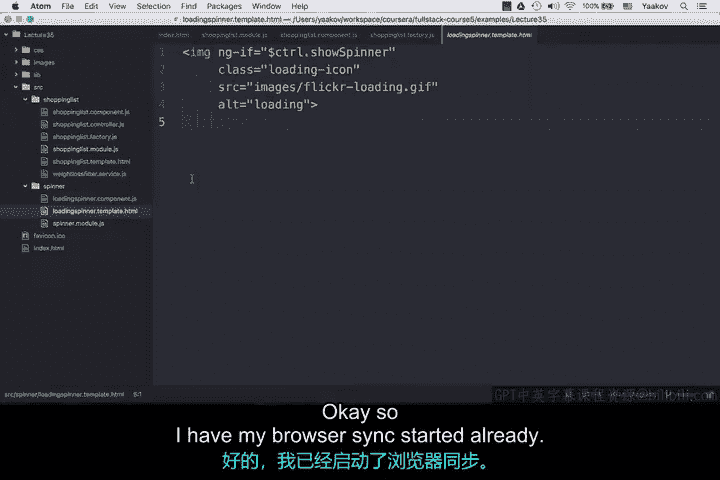
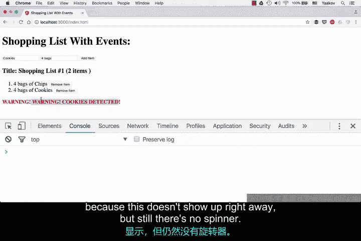
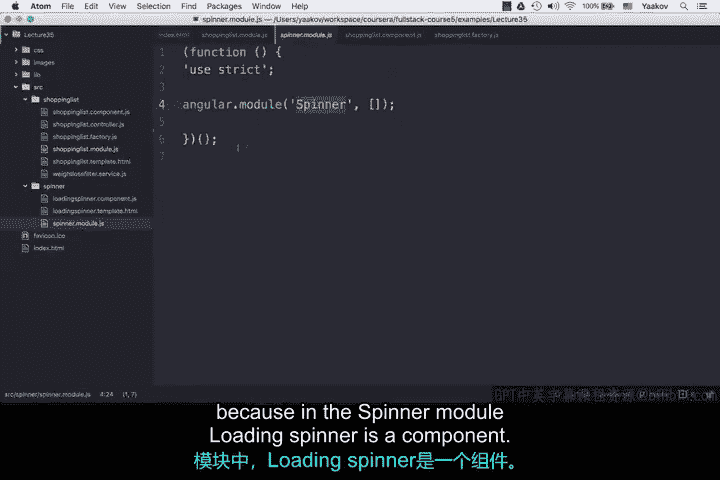
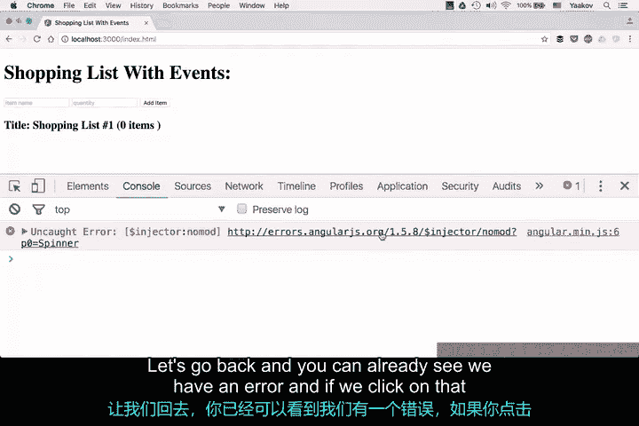
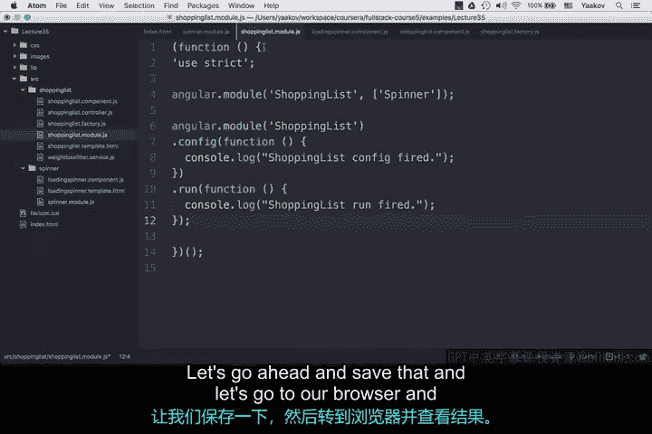
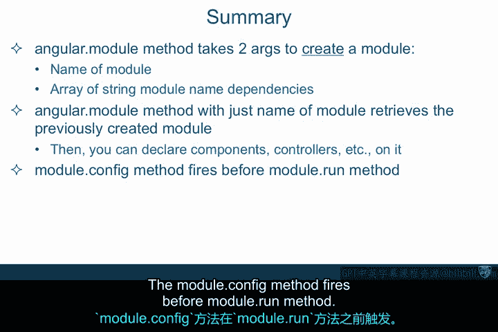

# 约翰霍普金斯大学《使用 AngularJS 开发单页 Web 应用｜Single Page Web Applications with AngularJS》中英 - P74：73_第35讲（第2部分）：模块.zh_en - GPT中英字幕课程资源 - BV1dsFDeZEQr

🎼。

Okay， we're back on our code editor and I'm located in lecture 35 folder。

 which is located in fulltag dash course 5 examples folder and this is our good old shopping list application except this time is you could see on the left here we kind of cleaned it up and split it up into different folder so it will be much more organized than before the index that HTML is as before pretty simple the NG app is pointing to this module this app module that's called shopping list so that means we have a module with the name shopping list and you could see it's the same shopping list app that we had before and at the very end we have this loading spinner right here。

 which is what we're really going concentrate a little bit on and the way we're now importing our artifact it's through separate script call So we're clearly putting the jQury and Angular itself into the lip folder and if you could take a look here those are the two files right there So those are the things we need to。

😊，Load first， obviously。 And then we're loading modules。

 You can see we're loading the source spinner spinner module dogs。

 And if you take a look at the source， you'll see we have a shopping list folder and a spinner folder。

 Well， the shopping list folder where all the shopping list artifacts are located。 the component。

 the controller， the factory in the service。 and these are all services and factories we've seen before。

 the shopping list factory， the weight loss filter service， we've seen all of them before。

 And it's actually a best practice to call them by the name of the service then followed by period followed by the name of the artifact。

 So in this case， I could clearly see that this Gs file contains the component that is a shopping list component。

 So if I go to the shopping list folder and open up the shopping list that component dogs。

 I could see that I am including or I'm calling that component on the module called shopping list module。

 Well， where does the。😊，Spping list module come from Well。

 there is a file called as you could see at the beginning here when we said that we're importing the modules up front。

 there's a file called shopping list that modules that's the file where we create and declare our module。

 let's go take a look at that。 So that's all it is we're just simply creating this module calling a shopping list and giving it for now no dependencies in every other file that we look at。

 we're simply retrieving that module notice that there is no second argument here。 that's an array。

 that would be declaring the shopping list module again。

 which would erase basically everything that's been placed into that module from before So we're not declaring the module we're retrieving the module and then calling the component method on it and basically in this case here we have this shopping list component controller sitting right inside of the same file which is sometimes people break that out and make that into a separate file。

😊，gether and then somehow glued them together again by possibly declaring this as a controller on the module itself and just simply having angular putting those two things together and you could see that there's a factory here and it's exactly the same thing they're just separate files but really they are all using this angular module angular that module retrieving the shopping list module to go ahead and declare on the very same module those same artifacts that we've declared before Now we also have a spinner module and you can see here spinner that modules also all it does is just declares or creates the module and then let's say something like spinner that component js actually attaches a component to the spinner module and this whole thing this whole spinner folder right here contains everything we need for our loading spinner implementation so you can see here well move this a little bit not only do we have actual ja but we also have template that HTML and that's where。

😊，This comes in here where we declare So spinner loading spinner template that HTML。

 and it's sitting right here in that same folder， and it's that same imG tag as it was before。 Okay。

 so I have my browser sync started already let's go to our browser and let's go ahead and try this out So we'll say chips we'll say four bags of chips we'll click add and click add you could see that there's no spinner going on here。

 It's not really working。 gonna even put cookies here and add that and something's definitely happening asynchronously because this doesn't show up right away。

 but still there's no spinner。 Well what's going on What's going on It's actually kind of simple。

 What's going on is if you look at the shopping list module。

 We're not dependent on the spinner module。 So all we have to do is really take the name of the module Spner and go to our shopping list module and say the shopping list actually depends。

😊。

On the spinner module， Once that happens， this declaration right here at the very end。

 loading spinner， the tag the element is actually going to be activated by Angular。

 before Angular didn't know what to do with that because it didn't know how to interpret it。

 So it basically just ignored it。 But now loading spinner will all of a sudden means something because in the spinner module。

 Loing spinner is a component。 Loing spinner is a component。

 So it will look in the HTML for loading dash spinner as the element。

 So let's say that let's go back to our browser and let's go ahead and say chips。

4 bags of chips looks click add And you could see now our spinner is showing up。

 So everything is actually working And even the log methods are firing here。

 so you can see the events that are flying back and forth。😊。

Now I told you that it doesn't matter how you declare the modules as long as you declare the module that you're using before you try to declare something that is already using the existence of that module so therefore if I wanted to I could take this line right here。

 cut it out and as long as I put it in front of the line that actually uses that module so the script of loading spinner that component that JS well it uses this module right here so I can't really put this above that but as long as I put it this way。

 let's go back to our browser， it will still work。 we'll just put some nonsense here just to test it real quick is you can see still working no problem but if I go back and try to put this line right here and try to put this line below this line。

Which means that the first thing that the browser will try to interpret is trying to retrieve our spinner module and attach a component to it。

 Well， that's not going to work because the spinner module at this point hasn't even yet been created。

 So let's save that， let's go back and you can already see We have an error。

 And if we click on that actually it will tell you something like module spinner is not available。

 So because we try to create a component on a module that didn't really yet exist。

 So let's go back and fix that。 let's undo that。😊。

And actually put it all the way back to where it was before。

 The next thing I want to show you is the config and run method blocks。

 Let's go to our spinner module do Gs。 And let's go ahead and declare the config and run blocks。

 I actually have it already precode it。 so I'll cut and paste it here and you can see here Ive created the spinner module and now I'm retrieving the spinner module in the next line。

 I could have just actually put it the dot config dot config right here。

 but its looks a little bit nicer if I do it a separate line。

 So as you could see I'm decing the config function which basically just going to say is spinner config fired and a run function that is going to just say spinner run fired and I want to do the same thing for the shopping list and again I have this precode it So it's the same thing。

 It's the same config same run except now we're saying shopping list config fired and shopping list run method fired。

 Let's go ahead and save that and let's go to our browser and。😊。

Let's go ahead and take a look。 Let's close this page and let's take a look。

 You could see here Spner is something our shopping list module dependent on。

 So spinner fires go to configurefig of the spinner fired first。

 then the config of the shopping list fired then again the spinner run fired because our shopping list depended on spinner and then finally the shopping list run method fired。

 Now if we go back and change which module is declared first。

 you may think that this is because the spinner is declared first。

 that's why it's config is fired first if we go ahead and flip it。😊，And save it again。

 So now the shopping list module is getting read by the browser first and the spinner module is getting read by the browser second。

 If we go back to the browser， you'll see that it's exactly the same thing nevertheless the spinner modulefi gets fired first because it's a dependency declared on the shopping list module。

 So that's why the shopping list has to configure itself after all of its dependencies。

 and the same thing with the run method， the spinner run method gets fired first since the dependency on the shopping list module and then the shopping list run method gets fired at the end。

😊，Okay， so let's summarize。Angular that module method takes two arguments to create a module。

 the first one is the name of the module itself， which is just a string。

 and the second one is an array of string module name dependencies。

Angular that module method with just one argument， which is the name of the module。

 retrieves the previously created module。Then once it's retrieved， you could declare components。

 controllers on it， and so on。The module thatconfigug method fires before module。ron method。

 and in fact all of the dependency modules get configured first and then the module that declares a dependency gets configured and the last thing to remember is it does not matter which modules are listed first in your HTML as long as module declarations that's where the modules are created are listed before the artifact declarations like controllers components directives on that module because those declarations use the existing module which needs to be created beforehand。

