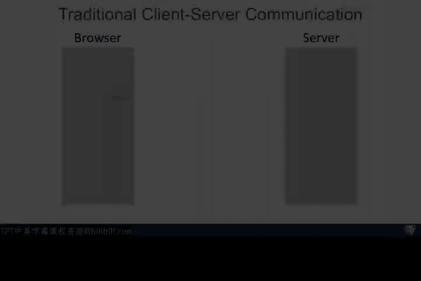
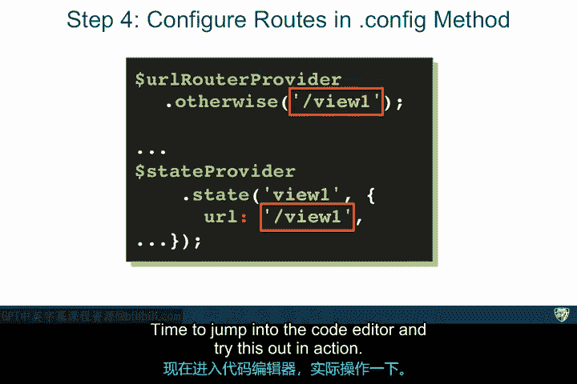

# 约翰霍普金斯大学《使用 AngularJS 开发单页 Web 应用｜Single Page Web Applications with AngularJS》中英 - P75：74_第36讲（第1部分）：路由.zh_en - GPT中英字幕课程资源 - BV1dsFDeZEQr

🎼。

In this video， we're finally going to address a topic that takes up the majority of the title of this course。

 single page applications。Even in a simple app， you'll probably have at least a couple of different views where the majority of the content on the page will have to be replaced with some other content one way or another。

 users need to be able to get from one view in your application to another view。😊。

Let's first take a look at some diagrams of traditional approaches to this feature and then talk about the single page application approach。

😊，In a traditional client server communication as they started calling it web 1。

0 any update whatsoever that the browser needed was handled by the server。 For example。

 the browser would start out by requesting a resource at the URL/ page1。

 HTMLt the server would evaluate the request， find the resource at that URL and then respond with the contents of some file probably named page1。

 HTML If the user clicked on some button that required some minor update to the page even as little as updating someone's name in some greeting。

 the browser would make another request to the server this time attaching some data or request parameters to the end of the original URL in this case ID equal to 3。

The server would process the request and then send the entire page1 at HTML content all over again。

 but with an updated name probably corresponding to the ID with a value 3。

 such updates are called Coarse grained updates because of the large chunk of data that had to travel through the network for even the smallest updates。

As you can imagine this was a slow experience for the user and also clogged up the networks quite a bit。

 passing around essentially the same content over and over If the user clicked on a link pointing to/lash page to the HTML。

 the browser made another request to the server， the server would process the request and then returned the contents pointed to by the URL as page to that HTML。

You can see that in this model， the writing from one view to another was clearly a serverside responsibility。

With introduction of AjaX， this picture improves quite a bit。

 Now when the browser needed a small update to the content it already downloaded from the server previously。

 it used AjaX to make a background request to the server， which only returned the needed data。

 This obviously improved user experience quite a bit。

 Updates fell faster and the server was considerably less taxed。

 no longer trying to serve thousands of users by reserving the same content to the same user over and over。

😊，It was now the browser's job through JavaScript to take the data in this fine grainined update and dynamically insert it into the page that was already on the user' screen。

 however， there was a disadvantage with this approach First。

 if the user wanted to go to the previous state of the view before they clicked on something that made a relatively minor UI update。

😊，The good old back button on the browser would not work。In fact。

 if there was something in their page browsing history already。

 they would simply leave this page altogether and move to the previous page they were on I don't want to harbor this too much since this is not a user experience class。

 but this is a big deal it's a big deal because it breaks the way pretty much any user expects to interact with your web application。

😡，The reason this was happening was because it was still the server。

 not the browser that was responsible for the routing from view to view in the web application。

So it was still the case that if the user clicked on a link that requested slash page to that HTML。

 the server had to find that route and return the content pointed to by that URL。

In a single page application or spa model， the beginning of the client server interaction is the same。

 The browser requests some index at HTML and the server responds with the content which comes along with CSS and JavaScript When the user clicks on a URL that's supposed to take them to a new view。

 the URL is constructed with the same index at HTML as before。

 but it gets followed by a pound sign that does not cause the browser to request anything from the server。

 but can be detected by JavaScript and thus processed。

Part of that processing might be making an Ajax call to the server to retrieve the relevant template for the view。

 but it doesn't have to be same goes for another click which can encode some data like ID equals 3 onto the URL the ja in the browser is what processes the URL change using the pound sign or the hashtag works for a browser only routing because the hashtag on the URL does not cause the browser to rerequest the resource from the server Traditionly the hashtag was used to cause the browser to automatically scroll to a section of the page where the element with the ID or the anchor tag was marked with the name of the hashtag We discussed this topic in my other course called HTMLlCss and ja for web developers So look there if you're interested learning more on this topic。

Note that the hashtag also changes the URL in the browser's address bar。

 thus adding another entry into the browser's history。

 this is why the browser's back and forward buttons work naturally with this type of setup。

The truth is that nowadays these URLs can even work without the hashtags when you configure the server to be in what's called an HTML5 mode。

 we're not going to mess with the server in this course so we'll stick with using the hashtags。

 but just so you know that that is possible。Theres another way to approach navigation from one view to the next This approach does not depend on the URLs whatsoever In it。

 we represent each view as a view state。 In other words。

 we represent the view using some ja object that holds the data to reproduce the same visual setup over and over。

 including the data associated with that state this is a much more generic way of approaching the whole idea of representing the state of a user interface at some particular point in time If you think about it all URL did was encode the state of our user interface with a unique string called a URL but we shouldn't get stuck on that。

 we can encode the same data using in JavaScript object and simply tell our navigation system to recreate a user interface based on that object。

😊，So the point in such a setup is that URL on the browser address bar is not updated。

 only programmatic state of the view is updated。😡，Now there are options when it comes to which package you use for your routing implementation in an Angular JS app。

 I'll describe two of the most commonly used ones， one is called EnG routeute and the other UI router EnG routeute gets installed into your application as a separate JavaScript file。

 it is not part of the core of Angular JS。It is developed by Google and the community meaning it's open source。

 but it has no concept of a UI state。 Every route must be represented by your URL。

 There is also no concept of a nested view and those couple of features really kind of leave it for an okay router to use for prototyping project。

 However， for a more full feature type of implementation。 UI router is the choice。

 It is also made as a separate jascript file and it is not developed by Google but simply as an open source project that's developed by the community。

 in UI router， UI state is a central concept In fact。

 you can have a route with no unique URL for that route whatsoever。 However。

 URL routing is also supported so you can have a state that is associated with a particular URL Now our UI state is updated based on that URL。

😊，Also， nested views are supported， and if you don't know what that is。

 you will see that in a few lectures and you'll understand their power and why they are so important to use on a day to day basis。

So all in all， that's really a better choice for more serious projects。

 and that's why we're going to cover UI router in this course。

Truth be told is that once you know how to use UI router。

 using AnG routeute package will be very easy and familiar。

 as well as possibly a little bit more frustrating since it lacks some of the really nice features we just described Let's go over the steps of using some of the basics of UI router。

The first step is to reference the UI router package in our HTML Since UI router depends on the core Angular package。

 it needs to be referenced and loaded by the browser after the core Angular package。

Step 2 is to designate some part in our HTML page where our interchangeable view can be dynamically placed when the view of a particular state is loaded。

 it will be inserted into the body of the UI router provided custom directive called UIDash View。

The third step is to declare the UI router as a dependency。

 This is fairly straightforward and we have seen how to declare other modules as dependency before note that the name of the module is UI dot router。

 slightly different than the name of the project itself， which uses a dash。

Since UI router handles UI states and routing through a URL as two independent functions。

 it only makes sense why it comes with two essential services。

 Dine state and Dasine UI router however， before we can use the state and UI routing services we need to preconfigure them with some knowledge about the states and URLs in our application you already know how to do this。

 you use the Angular。config method and inject the provider versions of those services into it so you can configure what data those services will be instantiated with。

First， we configure our UI states we give each state a unique name that we will be able to refer to throughout our application。

We can also optionally associate a URL with a particular UI state。😊，Finally。

 with specifying an HTML template， the contents of which will be inserted into the UI view tag in our HTML page。

You can also specify a template URL property and just like in other configurations。

 the contents of this URL will be retrieved from the server using AjaX if and when this state is activated。

 and then insert it into the UI view tagag The state method is chainable so you could continue to specify other state by simply executing another state method right after the first one and so on。

Now it's very common for users to mistypepe a URL or have an outdated or just a garbled URL for something a very common practice is to configure the URL router service provider by executing its otherwise method。

 this configuration tells the UI router that when it tries to match a browser URL with a URL associated with a particular declared state and it can't find any matches。

 it should default to the URL declared in the otherwise method。😊，In this case。

 any URL that the URL router cannot match will default to the URL slash view1。

 which happens to be associated with the V1 state。Okay， that's pretty much it for the configuration。

 time to jump into the code editor and try this out in action。

