# 约翰霍普金斯大学《使用 AngularJS 开发单页 Web 应用｜Single Page Web Applications with AngularJS》中英 - P76：75_第36讲（第2部分）：路由.zh_en - GPT中英字幕课程资源 - BV1dsFDeZEQr

🎼。

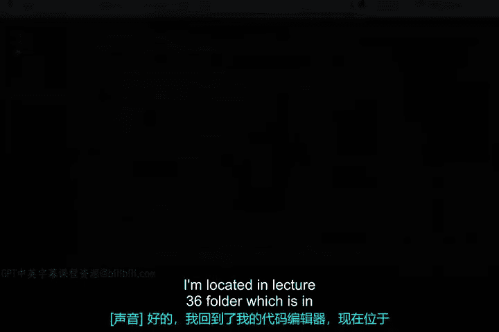

Okay I'm back in my code editor and I'm located in lecture 36 folder。

 which is in fulltag dash course 5 examples folder and the first thing we need to do is download the UI router JS file that I specified here that's supposed to be sitting in the Lib directory on it's actually is already sitting in the Lib directory because I downloaded already。

 but let me show you how to do this now the annoying part funny Google the annoying part about downloading UI router if you just type in download UI router。

😊。

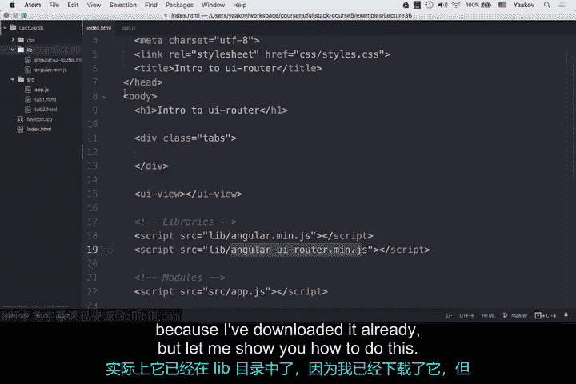

Is that all the links that will first come up。 In fact。

 if you click on any of these links will be all the wrong versions and the version that's keep constantly coming up is 0。

2。14。 Well， that's the wrong version that's not the latest the latest version that is stable。

 the latest version that is stable is actually 0。3。1。 So how do you get to it。 Well。

 instead of clicking in all these official UI router links which you should look for is a CDdn。

 a content delivery network。 So look for anything that says CDdn in it。 For example。

 here's the first one says the best the best false Cn for web related so on。 If you click on that。😊。

And you take a look。 the version that is going to be sitting here or at least one of the versions is 0。

3。1。 If you choose that version， and then in this case I could just have the min so that gives you a couple URLs1 is for the full version that's if you want to go and kind of read the code of the actual UI router and the second one is the min and the Minified version and that's the version we want so we could go ahead and copy this URL open up a new tab paste it there and this is the entire Minified version of the UI router make sure that if you see the version or make sure that you do see the version and the version is saying 0。

3。1 Now there's a newer version that is 1。0 that's using kind of more of an angular 2 approach even though it could still be used with Angular 1 but that one is still in beta or now for a beta at this point and it keeps updating with breaking changes so we don't want to go for the one that。

Its breaking it， it's not really stable， released。So the way you would get this file is just once you load in a browser。

 just right click it and click saveve as。And once you do that。

 you could go to whatever folder that you're in that you need to place it in in my case。

 it's lecture 36， the Lib folder。 I really already have it here so I don't need to click save again。

 but that's what you would do when you download it So I'll click cancel and go out of this again and let's go back to our code editor So this is a very simple app and it's called routing app that's the name of my module and the first thing we need to do is obviously reference the angular Ui that router that minajs and we already did that right here the second thing we need to do is place some sort of placeholder in our HTMLl where our views are going to be inserted into in this case it's Ui view right here and it's going to be inserted somewhere in the body here and I could see here that I' have a div here placeholder for something that has a class called tabs and basically what we're going do in this application and we're gonna have two tabs if you click on one tab it will show you the contents of one tab and。

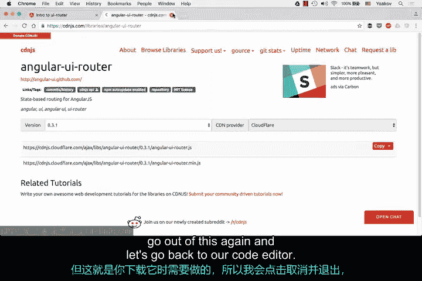

we click on another it will show you the contents of another tab so the next step is to go to our app dot Gs that's the one that declares our routing app and actually declare a dependency of our app of our module on another module called UI dot router notice the dot it's not a dash like the actual project name is and we need to configure our UI router or the UI router services and we're going to configure them in our config method with this function called routes config the routes configurefig is going to inject two things the state provider and the URL router provider as we discussed the providers are the ones that are going to be configuring the state service and the URL router service okay so so far we really have absolutely no code in here so if we save that and go back to our browser we close this tab and already have my browser sync running and really it's doing nothing more than just displaying our H1 tag at this point。

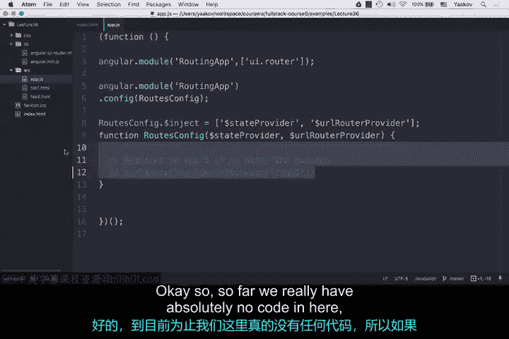

Take a look at the URL the URL is just regular whatever it is the host is slash index that H If we go back and the first thing we'll do is go ahead and uncommon this so URL router provider the otherwise method is going to say slash tab meaning that if you don't recognize anything that is matching your states and in this case we have no states and they have no states that are associated with URLs go ahead and try the slash tab1 if we go ahead and save that go back to our browser you could see that automatically forwarded us already to slash tab1 if I remove that delete it and try it again it automatically will jump right back to tab slash tab1 so that's working。

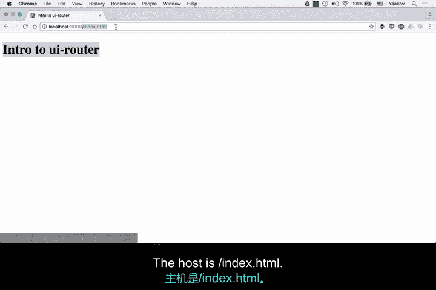

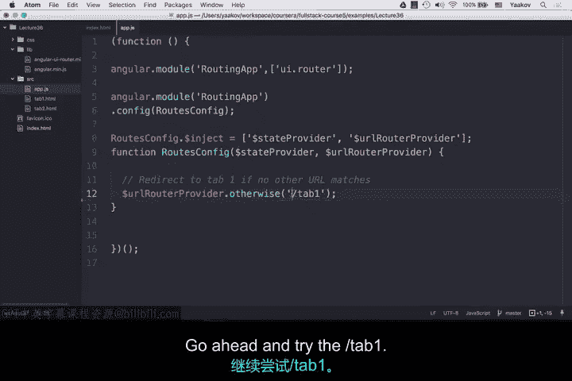

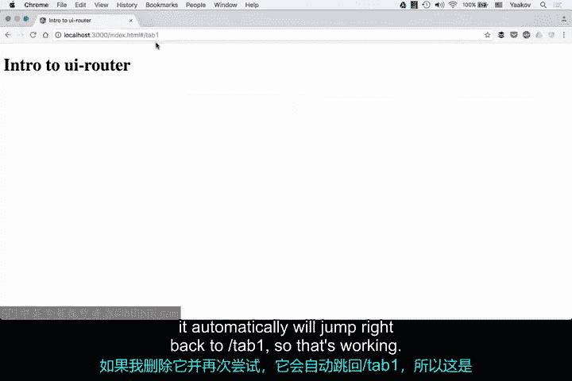

The next thing we need to do is to set up our states and the way we do that。

 let's say set up UI states。And the way we're going to do that is using the Do sign state provider and it's going to have we'll indent it a state and we'll start with the name we'll call the name tab1 and then we're going to have a configuration object that's going to represent that state and we're going to associate it with the URL slash tab1 and another parameter we'll provide is template template and its template is going to be super simple it's going to be just div and this is tabab1 content and that's pretty much it let's put a semicollon right here when we save that go back to our browser you can see that this is tab1 displayed because it automatically went to that state Well let's go back to the code editor and define one more state。

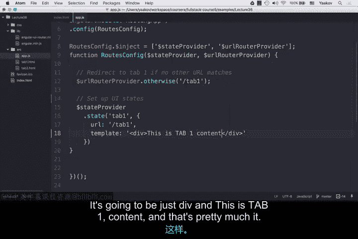

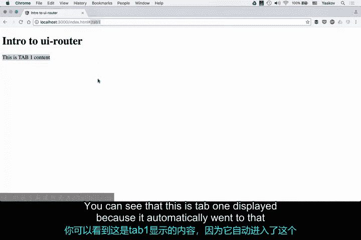

And we'll give it a little of space called state， and this time we'll define tabab 2 state again with a configuration of a URL of slash tabab 2。

And the template we're going to have is going to be another divb。

 but this time it's going to say this this is tab2 content。Let's save that。

 let's go back to our browser and now when we manually type in tabab2。

 you'll see that the content switched to Tab2 content if we inspect that。

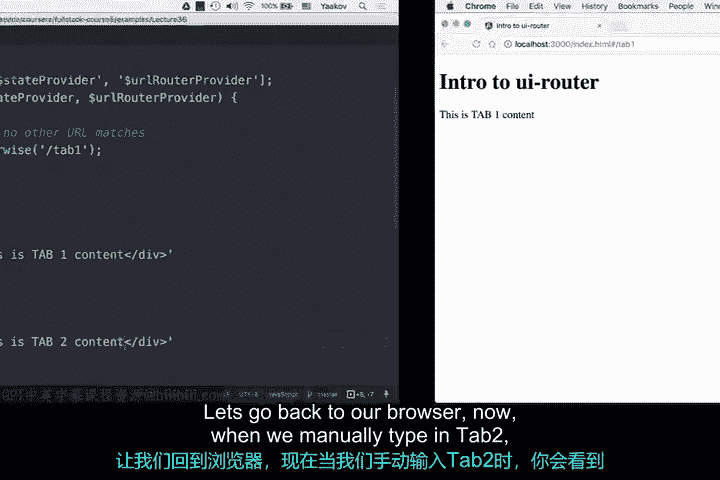

We'll see that UI view contains this div that says this is tabab 2 content and if we switch this back to tab1。

You'll see that the UI view is now going to contain this div with this is tab1 content。

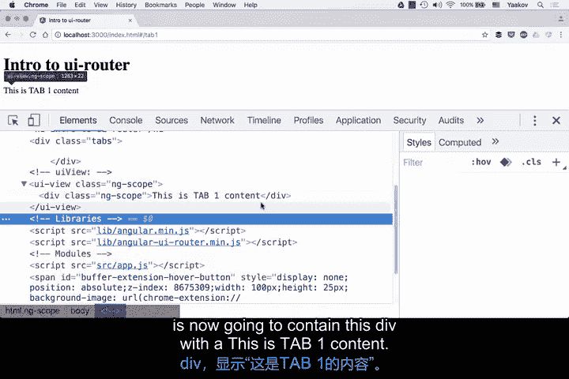

We can achieve the same thing by using the template URL property and in this case。

 specifying the URL to a tab1 HTML template which already contains these words So at this point we could just say source because it's sitting in the source directory tabab 1 HTML and the second one will say source tab 2 that HTML So if we save that go back to a browser we'll see the tab1 HTML is working and if we put tab 2 that HTML it's not working let's take a look as to why that's not working pretty simple。

 we forgot to say URL in the property so it's treating it as the actual content of the template instead of the URL So now that we save that it's go back to the browser so now it's actually saying tabab2 this is tabab 2 content。

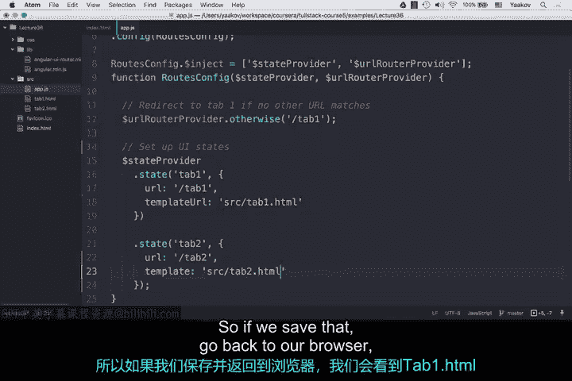

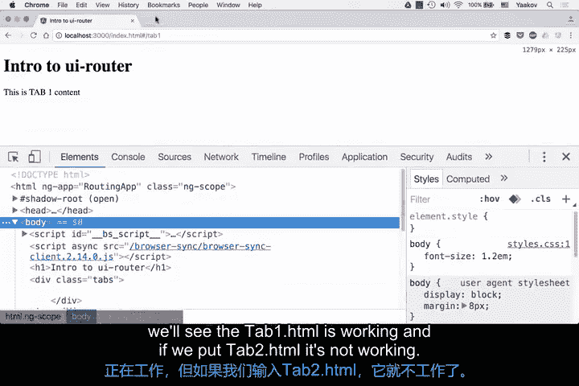

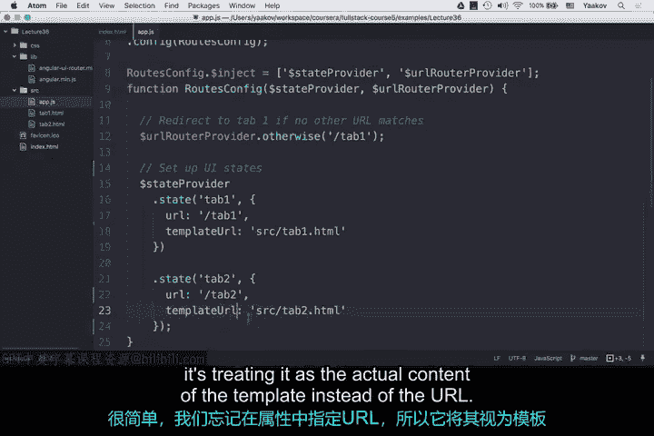

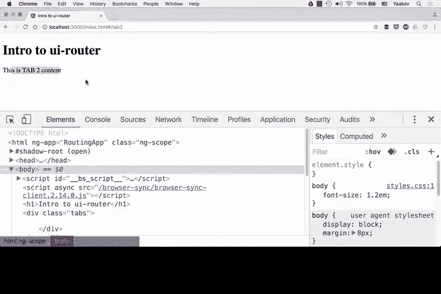

Now the URL router comes with a very convenient directive that lets us create links and actions in order to go from one state to another。

 If we go back to our index that HTML， we could provide those type of links right here we'll call an atag and instead of HR we say UIS ref and UIS rep stands for UI router state reference and we'll give it a state reference of we need the state tab1 and this tab1 is matching directly with the name of the state tab1 so it's looking for the name of the state in this particular attribute value and we'll go ahead and give it the name called tabab 1 and we'll do the same thing we'll copy it we'll do the same thing for tabab 2 since we have a state called tabab2 go ahead and say that let's go back to our browser and now you see we have a couple of links so if we click on tab 1 this is changing to tab1 click on tabab 2 it's changes to tabab 2。

😊。

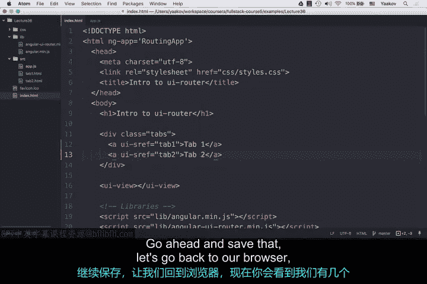

If you take a look as to what actually that UISRF directive did for us。

 we could take a look right here and see that what it's actually doing is it's creating the HRF for our anchor tag such as it's pointing to the right URL to invoke this type of behavior to changing from state to state however it does way more than that we can go ahead and emitm the actual URL that's associated with the state for example。

 the tabab 2 URL can be commented out and now our state is only referenced by its state name but this will still work。

 let's go back to our browser and even though the tab1 is looking like a link and tab2 is not well the reason it's not let's take a look is because it doesn't have an HRF attribute anymore as part of it and the reason it doesn't is because we remove the URL that is associated with the tabab2 state name however it is still clickable just like anything else and in fact。

😊。

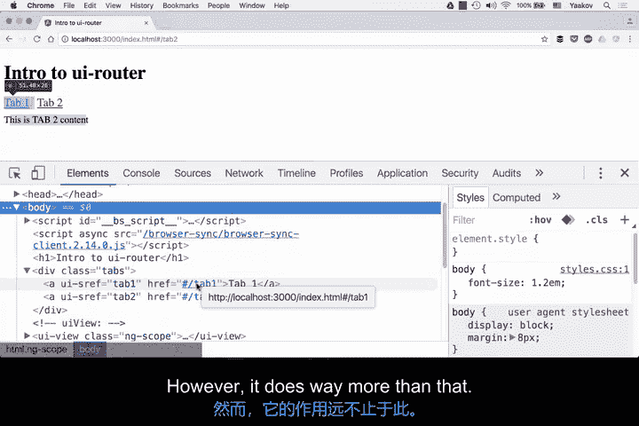

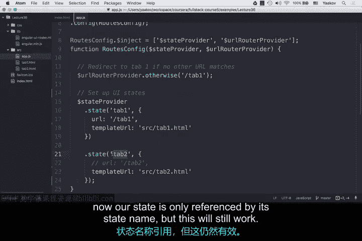

If I click it you'll see it will still change the tab2 and the reason it's clickable is because of this UIS ref directive that knows that when I click on this。

 I expect that my UI router should switch to the state with a name tabab2 that is specified in the UIS ref Obviously this looks a little bit ugly so we could go back to the code editor and instead of having a link right here。

 we could change it to， for example， a button and a button is certainly something that is clickable no matter what its Hf is which is not of a valid attribute name for it and we'll save it go back and now you see I have a button if I click the button the button now will invoke the state transition and will transition us to the state with the name tabab2 so you could see we're not bound to just the URL mapping we can also have simple state notice that we're sitting at Tab2 state but yet the URL is still saying tabab1 and the reason saying。

😊。

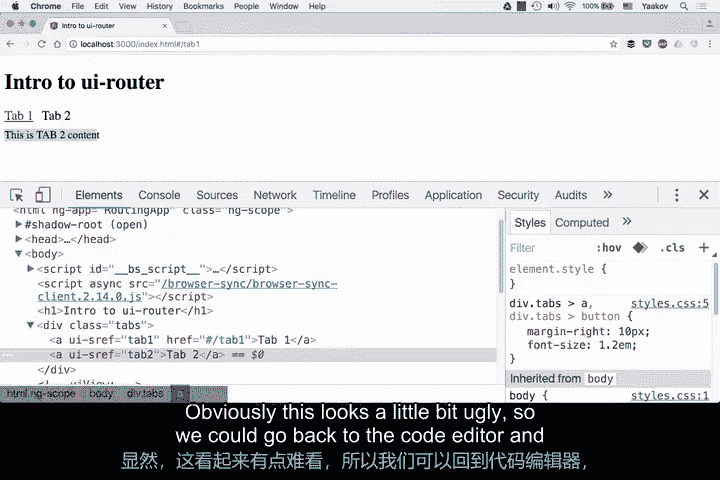

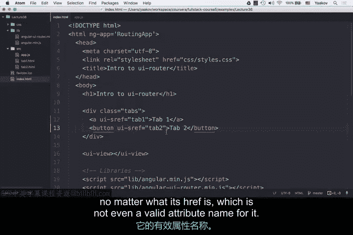

Tab1 is because that's the only URLl that got recorded。 So if we go ahead and press and refresh。

 you'll see that it's still going back to tab1， but tab2 really means absolutely nothing to it。

 This tabab2 is not mapped to anything。 so therefore it's going into the otherwise method and then jumping back to tabab1 however there is such a state called Tab2 So when I invoke it using my UIS ref directive。

 it will still switch our UI router to the state with the name tabab2 yet keep the URL exactly the same as before。

😊。

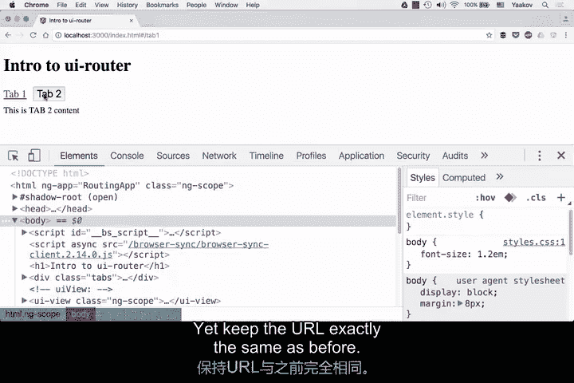

Let's go back to the code editor and actually we'll go ahead and comment this out and we'll place the anchor back to where it was。

 we'll just change this to T2。And let's learn about one more UI router directive。

 and that one is called。UI SRF。Active。And that directive lets us specify a class。

 a CSS class that should be applied to this particular tag when that particular state is active。

 so I want the class to be active tab。😊，And I'll do exactly the same thing。For the second one。

 so this will get activated or this active tab class will be attached to this a tagag when our state is tab 2。

 and in this case it will be attached to this atag when our state is tab1 Now I already premade this class called Act tabab and if you take a look at my CSS style。

 all is active tab doing is just bolding the text making a text bold so since weve defined our UI SRF active。

We just have to change the label here and we'll also have to go back to our Abt GS and actually reenable our URL so we could see the URL changing as well because we don't want to keep these two states without a URL they both should have a URL at least in our case and now we could go back to our browser and you could see that tab1 is bolded and the reason it's bold is because we are at that state if we click tabab2 tabab2 becomes bolded and tab1 is no longer bolded because the active state or the active tab class got removed from it。

 we could actually take a look at it right here and we'll take a look right here and you could see that class active tab got placed under the class attribute got placed on the USf tab 2 if we click tab1 it will get placed on the USR tab 1 because that is the active state at the moment。

😊。

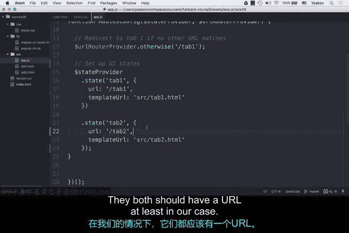

Okay， so let's summarize UI router uses independent concepts for URL mapping and UI state representation and therefore you could really think of those two things as two subsystems that exist inside the UI router package Now the way you configure UI router in Angular。

config is first by providing an alternate URL mapping with the URL router provider service with the method otherwise providing some other URL that's in case the URL is garbled or the user typed in the wrong URL this rule will kick in and go ahead and forward the browser to the correct URL that actually does exist within your system。

The second way is you configure states with optional URLs but usually you do use them。

 but sometimes they're optional using the state provider。

 state method and you provide the name of the state and a configuration object that has a whole bunch of properties。

 some of the ones that we've used so far is the URL property that maps the state or particular URL and a template URL which maps a particular URL of the actual template that contains some HTML to that particular state so when the state is activated。

 the contents of that template are inserted inside of the UI view tag and you use the UI view tag as a placeholder for your statebased user interface portions。

😊。

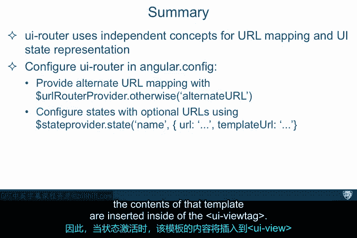

Now you can also use a special directive called UIS Re which stands for UI state reference as opposed to just an H hyperlink reference。

 and that is an attribute that you could place on an A tag or really any other tag and it constructs links for you and actions to configured states so such that you could for example place that on a button and when you click on a button。

 whatever state that you specified in your UISR attribute。

 that state will be activated when you click on a button or you click on a particular link if you're specifieding this attribute on an anchor tag and your state actually defines a URL that's associated with it。

 the UIS Re directive will create the HRF attribute on that tag for you so when you click it。

 it will go ahead and update the browser address bar。😊。

