# 使用 AngularJS 开发单页 Web 应用：P76：第36讲（第2部分）：路由 🧭


在本节课中，我们将学习如何使用 AngularJS 的 UI-Router 库来配置路由和状态管理，从而构建一个具有多个视图的单页应用。

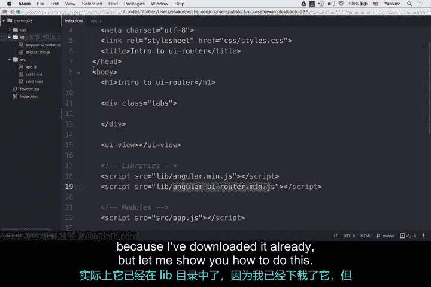

---

## 下载 UI-Router 库

首先，我们需要下载 UI-Router 库文件。正确的稳定版本是 `0.3.1`，而不是搜索结果中常见的 `0.2.14`。

以下是下载步骤：
1.  在浏览器中搜索 `UI-Router CDN`。
2.  找到一个提供 `0.3.1` 版本文件的 CDN 链接。
3.  复制该文件的 URL，在浏览器中打开。
4.  右键点击页面，选择“另存为”，将文件保存到项目的 `lib` 目录中。

在我们的示例中，文件已保存在 `lecture36/lib` 目录下。

---

## 配置基础应用

上一节我们准备好了库文件，本节中我们来看看如何配置一个基础的单页应用。

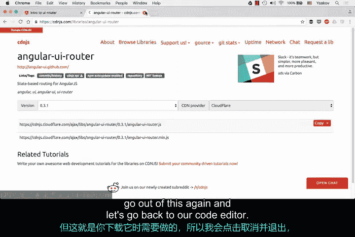

首先，在 HTML 文件中引用 AngularJS 和 UI-Router 库，并设置一个视图占位符。

```html
<!-- 引用必要的库 -->
<script src="lib/angular.min.js"></script>
<script src="lib/angular-ui-router.min.js"></script>

<!-- 视图占位符 -->
<div ui-view></div>
```

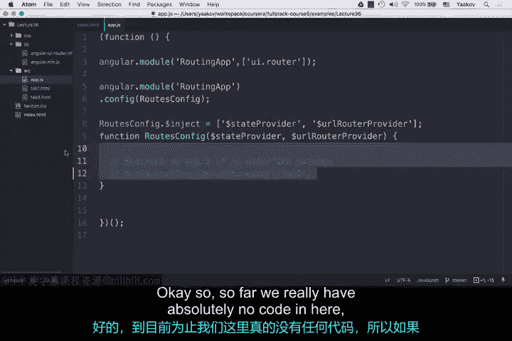

接着，在 JavaScript 文件中定义 AngularJS 模块，并注入 `ui.router` 依赖。

```javascript
// app.js
angular.module('routingApp', ['ui.router'])
```

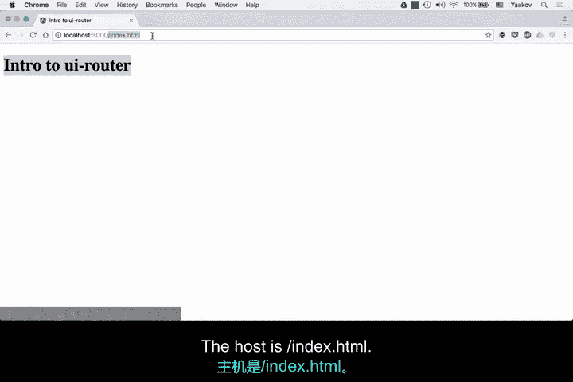

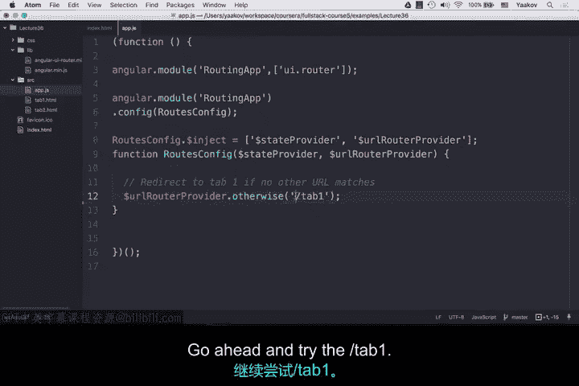

---

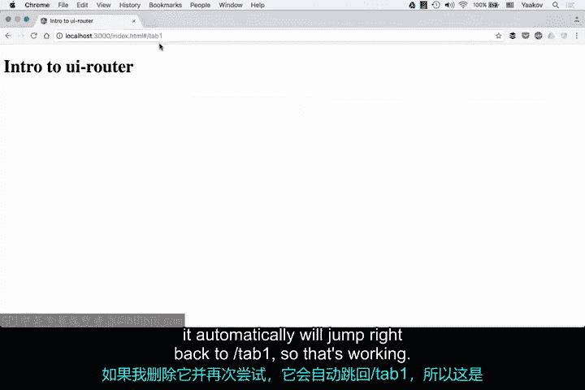

## 配置路由规则

现在，我们需要在应用的配置阶段设置路由规则。这需要使用 `$stateProvider` 和 `$urlRouterProvider` 服务。

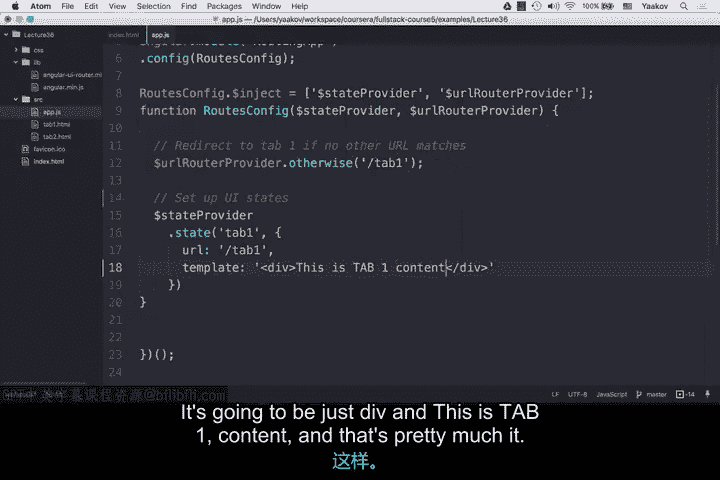

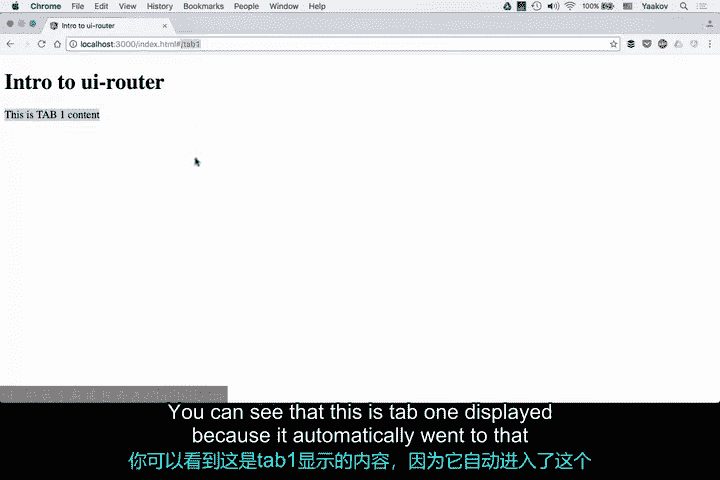

```javascript
.config(function($stateProvider, $urlRouterProvider) {
  // 配置默认路由
  $urlRouterProvider.otherwise('/tab1');
})
```

`$urlRouterProvider.otherwise()` 方法用于定义当没有匹配到任何已定义状态时的默认跳转路径。

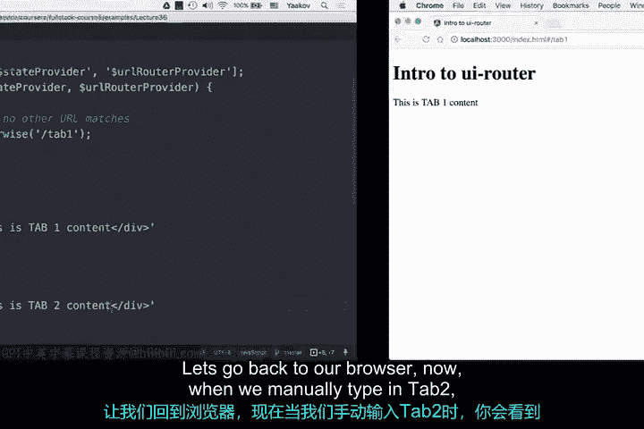

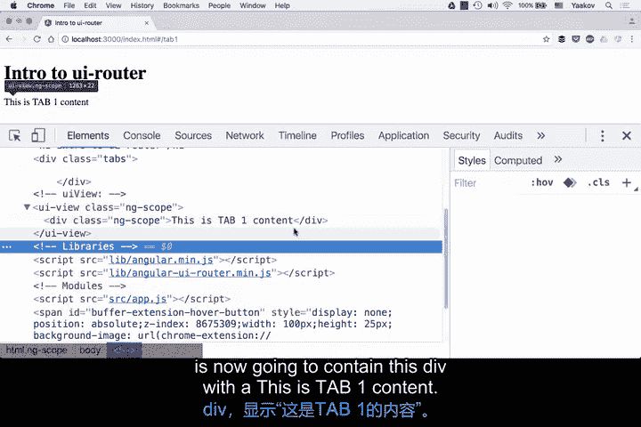

---

## 定义应用状态

接下来，我们使用 `$stateProvider` 来定义应用的不同状态。每个状态可以关联一个 URL 和一个模板。

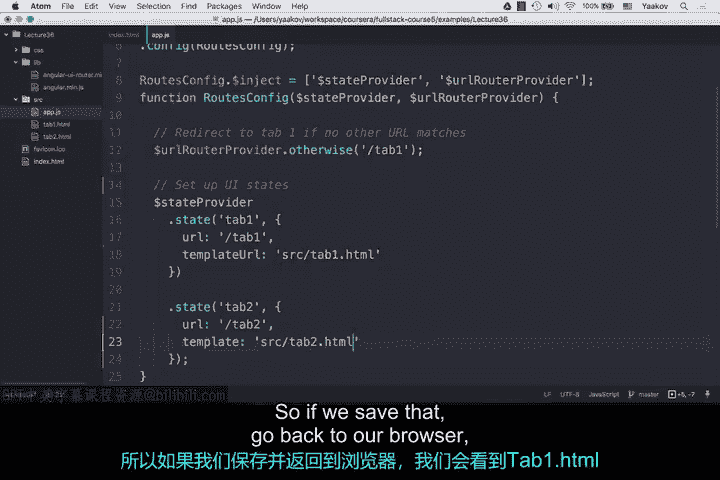

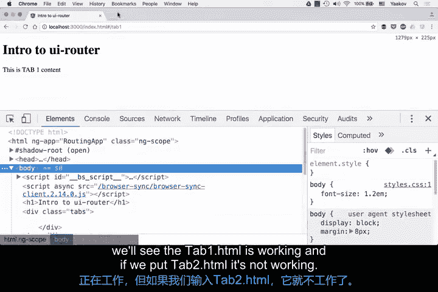

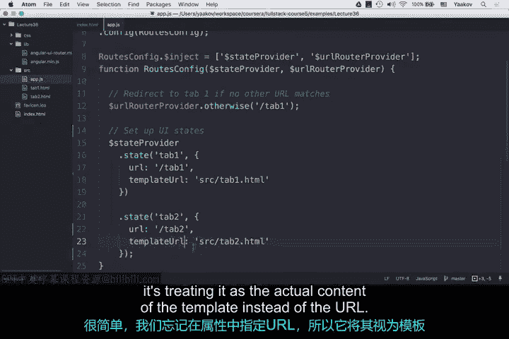

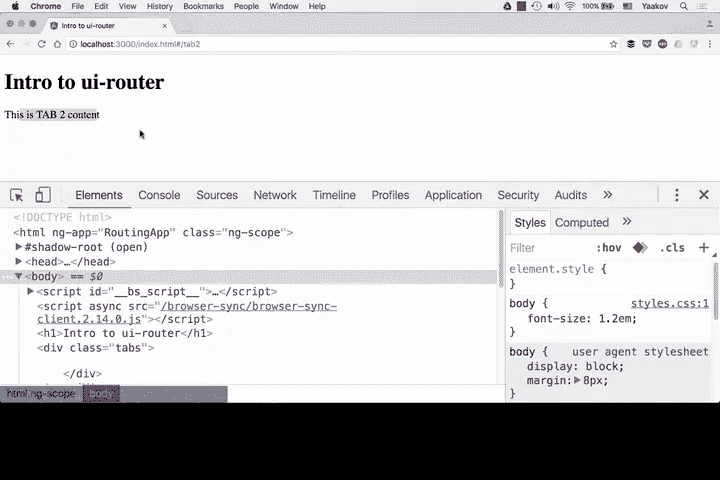

以下是定义两个标签页状态的示例：

```javascript
$stateProvider
  .state('tab1', {
    url: '/tab1',
    template: '<div>这是标签1的内容</div>'
  })
  .state('tab2', {
    url: '/tab2',
    templateUrl: 'src/tab2.html'
  });
```

*   **`state(name, config)`**：定义一个状态。`name` 是状态名，`config` 是配置对象。
*   **`url`**：该状态对应的浏览器地址栏 URL。
*   **`template`** 或 **`templateUrl`**：该状态激活时要插入到 `ui-view` 中的 HTML 内容。`template` 直接写字符串，`templateUrl` 指向一个外部 HTML 文件。

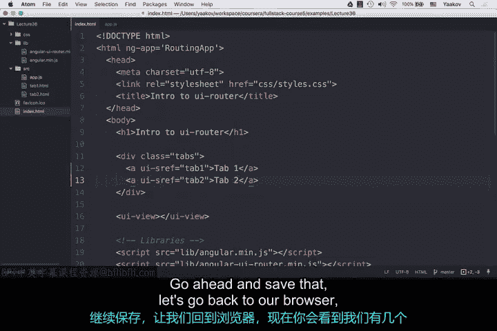

---

## 创建状态导航链接

为了在状态间导航，UI-Router 提供了 `ui-sref` 指令。它可以替代传统的 `<a href="...">` 链接。

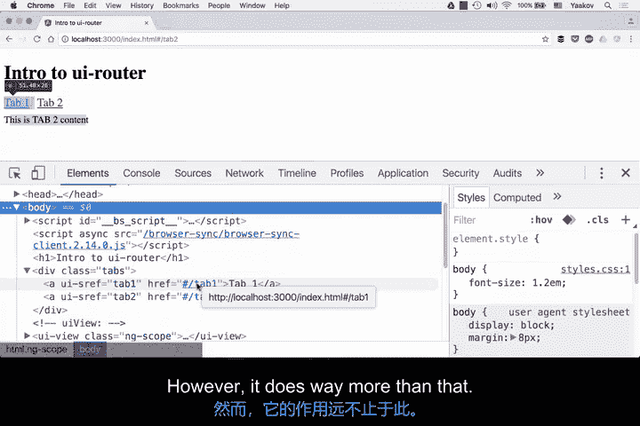

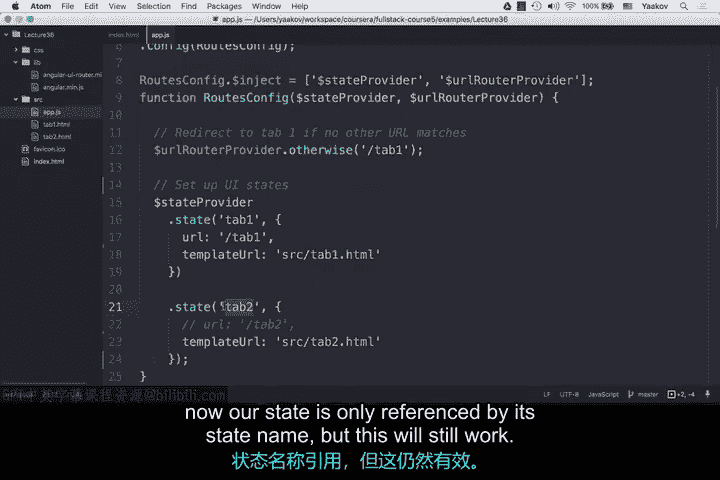

在 HTML 中，我们可以这样创建导航：

```html
<!-- 使用 ui-sref 指令链接到状态 -->
<a ui-sref="tab1">标签 1</a>
<a ui-sref="tab2">标签 2</a>
```

`ui-sref` 的值是目标状态的名称。当状态定义了 URL 时，该指令会自动为元素生成正确的 `href` 属性。

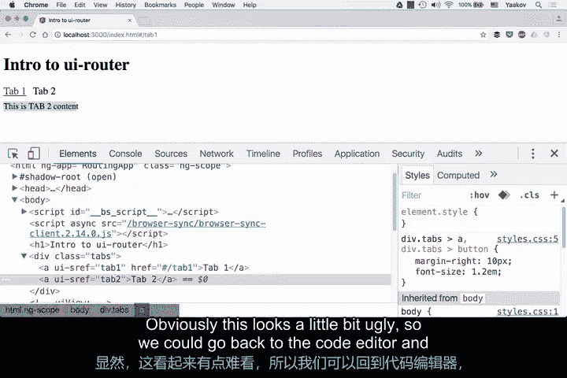

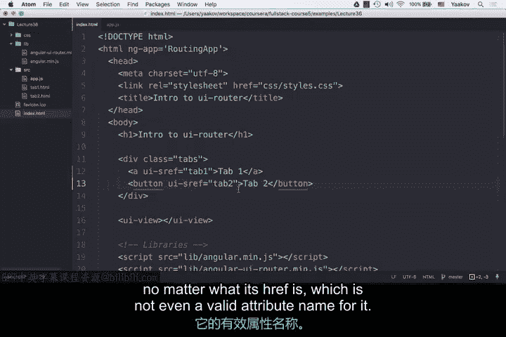

---

## 高级功能：无 URL 状态与样式激活

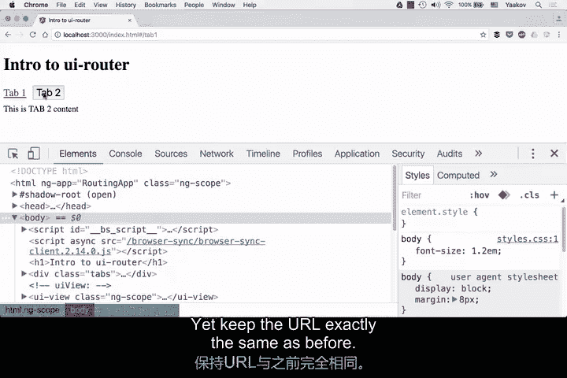

UI-Router 的强大之处在于，状态可以独立于 URL 存在。

例如，我们可以定义一个没有 `url` 属性的状态：

```javascript
.state('tab2', {
  // 没有 url 属性
  templateUrl: 'src/tab2.html'
})
```

即使没有 URL，通过 `ui-sref="tab2"` 点击按钮或链接，应用依然可以切换到该状态，只是浏览器地址栏不会变化。

此外，我们可以使用 `ui-sref-active` 指令，为当前激活状态对应的导航元素自动添加 CSS 类，实现高亮效果。

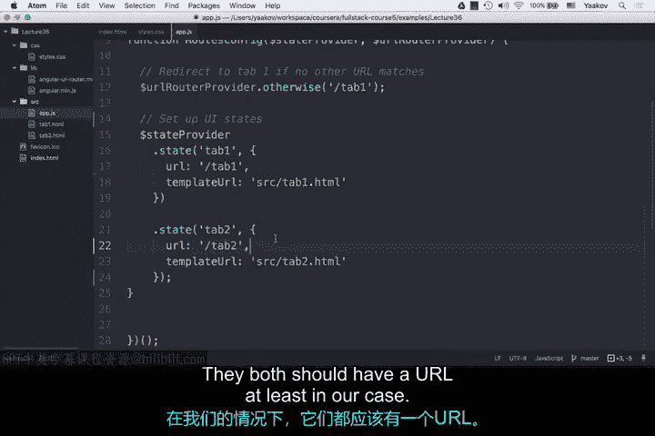

```html
<a ui-sref="tab1" ui-sref-active="active-tab">标签 1</a>
<a ui-sref="tab2" ui-sref-active="active-tab">标签 2</a>
```

当状态 `tab1` 激活时，第一个 `<a>` 标签会获得 `active-tab` 类，方便我们设置样式（如加粗文字）。

---

## 核心概念总结

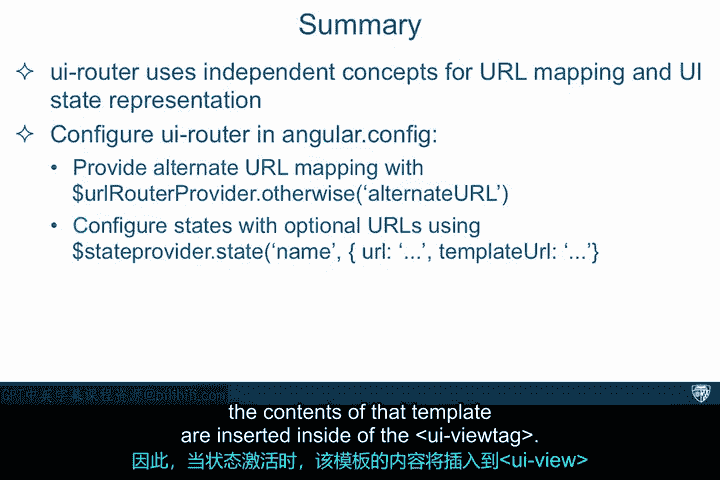

本节课中我们一起学习了 UI-Router 的核心用法：

1.  **两个子系统**：UI-Router 将 **URL 映射** 和 **UI 状态管理** 作为两个独立的子系统。
2.  **配置默认路由**：使用 `$urlRouterProvider.otherwise(‘/path’)` 处理未匹配的 URL。
3.  **定义状态**：使用 `$stateProvider.state()` 方法定义应用状态，可配置 `url`、`template` 或 `templateUrl`。
4.  **视图占位符**：在 HTML 中使用 `<div ui-view></div>` 作为状态模板的插入点。
5.  **状态导航**：使用 `ui-sref="stateName"` 指令创建指向特定状态的链接或按钮。
6.  **激活状态样式**：使用 `ui-sref-active="className"` 指令为激活状态的导航元素自动添加样式类。

通过以上步骤，我们就能构建一个通过状态驱动视图切换、功能清晰的单页 Web 应用。