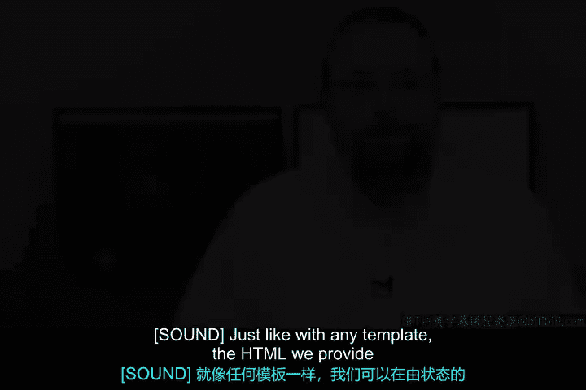
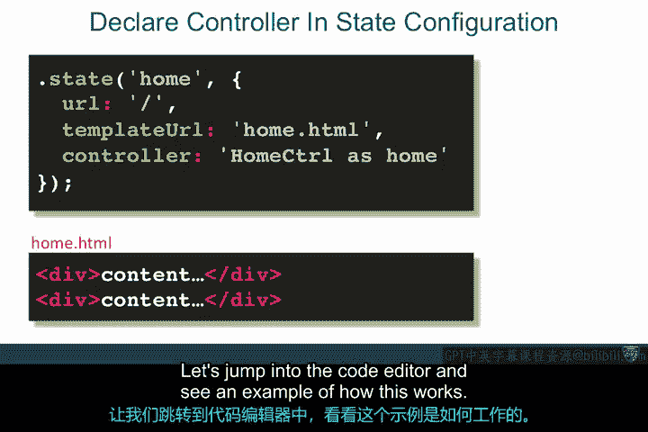

# 约翰霍普金斯大学《使用 AngularJS 开发单页 Web 应用｜Single Page Web Applications with AngularJS》中英 - P77：76_第37讲（第1部分）：带控制器的路由状态.zh_en - GPT中英字幕课程资源 - BV1dsFDeZEQr

🎼。

Just like with any template， the HTML we provide in the file pointed to by the state's templatelate URL property。

 we can declare a controller as responsible for the view model or the behavior associated with that HTML。

Suppose we have a state defined with a template URL pointing to an HTML template home that HTML The home HTML template will then declare a controller using our controller as syntax home controller as home。

 This setup is inefficient and perhaps not as elegant as it can be。

 You can see that the only reason we have the wrapper div tag is to declare the controller。

 It doesn't seem to have any other value。 Ui router allows us to pull out this declaration and define our controller directly on the state definition。

😊，You could see that now we declare in the controller using controller as syntax directly as part of the state definition。

 since we're not using a function value for the controller in this example。

 you can assume that we actually declared the home CTRL controller using the Angular controller method。

 we also have the option to specify the function value instead of the controller's string name if we have access to that function value at this point。

 the controller as syntax can still be achieved using the controller as property that's also available to be declared as part of the state definition。

😊，Note that our home that HTML became slimmer， while not that common。

 we can even potentially reuse this home that HTML template with a different controller somewhere else。

 and that's due to the fact that we pulled out the controller declaration from the actual template。

 so this is definitely a much more elegant solution。

 let's jump into the code editor and see an example of how this works。

