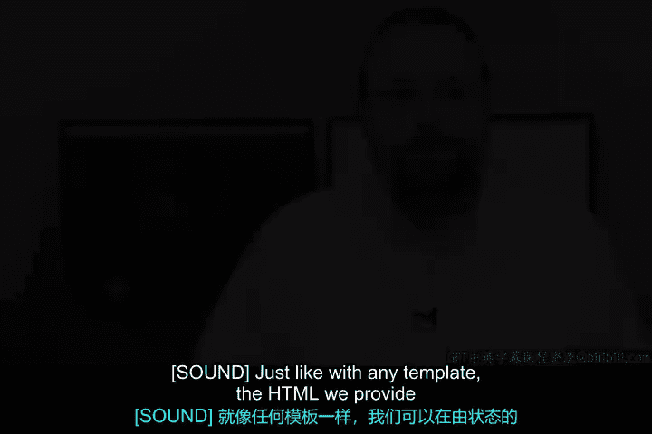
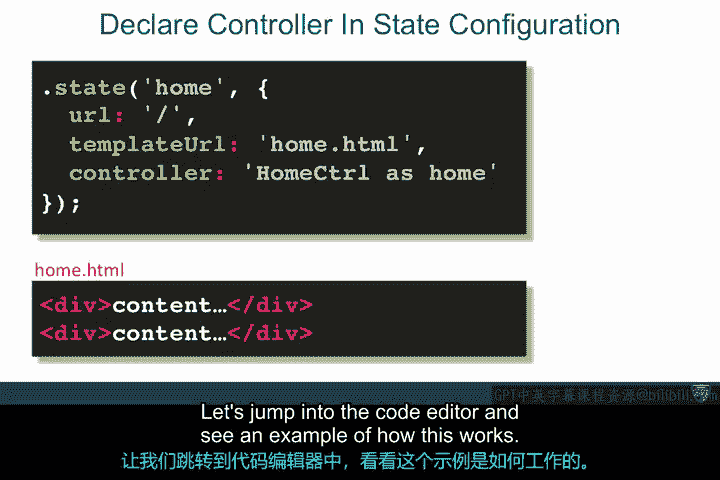

# 使用 AngularJS 开发单页 Web 应用：P77：带控制器的路由状态


在本节课中，我们将学习如何在 AngularJS 的 UI-Router 中，将控制器直接定义在路由状态上，而不是在 HTML 模板中声明。这种方法可以使代码结构更清晰、更优雅，并提高模板的可重用性。



## 模板中的控制器声明

与任何模板一样，我们可以通过状态定义中 `templateUrl` 属性指向的 HTML 文件来提供视图。在这个 HTML 模板中，我们可以声明一个控制器，负责管理该视图的视图模型或行为。

假设我们定义了一个状态，其 `templateUrl` 指向一个名为 `home.html` 的 HTML 模板。这个 `home.html` 模板通常会使用 `controller as` 语法来声明控制器，例如 `ng-controller="HomeCtrl as home"`。

以下是一个典型的模板内控制器声明示例：

```html
<div ng-controller="HomeCtrl as home">
    <!-- 模板内容 -->
</div>
```

## 状态定义中的控制器声明

上一节我们介绍了在模板中声明控制器的方法，但这种方法效率不高，也不够优雅。你可以看到，包装 `div` 标签的唯一目的就是声明控制器，它似乎没有其他价值。

UI-Router 允许我们将控制器声明从模板中提取出来，直接在状态定义中进行定义。这是一种更优的解决方案。

以下是如何在状态定义中直接声明控制器：

```javascript
$stateProvider.state('home', {
    templateUrl: 'home.html',
    controller: 'HomeCtrl',
    controllerAs: 'home'
});
```

现在，我们使用 `controller as` 语法，将控制器的声明直接作为状态定义的一部分。由于本例中没有为控制器使用函数值，你可以假设我们已经使用 Angular 的 `.controller` 方法声明了名为 `HomeCtrl` 的控制器。

如果我们在此处能访问到控制器的函数值，也可以选择指定该函数值，而不是控制器的字符串名称。同时，仍然可以通过状态定义中的 `controllerAs` 属性来实现 `controller as` 语法。

## 代码示例与优势

请注意，我们的 `home.html` 模板因此变得更简洁。虽然这种情况不常见，但我们甚至有可能在其他地方，为这个 `home.html` 模板搭配一个不同的控制器来重复使用它。这正是因为我们将控制器声明从实际模板中提取了出来。

所以，这无疑是一个更加优雅的解决方案。让我们通过一个简单的代码示例来看看这是如何工作的。

以下是状态定义的代码：

```javascript
angular.module('myApp')
.config(function($stateProvider) {
    $stateProvider.state('home', {
        url: '/',
        templateUrl: 'views/home.html',
        controller: 'HomeController',
        controllerAs: 'vm'
    });
})
.controller('HomeController', function() {
    var vm = this;
    vm.message = '欢迎来到首页！';
});
```

对应的 `home.html` 模板现在非常简洁：

```html
<h1>{{vm.message}}</h1>
<p>这是主页内容。</p>
```



## 总结


本节课中，我们一起学习了在 AngularJS 的 UI-Router 中管理控制器的两种方式。我们首先回顾了在 HTML 模板内部声明控制器的传统方法，然后重点介绍了将控制器直接定义在路由状态上的更优方案。这种方法通过 `controller` 和 `controllerAs` 属性实现，使得模板更简洁、控制器逻辑与视图分离更彻底，从而提升了代码的可维护性和模板的可重用性。