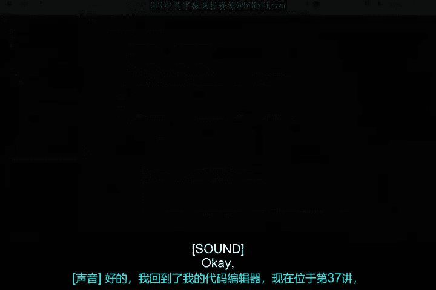
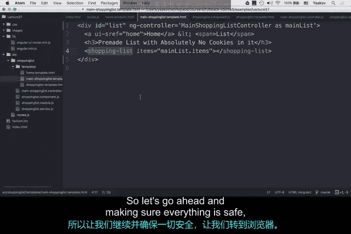
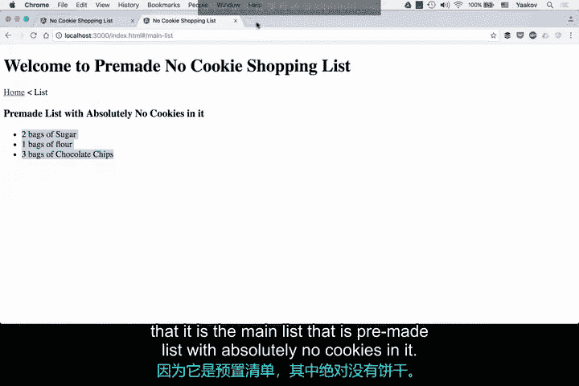
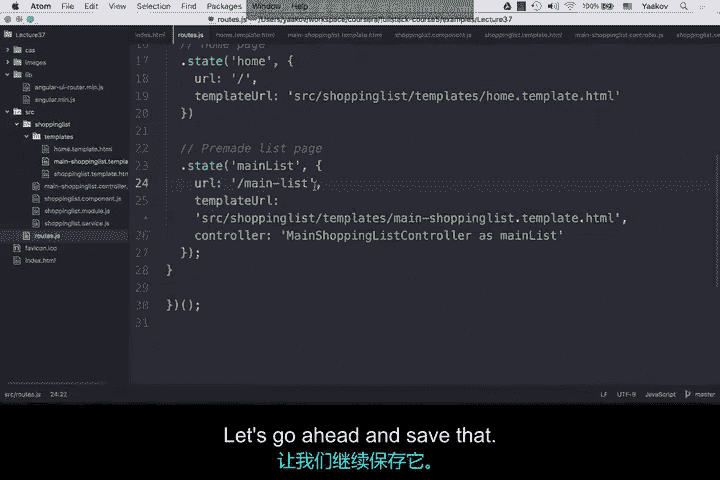
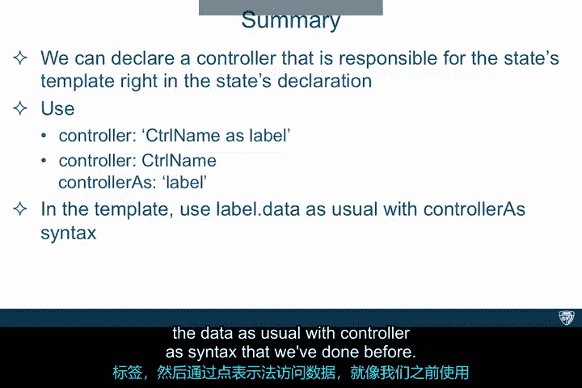

# 约翰霍普金斯大学《使用 AngularJS 开发单页 Web 应用｜Single Page Web Applications with AngularJS》中英 - P78：77_第37讲（第2部分）：带控制器的路由状态.zh_en - GPT中英字幕课程资源 - BV1dsFDeZEQr

🎼。

Okay I'm back in my code editor and I'm located in lecture 37。

 which is located in fulltag coursese 5 examples folder and this is a different version of our shopping list module。

 this version we're going to use some of the UI router features that we've learned about you could see that index that HTML that we're looking at right now doesn't really have much in terms of content it just has welcome to prem no cookie shopping list and then it has bunch of scripts。

 Angular Js Angular UI router， our shopping list module。

 which is the main module of the entire application。

 our routes which is going to contain our state and URL routing and also some shopping list component main shopping list controller and the shopping list service right here this application is fairly simple it just has one screen the home screen and that home screen contains a link to a main shopping list and that main shopping list is this premade no cookie shopping list other way。

😊，We are premaking a shopping list for our users and it's already containing no cookies whatsoever so our users wouldn't even be tempted to get one。

 Let's go ahead and take a look at the routes js as you can see it's using regular the module config and this routes config sets up a couple of states first of all it reroutes anything that doesn't match a particular URL in any of the declared states to just a s and the slash is actually the home state or the home page so the first date we're defining is the home and it is going to be accessible through just a slash and its template URL is sitting right here source shoppinglist templates homet h and we' can actually take a look at that it's a very short template all it has is one link tag and says CRprem noc list shopping list and it's using UIS ref so the state reference to main list。

Main list better be a state that we defined inside ro。gs and in fact it is right here。

 this is the premade list and it's called the main list and it's accessible through a URL slash main list and its template URL is pointing right here to main shopping list template htm and that is it right there As you can see it consists of this wrappper div tag which declares our controller main shopping list controller and gives it a label of main list let's dive a little bit deeper into what this is doing because we're going to be reusing this code in unless you lecture as we learn a little bit more about the UI router So besides declaring a link that lets us get back to the home screen again with the UIS ref home because home is a state it uses this shopping list component and this is the shopping list component right here that I'm pointing to and it's using the shopping list component to basically output our list。

Let's go ahead and take a look at the shopping list component， I believe it's right here somewhere。

 shopping list component and the shopping list component just passes along the items。

 which is the list of our shopping items and it is pointing us to the shopping list that template that HTML So if we go to the shopping list that template at H we see that we're just going to loop over the item quantity and item name to output our list Now if we look at the main shopping list controller which is what's outputting this whole list to begin with you see that we've injected shopping list service into it and we're using the shopping list service in order to initialize this main list that items you'll notice that we're using a promise the get items is clearly returning a promise since we're using the then method and only when the promise returns are we setting the main list that items to the result that it's returning In other words。

 if we look at the shopping list service it is done on purpose such that its delaying the answer and not return。

😊，Turning the actual items right away， but returning it 800 milliseconds later。

 So a little bit of a delay。 you could see also that we predefined a whole bunch of items here。

 You could see that we're creating an items and items now have a description to them。

 and there's the sugar item。 There's the flower item。 There's the chocolate chips items。

 So there's three items in our shopping list。 And the reason we're using a promise is because we're basically simulating a call to the servers。

 I suppose this something was sitting in a database and we're pulling out this solicit of a database。

 we need to make a server call。 So that's what basically we're doing with simulating the server call That server call comes back to our shopping list controller right here and the main list。

 that items get set which then goes to our main shopping list controller or main shopping list template and is able to then pass the main list that items into the shopping list component that goes ahead and outputs the shopping list。

😊，So let's go ahead and making sure everything is saved。

 Let's go to our browser and we could see that our welcome screen is just starting with pound sign s。

 which is our home home state and we could click on this CR premate cookie shopping list and it's a little bit of a delay as you could notice before it outputs the entire list and you could see here we're at slash main list and obviously since this state has a URL map to it we could go ahead and copy this URL open up on a different tab or really a different browser and we'll still get exactly the same UI state as this URL is indicating being that it is the main list that is premade list with absolutely no cookies in it let's close this and let's go back to our code editor and let's go ahead and pull out this whole div because as we said it's a little bit superfluous in fact which is going go ahead and copy this item which is the of our controller which we're going to reuse So let's go ahead and actually comment out this item。

😊。

And comment out the last div So this is just going to be just this as part of the template let's save that let's go back to the routes and instead of just declaring the template we're going to declare one more thing this is already common there we'll say controller and we'll paste that in here so now our controller is declared on the main list state that is associated with this particular template let's go ahead and save that let's go back to our browser and you can see it's already working here but if we click back and we'll click again and there it is it's showing up and everything is working as it should。

😊。

Okay， so let's summarize we can declare controller that is responsible for the state's template right in the state declaration。

 not just in the template itself， in the state declaration。

 we can use a syntax of controller as the property of the state declaration with a string of controller as syntax in this case。

 for example， CTRL name as some label and the whole thing would be a string。

 or we could use controller and reference the controller function value and also use controller as property and give it a string label that we could later use to refer to the controller in the template。

😊，In the template itself， we could use the label that we declared in the controller as syntax and then access with the dot notation。

 the data as usual with controller as syntax that we've done before。😊。

