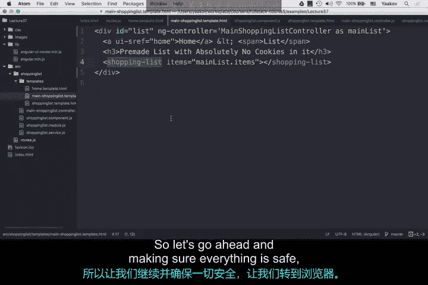
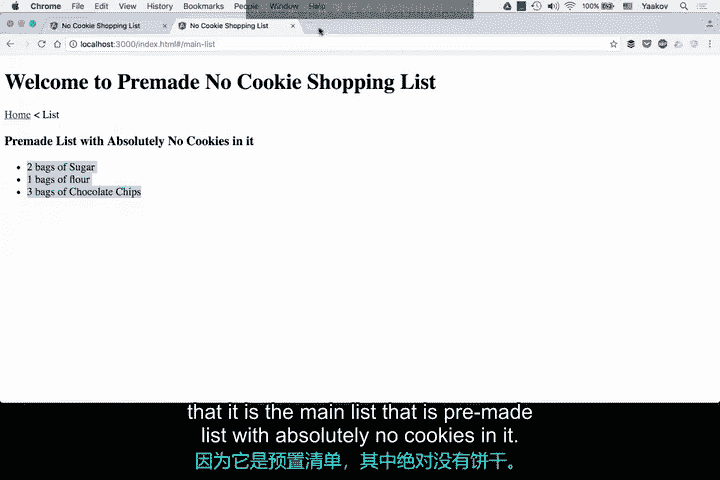
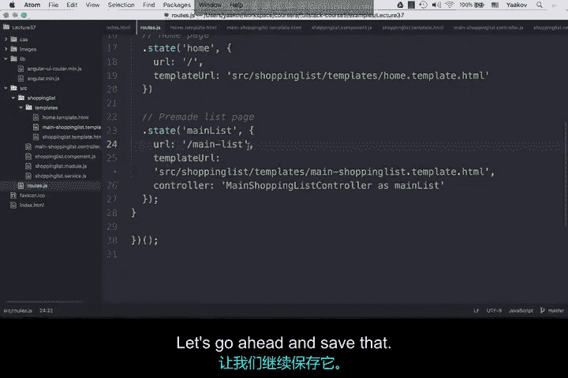
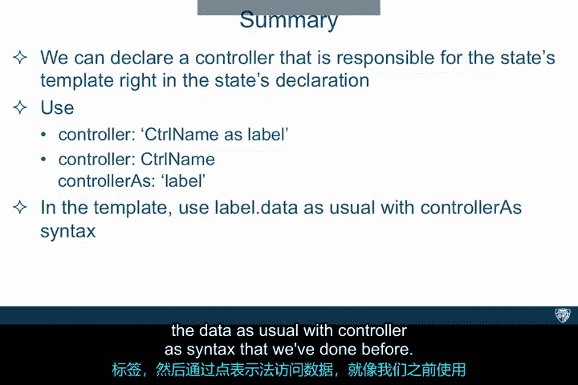

# 使用 AngularJS 开发单页 Web 应用：P78：带控制器的路由状态


## 概述
在本节课中，我们将学习如何在 AngularJS 的 UI Router 中，为路由状态（state）直接关联一个控制器。我们将通过一个购物清单应用的例子，演示如何将控制器从模板中移动到状态配置中，并理解其工作原理。

---

## 项目结构与初始状态
我们位于课程第37讲的示例文件夹中。这是一个购物清单应用的不同版本，旨在利用我们已学过的 UI Router 功能。

当前 `index.html` 文件内容非常简单。它包含欢迎信息“Welcome to prem no cookie shopping list”以及一系列脚本引用。这些脚本包括：
*   AngularJS
*   Angular UI Router
*   主应用模块 `shoppinglist.module`
*   路由配置文件 `routes.js`
*   购物清单组件 `shoppinglist.component`
*   主控制器 `main-shoppinglist.controller`
*   服务 `shoppinglist.service`

这个应用目前只有一个主屏幕（home screen），其中包含一个指向“预置无饼干购物清单”的链接。

---

## 分析路由配置
让我们查看 `routes.js` 文件。它使用 `module.config` 来设置应用状态。

首先，它将任何未匹配的 URL 重定向到根路径 `/`，该路径对应 `home` 状态。

以下是定义的两个状态：

**1. Home 状态**
*   **URL**: `/`
*   **模板**: `src/shoppinglist/templates/home.tmpl.html`
该模板仅包含一个使用 `ui-sref` 指令指向 `mainList` 状态的链接。

**2. MainList 状态**
*   **名称**: `mainList`
*   **URL**: `/mainList`
*   **模板**: `src/shoppinglist/templates/main-shoppinglist.tmpl.html`

初始的 `main-shoppinglist.tmpl.html` 模板内容如下：
```html
<div ng-controller="MainShoppingListController as mainList">
  <!-- 返回首页的链接 -->
  <a ui-sref="home">Home</a>
  <!-- 使用购物清单组件 -->
  <shopping-list items="mainList.items"></shopping-list>
</div>
```
该模板使用 `ng-controller` 指令关联了 `MainShoppingListController` 控制器，并为其指定了别名 `mainList`。然后，它将控制器中的 `mainList.items` 数据传递给 `shopping-list` 组件进行渲染。

---

## 理解数据流与异步操作
`MainShoppingListController` 控制器注入了 `ShoppingListService` 服务。它调用服务的 `getItems()` 方法来获取购物清单数据。

关键点在于，`getItems()` 方法返回一个 **Promise** 对象，用于模拟从服务器异步获取数据的过程。在服务中，我们故意设置了800毫秒的延迟来模拟网络请求。
```javascript
// 在 MainShoppingListController 中
ShoppingListService.getItems().then(function (result) {
  mainList.items = result;
});
```
只有当 Promise 被成功解析（resolve）后，返回的数据才会被赋值给 `mainList.items`。随后，数据通过组件传递并最终渲染到页面上。

在浏览器中测试应用，可以看到从首页点击链接进入 `/mainList` 页面时，清单数据会稍有延迟才显示出来，这模拟了真实的异步数据加载场景。

---

## 重构：将控制器移至状态配置
之前，控制器是在模板中通过 `ng-controller` 声明的。UI Router 允许我们将控制器定义在**状态配置**中，使关注点分离更清晰。

以下是重构步骤：

1.  **修改模板**：从 `main-shoppinglist.tmpl.html` 模板中移除 `ng-controller` 指令及其外层的 `<div>` 标签。模板变得非常简洁，只包含返回链接和组件标签。
    ```html
    <!-- 修改后的 main-shoppinglist.tmpl.html -->
    <a ui-sref="home">Home</a>
    <shopping-list items="mainList.items"></shopping-list>
    ```
    注意，组件仍然期望 `mainList.items` 数据，但 `mainList` 这个控制器实例现在将由状态配置提供。

2.  **修改状态配置**：在 `routes.js` 文件的 `mainList` 状态定义中，添加 `controller` 和 `controllerAs` 属性。
    ```javascript
    .state('mainList', {
      url: '/mainList',
      templateUrl: 'src/shoppinglist/templates/main-shoppinglist.tmpl.html',
      controller: 'MainShoppingListController', // 指定控制器函数
      controllerAs: 'mainList' // 为控制器实例指定别名
    })
    ```

经过以上修改，应用功能保持不变。控制器的职责从模板转移到了路由状态配置中，`mainList` 这个别名在模板中依然可用。





---

## 核心语法总结
本节课我们一起学习了在 UI Router 状态中声明控制器的两种主要方式。

**方式一：使用字符串语法**
在状态配置中，可以直接使用字符串形式的 `controller as` 语法。
```javascript
controller: 'MainShoppingListController as mainList'
```



**方式二：使用属性分离语法**
更清晰的方式是分别指定 `controller` 和 `controllerAs` 属性。
```javascript
controller: 'MainShoppingListController', // 控制器函数名
controllerAs: 'mainList' // 模板中使用的实例别名
```

在模板中，你可以通过 `controllerAs` 指定的别名（例如 `mainList`）来访问控制器中的数据和方法，例如 `mainList.items`。

---




## 总结
本节课中，我们一起学习了如何将控制器与 UI Router 的状态进行绑定。关键要点包括：
1.  控制器可以从 HTML 模板中移出，直接定义在路由状态配置里。
2.  使用 `controller` 和 `controllerAs` 属性可以清晰地建立这种关联。
3.  在模板中，通过 `controllerAs` 定义的别名来访问控制器作用域。
4.  这种方式使得状态的管理更加集中和清晰，符合单页应用的路由设计理念。