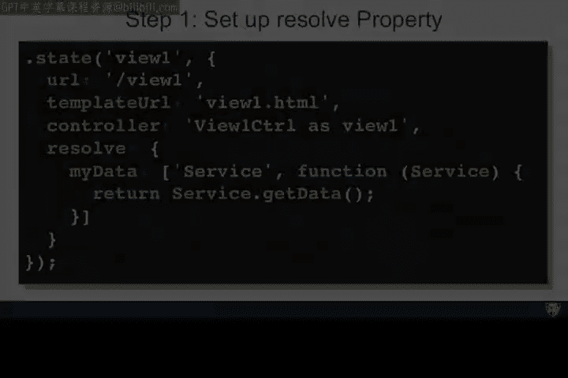
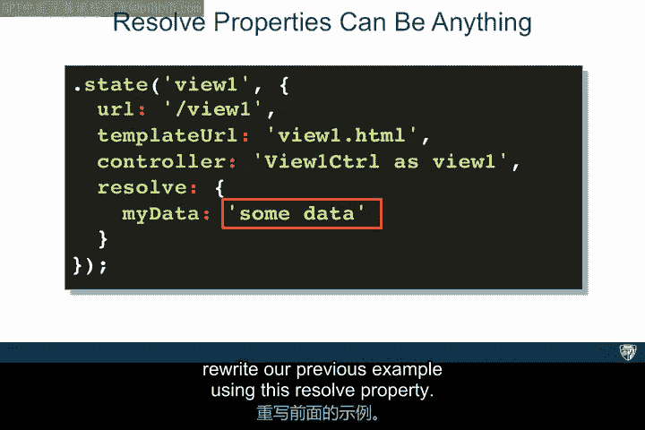

# 约翰霍普金斯大学《使用 AngularJS 开发单页 Web 应用｜Single Page Web Applications with AngularJS》中英 - P79：78_第38讲（第1部分）：带resolve的路由状态.zh_en - GPT中英字幕课程资源 - BV1dsFDeZEQr

🎼。

In the previous example， we had our routing switch to a state which was configured with a controller inside of that controller as part of the very first action in the dollar sign on a knit function。

 we reached out to an asynchronous service to retrieve the data we needed for that controller to function。

There's some disagreement in the community if this sequence of events is backwards or not。

Some say it would be definitely better if part of the transition to the next view， the next state。

 we first retrieve the data needed and then simply pass that data to the controller well with the state's resolve property we could do just that and more let's take a look at the syntax。

You could see that here we're declaring a state by the name of view1 you can also see that we're declaring that state with a controller。

 view1 controller as view1， but now we have a new property called resolve Resol is a configuration object that has some key and value pairs the key my data has something that we haven't really seen since the very beginning of the course and that's because we've been using a much more elegant injection that I'm using here in this example。

 but all we're doing here is protecting our function that gets the service service injected into it with some muification protection so if you remember from the very first lectures that we had if you provide an array with bunch of strings the last value which is a function those strings in the order that they are declared are going to be considered the items that you want to inject into that last value the function value and its arguments will match up to the declared injection。

😊，arrtacts that were listed in the same array， so here we have an array with the first value which is a string service and the last value or the second value is a function value that takes a service as an argument which means Angular Js will inject the service into that function。

Note that service that get data returns a promise。At the end of this。

 my datata is going to have a value which is going to be injected into the view1 controller with the key of my data。

 which means just like we inject a controller with a service called my service for example。

 we will be able to inject our view1 controller with yet another artifact by the name of my data which matches exactly the key inside the resolve object Now if the resolve property in this case。

 my data gets assigned a promise which is also the case in this example。

 the router will not advance us to the new state in this case view1。

 until the promise is resolved if the promise gets rejected altogether。

 the router will not advance us to the new state at all。😊，Inside of our controller。

 the view1 controller， we inject my data， just like we would inject anything else that needs to be injected into our controller。

 we protect it from unification by declaring it on the Do signine injector array and then simply listed in the same order as one of the arguments to the function view1 controller。

The resolved properties don't have to be promises， they can actually be anything we want to inject into the corresponding controller。

 even the string as this example shows， okay， let's jump back into the code editor and rewrite our previous example using this resolved property。

