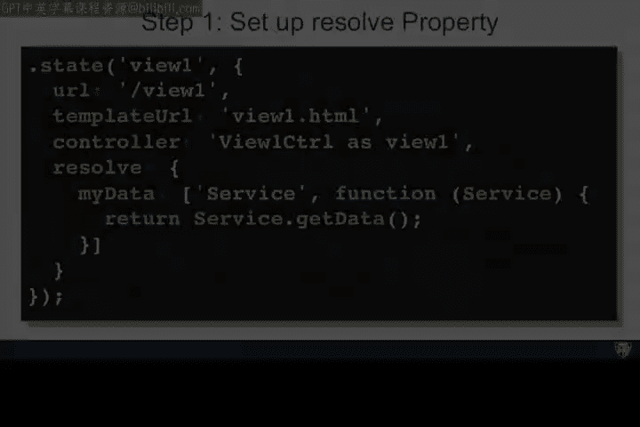
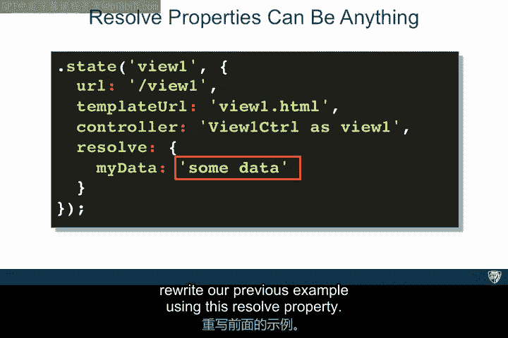

# 使用 AngularJS 开发单页 Web 应用：P79：带resolve的路由状态


## 概述

在本节课中，我们将学习 AngularJS 路由中一个名为 `resolve` 的强大属性。通过 `resolve`，我们可以在路由切换到新状态（state）并加载控制器（controller）之前，预先获取该控制器所需的数据。这能确保控制器在初始化时，其依赖的数据已经准备就绪。

---

## 回顾上一节内容

在上一节的例子中，我们配置了一个路由状态，该状态包含一个控制器。在该控制器的 `$onInit` 函数中，我们调用了异步服务来获取控制器运行所需的数据。

社区对这种执行顺序存在一些争议。有人认为，在切换到下一个视图或状态时，如果能先获取所需数据，再将数据传递给控制器，会是更好的做法。通过状态的 `resolve` 属性，我们不仅可以实现这一点，还能做得更多。现在，让我们来看看它的语法。

---



## `resolve` 属性的语法

以下是 `resolve` 属性的基本语法示例：

```javascript
.state('view1', {
  controller: 'View1Controller as view1',
  resolve: {
    myData: ['Service', function(Service) {
      return Service.getData();
    }]
  }
})
```

你可以看到，这里我们声明了一个名为 `view1` 的状态。我们为该状态声明了一个控制器 `View1Controller as view1`，但现在我们有了一个新属性 `resolve`。

`resolve` 是一个配置对象，包含一些键值对。键 `myData` 对应的值，我们使用了自课程开始以来未曾详细讲解的语法。这是因为我们之前一直在使用更优雅的依赖注入方式。但在这里，我们使用数组语法来保护函数，防止代码压缩（minification）破坏依赖注入。

如果你还记得最初的课程内容，当你提供一个包含多个字符串的数组，并将最后一个值设为函数时，数组中声明的字符串（按顺序）将被视为你想要注入到该函数中的依赖项。函数的参数将与数组中声明的依赖项一一对应。

因此，这里我们有一个数组，第一个值是字符串 `'Service'`，第二个值（即最后一个值）是一个函数，该函数以 `Service` 作为参数。这意味着 AngularJS 会将 `Service` 注入到这个函数中。

请注意，`Service.getData()` 返回一个 Promise。最终，`myData` 的值将被注入到 `View1Controller` 中，其键名就是 `myData`。

这意味着，就像我们向控制器注入一个名为 `myService` 的服务一样，我们将能够向 `View1Controller` 注入另一个名为 `myData` 的依赖项，该名称与 `resolve` 对象内的键名完全匹配。

现在，如果 `resolve` 属性（在本例中是 `myData`）被赋予一个 Promise（本例就是这种情况），路由器将**不会**推进到新状态（本例中是 `view1`），直到该 Promise 被成功解析（resolved）。如果 Promise 被完全拒绝（rejected），路由器则根本不会切换到新状态。

---

## 在控制器中使用 `resolve` 数据

在我们的控制器 `View1Controller` 中，我们像注入其他任何依赖项一样注入 `myData`。我们通过将其声明在 `$inject` 数组中来防止代码压缩问题，然后将其作为 `View1Controller` 函数的一个参数按相同顺序列出。

```javascript
View1Controller.$inject = ['myData'];
function View1Controller(myData) {
  // 控制器逻辑，此时 myData 已可用
}
```

`resolve` 属性返回的不一定是 Promise，它实际上可以是任何我们想要注入到对应控制器中的东西，甚至可以是字符串，如下例所示。

---

## 动手实践：重写示例

现在，让我们回到代码编辑器，使用 `resolve` 属性重写之前的示例。

通过使用 `resolve`，我们确保了在 `View1Controller` 初始化之前，其所需的数据 `myData` 已经成功获取。这消除了控制器内部处理数据加载和等待的逻辑，使控制器代码更简洁、更专注于视图逻辑。

如果数据获取失败（Promise 被拒绝），路由将不会跳转，这提供了内置的错误处理机制，防止用户进入一个数据不完整的视图。

---

## 总结

本节课中，我们一起学习了 AngularJS 路由的 `resolve` 属性。我们了解到：

1.  **`resolve` 的作用**：在路由状态切换前预先获取数据，并注入到目标控制器。
2.  **基本语法**：`resolve` 是一个对象，其键值对定义了要注入的依赖项及其获取方式。
3.  **与 Promise 的关系**：当 `resolve` 返回 Promise 时，路由会等待其解析后才进行切换。
4.  **在控制器中的使用**：通过依赖注入，像使用服务一样使用 `resolve` 提供的数据。
5.  **优势**：使控制器逻辑更清晰，提供了数据预加载和路由守卫的能力。




通过将数据获取逻辑从控制器移至路由配置，我们的代码结构变得更加清晰和可维护。