# 约翰霍普金斯大学《使用 AngularJS 开发单页 Web 应用｜Single Page Web Applications with AngularJS》中英 - P7：6_Windows开发环境设置（第2部分）.zh_en - GPT中英字幕课程资源 - BV1dsFDeZEQr

🎼，Okay， so I'm back in my command prompt where we left off previously。

 and the next thing we need to do is we need to create an account on Github。com。

 we'll go back to our browser and we'll type in Github。com。😊。

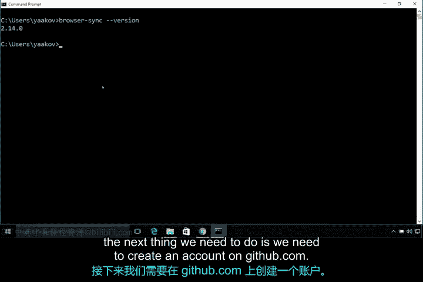

And here all you have to do is pick a username that's available。

 give you your email address and a password and you're done Since I already have an account。

 I'll just click sign in。😊，And provide my username and password。We'll click sign in。

We don't want it to remember my password。Once you sign in， you'll see this front page of Github。

com and your view probably look different in mine， especially if you just signed up。

 it will probably look pretty empty but I have a bunch of repositorory so that's what you see the next thing we want to do is we to create our own repository that we'll use for the rest of the course for all the assignments that you will do So what we'll do is we'll go up here to the top right and we'll click this down arrow next to the plus and click new repository and we'll call this repository Cosera dash test obviously you could call your repository whatever you want and here we'll say test repo for Coursera and we'll leave it as public because private will cost us money and we'll check initializes repository with the readme file which is always a good idea and at this point you can just click create repository and repository gets created。

Now， before we move away from this and go to our command line again。

 what we want to do is we want to make this repository accessible to the web like a regular website。

 And fortunate， GitHub allows us to do that with something called Github pages。 However。

 we need to first enable it。 noticeice that we're right now on this something called branch master。

 You't really need to tell too much about Git to know branchch master。

 but just remember that that's where we are in order to enable this repository to be like a website。

 we have to go to the settings， which is here top right。😊。

And scroll down and you'll see a section called Github pages。

 And basically it's telling you here that Github pages is designed to host your personal organization or project pages from a Github repository directly。

 However， right now it is disabled and we haven't picked a source for where it should look for the files to serve up as a server of your website。

 So we're gonna click this downarrow and we actually going select master branch。

 Now Github used to only allow this on a special branch that you would have to create manually called Gh dash pages。

 but now it allows even the actual main branch， the main repository kind of part of your main repository。

 which is the master branch to be the source of your Github pages。

 So as long as we choose that and click save Now we're done。

 we scroll down you'll see now that it says that your site is ready to be published at and it gives us a link。

 So if we right click on that and open it in a new。😊，Tab。

 you'll see that what it's going to give us is my usernamegithub。o slashcoseratest。

 which is the name of my repository。 however， I'm still getting a 404 meaning page not found and that's because I haven't really put anything into my repository yet well we'll change that in a minute。

The next thing we want to do is go back to our repository。

 we'll click on the name of it and we'll go to this green clone or download button here and you see here one of the things you could do。

 you could download the whole thing is a zip file but what we want to do is we want to clone it or copy it or download it directly to our machine using Git commands。

 so we'll click this button here that will copy this URL into our clipboard we'll go back to the command line and perhaps we can even make a directory here we'll say Coursera。

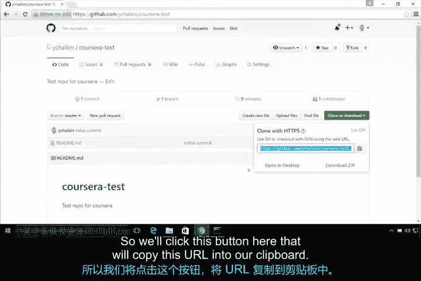

Project。And now if we do a DIR to see， you could see that Coursera Project is one of the directories that we just created。

 and we could do a CD change director into Coursera project。

 and we'll go ahead and clear the screen CLS。And now what we could do is we could say Git clone。

 which is another name for go ahead and download the site or clone it， make a clone copy of it。

 and we'll paste the URL that we copied from the Github repository we'll hit enter and the clone repository is now here。

 So if we go ahead and do a DIR just to see what's going on you could see that it created a folder for us called Coursera dash test。

 which is was the same thing as what we pointed it to minus this dot Git So if we now Cd into Coursera dash test。

 it's very important to do that。😊，To actually get inside of our repository。

 we'll do a CLS to clear the screen， we'll go ahead and do a DIR。

 and you can see there's really nothing in here yet。😊。

So what we want to do now is we want to start our at editor directly from this command line prompt such that it considers this Coursera test directory as kind of the project holding folder the way we could do that is by issuing the at command Adam with the dot meaning I want you to start the entire project from this directory dot meaning the directory that I'm in right now which is Coursera project Coursera dash test If I enter it's going to go ahead and open up Adam and now I could see that I' am inside the Cosera test as my project folder Now I'm ready to create my first HTML page I'll right click on that folder。

 say new file。😊。

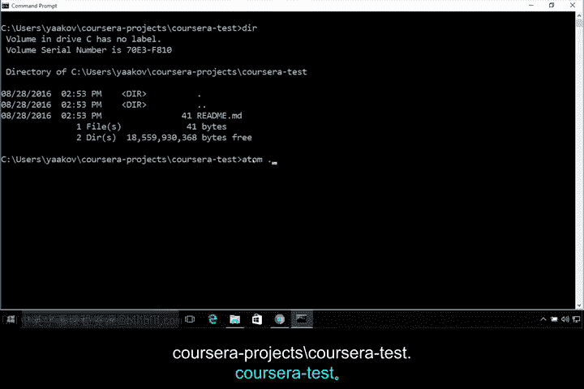

And we'll say index that HTML。And it will open up a new file for me and I'll say HTML and here I'll just give it a title of hello Coursera inside the body we'll just give it1 H1 tagag and we'll say hello Coursera and save that Now before we move on it would be really useful if we can see the outcome of whatever we're typing directly on the web browser to see what affect everything we type has well we could do that with browser sync let's go ahead and move this over a little bit and go back to our command prompt and start the browser sync command and the browser sync command is browser dash sync in this case we want to start it and we also want to start in dash dash after a space dash server mode which means I want you to serve up all the files in a particular directory and I also want to start it in the dash dash directory mode which means that if there's nothing in that directory and it can't find index that HTML it will still display a web page。

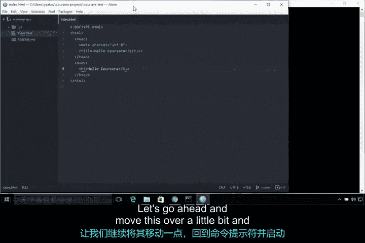

With basically a directory structure that it sees the last but not least with the space will say dash dash files。

 we want to tell browser sync which files to watch for changes that if any of those files change。

 we want browser sync to reload whatever is in our browser So we see the latest。

 So we'll say dash files space quotes and in this case we'll say star star slash star and end the quote And what we're saying is we want any directory that's the star star and whatever director you find we want any file inside of the directory that is the single star。

 So once we're done with that we press enter。😊。

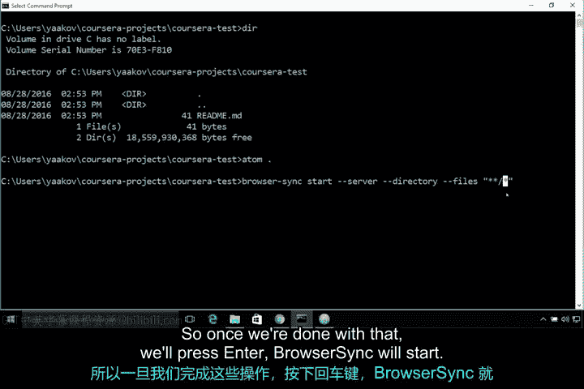

Brows sync will start。 It will tell us a whole bunch of warnings。

 but will allow it to access and now we could see that our index that HTML right here is showing up together with Readme。

 Let's click on that， you could see that Coursera， hello Cora is showing up。

 Let's make this browser a little bit smaller， not full screen so we could see it's side by side with our code editor which is really convenient。

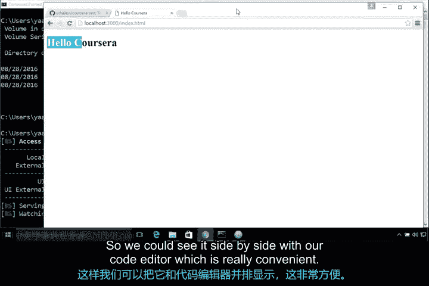

Let's switch to our code editor and make this side by side。

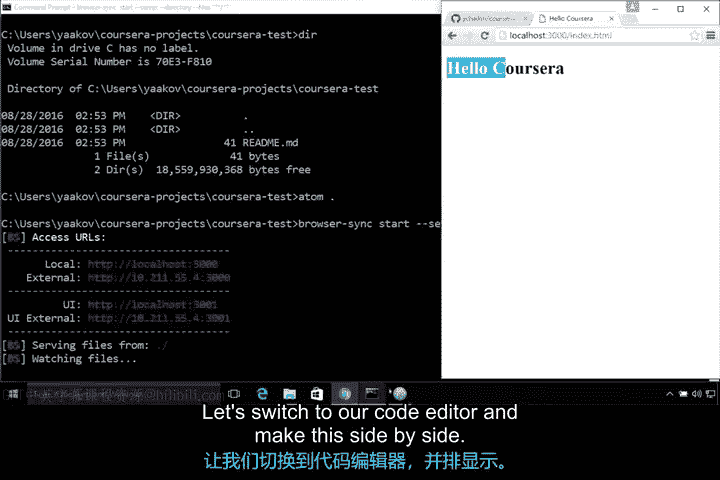

And now if I start typing Hello Coursera Student exclamation point and save that file。

 you could see that it browsers syncnc immediately refreshes the page and Hello Coursera students shows up that is really convenient for being able to develop things and immediately see the feedback from your browser sitting in a window next to your editor。

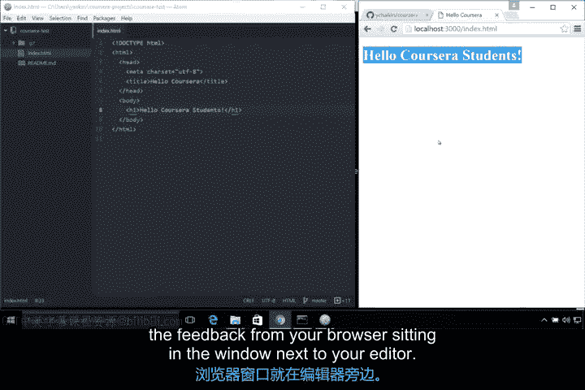

Okay so we're done with that for now。 Let's go back to our command prompt and exit browser sync with controlr C。

 We'll say yes， we want to finish it。 And the next thing we want to do is we want to do Git status。

 actually let's clear the screen CLs and do Git space status just to see what our repository status is and you can see that we're in branch master and my branch is up to date and we have on track files and it's actually even telling you a hint as to what you might want to do next what you might want to do next is do Git add to include in what will be committed in the future In other words。

 if you do Git add。And specify a file， it will mark that file to be committed when you commit to your repository next。

 meaning when you save things in your repository in this case I could just say dot which means anything in this directory and below and I'll press enter and I'll do a status Git status again and you can see that now that file shows up as new file and it' green and it's telling you that changes to be committed right here and this is green file so next thing we want to do is actually save this file into our repository or otherwise known as commit so we'll do git space commit M for flag to specify a message with our commit and that's required and we'll say first web file。

And close the quote， well press enter。And you could see the first thing that's telling us is that we need to tell it who we are。

 whenever never even told it who we are， it needs to somehow identify the user I am that I am committing this particular change。

 and it's actually very nice because it's telling exactly the commands to run so we'll go ahead and copy this first command and it's called gettconfiggbal user email with a space and you could put whatever you want here it could say yaov at Cosera something co really could give a fake email here if you want it's really there not for any configuration but really to identify you to other developers that are using this repository and we'll press enter on that and one more thing that's telling us to do is it wants us to give it our username so we'll go ahead and copy that and our username will be just yaov at this point doesn't matter and we'll press enter and now let's clear the screen。

Now let's say git commit dash M with a message first web file。Close the quote and press enter。

 and now it's committed。 And if we now do a git status。

You can see that what it's telling is that your branch where in Bma is head of origin master by one commit Origin master is referring to the Github repository we have two repositories at this point one is sitting in Github。

 co and the other one is sitting on our local machine so what it's telling us is that our local one is ahead of the one in Github。

com by one commit which makes sense because we committed one commit just now however all that did was record our commit or record our saving of particular slice and time in our local repository Github again is nice enough to tell us to use Git push to publish our commits to the remote repository well go ahead and do that will say Git push and that willll upload our commits and everything from our repository that is ready to go and that's everything that's marked committed。

😊，Two， the remote repository， which is on GiHub will press enter。

It will pop up the screen to ask us for our username and password。

 so we'll go ahead and give it the username and my password。Youll obviously have your own。

 we'll click Logan。And you could see it's counting the objects， compressing the objects。

 and finally it says we're done， we committed to this remote repository right here。

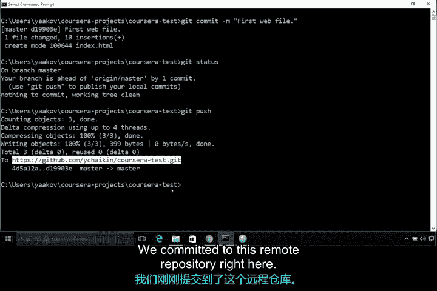

The next thing we want to do is go back to our browser and see if we could see these commits in our repository。

 let's go ahead and close this tab and let's go to our repository when we refresh。

 you could see the index that HTML showed up Now what we want to do is see if it actually shows up on Github pages。

 the Github。 Io link and looking like like our real website If I don't remember what my website's address is。

 it's easy to figure out what it is again。 you just go to the settings。😊。

Scroll down to the GitHub pages section and it will tell you the link right here。

 we'll go ahead and open it in the new tab。You could see here that what's giving us is hello Cosera students。

 That's that index that HTML file that we committed and uploaded。

 and you could see here it's again using my username Github do o Cosera dash test is the name of the repository Now when you submit assignments what you're going to want to do is you want to create a separate folder for each of the module assignments as it will be described in each assignment document and you could repeat this process we could go back to our Adam editor。

 we could say hello Cora students I am thrilled about this course exclamation point we'll save that will go back to our command line and we'll say git status and you could see once again we have something in red because we've modified now this index that HTML So we basically have to go through that same process again we'll say git add to market for commitittal and we'll say dot anything in this directory we'll do git status again。

😊。

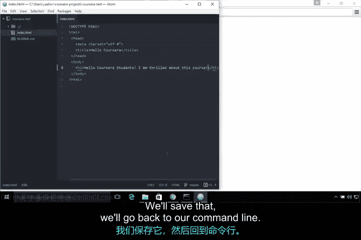

You'll see now it is ready to be committed because it is now green。

And we could say git commit dash and the message next next version of web file and we'll press enter so now that's commit。

 but that's only to our local repository we once again have to say we'll say Git status just to see what's going on it's telling us once again that it is ahead by one commit so we'll go ahead and say Git push to upload it to our GitHub repository and it's done then we could go to our browser and we'll go ahead even can just refresh that right here and you could see it immediately shows up there and that's because if I go back to my Coursera test repository you could see that that's the commit that is sitting in this particular branch at this point。

 meaning it's the one that I already pushed or upload it to this repository so that's why you see the updated file right here which makes it very easy for you to simply push commit and push your changes through Git and then。

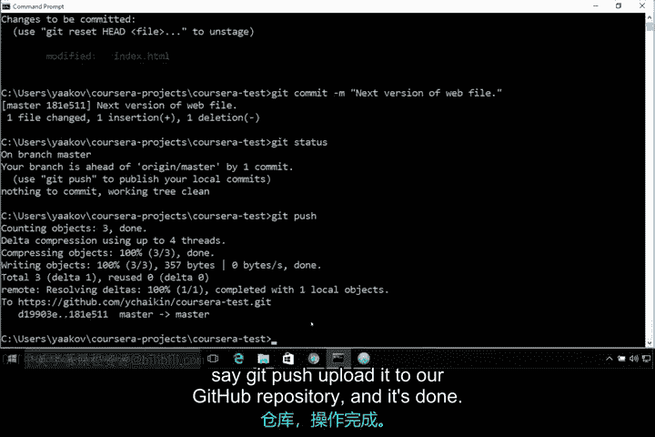

see those results published as a regular website on the web。

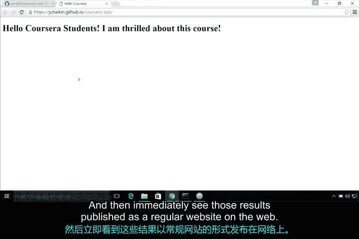

