# 使用 AngularJS 开发单页 Web 应用：P7：Windows开发环境设置（第2部分）🚀

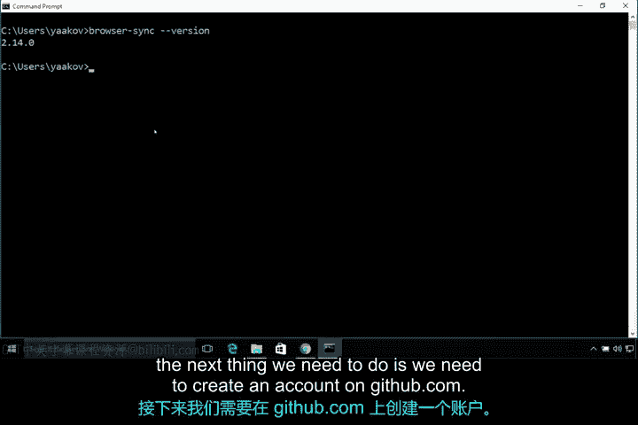

在本节课中，我们将继续完成 Windows 开发环境的设置。我们将学习如何创建 GitHub 账户、建立代码仓库、启用 GitHub Pages 来托管网站，以及如何使用 Git 命令和 Atom 编辑器进行本地开发与代码同步。

---

上一节我们安装了必要的开发工具。本节中，我们来看看如何将本地开发环境与 GitHub 连接起来，并创建一个可以实时预览的 Web 项目。

首先，我们需要在 GitHub.com 上创建一个账户。

以下是创建账户的步骤：
*   访问 GitHub.com。
*   选择一个可用的用户名。
*   提供你的电子邮件地址和密码。
*   完成注册。

如果你已有账户，可以直接登录。

登录后，你将看到 GitHub 的主页。新账户的页面可能看起来比较空。

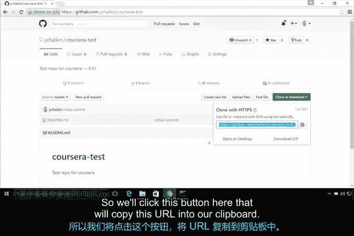

接下来，我们需要为课程创建一个代码仓库，用于存放所有作业。

以下是创建新仓库的步骤：
*   点击页面右上角加号旁边的下拉箭头。
*   选择 “New repository”。
*   将仓库命名为 `coursera-test`（你可以使用任何名称）。
*   添加描述 “test repo for Coursera”。
*   保持仓库为 “Public”（私有仓库需要付费）。
*   勾选 “Initialize this repository with a README”。
*   点击 “Create repository” 完成创建。

在返回命令行之前，我们需要将此仓库配置为一个可通过网络访问的网站。GitHub 提供了名为 “GitHub Pages” 的功能来实现这一点。

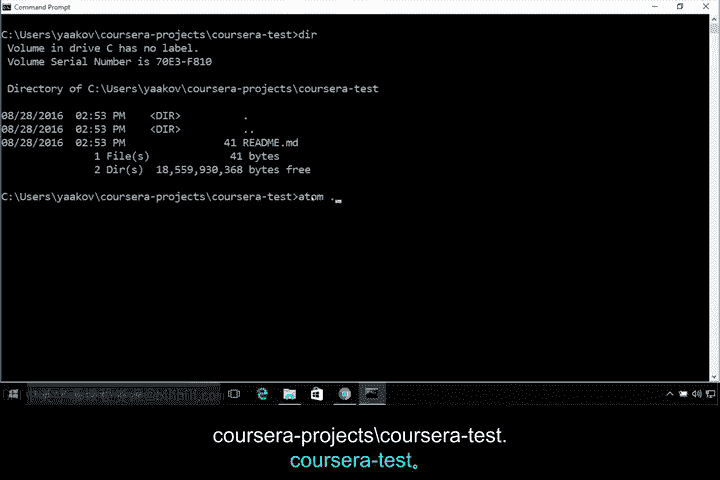

我们需要先启用此功能。请注意，我们当前位于 `master` 分支。要启用 GitHub Pages，请按以下步骤操作：
*   点击仓库页面右上角的 “Settings”。
*   向下滚动到 “GitHub Pages” 部分。
*   点击 “Source” 下的下拉菜单。
*   选择 “master branch” 作为网站源。
*   点击 “Save”。

保存后，页面会显示你的网站已准备就绪，并提供一个链接。点击此链接可能会看到 404 错误，这是因为仓库中还没有任何网页文件，我们稍后会解决这个问题。

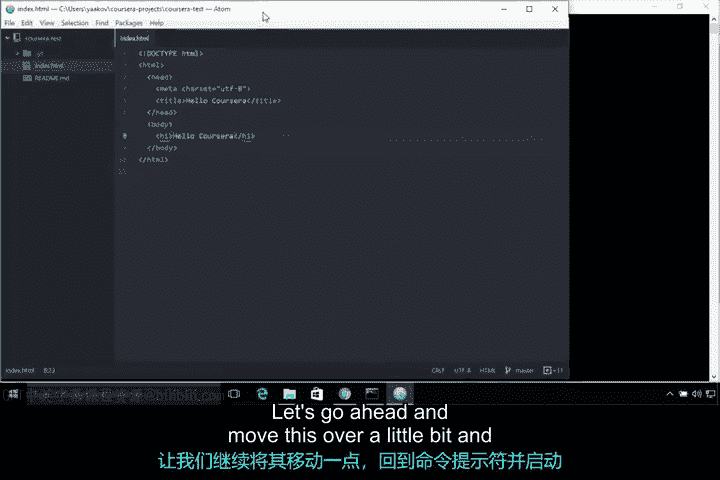

接下来，我们需要将仓库克隆到本地机器。

以下是克隆仓库的步骤：
*   返回仓库主页面。
*   点击绿色的 “Clone or download” 按钮。
*   复制显示的 URL。
*   打开命令行，创建一个项目目录，例如 `CourseraProject`。
*   进入该目录，执行 `git clone <你复制的URL>` 命令。

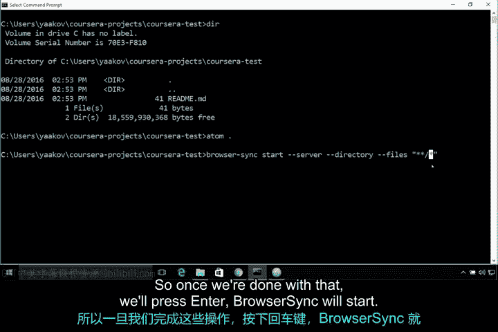

克隆完成后，进入新创建的仓库目录（例如 `coursera-test`）。现在，我们可以从这个目录启动 Atom 编辑器，将其作为项目根目录。

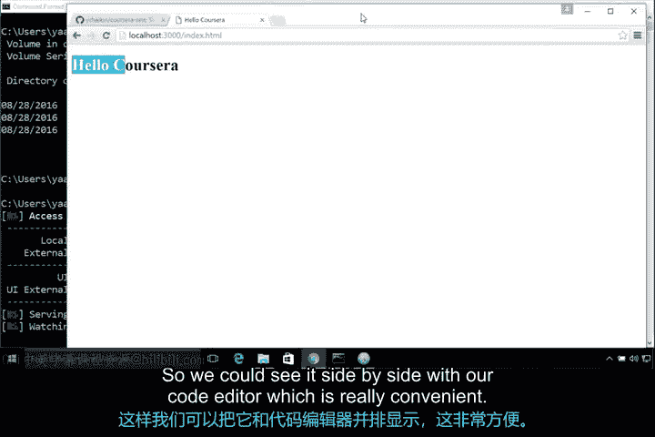

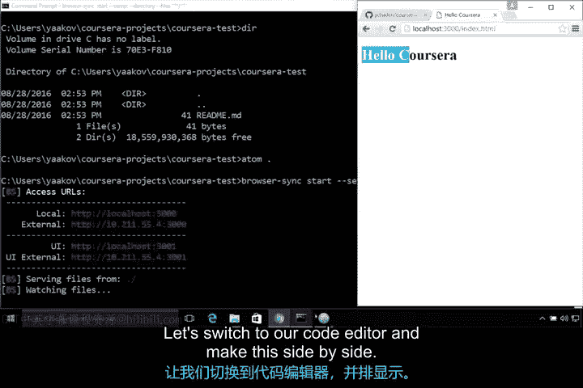

在命令行中，执行 `atom .` 命令。这将在 Atom 中打开当前目录作为项目文件夹。

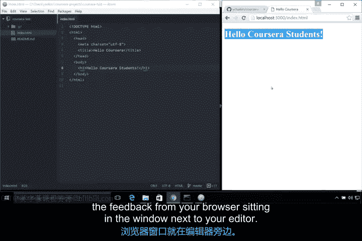

现在，我们准备创建第一个 HTML 页面。

在 Atom 编辑器中：
*   右键点击项目文件夹。
*   选择 “New File”。
*   将文件命名为 `index.html`。
*   在文件中输入基本的 HTML 结构，例如包含标题和 “Hello Coursera” 的 H1 标签。
*   保存文件。

为了能实时看到代码更改在浏览器中的效果，我们将使用 Browser Sync 工具。

返回命令行，在项目目录中执行以下命令来启动 Browser Sync 服务器：
`browser-sync start --server --directory --files "**/*"`

此命令会启动一个本地服务器，并监控项目目录中所有文件的更改。命令执行后，默认浏览器会自动打开并显示你的 `index.html` 页面。

现在，你可以将浏览器窗口和 Atom 编辑器并排摆放。在 Atom 中修改 `index.html` 文件并保存后，Browser Sync 会自动刷新浏览器页面，让你立即看到更改效果。

完成预览后，可以在命令行中按 `Ctrl + C` 停止 Browser Sync 服务。

接下来，我们需要将本地修改提交到 Git 仓库，并推送到 GitHub。

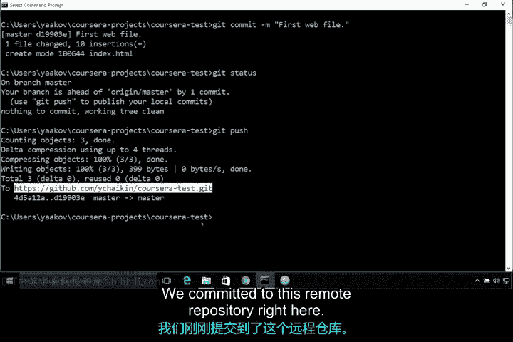

以下是提交和推送代码的步骤：
*   在命令行中，使用 `git status` 查看文件状态。
*   使用 `git add .` 命令将所有更改标记为待提交。
*   再次使用 `git status` 确认文件已变为绿色（待提交状态）。
*   使用 `git commit -m "提交信息"` 命令提交更改到本地仓库。如果是首次提交，Git 可能会提示你配置用户名和邮箱，按提示执行 `git config --global user.email "你的邮箱"` 和 `git config --global user.name "你的用户名"` 即可。
*   使用 `git push` 命令将本地提交推送到远程的 GitHub 仓库。系统会提示你输入 GitHub 的用户名和密码。

推送完成后，返回浏览器中的 GitHub 仓库页面并刷新，你应该能看到新提交的 `index.html` 文件。

最后，再次访问你的 GitHub Pages 网站链接（在仓库设置的 GitHub Pages 部分可以找到）。现在，你应该能看到 `index.html` 中 “Hello Coursera” 的内容已经成功发布到网上。

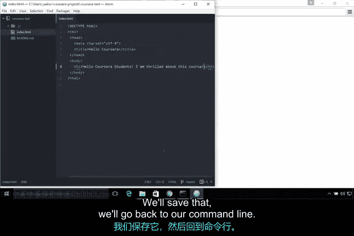

今后提交作业时，你只需为每个模块的作业在项目中创建单独的文件夹，然后重复 `修改 -> git add -> git commit -> git push` 这个流程即可。每次推送后，你的作业网站都会自动更新。

---

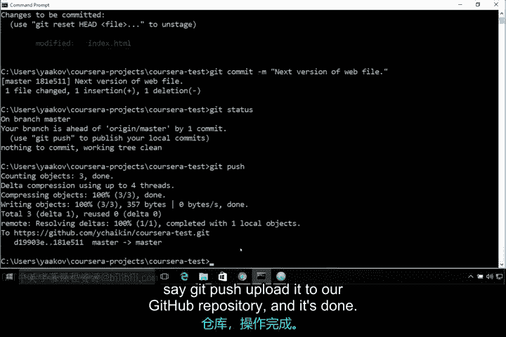

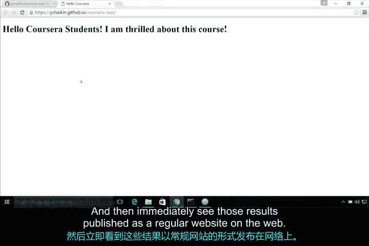

本节课中我们一起学习了如何设置 GitHub 仓库、启用 GitHub Pages、使用 Atom 和 Browser Sync 进行本地开发与实时预览，以及使用 Git 进行版本控制并将代码同步到线上。这套工作流将贯穿整个课程，用于开发和提交你的作业。