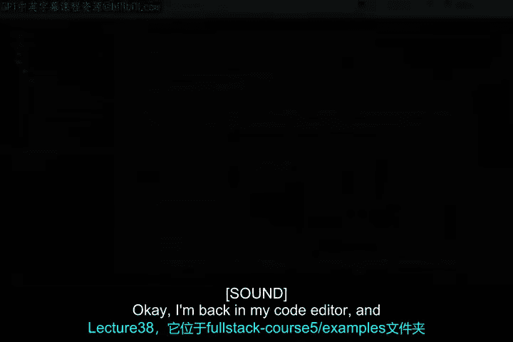
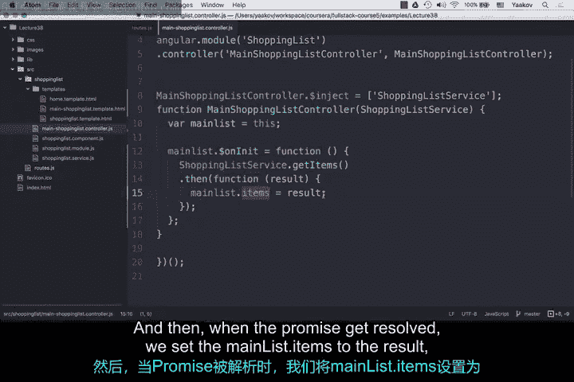
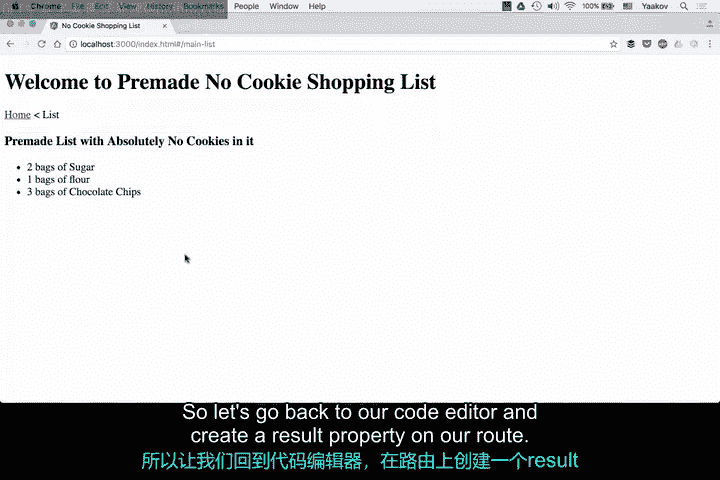
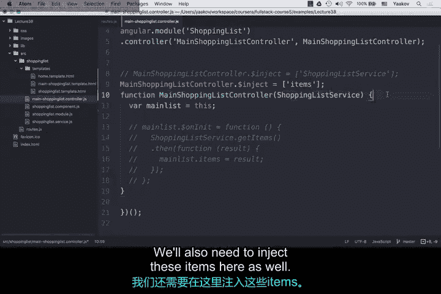
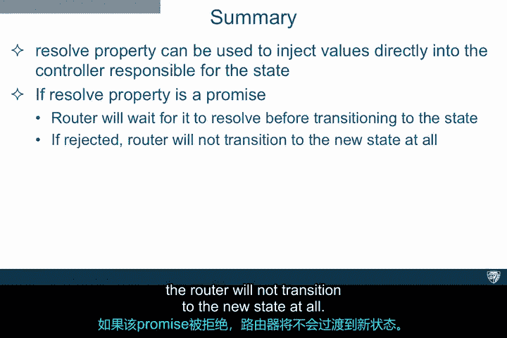

# 约翰霍普金斯大学《使用 AngularJS 开发单页 Web 应用｜Single Page Web Applications with AngularJS》中英 - P80：79_第38讲（第2部分）：带resolve的路由状态.zh_en - GPT中英字幕课程资源 - BV1dsFDeZEQr

🎼。

Okay I'm back in my code editor and I'm located in lecture 38。

 which is located in fullt dash course 5 examples folder。

 and this is really the identical application that we left off in lecture 37 As you can see here in the main list state we have a controller called main shopping list controller And if we go to that controller right now。

 we could see that on the dollar sign in it we're calling this shopping list service that we know to be an asynchronous service。

 and then when the promise gets resolved， we set the main list that items to the result meaning the array of the shopping list items。

 Let's go to the browser and see how it behaves When we click in this link you'll see that it goes to main dash list you can also see that this list pops in a little bit about 800 milliseconds later after the entire view the main list view comes into the browser and that is because we're switching the view first and then going to get the data that。

😊。

The best thing to do it also looks a little bit weird that we switched to a view before we know whether or not there's any data in that view to begin with。

So let's go back to our code editor and create a resolve property on our route。

 let's go back to the routes。gs and besides for declaring main shopping list controller as main list。

 we're going to put a comma here and we'll call another property called Resolve。😊。

And the resolved property is going to have one item or actually it's going to have one item called items and the items's property is going to resolve to a promise that it gets returned by the shopping list service。

 so let's go ahead and declare an array because we want to protect our shopping list service injection from muification and we'll say shopping。

😊，List service， there it is right there， we'll put a comma and now we'll put the function。

 the actual function is going to retrieve that shopping list and we'll inject it here again。

 shopping list service。And inside here， we need to return our shopping list service that get items。

So now this will immediately return a promise and the UI router will then wait for the items' property to get resolved before it takes us to this main list UI state。

 so now that we're retrieving this data upfront in the actual state transition let's go ahead and save that let's go back to our controller and we really no longer need this we'll go ahead and comment that out。

 what we do however we need is and we'll actually comment this out as well and maybe just duplicate it because we do need this but we need to inject something else in here。

 we need to inject our items from from the resolve let's copy that let's go back and inject the items right here we'll also need to inject these items here as well。

 let's go ahead and duplicate that that way we could at least keep it for our records so you'll see the difference and we'll just。

😊。

Copy and paste it right here。 So now here I need to inject items。

 Those are the same items that are here and all I really need to do here is just say main list。

That items equals to items that are passed into our main shopping list controller。

 Let's go ahead and save that and let's go back to our browser。

And we could see something is not working。 Let's go ahead and take a look as to what's not working in the console and nothing seems to be appearing。

 So let's go back to the code editor and see what we might have messed up here。

 We have the main list that seems to be working。Oh， and I see that I said items instead of items。

 okay let's save the items here， let's go back to the browser and they already switched us to the next transition。

 so let's go back to home。 when we click on premate no cookie list you see it's not going anywhere until the entire data is there and then the whole thing shows up immediately we could try that again we click 800 milliseconds later the entire thing shows up So the actual gating of the data。

 the asynchronous communication it's happening when you click this link not after you click this link So by the time we click this link and the controller gets invoked it already gets invoked with all this data and it gets displayed immediately。

😊，And coincidentally I just noticed that list here is spelled with lowercase L which is probably not a good idea for consistency's sake。

 so let's go ahead and change that really quickly main list is now going to be uppercase everywhere and I think we're good to go let's go ahead and test it one more time and you see that's still working so we're all good to go。

Okay， so let's summarize the resolved property can be used to inject values directly into the controller responsible for the state。

 and that is declared on the state's configuration。If the resolved property is a promise。

 the router will wait for it to resolve before transitioning to the new state。

 if that promise is rejected， the router will not transition to the new state at all。

The name of the key in the results property object is what is to be injected into the corresponding controller's function。

Also note that while it's very common to use resolve to resolve a promise before you transition to the new state。

 resolve properties can contain anything， object strings， etc。

