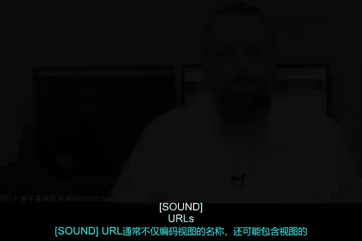
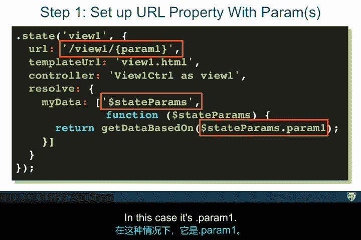
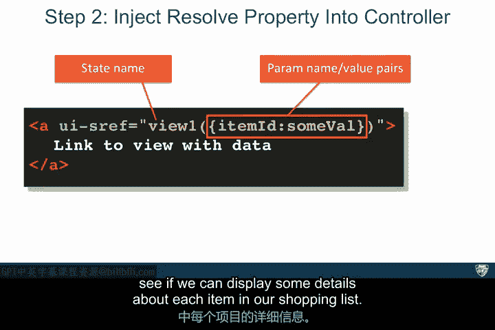

# 约翰霍普金斯大学《使用 AngularJS 开发单页 Web 应用｜Single Page Web Applications with AngularJS》中英 - P81：80_第39讲（第1部分）：带URL参数的路由状态.zh_en - GPT中英字幕课程资源 - BV1dsFDeZEQr

🎼。

URls often encode a state of the view that requires more than just a name It may require some actual data that can change how the view is constructed for the user For example。

 imagine a weather forecast web application which displays the forecast based on the zip code The view showing the weather forecast for a particular zip code would then contain that zip code as part of the URL with UI router mapping URLs with parameters and retrieving those parameters is very straightforward Let's take a look at the syntax。

😊，First， we declare the URL property with a slash and the name of the parameter wrapped in curly braces Next we inject the special state parameter service that UI router provides either into our controller directly or into the function that populates our resolved property data。

 then we can retrieve the value of the past in parameter by using the state parameter service with the dot notation and the name of the parameter。

 in this case its dot parameter1。

Now when it comes to mapping the URL the rules are pretty straightforward。

 there is no special treatment of the trailing slash so the pattern on the left will match a simple slash view1 slash with a parameter 1 being equal to an empty string This type of mapping will also map to slash view1 s hello or slash U1/ 12 on top of all this UI router has syntax for being more specific on how a parameter is matched it even has support for regular expressions so you could specify the match parameter using a regular expression。

Going back to our example， once the parameter is matched。

 some data is retrieved based on a parameter and stored in the Mydata Reve property。😊。

The Mydata property is available to be injected into the View1 controller just like we've done before。

If you wanted to use the UIS Re directive to construct a link or in action to transition to the state that expects parameters。

 the value of the UIS Re would be the state name being invoked like a function。

 its argument would be an object which contained parameter name value pairs。

 where the names would have to match the expected parameters exactly。Okay。

 let's go back to the code editor and see if we can display some details about each item in our shopping list。

