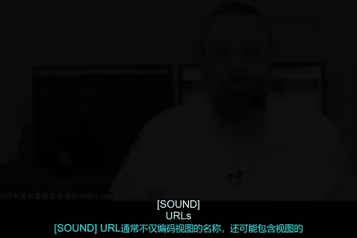
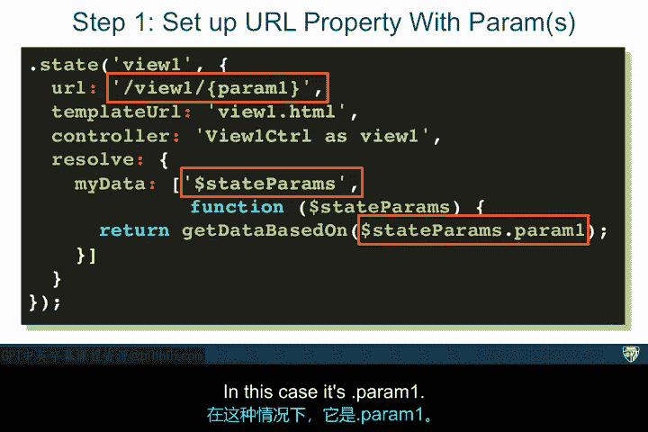
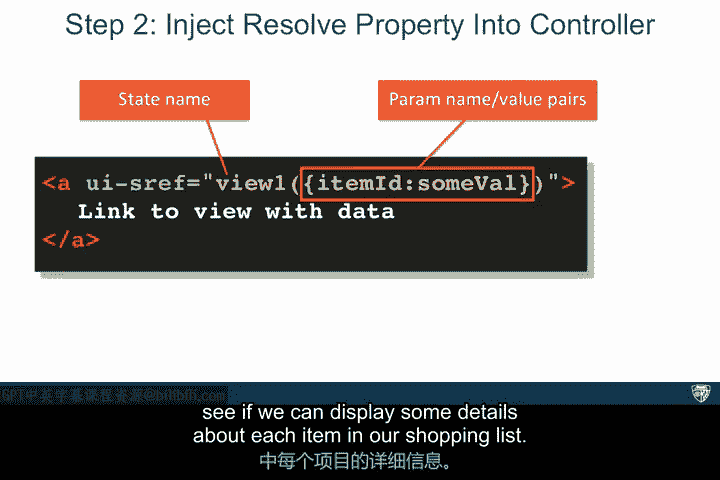

# 使用 AngularJS 开发单页 Web 应用：P81：带URL参数的路由状态




在本节课中，我们将学习如何在 AngularJS 的 UI-Router 中定义和使用带参数的路由状态。URL 参数允许我们根据动态数据（如用户ID或邮政编码）来构建和显示不同的视图内容。

## 概述

URL 通常不仅编码视图的名称，还可能包含决定视图如何构建的实际数据。例如，一个天气预报应用需要根据邮政编码来显示不同的天气信息。UI-Router 使得映射带参数的 URL 并从中提取这些参数变得非常简单直接。

## URL参数语法

上一节我们介绍了基本的路由状态定义，本节中我们来看看如何为状态定义带参数的URL。

首先，我们在状态的 `url` 属性中声明参数。参数名被包裹在花括号 `{}` 中。

```javascript
$stateProvider
  .state('view1', {
    url: '/view1/{parameter1}',
    templateUrl: 'view1.html',
    controller: 'View1Controller'
  });
```

接下来，我们需要在控制器中获取这个参数值。UI-Router 提供了一个特殊的 `$stateParams` 服务。

```javascript
app.controller('View1Controller', ['$scope', '$stateParams', function($scope, $stateParams) {
  // 使用点符号和参数名来获取值
  $scope.myParameter = $stateParams.parameter1;
}]);
```



## URL映射规则

关于URL映射，规则相当直接。

*   尾部斜杠没有特殊处理。例如，模式 `/view1/` 会匹配 `/view1/`（此时 `parameter1` 为空字符串）。
*   该模式也会匹配 `/view1/hello` 或 `/view1/123`。

此外，UI-Router 还支持更具体的参数匹配语法，甚至可以使用正则表达式来限定参数的格式。

## 在链接中使用参数

如果你想使用 `ui-sref` 指令来创建一个链接，以跳转到需要参数的状态，可以像调用函数一样使用状态名。

`ui-sref` 的值是一个函数调用，其参数是一个对象，该对象包含与预期参数名完全匹配的键值对。

```html
<!-- 假设当前状态需要 itemId 参数 -->
<a ui-sref="itemDetail({itemId: 123})">查看项目 123 的详情</a>
```

## 回到代码示例

现在，让我们回到代码编辑器的上下文，看看如何利用URL参数来显示购物清单中每个项目的详细信息。

我们将创建一个新的状态来显示项目详情，其URL包含项目ID作为参数。当用户点击列表中的某个项目时，应用将导航到这个详情页，并通过 `$stateParams` 获取对应的ID来加载和显示该项目的具体信息。

## 总结




本节课中我们一起学习了在 AngularJS 的 UI-Router 中使用URL参数。
*   我们学会了如何在状态定义中声明URL参数（`/path/{parameter}`）。
*   我们掌握了通过 `$stateParams` 服务在控制器中获取参数值的方法。
*   我们了解了如何使用 `ui-sref` 指令生成带参数的导航链接。
通过URL参数，我们可以构建出能反映应用深层状态、且可被直接分享或书签的单页Web应用。