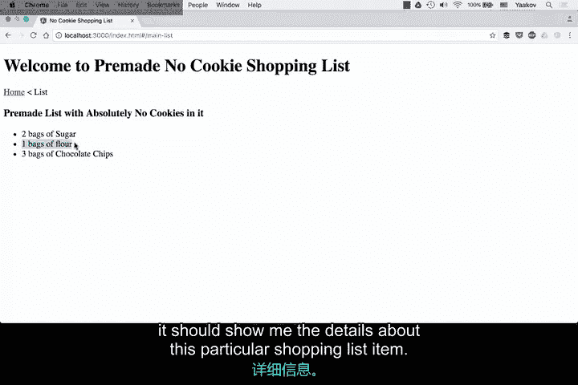
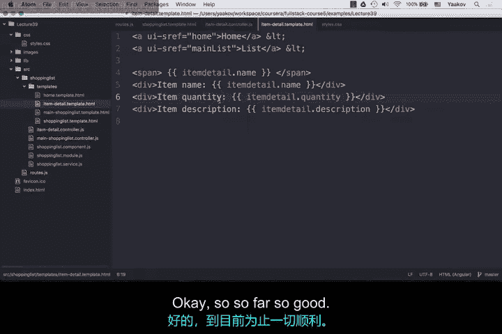
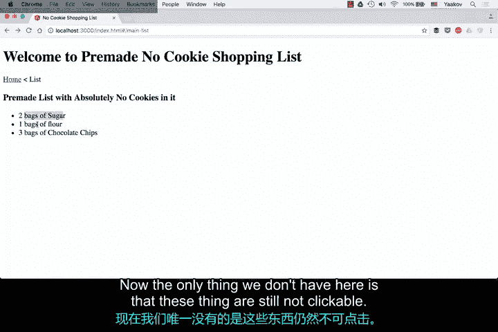
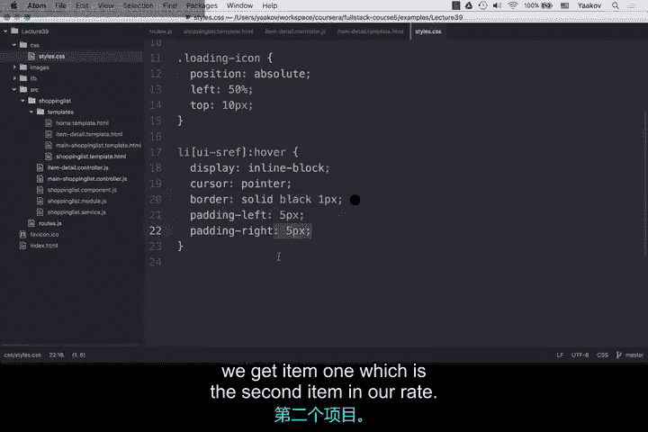
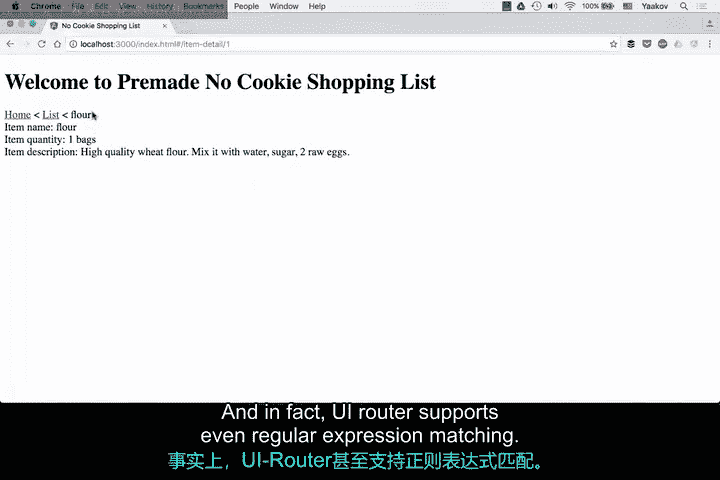
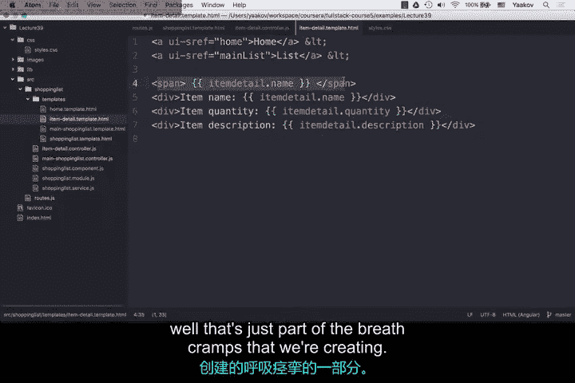
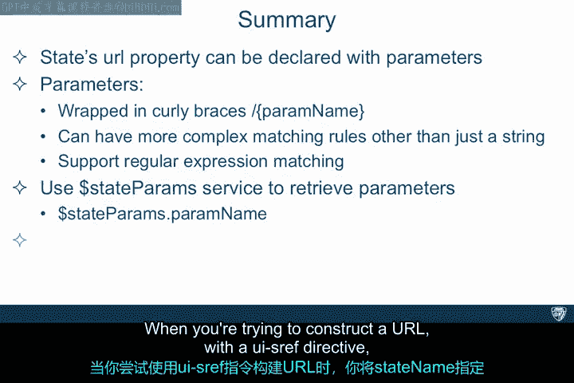
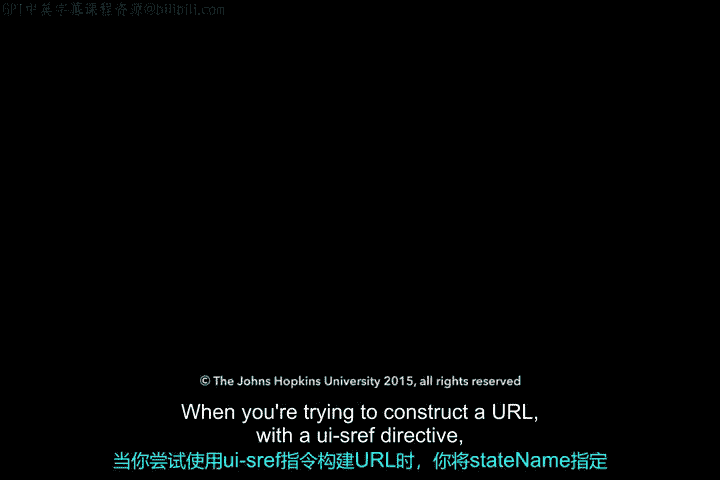

# 约翰霍普金斯大学《使用 AngularJS 开发单页 Web 应用｜Single Page Web Applications with AngularJS》中英 - P82：81_第39讲（第2部分）：带URL参数的路由状态.zh_en - GPT中英字幕课程资源 - BV1dsFDeZEQr

🎼。

Okay so I'm back in my code editor and I'm located in lecture 39。

 which is located in fulltag dash course 5 examples folder and right now we're looking atro dogs and the way this application stands right now。

 it's basically a copy of lecture 38 which one lecture before this one Let's take a look at the browser so here we have welcome to premade no cookie shopping list if we click our premade no cookie shopping list you'll see that the list will appear right here but we would like to do is we would like to be able to have each one of these items right here clickable and when I click it it should show me the details about this particular shopping list item。

😊。

If you remember when we look at our shopping list service。

 js you'll see that besides the name and the quantity。

 we also have a description of each item so we should be able to get at that description but one item at a time let's go ahead and close this and let's go to route。

 js So the first thing we need to do is we need to add that state that displays the item detail let's go ahead and scroll all the way to the bottom here and we'll open up and make one more state and we'll call the state item detail。

😊，And we'll configure the state with a URL and the URL will be slash item dash detail slash and we'll give it a parameter because we need to know which item ID01 or two because we have three items and this is an array so it's zero based we need to know which index in this item array we're trying to look at and we'll call this parameter item I so now we have the URL mapped let's go ahead and create a template URL and we'll point it to something I already have which is the item detail that template that HTML which is sitting right here and basically all it is is a couple of links one taking you to the home state。

 the other one taking you to the main list and basically all this does is says here's the item name and the item name is some reason repeated here twice which I'm not sure why but maybe we styled it a little bit different But point is we outputting the item name the item quantity and the item detail。

All at the same time， so we can see a very detailed list。

Let's go back to the state configuration it will give it to URL for our template of source shopping list。

 slash templates， slash item detail。tlatetlate。 HTMLtm okay， we'll put a comm over there。

well also specify a controller， and the controller will specify called item detail or detail controller。

And we'll say it as item detail。And we also have the controller。

 the item detail controller here just started right here so we just registered it we didn't really do much with it yet。

 so we'll do that in a second so so now that we have the controller we need our resolve property because we're going have to pull those items from our shopping list service and then pull out just the item that we need based on this item ID parameter so we'll say resolved we want it to be resolved before the state is activated and we'll call it item before it was items and that was just one item and again we'll put a square brackets for an array and what we need to inject here is number one is state parameters。

That's what's going to give us the value of this parameter。

 we're going to pull it out from the state parameter service and we also need our shopping service。

 shopping list service because that's where we're going to get the entire list of items Okay。

 we'll put a comma here and then we'll say function。

And we'll probably just actually put it on a next line so it won't be so messy。

And this function now is going to take state parameters because that's what we specified and shopping list service。

Okay， in fact let's just put it right here There's no really good way to format this properly。

 but maybe we'll just move this like this， so at least it'll be a little bit more legible maybe we'll one more time okay so what do we need to return here well we need to first return the promise and the way we return a promise is by calling return shopping list service that get items but we don't need all the items we need to say then and we need to since then also returns the promises you remember those things are chainable。

We're going to add an open a par and we'll close it right here with a semicolon。

 but inside we need another function。The success function and a success function is going to return our items。

 right， so let's maybe indent it one more time here。 let's create then here we go。

 So then this is where the function ends。😊，Maybe we'll leave it right here and so inside of that function。

 we need to return the items that were passed to us through this asynchronous shopping list service but we need to look up this specific item that is being referred to by the item ID and the way we could do that is by using our state parameters service state parameterss that item ID So now this item I。

 whatever it is 01 or two is going to get placed inside of these square brackets and therefore well find the right item in our item array and that's the item that's going to get assigned to the item resolve property。

 Okay let's put a semico here and let's save that Okay so we're good to go here we have the item and we're ready to inject this resolve item into our controller and our controller is item detail controller let's go ahead and copy the item Let's go to our item detail controller So the first thing we need to do we're going put。

😊，Item right here， but we also need to make sure that we protect our controller from minification。

 so we'll say d sign inject。And we'll open up an array and we'll say item right here。

 So now we're injecting this item into this item detail controller。

 And what we need to do here is we need to expose those properties of a particular item that our template expects。

 Let's take a look at our template again。 Our template expects the name。

 The quantity and the description。 So let's go ahead and do that。 We'll first say。Item detail。

 that name equals to item that name。 That's the item that was injected into our controller。

 then item detail。That quantity。Equals item dot quantity。

And also item detail that description equals to item detail or item thatt description。

Okay so now we've injected that item and we've copied the item's properties onto our item detail。

 which is the instance of our controller， which is what we're using inside of the template so so far so good we should be able to save all this and then go back to our browser and be able to invoke this item details with a particular ID let's go there and let's go to our browser and let's go ahead and say it's hashtag slash item detail ended up having two slashes here we don't need that and instead of slash with a curly braces we'll say two and when we do that you see we get all the item details for number two now the only thing we don't have here is is that these things are still not clickable we can make them clickable using our UIS ref directive Let's go back to the shopping list template and the shopping list that template at HTML is something that below。

😊。

To the shopping list component and that's a thing that loops over our items when we display our main shopping list and puts them in these bulleted list Okay so what we want to do is we want this item to be clickable so let's go ahead and enter our UI Sf and we'll have it equal to we have our name of the state which is item detail let's copy that we'll place it right here and we're invoking it as a function with an object and the object is supposed to have our item ID and the item ID is going to be whatever it is right now through the NG repeat loop which we could specify by using just dollar sign index that's the index and let's maybe clean it up a little bit so we could see it a little bit better。

There we go。 So now we have this as a clickable item。

 The other thing that we don't have yet is how do we display to the user that's clickable In other words。

 when the user rolls over this item， we want some visual effect to kick in Well actually already precoded that and we're using this attribute UIS ref as the selector in our CSS。

 So if you look at our styles that CSs scroll down here we say that any a that has a UIS ref unh we're going to make it block we're gonna make the cursor。

 the pointer， we're gonna highlight the border around it with black one pixel and we're going increase the padding a little bit left and right。

 Okay， let's go ahead and save all that， let's go back to our browser。

 let's start from the very beginning when we click in the cookie well wait about 800 milliseconds will get here and now as we scroll over each item the cursor turns into a pointer and now we could click on it and if we click on it take a look what's gonna happen when we clicked on the first item which is。

😊。

Item  zero now our URL is item detail slash0 and we see the item0。

 which is sugar and get our description here。 Su used for baking delicious baked goods right and if we click back to the list It's gonna take 800 milliseconds。

 It will take us back to the list We'll click the second item It will take a little bit and we get item one which is the second item in our array and again。

 we get all the names and descriptions and that by the way。

 that initial span that we spoke about we's go back to our template and see that initial span is displaying this。

 well that's just part of the breadcrumbs that we're creating as kind of on top as to where we are we're at home list flower item so we can go back all the way to home and everything is working as it should。

😊。

Okay， so let's summarize the state's URL property can be declared with parameters parameters are wrapped in curly braces after a slash。

Pararameters can also have more complex matching rules other than just a string and in fact UI router supports even regular expression matching once the browser goes to the URL that is matched by a URL with parameters in order to retrieve those parameters。

 you use the Do science state parameter service and the way you retrieve it is by specifying state parameters the parameter name that is declared in the URL of the state when you try to construct the URL with the UI s Re directive。

 you specify the state name as a function name and then pass an object into that function such that the keys in the object are the parameter names that have been declared in the state URL property。

