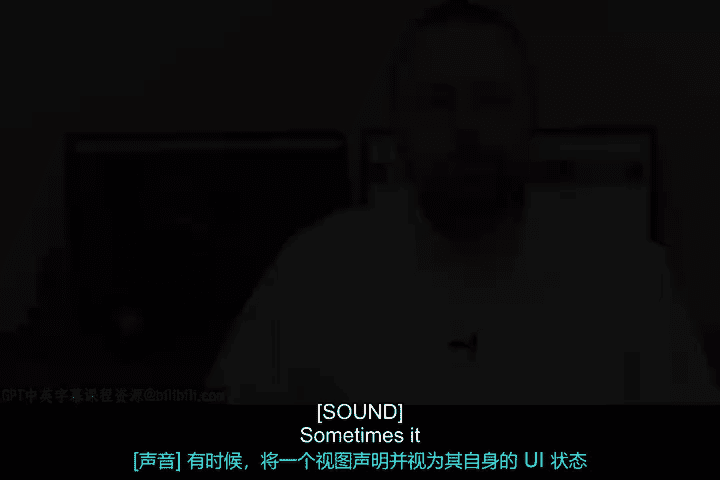
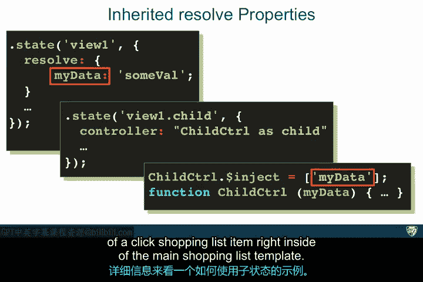

# 约翰霍普金斯大学《使用 AngularJS 开发单页 Web 应用｜Single Page Web Applications with AngularJS》中英 - P83：82_第40讲（第1部分）：带嵌套视图的路由状态.zh_en - GPT中英字幕课程资源 - BV1dsFDeZEQr

🎼。

Sometimes it just doesn't make sense for a view to be declared and treated as its own UI state for example。

 it's quite common to have a list of some items and when the user clicks on one of the items in the list。

 the user would then see the details about that item without leaving the view that displays the entire list。

😊，The two views， one being the entire list of items and another being the details about a particular item is often referred to as the master detail view pair。

Not every master detail of view pair is suited to remain on the user's screen at the same time。

 but some certainly are a really useful feature of UI router is that child states inherit resolves and custom data properties from the parent states。

Among other things， what this means is that if the parent state already made the call to the server and retrieved the data。

 the child state need not repeat the process， it can simply use the parent's existing data without making another server call let's take a look at the syntax of declaring a child state。

The child state is usually declared with a do notation specifying the parent state name。

 that child state name。When set up this way and the child has its own URL assigned。

 its URL is concatenated to the URL declared for the parent。 So， for example。

 if the parent's URL was slash view1， this child's URL would be a slash view1 s detail slash sum value for Para1 parameter。

 Having a child state also means that somewhere in the parent's template。

 there's a declaration of the UI view into which the child template can insert its own template。

 This setup is really no different than the UI view directive that's placed directly in the main HTML page。

😊，As far as the inherited resolved properties， they would work as follows suppose the parent state declared a resolved property called by data If there was a child state declared with a controller named child control that would mean that we can inject the Mydata property directly into the child controller function in a lot of scenarios。

 this type of setup allows us to avoid extra server site calls as we can reuse the data already prefetched when the parent state gets activated。

 let's take a look at an example of how to use child states by displaying the details of a clicked shopping list item right inside of the main shopping list template。

