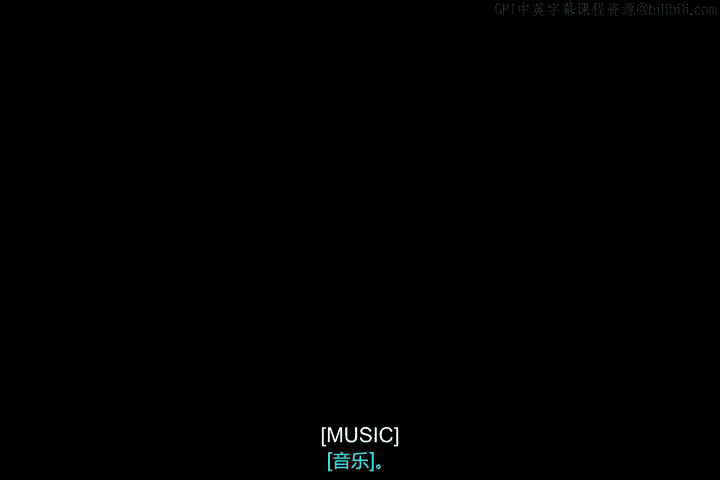
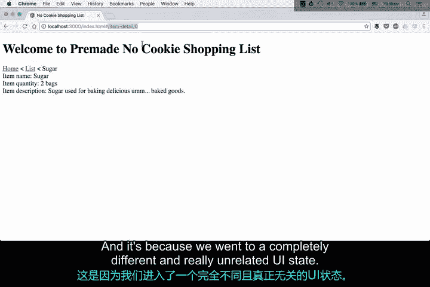
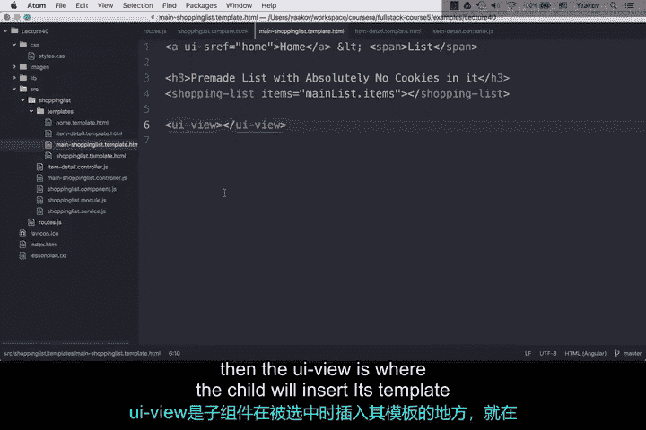
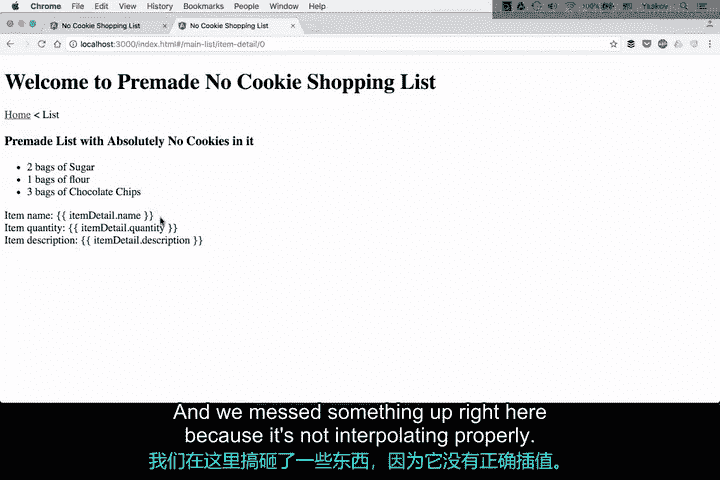
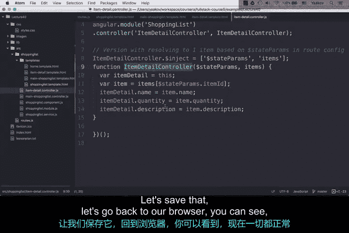
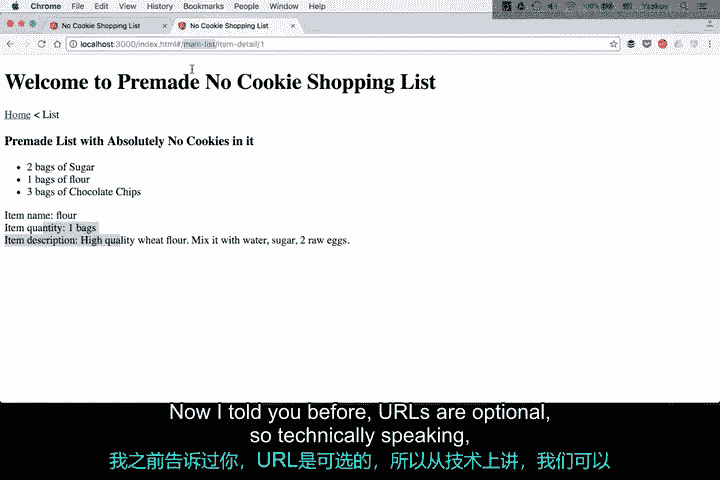
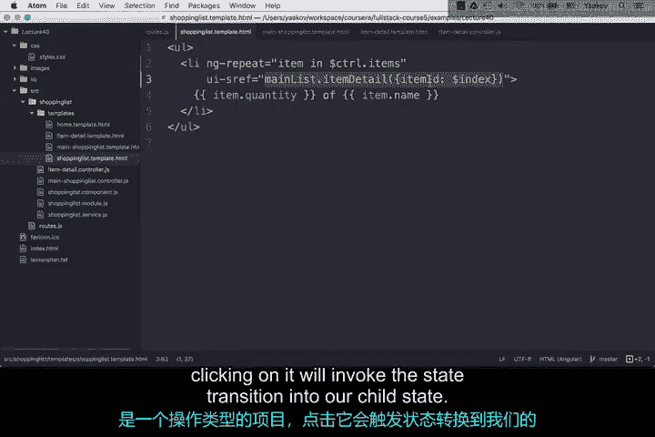
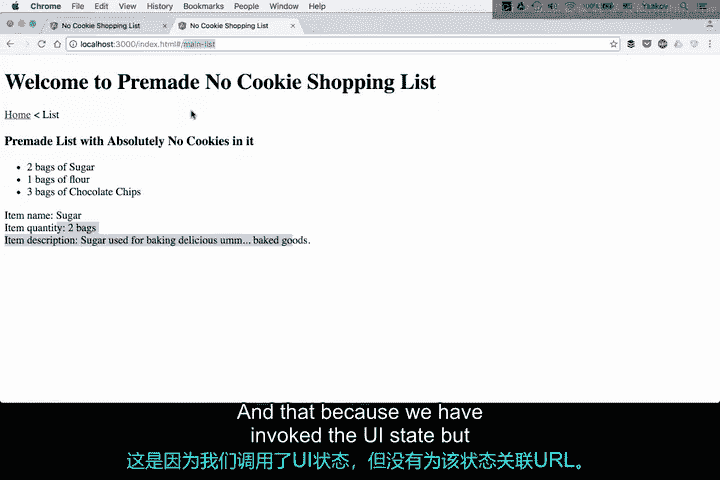
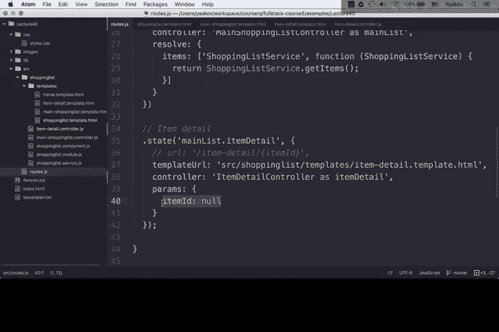
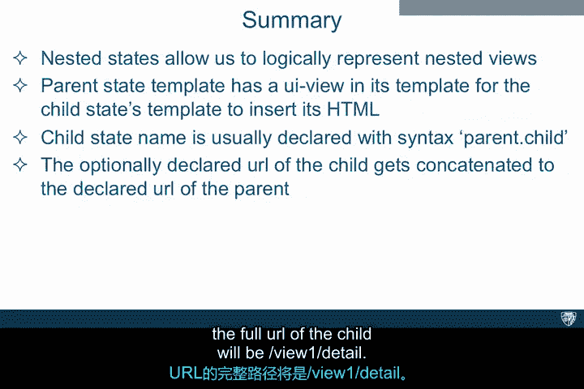

# 约翰霍普金斯大学《使用 AngularJS 开发单页 Web 应用｜Single Page Web Applications with AngularJS》中英 - P84：83_第40讲（第2部分）：带嵌套视图的路由状态.zh_en - GPT中英字幕课程资源 - BV1dsFDeZEQr

🎼。

Okay so we're back to our code editor and we're located in lecture 40。

 which is located in fullt dash course 5 examples folder and this is pretty much a carbon copy of where we left off in lecture 39 plus I simplified a couple of minor things What we see here it was scroll down and look at the states is that we have the main list that we were working with which basically lists all of our shopping items and we have this item details state and the item detail state takes one particular item based on the state parameters and based on the item ID and displays all the details about that particular item The problem is it displays those details in a completely separate screen so you don't see the complete list of the items you just see the detail about this particular item Also notice that main list already has a resolved property called It and it's actually calling the shopping list service get It method If you look at the item detail state We're basically doing the same。

😊，Same thing except now we're filtering that list down to one item using the state Para item ID。

 Let's jump to the browser and see how this works again so we click on this link and we see a list of these items and if we click on one of them you could see that the slash item detail0 shows up in the URL and we notice that we see the description of the item but we don't see the entire list and it's because we went to a completely different and really unrelated UI state let's go ahead and fix that by making the item detail state a child state of the main list state。

So the first thing we're going to do is we're going to copy the name main list and we're going to place it right in front of item detail and put a dot in between them so it's main list dot item detail so now this state became a child state of the main list。

We can now remove the resolve property from our child list and the reason we could do that is because we are already going to get all the items from the parent so we don't need to ask for them again and then filter them。

 we could directly inject the items resolved property into our item detail controller so let's go ahead and scroll down here and remove this whole resolve property altogether。

 let's take the come out as well and save that for now so now we could go to the item detail controller and go ahead and inject the items property and then find the item we actually need using our state parameters let's go to the item detail controller which is right there and instead of injecting the item in here we're actually going to inject items because items as we spoke about it's coming from the parent state so let's go back and items it is and in this case we need to inject one more thing。

😊，That's state PRs， so the state Para service， Do state parameterss。

 and we need that because we need to look up the item ID that is on the URL and we'll go ahead and put it here as well。

 state parameterss。Okay， so now what we need to do is we need to find the item based on the item ID that's on the URL。

 so we'll say var item equals and we'll use state parameterss dot and we'll go back to the route and we'll see that what we're actually looking for is this right here item ID parameter we'll go back to the controller。

So place the item ID right here and this is the index into our items array So really all we need to do is say items array of index of I should say of state parameterss item ID So now our item is the object with the index that was passed in through the URL and now we could set the item detail of name quantity and description okay let's go ahead and click save there is however one more thing we need to do before we move on when the user clicks on the list item the URL needs to be constructed properly and that is sitting inside the shopping list template HTML which is the template for our component Currently what we have from the past here is just item detail let's no longer going to do because the name of our state is no longer item detail the name of our state is main list that item detail so we'll copy that we'll go back。

😊，to the Ui ref and we'll go ahead and replace that with main list item detail。

 Let's go ahead and save that。 and before we can do anything else。

 we do need to go to our main shopping list and go ahead and place this UI view holder right here。

 so our main shopping list will be handled by this shopping list component and then the UI view is where the child will insert its template when it is selected right there。

 Okay so let's go back to the browser and we'll click our link to see our list and now we should be able to click on one of these links right here and we mess something up right here because it's not interpolating properly So let's go back to our code editor and take a look as to what's going on here and let's see this looks pretty good the controller。

 the item detail controller seems to not be setting these names up and。😊。

LetsSee the reason why because we injected items and yet we're not saying items we saying item。

 so we need to actually reference the items。That we injected into the item detail controller。

 Let's save that。 Let's go back to our browser。 and you can see now it's all working。

 So let's go back to home and we'll click。

And you could see it's right there。 and when we click one more time you could see that now inside of this template。

 we have one more template inside of that that is being displayed。

 and that is the detail of the item that we clicked on and as we clicking different items you could see it's happening instantaneously and the reason it's happening instantaneously is because we're no longer requesting any items from the shopping list service Those items were all loaded right here in the parent state which was the main list。

 Also notice our URL main dash list slash item dash detail slash0 and I can actually manually changing it if I want and you could see it's manually changing right there our item detail URL became sort of like a sub URL to the parent main dash list。

😊，Now I told you before URLls are optional so technically speaking。

 we could go back and go to our routes and comment out the URL of the child。 There is， however。

 a caveat to this if we comment out the URL of the child and it happens to have a parameter UI router will not know to expect a parameter like that therefore it requires us to give it one more property called PRs and in the parameterss it requires us to give the UI router as the name of the parameter with some value So in this case we'll give it。

 I don't know no it really is good enough once we do that and we save it notice that our child state no longer has a URL that we're going to be able to identify the child by but we'll still be able to get to the state of the child because of the link that we made inside of our shopping list main shopping list we made the link or I should say inside the controller we made the link we're making the link right here and even though that link is not necessarily going to be a。

URL but it will be an action type of item where somebody clicking on it will invoke the state transition into our child state。

 Let's go back to the browser and let's check that out。

 let's click on this one first and you can see here it says main dash list that's correct And if we click on two bags of sugar you'll see two big of sugar show up and we are in that state of UI but if you look at the URL the URL still stays at main dash list and that is because we've invoked the UI state but we did not associate a URL together with that state。

 we simply comment it out and provided it a hint that we are expecting an item ID as a parameter into that UI state。

😊。

Okay， so let's summarize。Nested states allow us to logically represent nested views The parent state template has a UI view placeholder in its template for the child's template to insert its HTML。

The child state name is usually declared with a syntax parent dot child， in other words。

 the parent name， then dot then the child name。The optionally declared URL of the child gets concatenated to the declared URL of the parent。

 so if the parent URL is slash view1 and the child's URL is declared as/ detail。

 the full URL of the child will be/lash view1/ detail。

Also a very important feature that UI router implements is that the parent's resolve property is inherited by the child and is injectable directly to the child's controller。

 among other things this allows us to avoid multiple serverite calls that keep fetching the same data over and over instead the child simply can inject the data that is already prefetched by the parent directly into its controller。

