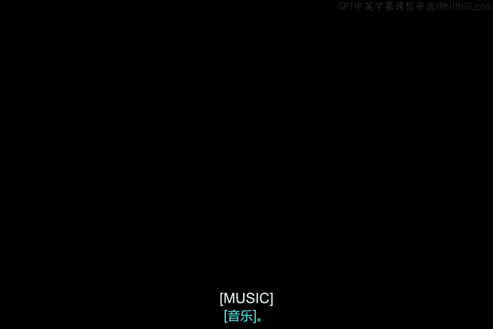
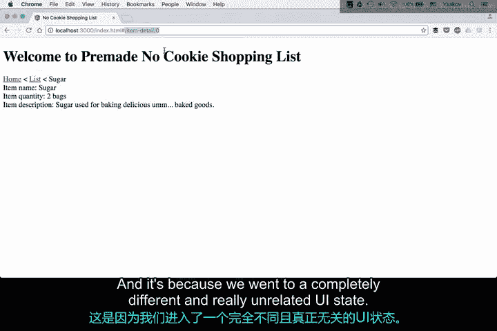
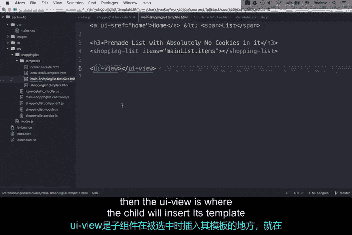
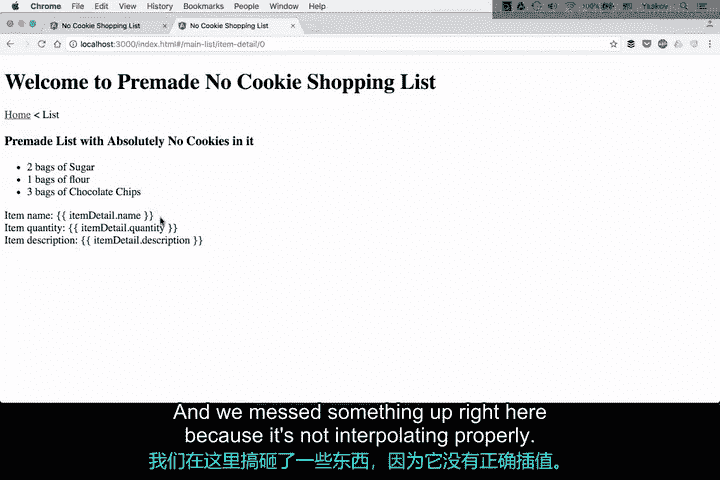
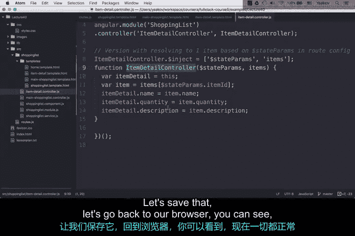
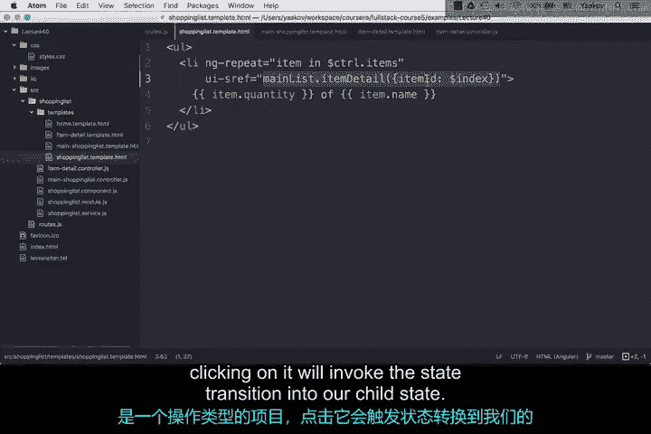
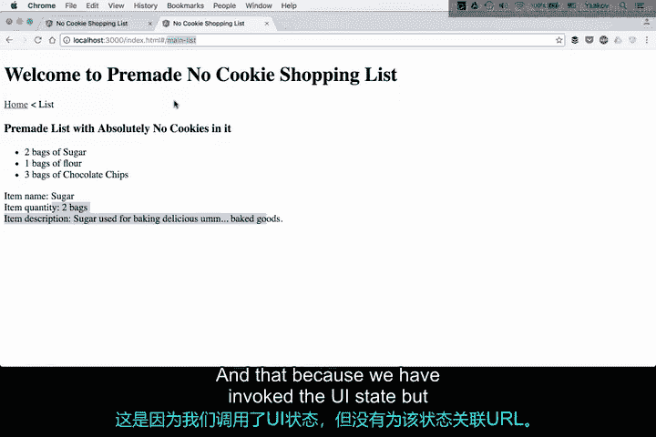
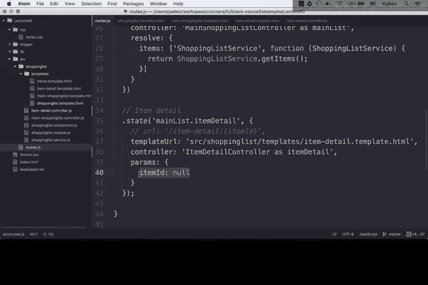
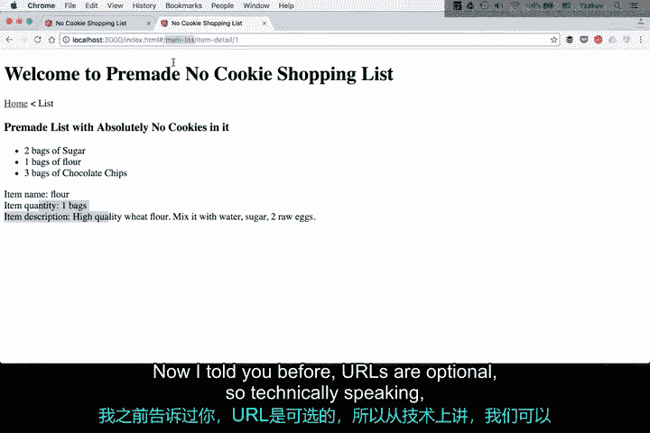
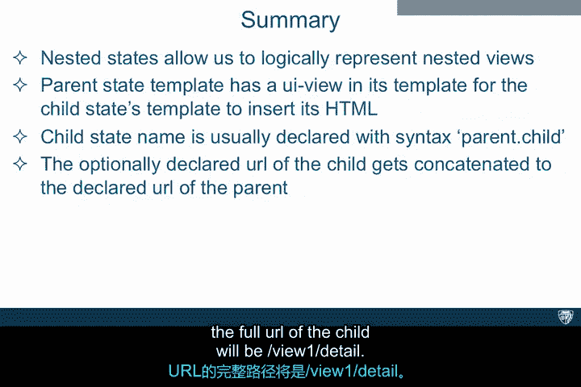

# 使用 AngularJS 开发单页 Web 应用：P84：第40讲（第2部分）：带嵌套视图的路由状态

在本节课中，我们将学习如何在 AngularJS 应用中创建嵌套的路由状态。我们将从一个现有的购物清单应用开始，它目前有两个独立的状态：一个用于显示主列表，另一个用于显示单个项目的详情。我们的目标是让项目详情状态成为主列表状态的子状态，从而实现嵌套视图，让详情页面在主列表的上下文中显示。

我们回到代码编辑器，位于第40讲的文件夹中。这里的代码基本上是第39讲结束时的副本，只是简化了一些小细节。我们向下滚动查看状态定义，可以看到我们正在使用的主列表状态，它列出了所有的购物项目。此外，还有一个项目详情状态，它根据状态参数中的项目ID来显示特定项目的所有详细信息。

问题是，它在一个完全独立的屏幕上显示这些详情。你看不到完整的项目列表，只能看到这个特定项目的详情。同时注意到，主列表状态已经有一个名为 `items` 的 `resolve` 属性，它调用了购物清单服务的 `getItems` 方法。如果你查看项目详情状态，我们基本上在做同样的事情，只是现在使用状态参数 `itemId` 将列表过滤到一个项目。

让我们跳转到浏览器，再次看看它是如何工作的。我们点击这个链接，看到一个项目列表。如果我们点击其中一个，可以看到 URL 中出现了 `/item-detail/0`，并且我们看到了项目的描述，但没有看到整个列表。这是因为我们进入了一个完全不同的、实际上无关的UI状态。现在，我们通过让项目详情状态成为主列表状态的子状态来修复这个问题。

我们要做的第一件事是复制主列表状态的名称 `mainList`，并将其放在 `itemDetail` 前面，中间用一个点连接。所以它变成了 `mainList.itemDetail`。现在，这个状态成为了 `mainList` 的子状态。

我们现在可以从子状态中移除 `resolve` 属性。这样做的原因是，我们已经从父状态获取了所有项目，所以不需要再次请求并过滤它们。我们可以直接将父状态解析出的 `items` 属性注入到我们的项目详情控制器中。

让我们向下滚动，完全移除这个 `resolve` 属性。也把逗号去掉，然后保存。现在，我们可以转到项目详情控制器，注入 `items` 属性，然后使用状态参数找到我们实际需要的项目。

让我们找到项目详情控制器。在这里，我们不再注入 `item`，而是注入 `items`，因为正如我们讨论过的，`items` 来自父状态。我们还需要再注入一个东西，那就是 `$stateParams` 服务，用于状态参数。我们需要它，因为我们需要查找URL上的项目ID。我们把它也加在这里。

现在我们需要做的是，根据URL上的项目ID找到对应的项目。我们将设置一个变量 `item`，使用 `$stateParams.itemId` 作为索引来访问 `items` 数组。所以，我们的 `item` 就是通过URL传递的索引所对应的对象。现在，我们可以设置项目详情的名称、数量和描述了。

让我们点击保存。然而，在继续之前，还有一件事需要做。当用户点击列表项时，URL需要被正确构建。这部分代码位于购物清单模板HTML中，也就是我们组件的模板。目前，我们在这里使用的是 `itemDetail`。但我们的状态名称不再是 `itemDetail`，而是 `mainList.itemDetail`。所以，我们复制这个名称，回到 `ui-sref` 指令中，将其替换为 `mainList.itemDetail`。

保存后，在继续之前，我们还需要去主购物列表组件中，放置一个 `ui-view` 占位符。这样，主购物列表将由这个购物清单组件处理，而 `ui-view` 则是当子状态被选中时，其模板插入的地方。

现在，让我们回到浏览器，点击链接查看我们的列表。现在我们应该能够点击这里的链接了。但我们似乎搞错了什么，因为插值没有正常工作。让我们回到代码编辑器，看看发生了什么问题。控制器看起来没问题，但项目详情控制器似乎没有正确设置这些名称。

让我们看看原因。因为我们注入了 `items`，但在控制器里我们却引用的是 `item`。我们需要实际引用注入到项目详情控制器中的 `items`。保存后，回到浏览器，现在可以看到一切正常了。

让我们回到主页，点击链接。你可以看到它就在那里。当我们再次点击时，可以看到在这个模板内部，又显示了一个模板，那就是我们点击的项目的详情。当我们点击不同的项目时，可以看到它是即时发生的。之所以能即时发生，是因为我们不再向购物清单服务请求任何项目。这些项目都已经在父状态（即主列表）中加载好了。

同时注意我们的URL：`/main-list/item-detail/0`。我实际上可以手动更改它，你可以看到它正在手动更改。我们的项目详情URL变成了父URL `/main-list` 的一个子URL。

我之前说过，URL是可选的。所以从技术上讲，我们可以回到路由配置中，注释掉子状态的URL。然而，这里有一个注意事项：如果我们注释掉子状态的URL，而它恰好有一个参数，UI Router 将不知道需要这样一个参数。因此，它要求我们提供一个名为 `params` 的属性。在这个属性中，我们需要给UI Router提供参数名及其值。在这个例子中，我们给它一个值，比如 `null` 就足够了。

一旦我们这样做并保存，注意我们的子状态不再有一个我们可以识别的URL。但我们仍然能够通过我们在主购物列表控制器中创建的链接进入子状态。即使这个链接不一定是一个URL，但它会是一个动作类型的项目，当有人点击它时，会触发状态转换到我们的子状态。

让我们回到浏览器检查一下。首先点击这个，你可以看到URL显示为 `/main-list`，这是正确的。如果我们点击“两袋糖”，你会看到两袋糖的详情显示出来，我们处于那个UI状态。但如果你看URL，URL仍然停留在 `/main-list`。这是因为我们调用了UI状态，但没有为该状态关联一个URL。我们只是注释了它，并提供了一个提示，表明我们期望一个 `itemId` 作为该UI状态的参数。

好的，让我们来总结一下。

嵌套状态允许我们在逻辑上表示嵌套的视图。父状态的模板中有一个 `ui-view` 占位符，用于子状态的模板插入其HTML。

子状态的名称通常使用 `parent.child` 的语法声明。换句话说，就是父状态名，然后一个点，然后是子状态名。

子状态可选声明的URL会连接到父状态声明的URL之后。所以，如果父URL是 `/view1`，子URL声明为 `/detail`，那么子状态的完整URL将是 `/view1/detail`。

此外，UI Router 实现的一个非常重要的特性是，父状态的 `resolve` 属性会被子状态继承，并且可以直接注入到子状态的控制器中。这使我们能够避免多次重复获取相同数据的服务器调用。相反，子状态可以直接将父状态已经预取的数据注入到其控制器中。

本节课中，我们一起学习了如何创建嵌套的UI状态，如何通过点号语法定义父子关系，以及如何利用 `resolve` 属性的继承来优化数据获取。我们还探讨了子状态URL的可选性及其对参数处理的影响。