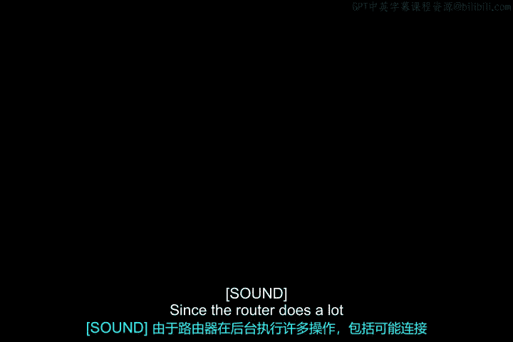
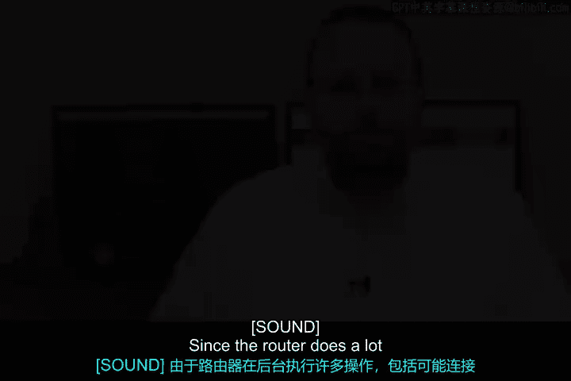
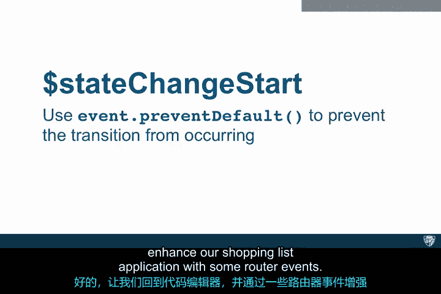

# 约翰霍普金斯大学《使用 AngularJS 开发单页 Web 应用｜Single Page Web Applications with AngularJS》中英 - P85：84_第41讲（第1部分）：路由器状态转换事件.zh_en - GPT中英字幕课程资源 - BV1dsFDeZEQr

🎼。

Since the router does a lot of things in the background。

 including potentially reaching out to a server and fetching data。

 it's very useful to be able to plug into different events that occur as the router performs its functions All your router events are fired at the Do sign rootcope level In other words。

 all events broadcast down the document object model tree for any node to potentially respond to the event。

😊，I'm not going to go over every event that the UI router provides。

 but let's take a look at some of the events UI router exposes that we will make use of in our example。

 for a complete list of the events and when they're fired， please see the UI router documentation。

The first one is called Deasign state change start and that event fires when the state change transition begins。

 so if you know that it's going to be somewhat of a long running transaction or it's going to wait for some server responses。

 probably this is the time to fire of some sort of a spinner to let the user know that we're waiting for something。

If you started a spinner when the Dalasine state changed start event fired。

 now will be the time to turn it off since the transition is complete。

The same goes for the Dallasasine state change error that fires when an error occurs during the transition。

Now the UI router documentation points out an important point if any errors occur in your resolve function。

 they will not be thrown traditionally， in other words。

 you will not see any errors in the console and everything will appear normal when in fact there's an error。

 you have to listen for the Do science state change error event to catch all errors that occur during state changes。

If you wanted to catch the transition， right when it starts and based on some data evaluation。

 stop the transition from occurring， you can call Prevent default method on the event object to stop the transition from going forward。

 essentially canceling it。😊，Okay， let's get back to the code editor and enhance our shopping list application with some router events。

