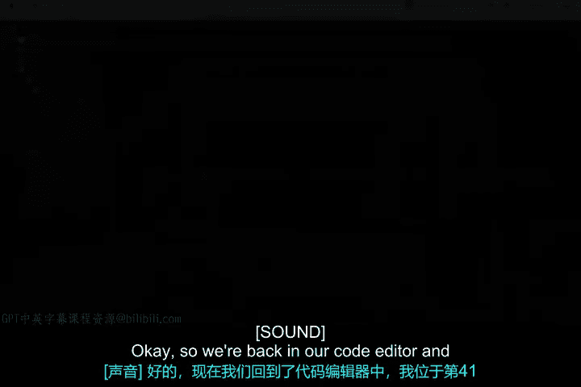
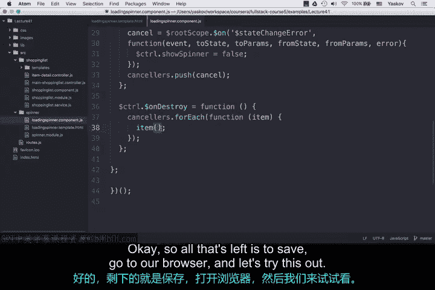
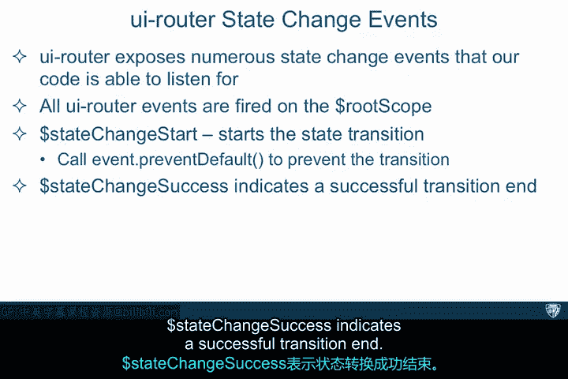

# 约翰霍普金斯大学《使用 AngularJS 开发单页 Web 应用｜Single Page Web Applications with AngularJS》中英 - P86：85_第41讲（第2部分）：路由器状态转换事件.zh_en - GPT中英字幕课程资源 - BV1dsFDeZEQr

🎼。

Okay， so we're back in our code editor and I'm located in lecture 41。

 which is located in fulltag dash course 5 examples folder and this code sample is basically the same as lecture 40 but we're bringing our spinner back except we're bringing our spinner back and it's now going to respond instead of to the custom events that we're throwing its going to respond to the events that the Ui router is throwing So the first thing we need to do is go to our shopping list module do js and import our spinner module and we see here we're importing the Ui do router and we're importing the spinner module as well。

 Now the spinner module is going to be slightly different。

 let's go ahead and go to the component js which is where the main logic is located we're declaring the component loading spinner and the component is going to have the spinner controller in this controller we're going to do the following on the dollar sign in it we're going to go ahead and listen for some of these events number one is we're going to listen for the state。

😊，Change start event and when the change that start event fires。

 we're going to respond by setting the controller show spinner to true。

 Well show spinner equals true will turn on our spinner image and make it visible if we look to our components template and you'll see that we have an NG if with the controller and show spinner。

 So if the show spinner property is true。 this image will show up。

 let's go back to the component do js。 So point is if we detect the dollar sign state change start。

 This is when the Ui router is starting the transition。 it will turn the show spinner to true。

 It will also remember the function that the on dollar sign on method produces because that function is something we could cancel listening for this event later and what we're going to do is we're gonna have outside of our dollar sign and knit function this canceler's array and we're basically going to push our。

😊，Cancel for this particular event。 our cancel function onto this cancels array。

 And you'll see in the second why we're doing that。

 We're also going to listen for D science stay change success。

 That means that the transition has finished。 and therefore we can go ahead and turn off the spinner by setting show spinner equals false。

 Once again， this listener will get pushed onto our cancelers array that will use later。😊。

And the last but not least the state change error， so if any error occurs。

 we don't want our spinner to keep going on and on forever。

 we want the spinner to stop and therefore we're listening on this state change error and we're also setting our show spinner to false if that occurs because that means the transition really has ended unfortunately unsuccessfully and once again we taking the canceling function for that listener and we are pushing it under our canceler's array。

Okay， so the very last part is is that we're using the lifecycle method dollar sign on Detro when this scope is getting destroyed。

 we're going to go ahead and take our cancel's array。

 that's what we've been pushing everything on since it's sitting outside of the dollar sign in it。

We're going to take this cancelless array and for each member of that array。

 we're going to go ahead and invoke this function and take the item in that array。

 which is what is going to get passed into it through each iteration， and we're going to invoke it。

 canceling， listening for that particular event。😊，Okay。

 so all that's left is to save go to our browser and let's try this out。

 We'll click and you can see it's spinning showing us that something is working。

 So if we click on here again it's so quick and since we're not really reaching out to any asynchronous services it's so quick that we don't want see that at all So as we keep clicking here we're not going to see the spinning but if we go home again and click on this we'll see the spinning again and that is an indication to the user that something is going on while the next state is loaded。

😊。

Okay， so in a nutshell that's pretty much the features of UI router and believe it or not we actually went pretty deep on that topic as well Before we' finished the entire UI router topic。

 I do want to show you where to get documentation for this UI router go ahead and Google UI dash router you can even Google Angular。

😊，And you'll see that you'll get to this Github page， which is going to be the Ui router Github page。

 What you want to do is it's a little bit unfortunately confusing the way they've set it up here because there's so many versions flying around and most of them again。

 unfortunately pointing to the wrong one。 What you want to do is you want to scroll all the way down on that page。

 and you'll see an in-dth guide link And if you click that indepth guide link by and large this documentation is pretty accurate and it's actually pretty good。

 Another thing to point out is that very soon， hopefully the Ui router is going to release it' 1。

0 version and the 1。0 version is going to be very much component centric。

 which is something that angular is really moving towards in angular 2 and in angular 1 as well。

 it's moving to the componentbased architecture。 So watch out for that And once it actually is released you will no longer even have to specify controllers in your。

😊，You will directly be able to specify components that are responsible for handling the entire state that you're defining。

😊，Okay， so let's summarize UI router exposes numerous state change events that our code is able to listen out for All UI router events are fired on the Doarine rootcope There are several events in particular that we probably are interested in almost all the time one of them is dollar sign state change start That is the event that signals that the state transition has started You could call event that prevent default to prevent the transition from finishing。

State change success indicates a successful transition end。

And state change error indicates that the transition failed。

 including having some errors in the resolve。Now you need to listen for this particular event。

 Dci and state change error to catch all errors during state transition， for example。

 the errors that come out from the result functionality are not displayed in the console and are basically swallowed and the only way you could look at them is to actually listen out for the state change error event of the UI router。

