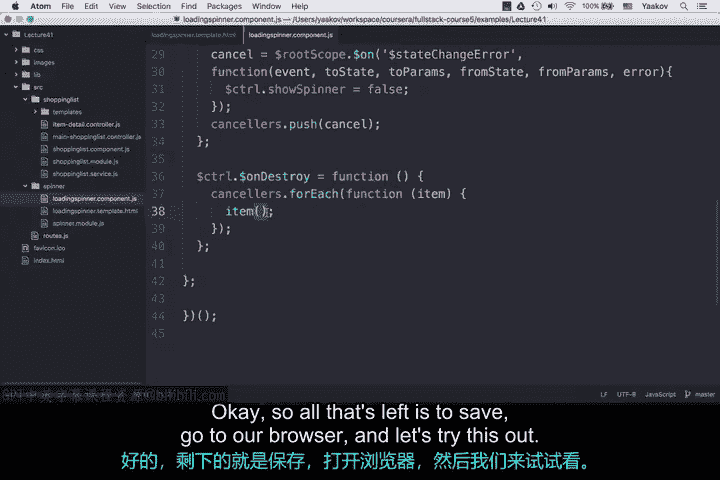
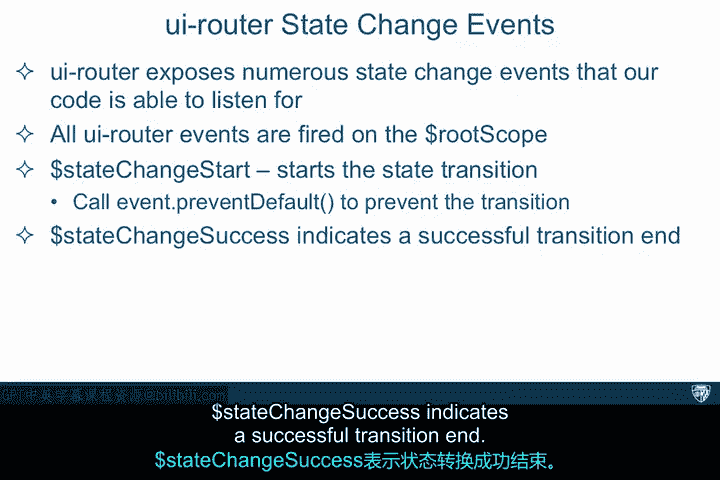

# 使用 AngularJS 开发单页 Web 应用：P86：路由器状态转换事件 🚦


在本节课中，我们将学习如何利用 AngularJS UI Router 内置的状态转换事件来控制页面加载指示器（如旋转器）的显示与隐藏。我们将通过监听路由器的特定事件，来替代之前自定义事件的方法，实现更优雅的交互反馈。

---

## 代码结构与准备

上一节我们介绍了自定义事件，本节中我们来看看如何利用 UI Router 的内置事件。我们回到代码编辑器，位于 `lecture41` 目录下。此示例代码与第40讲基本相同，但我们重新引入了旋转器组件。关键区别在于，现在的旋转器将响应 UI Router 抛出的事件，而非我们自定义的事件。

首先，我们需要在购物列表模块 `shopping-list.module.js` 中导入旋转器模块。我们看到这里已经导入了 `ui.router` 和 `spinner` 模块。

接下来，旋转器模块的代码将有所不同。

---

## 旋转器组件逻辑

让我们查看组件的主要逻辑文件 `component.js`。我们声明了一个名为 `loadingSpinner` 的组件，其控制器为 `SpinnerController`。

在控制器的 `$onInit` 生命周期函数中，我们将设置事件监听器。

以下是控制器中需要实现的核心步骤：

1.  **监听 `$stateChangeStart` 事件**：当 UI Router 开始状态转换时触发此事件。我们的响应是将控制器的 `showSpinner` 属性设置为 `true`。
    ```javascript
    $scope.$on('$stateChangeStart', function(event) {
        vm.showSpinner = true;
    });
    ```
    如果查看组件的模板，会发现有一个 `ng-if` 指令绑定到 `controller.showSpinner`。当该属性为真时，旋转器图片就会显示。

2.  **存储取消监听函数**：`$on` 方法会返回一个函数，调用该函数可以取消对应事件的监听。我们将在控制器作用域外定义一个 `cancellers` 数组，并将每个监听器的取消函数存入该数组。
    ```javascript
    let cancels = [];
    cancels.push($scope.$on('$stateChangeStart', function(event) {
        vm.showSpinner = true;
    }));
    ```

3.  **监听 `$stateChangeSuccess` 事件**：当状态转换成功完成时触发此事件。此时，我们可以通过将 `showSpinner` 设置为 `false` 来关闭旋转器。
    ```javascript
    cancels.push($scope.$on('$stateChangeSuccess', function(event) {
        vm.showSpinner = false;
    }));
    ```

4.  **监听 `$stateChangeError` 事件**：如果在转换过程中发生任何错误（例如 `resolve` 中的错误），也会触发此事件。为防止旋转器无限旋转，我们需要在此事件中同样将 `showSpinner` 设置为 `false`。
    ```javascript
    cancels.push($scope.$on('$stateChangeError', function(event) {
        vm.showSpinner = false;
    }));
    ```

5.  **清理监听器**：最后，我们需要在控制器作用域被销毁时，清理所有的事件监听器，以防止内存泄漏。这可以在 `$onDestroy` 生命周期函数中完成。
    ```javascript
    this.$onDestroy = function() {
        cancels.forEach(cancelFn => cancelFn());
    };
    ```

---



## 运行与效果

完成上述代码后，保存并刷新浏览器。现在，当点击链接进行页面导航时，旋转器会短暂出现，提示用户页面正在加载。由于我们的示例没有调用异步服务，转换速度极快，旋转器可能一闪而过。但反复在“首页”和“列表页”之间切换，就能观察到旋转效果，这向用户清晰地表明了应用正在后台工作。

---

## UI Router 文档与未来

在结束 UI Router 这个话题之前，有必要了解一下如何获取其官方文档。

你可以搜索“ui-router”或“Angular ui-router”来找到其 GitHub 页面。需要注意的是，由于版本较多，文档链接可能有些混乱。最可靠的方法是滚动到页面底部，找到并点击“In-Depth Guide”链接。这份指南文档通常比较准确和实用。

另外需要指出的是，UI Router 即将发布 1.0 版本。该版本将完全以组件为中心进行设计，这与 Angular 2 以及 Angular 1.x 向组件化架构发展的趋势是一致的。届时，在定义状态时，你将可以直接指定负责处理该状态的组件，而无需再单独定义控制器。

---

## 核心概念总结



本节课中我们一起学习了 UI Router 状态转换事件的应用。让我们总结一下要点：

*   **事件监听**：UI Router 暴露了多个状态转换事件，供我们的代码监听。
*   **事件作用域**：所有 UI Router 事件都在 `$rootScope` 上触发。
*   **关键事件**：有几个事件在开发中尤其常用：
    *   **`$stateChangeStart`**：状态转换开始时触发。可以调用 `event.preventDefault()` 来阻止转换完成。
    *   **`$stateChangeSuccess`**：状态转换成功结束时触发。
    *   **`$stateChangeError`**：状态转换失败时触发（包括 `resolve` 中出现的错误）。
*   **错误处理**：必须监听 `$stateChangeError` 事件才能捕获状态转换期间的所有错误。例如，从 `resolve` 功能中产生的错误不会显示在控制台中，只会被“吞掉”，监听此事件是查看它们的唯一方式。


通过合理利用这些事件，我们可以构建出响应更灵敏、用户体验更佳的单页应用程序。