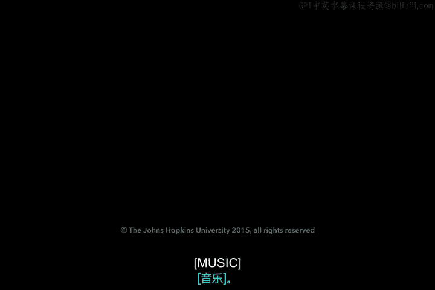

# 约翰霍普金斯大学《使用 AngularJS 开发单页 Web 应用｜Single Page Web Applications with AngularJS》中英 - P87：86_模块4总结.zh_en - GPT中英字幕课程资源 - BV1dsFDeZEQr

🎼。

🎼The。🎼Yeah。🎼，🎼，Congratulations on finishing module4 the skills you now possess are enough to produce really nice and elegantly designed single page web applications All that's left is to practice。

😊，In the next module， we're going to leave the classroom behind and get out into the real world for a bit you will get to go on a fun field trip with me to meet with our real customer and get familiar with their business。

Then you'll sit right next to me as I code up a real AngularGS application that will be used by real users。

While I'll still be the one writing the code， you will get to observe a step by step creation of a real web application using Angular JS up close and personal。

See you on the next module。This thing is hard to open。What come on。呃。It's corn， corn is a vegetable。

没有。Corn's a vegetable。Corn is a vegetable。It's really button。嗯。So the next module。

They're really good vegetables。🎼嗯。🎼。

