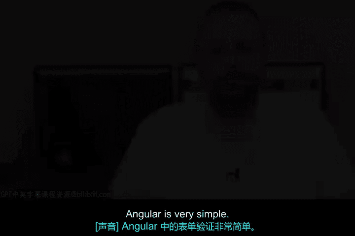
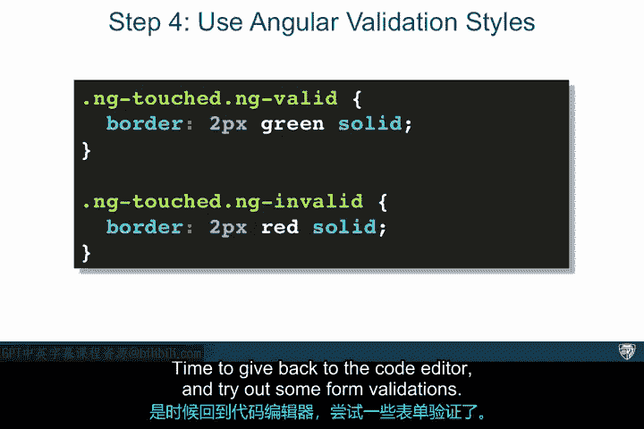

# 约翰霍普金斯大学《使用 AngularJS 开发单页 Web 应用｜Single Page Web Applications with AngularJS》中英 - P89：88_第42讲（第1部分）：表单验证.zh_en - GPT中英字幕课程资源 - BV1dsFDeZEQr

🎼。

Form validation in Angular is very simple in fact I've heard of some small projects that don't use Angular for their entire application but only import and use Angular to validate their forms if you've never dealt with forms before let me give you a quick overview。

😊，A form is a collection of controls which are usually native HTML controls that users can interact with by choosing or entering data into them。

 One control we have worked with quite a bit at this point is the text box you can see that each input type has a type attribute whose value tells the browser how to display that input input type text tells the browser to display that input tag as a single line text box type value of text area displays a multiline text box which you can also used to enter text There's really not that much more to those type of input elements So I'm not going to go through every single one of them and explain what they do。

 input type checkbox is guess what It's a checkbox The last type displayed in our example form is submit the submit type is largely a historical as forms used to be submitted by the browser where the browser automatically collected all the values of the formrranging them。

key value pairs and constructing a URL request to the action attribute on the form element containing those key value pairs note that I'm not showing the action attribute on the form element in our example that's because we're going to have our own front end logic handle data attached to the input fields using Angular submitting the form using a declared action attribute does not really fit into the single page application paradigm。

 but the input type submit natively displayd as a button so we can still use it。 however。

 we could also use the HTML button tag here。Collection of all the inputs under a single form tag is not a requirement as far as HTML document validity is concerned。

 but it does provide the ability for us to naturally group those inputs together and is needed to use angular form validation。

Okay， let's go over the steps involved in setting up form meloation in Angular JS。First。

 you must create a form with containing input elements and give the form as well as the input elements a value for the name attribute。

Form validation functionality is introduced into our HTML with the NG model directive that we've used multiple times before。

Note that I'm assuming that you have a controller surrounding this form whose instance label or controller S syntax has been set to CTRL。

 and that is why you see here NGDash model equals to CTRl。

 name with binding the name property of the controller instance to this text input box。Optally。

 we can also assign our button and EnGCl so we are ready to do something with our bound data in the controller once everything validates however。

 for now we haven't asked our form to actually do any validation that's what we'll do in the next step。

😊，Step 3 is to declare HTML5 validation attributes In this case you can see that our text box has required and Minle validation attribute set。

 which means that we're announcing that this text box cannot be left empty thus required and when you type something into it it has to be at least four characters long we can also optionally specify the same validation attributes that are supplied by angular for example。

 instead of minle we can use NG dash mean length， the only difference between the two is that with NG dash mean length attribute。

 its value can be a regular angular expression without having to use the double curly braces to interpolate it。

That's useful if you don't want to hardcode the value for min length and instead have that value retrieved from controller instance or some other angular container note that since we want Angular to take care of validation。

 we need to disable the more limited native browser form validation so it doesn't get on away we can do that by specifying no validate attribute on the form element。

😊，Step 4 is for us to use angular formbound objects in order to affect our UI and give feedback to the user in this case you could see that we have an error message that is wrapped with the span and an NG if which means it will only show up if the things inside of the value for the NG if attribute are true in this case you see we have form name that name meaning the name of our input field。

 that dollar sign error that required， so we're saying that if that's true and and m percent and percent stands for end form name which is again the form with the name that we declared it which was form name that name referring to the input field with the name attribute equal to name that dollar sign touched all of these objects are being made available to us by angular the reason you're able to refer to the form object by its name and access the input fields through a familiar that notation。

😊，I because when Angular compiles HTML contained within the NGab directive and sees the form tag it automatically creates a special controller called form controller whose instance is attached to our dollar sign scope with the name that the form attribute name specifies This process is very similar to the controller S syntax where our controller is attached to dollar sign scope with the name we specify as our label In the form controller。

 Angular creates a bunch of objects that keep track of the requirements and validity of each named input contained in the form we can then access those objects using the form name as well as the name of the input fields So in this example we're using the NG if directive passing it an expression that will evaluate to either true or false If both a true meaning that the name input field has a validation。

😊，and it has been touched signified by the D sign touch property。

 The error message name is required will appear on the screen。

 The D sign touch property is an input state indicator。

 It's true if the user clicked into our input field， In other words， touched it in some sense。😊。

Since we don't want an error message displayed before the user even had a chance to try to enter a value。

 we add this condition to prevent that if the user clicked into the text box and still left it blank by clicking out of it。

 the error message name is required will be displayed。

Angular also creates a number of bound properties on the form object itself for example。

 we can use the dollar sign invalid property to conditionally enable and disable the submit button depending on whether or not the form is verified to be valid will enable the submit button only if the dollar sign invalid flag is false。

😊，Step 4 is for us to use Angular validation styles Behi the scenes。

 Angular is helping us out even more by injecting and removing its validation related classes from our input fields。

 we can use that by providing styles for those classes in our style sheet In this case。

 we're turning the border of an input element green if it has been touched by the user and is valid at the same time。

 and red if it has been touched but failed the validation。For a complete list of the CSS classes。

 you could style based on Angular validation and a complete list of validation bound objects。

 look upG model， EnG model controller， and form controller documentation。Okay。

 time to get back to the code editor and try out some form validations。

