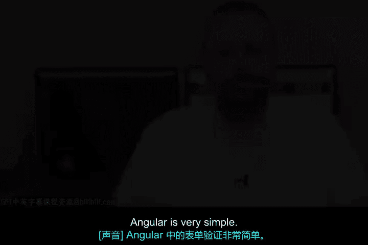
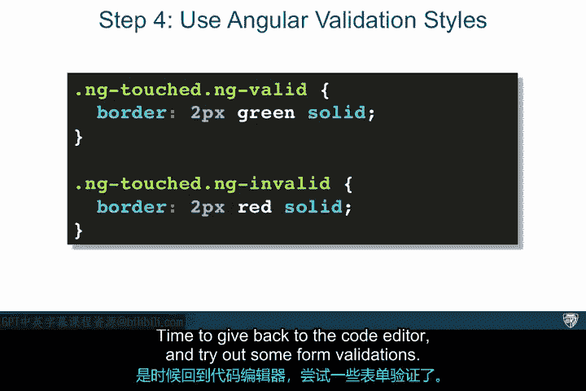

# 使用 AngularJS 开发单页 Web 应用：P89：表单验证（第1部分）




## 概述
在本节课中，我们将学习如何在 AngularJS 中实现表单验证。表单验证是 Web 应用开发中的核心功能，用于确保用户输入的数据符合特定规则。AngularJS 提供了强大且简单的方式来处理表单验证，甚至有些小型项目会专门引入 AngularJS 来管理其表单验证。

## 表单与控件简介
在深入了解验证之前，我们先简要回顾一下表单和控件。表单是控件的集合，这些控件通常是用户可以与之交互的原生 HTML 控件，例如通过选择或输入数据。

我们目前已经接触过的一个控件是文本框。每个输入元素都有一个 `type` 属性，其值告诉浏览器如何显示该输入。例如，`input type="text"` 会显示为单行文本框，而 `input type="textarea"` 则显示为多行文本框。

其他常见的输入类型包括 `checkbox`（复选框）和 `submit`（提交按钮）。`submit` 类型在历史上用于由浏览器自动收集表单所有值，将其排列为键值对，并向表单元素的 `action` 属性构造一个 URL 请求。但在单页应用中，我们通常使用前端逻辑（如 AngularJS）来处理数据，因此不常使用 `action` 属性。不过，`input type="submit"` 会原生显示为一个按钮，我们仍然可以使用它，或者也可以使用 `HTML button` 标签。

将所有输入元素放在一个 `form` 标签下并不是 HTML 文档有效性的强制要求，但它能让我们自然地分组这些输入元素，并且是使用 AngularJS 表单验证所必需的。

## 设置 AngularJS 表单验证的步骤
上一节我们介绍了表单的基本概念，本节中我们来看看在 AngularJS 中设置表单验证的具体步骤。以下是实现验证需要遵循的流程。

### 第一步：创建表单并命名
首先，必须创建一个包含输入元素的表单，并为表单以及输入元素设置 `name` 属性的值。

```html
<form name="myForm">
  <input type="text" name="userName" />
</form>
```

### 第二步：引入 `ng-model` 指令
表单验证功能通过我们之前多次使用的 `ng-model` 指令引入到 HTML 中。假设你有一个控制器包裹着这个表单，并且其实例标签（或 `controller as` 语法）已设置为 `ctrl`。

```html
<input type="text" name="userName" ng-model="ctrl.name" />
```

这会将控制器实例的 `name` 属性绑定到这个文本输入框。我们还可以为按钮添加 `ng-click` 指令，以便在验证通过后，在控制器中处理绑定的数据。

### 第三步：声明验证属性
目前，我们还没有要求表单进行任何验证。接下来，我们需要声明 HTML5 验证属性。例如，可以为一个文本框设置 `required` 和 `minlength` 属性。

```html
<input type="text" name="userName" ng-model="ctrl.name" required minlength="4" />
```

这意味着该文本框不能为空（`required`），并且输入的内容长度至少为 4 个字符（`minlength="4"`）。我们也可以选择使用 AngularJS 提供的等效验证属性，例如用 `ng-minlength` 代替 `minlength`。两者的主要区别在于，`ng-minlength` 属性的值可以是一个常规的 Angular 表达式，而无需使用双花括号进行插值。如果你不希望硬编码最小长度值，而是希望从控制器实例或其他 Angular 容器中获取该值，这将非常有用。

由于我们希望 AngularJS 负责验证，需要禁用功能有限的原生浏览器表单验证，以免造成干扰。我们可以在 `form` 元素上指定 `novalidate` 属性来实现。

```html
<form name="myForm" novalidate>
  <!-- 输入字段 -->
</form>
```

### 第四步：使用表单绑定对象提供用户反馈
现在，我们可以使用 AngularJS 创建的表单绑定对象来影响用户界面并向用户提供反馈。例如，我们可以使用 `ng-if` 指令来条件性地显示错误信息。

```html
<span ng-if="myForm.userName.$error.required && myForm.userName.$touched">
  用户名是必填项。
</span>
```

在这个例子中，`myForm` 是表单的 `name`，`userName` 是输入字段的 `name`。`$error.required` 和 `$touched` 是 AngularJS 提供的对象属性。`$touched` 属性是一个输入状态指示器，如果用户曾点击进入该输入字段（即“触摸”过它），其值就为 `true`。我们添加这个条件是为了防止在用户甚至还没有机会尝试输入值之前就显示错误信息。

AngularJS 还会在表单对象本身上创建许多绑定属性。例如，我们可以使用 `$invalid` 属性来根据表单是否有效来条件性地启用或禁用提交按钮。

```html
<button ng-disabled="myForm.$invalid">提交</button>
```

### 第五步：应用 AngularJS 验证样式
在幕后，AngularJS 通过向我们的输入字段动态添加和移除与验证相关的 CSS 类，为我们提供了更多帮助。我们可以在样式表中为这些类提供样式来利用这一点。

例如，如果一个输入元素被用户触摸过并且同时有效，我们可以将其边框变为绿色；如果被触摸过但验证失败，则变为红色。

```css
.ng-valid.ng-touched {
  border: 2px solid green;
}
.ng-invalid.ng-touched {
  border: 2px solid red;
}
```

关于可基于 AngularJS 验证进行样式化的完整 CSS 类列表，以及完整的验证绑定对象列表，请查阅 `ng-model`、`ngModelController` 和 `formController` 的官方文档。




## 总结
本节课中，我们一起学习了在 AngularJS 中实现表单验证的完整流程。我们从创建和命名表单开始，然后使用 `ng-model` 指令绑定数据，接着声明了 HTML5 或 AngularJS 特有的验证属性。之后，我们探讨了如何利用 AngularJS 提供的表单绑定对象（如 `$error`、`$touched`、`$invalid`）来向用户提供实时反馈。最后，我们还了解了如何通过 AngularJS 动态添加的 CSS 类来美化验证状态的视觉呈现。掌握这些步骤，你就能为你的单页 Web 应用构建出健壮且用户友好的表单验证功能。