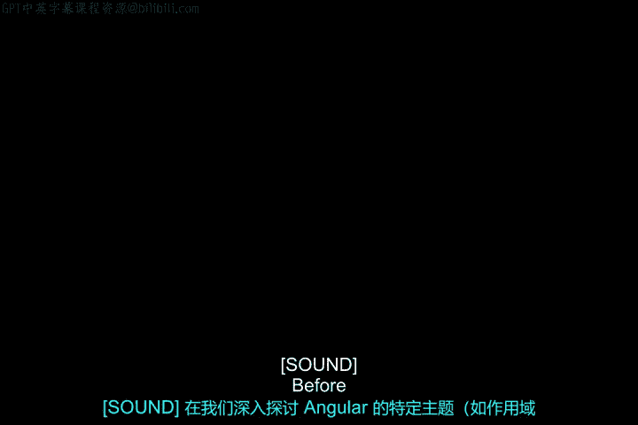
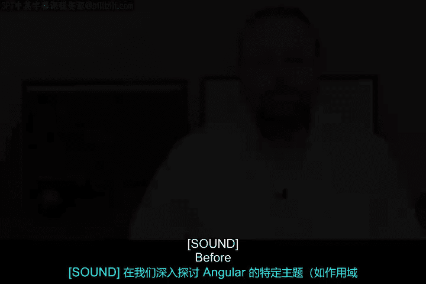
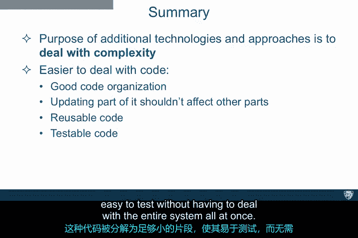

# 约翰霍普金斯大学《使用 AngularJS 开发单页 Web 应用｜Single Page Web Applications with AngularJS》中英 - P8：7_第1讲：为什么不保持简单.zh_en - GPT中英字幕课程资源 - BV1dsFDeZEQr

🎼。

Before we jump into all kinds of angular specific topics like explaining scope， services。

 directives as well as general programming concepts that Angular uses like model view view model architecture。

 I think would be really helpful to take a step back and understand the why behind whole approach when you're learning something new。

 the more you can understand why things fit together the way they do。

 not only does it help you understand and retain information。

 but it also makes your effort meaningful， no one likes doing things that are pointless。

 especially if they're more complex and Angular can get complex。😊。

But if you know and understand the value of your approach you have a whole different view of things you can appreciate the goal you're going for as well as judge how close so far you are from that goal in this course I'll explain everything step by step so you don't have to worry about the complexity so much however knowing the motivation behind making things less simple is still important。

So what is that goal that Angular and other such frameworks are trying to achieve。

 why not keep things simple， why complicate anything at all？

So what do I mean by keeping things simple so you already know the core technologies from the previous course that we went over that drive the web you know how to structure a web page using HTML。

 you can lay out and style that page using CSS and you can add functionality that makes your page come alive you can request data from the server and other services on the web So the question is why add anything else？

Let's take a look as to what happens to your project codeb as you keep adding more and more functionality as the project goes along。

 so you keep adding functionality， obviously the codeb grows together with it。

 and the most important part is that the JavaScript as's to where the functionality lives。

 grows in size and complexity， if not in size， certainly it grows in complexity。😊，So right off Tibe。

 the answer to the original question is that we as developers are not introducing all these complicated frameworks and approaches to coding and therefore making things complex No no no。

 without such approaches our code gets complex inherently by itself。

 these frameworks and approaches are here to help us deal with that complexity and keep it under control。

The question is how can we control the size to some extent。

 but certainly to a large extent how can we control the complexity of our code base and what does it mean control complexity what are we trying to achieve what do we want out of our code in other words what code characteristics do we need our code to have in order to consider it not so complex and fairly easy to deal with let's go over some of the basic ones？

😊，So the first one is that we need some way to organize different parts of our code such that we find the code that's responsible for a particular part of functionality quickly and don't forget that it's not just for you you need to organize it in such a way that it is clear as possible for your teammates as well a good rule of thumb to employ here is to think about what it would take to bring a completely new developer on board would it be fairly straightforward to explain to the new developer where the functionality lives in your codeb。

😊，Requirements of apps change all the time they change because customer want something new because the business rules change。

 but also because some requirements are misunderstood until later into the development process。

 so we need to prepare for that upfront if some business rule changes we don't want to have to rewrite the whole application In fact。

 we want to change as little as possible on our code in order to integrate the new change and have the rest of the code not even notice that anything happened。

It also would be a huge waste of time to have to write the same functionality more than once。

 especially if it's in the same application， however， even worse than our original duplicated time。

 so to speak， think about what happens when we need to update the functionality we would have to update it in more than one place Of course something like that is very prone to making simple mistakes and introducing hard to track bugs into your code so when we start thinking of how we're going to write some piece of functionality we should take at least a little bit of time to think if we need to make our code work more generically and write it in such a way that it can be used in several places in our app。

😊，And finally， how do you convince yourself that your code is actually working Well you test。

 but how， well you can fire up the entire system and see if code unquote everything works。

 but is that an efficient and good use of your time if you just edit a couple of small functions and don't even have the entire feature coded up yet probably not instead you need to code your solution in such a way that small chunks of it can be tested independently without having to deploy the entire web application that means that as you code you have to keep this idea in mind and separate your functionality into smaller testable components。

😊，So as a summary， the purpose of additional technologies and approaches is not to make things more complex。

 they're there to deal with an inherent complexity that our code brings as it grows in functionality。

We also spoke about what it means to have an easier to deal with code First of all。

 we need good code organization so we could find relative code we need to work on quickly Second。

 updating part of our code shouldn't affect other parts at the same time that will allow us to write smaller chunks of code and not have to deal with the rest of the system every time we update a small thing we also want to write reusable code we don't want to write the same code twice and certainly don't want to debug it in more than one place。

😊，And finally， we need to be able to write testable code。

 and that's code that's written in small enough chunks that makes it easy to test without having to deal with the entire system all at once。

😊。

