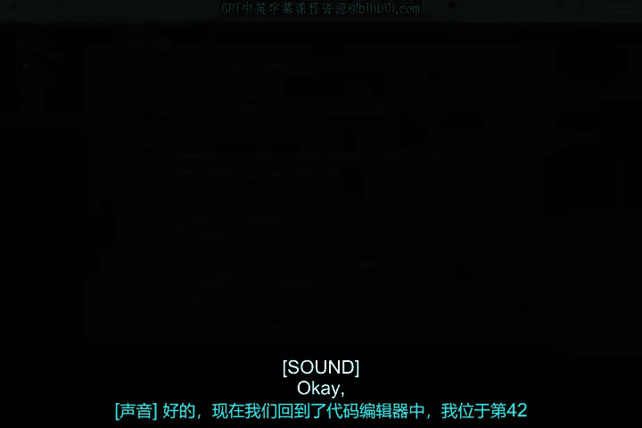
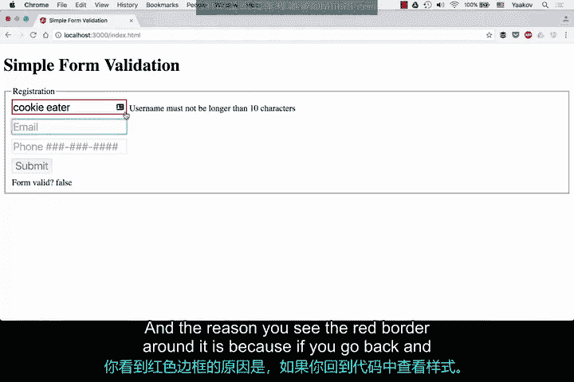
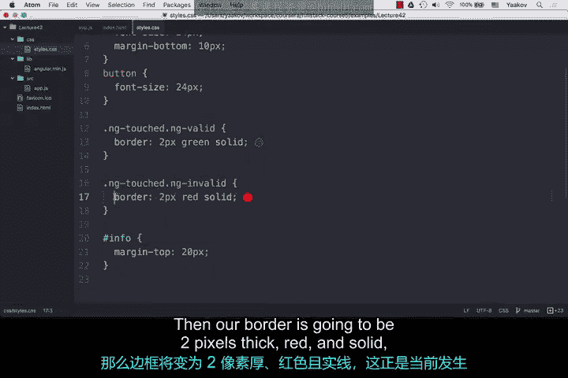
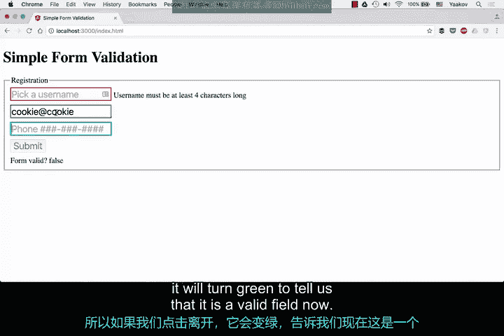
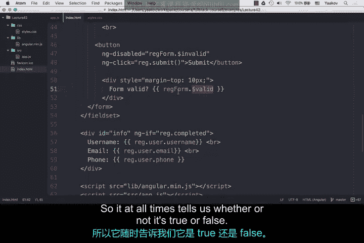
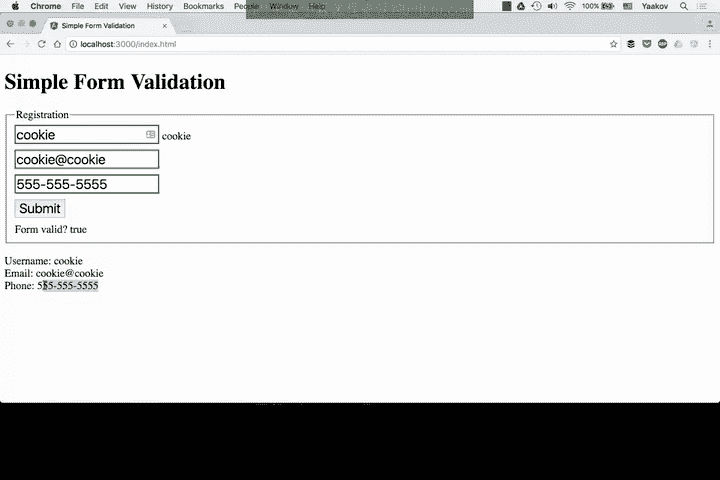

# 约翰霍普金斯大学《使用 AngularJS 开发单页 Web 应用｜Single Page Web Applications with AngularJS》中英 - P90：89_第42讲（第2部分）：表单验证.zh_en - GPT中英字幕课程资源 - BV1dsFDeZEQr

🎼。

Okay so we're back on our code editor and I'm located in lecture 42 folder。

 which is located in fullt course 5 examples folder and this is a simple app called simple forms app and really all it has here is one controller called registration controller and we're giving it a label of Regdge as Regdge controller as syntax and it has a form So it has a form that we're gonna to fill out and it's basically a registration form username email address and a phone number So there's a few input fields here let's take it one by one The first one input field is username they are named here and you can see it's inside the form we definitely named the form and we wanted to make sure that the native browser validation doesn't kick in so we gave it a no validate attribute Now the first thing we need to do is we need to bind our text field our username text field to an object inside of our controller So here we have NG model and we have Regdge that user。

😊，username and the reason we're doing is because we want all the registration for this particular user to reside in this user object attached to the instance of our controller。

😊，So the username is going to be a user that username， just scroll down。

 you will see the email will be user。 email and so on。Okay。

 then we're going to declare a couple of validation requirements， one is required。

 meaning I don't want this text bug to be empty and be considered valid， and the other one is midle。

 meaning that I want my username to be at least four characters long and for the max length we're going to use the angular version of this which is NG dash max length even though we really don't need to hear and we'll give it a 10。

 so the username cannot be longer than 10 characters。And right after that。

 right after this input field， we're going to go ahead and interpolate the value that we're typing in into this text field。

 this re that user that username will just interpolate it to the screen right next to it right below that we have a couple of spans here that basically is going to provide our error messages to the user So the first one is has an N if so it means it's going to show up here if this N if is going value to true So it has a little bit of a more of a complex condition。

 So basically it has these par right here， meaning if this is true and this is true。

 that's one this error message is going to show up So let's take a look as to what this is exactly So the red form here is referring to our form and it has an attribute of username and the username again is the name of our input field that dollar sign error and that's a special object that says that whatever errors you have in validation of this particular input field will show up here as the。

😊，Attributes that you declared on that particular input field。

 So required and min min length and max length。 So at this point， not the Nng Nng is just extra。

 but dialine error， that min length， if that value is to true。

 it means that we have a validation problem with a minimum length requirement。

 So we're saying that if this is true， if you have an error with a minimum length or you have an error with required the same thing。

 D sign error that required。Then this condition， the whole thing is going to evaluate to true。

 So either this is true or this is true。 note that min length does not imply that it's required。

 In other words， we can have this is not required。 but if somebody does type something into here。

 we're requiring it to be at least four characters long but if they type nothing if the required attribute was not declared。

 then an empty field would have been fine even though it is less than four characters long and we're saying that if either one of these things is true and our form that username is touched。

 meaning somebody clicked into this input field and clicked out of it already。

 that's when this will evaluate to true。 So we're saying that when somebody already basically messed with it。

 and it's not passing the min length validation or the required validation。

 then we want to say the username must be at least four characters long very similarly we're going to do the same thing with the max length we're saying if the max length is an。

And it's already been messed with， it's touched， then we'll say username must be longer。

 must not be longer than 10 characters。Let's go ahead and save that。

 Let's go to our browser where I already started browsing for this project and let's go ahead and try typing something。

 Let's start typing CO0 for example， Something weird is already happening I don't know if you realize it or not but if you go back to the code and you take a look we interpolate it this value right away So usually when you type into an NG model bound input field whatever is bound to it immediately starts showing up on the screen and this time it didn't and the reason it didn't is because the value from this input field is only copied inside of the N model bound property。

 if older validations for that field half passed but since we only typed in CO that's less than four characters long which means the validation hasn't passed it means it's still invalid so it does not get copied in here So let's go back we already see the error message let's go ahead and reload and now if we type in CO。

And type a K， you can see that now this is starting to show up。 but if we keep typing cookie。😊，Eater。

You could see that it's not showing up anymore because again。

 we broke another validation rule because now it's longer than 10 characters。 So we click out of it。

 you'll see that now that this field has been messed with the error message does show up that it must not be more than 10 characters long and you could see the red border around it and the reason you see the red border around it is because if we go back and look at our styles。

 you could see that we said Nng touched and nng here right here， it's nng touched an nng invalid。

 if it's the same element that has both of those classes。

 which is something that angular inserted into our element then our border is gonna to be two pixels thick。

 red and solid and that's exactly what's going on right here。 if we load click in here。

 click out of it will still get a red and username must be at least four characters long。

 because it is an empty field。 but as soon as we type something in。😊。

And get out of it。 It's now green because we again styled it that it can be has to be green if it's actually valid。

 Okay so let's go back to the code editor and let's take a look at the next field。

 which is email and in this case all we really specified was required。

 we didn't specify that it has to be an email ty oflook string that you type in in this text box and the reason we didn't do that is because it is implicit when an input type is typed as email that it has to be something at whatever domain in this case the NG if our error message we're using the red form email and we're using another flag called Dowa sign invalid which means we're saying that if this input field is invalid。

 meaning whatever validations that we declared on it one is implicit email the other one is the fact that something has to be there。

 if it's invalid and we've already touch this input field it'll go ahead and output this message let's go ahead and save that and try it if。

😊，Type something else here。 The first one we didn't do anything with and we click out of it。

 it's red and says must be a valid email address。 if we type in something like cookie at and click out of it it's still not good enough but we say cookie at cookie even though it's not necessarily a full domain name like co it's still a valid domain name and therefore it validates just fine so if we click out of it。

 it will turn green to tell us that it is a valid field now okay so let's go back to the code and the last one is phone number and the phone number is bound to this redus phone property。

 this time our validation is patternbased we can actually give it a regular expression。

 So this time we're saying we want something that has three digits dash another three digits dash and four digits So if it doesn't fit that model this will be invalid and our span meaning our error message is very similar to before it's just says phone that's what be registered。

This filled with if it's invalid and it's been touched。

 we're just going to go ahead and print out phone must be in the format and give it the format。😊。

The last element is a button and the button is disabled。

 we declared N disabled if the entire form is actually dollar sign invalid。

 so if dollar sign invalid valid this will turn into true form is invalid and therefore disabled will turn it into true as well。

 which means the button will not be clickable we also here prepared by saying when it is clickable。

 go ahead and reach out to our controller， our red controller and call the submit method。

 the submit method method is not going to do much more that just simply set the flag complete to true and you'll see that this submission or registration summary will show up。

😊，At all this time we actually had this form valid question where we just interpolated our rich form do dollarar sign valid so it all times tells us whether or not it's true or false let's go to our browser。

 let's refresh and let's actually make this true first as we type you could see that the form is still false we'll say cookie at cookie。

😊。

So now the form is true and that's because we didn't make the phone required。

 but as soon as I type something into the phone like 555。

 you see that the form is false and the reason the validity of the form is false is because even though it's not required but if you start typing something in it'd better be matching that pattern。

 So that's why it is false So if I do 555 and another four digits and if I type this last one you could see the submit button now enables and the form valid is true。

 so we're able to click the submit button。😊，And sure enough， our username。

 email and our phone number is displayed， so we're all good to go。

