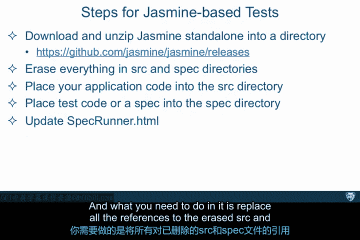
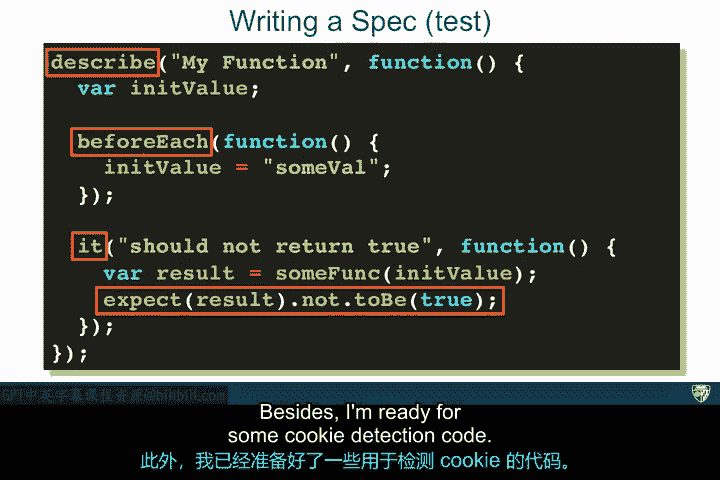

# 约翰霍普金斯大学《使用 AngularJS 开发单页 Web 应用｜Single Page Web Applications with AngularJS》中英 - P91：90_第43讲（第1部分）：使用Jasmine测试JavaScript.zh_en - GPT中英字幕课程资源 - BV1dsFDeZEQr

🎼。

Because of JavaScript's dynamic type nature， coding in JavaScript can be an unconstrained experience as long as you know how ja actually works。

 but that freedom comes at the cost of missing out on the immediate nature of error reporting that exists in strongly type languages like Java That's why testing your JavaScript code before shipping it off to your users is very important you don't want to wait until the user calls you up and tells you that something is broken just to discover it was as simple as a mistyping of a variable name somewhere if only you exercised your code before calling it done such errors could have been avoided。

Modern day software development is rarely done without writing unit tests。

 It's simply part of the process。 So what's unit testing。

 Well unit testing is independent checking for proper operation of the smallest testable part of your application。

 Uni testing is the very powerful concept。 and it is a lot to this definition。

 So let's take it step by step。 First of all， it's independent。

 It's important to isolate the small piece of functionality。

 you're testing from the rest of your application as much as possible。 First。

 you want to make sure you're testing just that small piece and not the entire system。

 There is a place for whole system testing。 but that's not unit testing。 In unit testing。

 we want to verify that just this small part functions as it should。

 The rest of the system doesn't matter。 Think of testing how well a car tire holds the tire pressure in a hot temperature environment。

😊，You wouldn't want to assemble the entire car just to test that。

 not only would that be very time consuming， but it would also introduce other issues into the test that have nothing to do with the tire pressure。

The smallest testable part of this definition should also hint to you that incorporating unit testing into your development process changes the way you approach the rest of software development process altogether In other words。

 you can't write functions that do 20 different things and then expect it to be small and testable。

Each function or component you test has to be focused on a single function or small outcome。

 wrapping an entire application into one function that does everything makes unit testing impossible because unit implies small and focused This is true of whether or not you buy into the purest approach of test driven development or not。

Unit tests should also be written such that they are repeatable This means that as you add more functionality to your code base。

 rerunning your existing unit tests and seeing them all pass should give you the confidence that your new code additions did not break some existing functionality。

But what happens if your small unit of code has a fairly large and complex dependency you still need to test just that small unit of code without the dependency and the answer to that problem is mocking mocking is a technique where dependency and its behavior is imitated or otherwise just known fake mocking can be done directly by the developer or a mocking library a mocking library will usually provide a more complex or perhaps a more generic interacting with some functionality that you're trying to mock For example。

 if your component depends on the Dallasas sign HTP service that makes an AJX call。

 you would need to mock the Dallas sign HTP service so that in your unit test you can fake a server response to verify the expected behavior of your component actually occurs。

😊，Now you could certainly write your own unit tests without any help from any other framework。

 however， it's easier to use a testing framework that comes with a bunch of tools to help you with setup of your tests。

 providing methods that help you verify the result you got was the result you expected and so on the Jasmine framework is a very popular ja testing framework and one that works very well when testing angular code。

 so that's what we're going to use to construct our tests。

 You can use Jasmine as a standalone browser- based testing framework or command line one in this course I'm going to cover the browser based one but realize that using the command line based one would allow you to create scripts that automate your testing and that's a huge benefit not to be dismissed so easily。

😊，Okay， let's go with the basic steps of using Jasmine。

Step number one is for you to download and unzip the Jasmine standalone into some directory you could download it from this URL and it's a URL to the releases of the Jasmine testing framework once you download it an unzipped that release version you erase everything in the source and the spec directories then you place your own application code into the source directory and you place your test code or spec code into the spec directory by the way。

 the reason we're calling our test specs is a bit outside of scope of this course it has to do with the approach called behavior drivenriven development or BDD basically as you'll see on our example。

 the test code will read like a specification of the functionality we're trying to test。

The next step is to update the supplied HTML page， which is called spec runner。

 and what you need to do in it is replace all the references to the erased source and spec files with the files that you yourself edit into those directories。

 in other words， your application code and then your testing code or your spec code。

The last step is for you to start something like browser sync or whatever you used for a local server and go to htp。

co// something probably local cost colon 3000/ specrunner。

htm and that webage will kick off running all of your tests for the standalone version of Jasmine in other words the browserbased one and not the command line1 you could keep the browser sync running and then keep the browser open on the spec runner。

ht that way you could see live as you code if the tests are failing when you think they should be passing。

Okay， so how do we write this spec that we spoke about Well。

 writing a specification or a test is fairly straightforward。

 You start all specs with calling the function describe。

 This function is a container for all the tests we're going to run next optionally you can specify a function called before each the function value specified as the argument into the before each function will be invoked once before each spec is run。

 This is very useful because before any test is run。

 we have to make sure that the conditions under which the test is running are identical to what we need them to be。

 If your code change some data as a result of some other test execution and then we ran another test thinking that our application is in a certain state when it's not our results might be wrong but either way。

 certainly not reliable So here inside the before each function you can initialize whatever data you。

😊，Inteniate whatever services you might need for each test and so on。

The it function is the actual test Note how the whole thing。

 the describe string and the it string read like a specification together。

 my function should not return true。Now Jasmine provides a pretty extensive set of functions that you can use to test the result of your application code execution note that the function names are also designed such that it reads like regular English in Jasmine to negate a certain expectation statement you simply append the not property to it and continue calling verification statement for example。

 here we're expecting the result not to be true。Okay， enough theory。

 let's go to the code editor and try out testing some simple functionality besides I'm ready for some cookie detection code。

😊。

