# 约翰霍普金斯大学《使用 AngularJS 开发单页 Web 应用｜Single Page Web Applications with AngularJS》中英 - P92：91_第43讲（第2部分）：使用Jasmine测试JavaScript.zh_en - GPT中英字幕课程资源 - BV1dsFDeZEQr

🎼。

Okay， so we're back in our code editor and I'm located in lecture 43 folder。

 which is located in full stack course5 examples folder And here and you could see my lecture 43 folder is really the contents of that jasmine zipip unzipped inside of it So I took the jasmine zipip I zippped it took the contents of that folder that was unzpped and Ja basically dumped inside the lecture 43 Then there were a couple of specs here and a couple of source files here I erased those and I put my own in here you could see that I'm looking at specraner html and basically it's left exactly as it was before。

 all these script imports are jasmine imports and you can see that I substituted this two lines and these two lines with my own scripts First we have this cookie detectorgs that's my source。

 we have this ad even though we're gonna take a look at also in my source and we have a couple of specs One is cookie detector spec dogs and then the other one is add even that spec。

😊，S okay so cookie detector is pretty straightforward we're gonna to write a function that given an array of some items is going to tell us whether or not a cookie is part of one of those items or not so let's go to cookie detector js and you can see I have several versions of this cookie detect cookie function and you'll see in a minute why so this cookie detector takes an array of items it loops over the array of items using this full loop pulls out the item that is current iteration in the array then tests if the item has the word cookie inside of it and if it does it will go ahead and return true you could see here if it's not equal to negative one which means it does have the word cookie it some kind of index so it will return true otherwise it will return false let's leave it at that and let's go to our cookie detector spec js here you can see I'm describing calling this describe function and calling cookie detector as our string and。

😊，I'mSetting up two arrays here items without cookies and items with cookies and the way I'm initializing those arrays is through this before each function you could see that I'm initializing the items without cookies I have a bunch of fruit here and items with cookies it and does indeed have the cookies string as one of the items in that array Now it really didn't have to have the initialization sitting inside of forage here this is simple enough that it doesn't really change from test to test so I could have just basically made it equal right here instead of here。

 but this is for demonstration purposes and it's a good demonstration to see that you can initialize things right here。

😊，Okay so let's write our first test here and it started within an it and it reads should be able to detect no cookies。

 It means that I am going to go ahead and run detect cookie function with items without cookies I'm going to pass that in get the result and I'm going to expect use the function called spec that's a jasmine function and I'm gonna pass the result to it and say not to be true。

 We expect it not to be true because the cookies aren't there。

 The second one is it should detect cookies inside of there should be able to detect cookies because it has cookies in it So let's go ahead and save that and I browse a sync running already let's go to our page here and we'll click on the spec runner at HTML when we click that we see we have a failure first of all we have four specs but we don't need to look at that list yet I guess we could look at the list we have a whole bunch of cookie detector and then add even generator well look at that later but you could see。

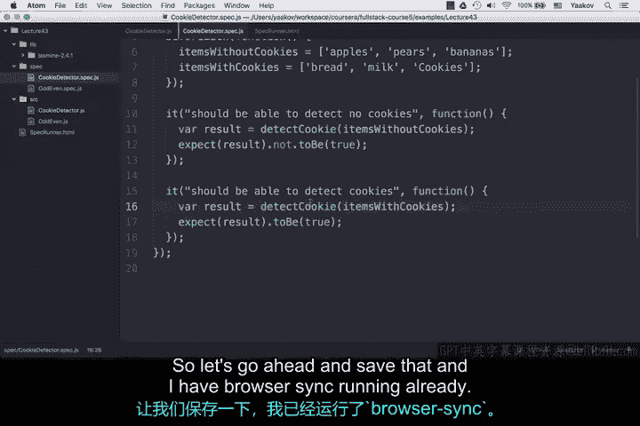

That one of them is passing。 It's green， and the other one is not。 It's red。

 This one says should be able to detect no cookies。 That one seems to be passing。

 but should be able to detect cookies is not passing。 So therefore。

 we go back to the code and take a look at our cookie detector。 And if you notice。

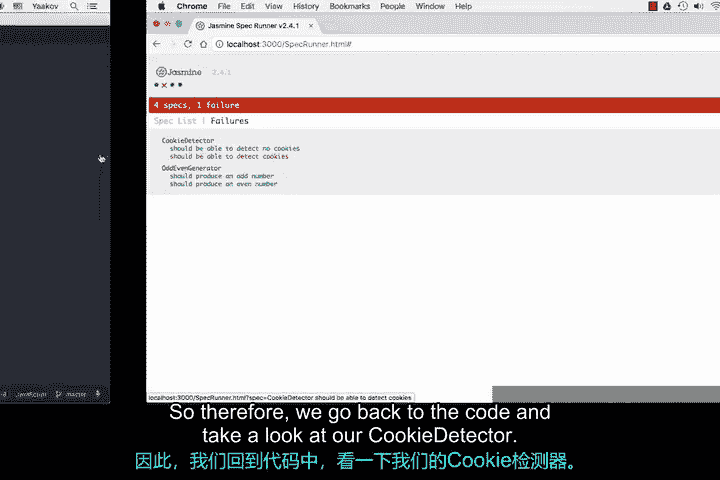

Our full statement is actually sitting right up inside the for loop and that's wrong。

 we really needed to take that return false statement and put it outside of it right here。😊，Now。

 the funny part is that I didn't do this on purpose。 Maybe that's an embarrassing thing。

 but I didn't do this on purpose。 I actually wrote this function very， very quickly。

 I just whipped it out and didn't really look twice at the fact that I stuck this return statement in the wrong place and then wrote the spec and then read the spec and saw that it was not passing and therefore I had to go back and look at the code。

 And that's really a perfect example that even somebody whose experience can make really stupid mistakes and these stupid mistakes don't come out until much later。

 because remember the first test passed which means that if I had a whole bunch of lists with no cookies in them。

 which is a horror into itself。 it would have returned no cookies and everything would have been fine。

 I wouldt have noticed anything until I finally passed in something that did have cookies in it。

 and it would have failed it would have told me the wrong thing。

 So let's go back and I actually wrote instead of erasing it and changing it。

 I just commented it out and wrote。😊。

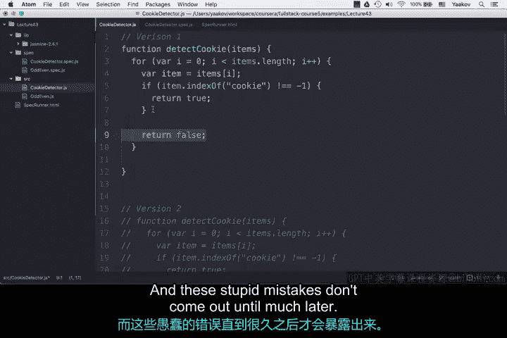

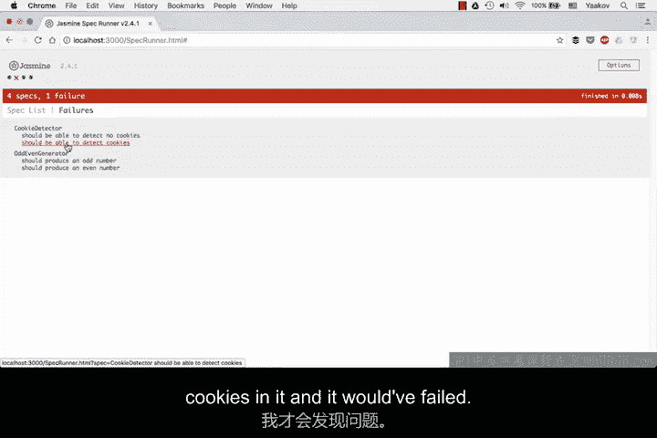

Version2Once again， I was very quick to just slap it together without thinking twice about it and when I wrote version2。

 let's go back to now so the version 2 now moves the return false statement outside of the for loop。

 so let's save that let's go back to our browser and you can see we're still not working here it says expected false to be true which means it's returning false when really should be true。

 the cookie detector should be able to detect cookies。

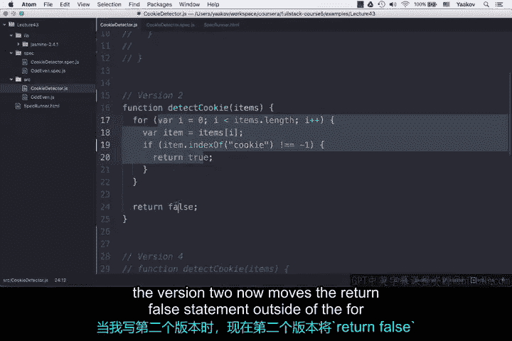

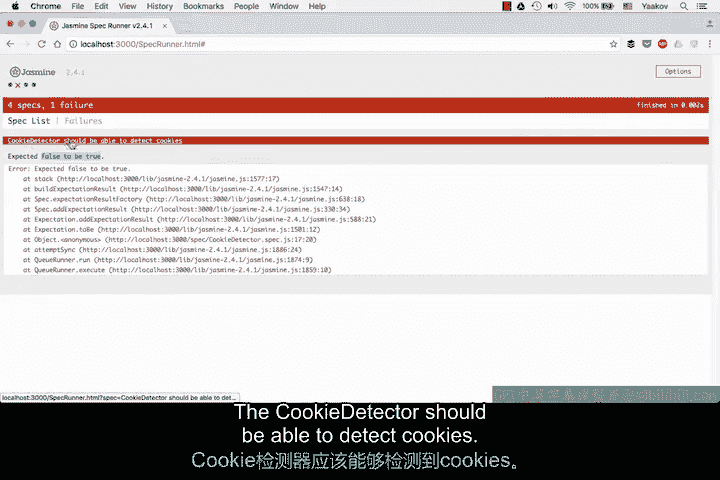

Let's go back and take a look as to what's going on here， and I'll go ahead and comment that out。

And we'll go to actually this is a version  three， version4。

 and we'll comment this out and the reason this wasn't working。😊。

Properly was because I forgot that in my cookie detector or in my cookie spec。

 I should say I have these cookies with a capital C。

 so capital C doesn't really work unless you first lowercase it and then compare it to the cookie which is our lowercase and in this case。

 if I go ahead and save it， go back to my browser you'll see that both tests now are green which means both tests are passing and this is really a perfect example of how you should always try to test even the simplest code you have you exercise your code and stupid little mistakes come out that you could fix now instead of having to have a whole investigation process later as to why your entire application is failing when it's really just the small minor mistake and if you tested it at the unit level。

 the smallest level you would have detected it。😊。

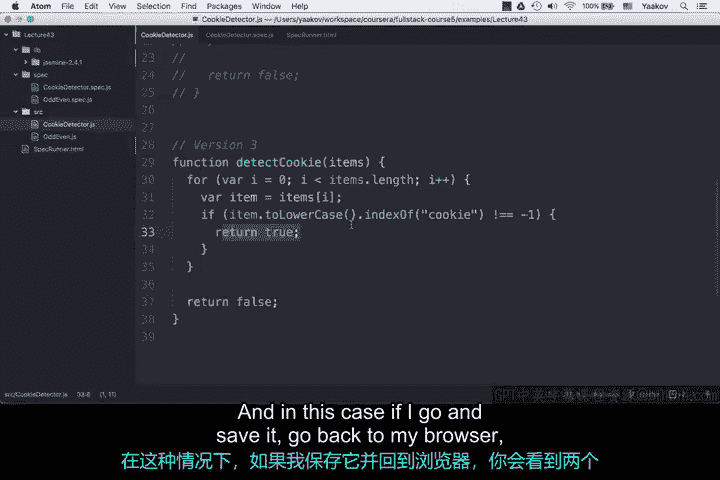

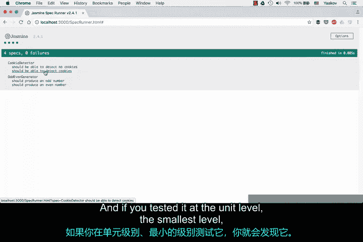

Okay let's go back to the code editor and let's see one more example and one more example is this odd even add even dogis what this odd even dogs does is called get random odd even one to 10 So this function will return to me a random number from one to 10 and it takes the type is one of its arguments。

 which means I could tell it whether or not I want an even number or an odd number but I want them to be a random number Now the way we achieve it is by having a random number generator passed to us as a dependency into this function true we could have had this random number generator right inside this function but it's much better to separate the two because those are two separate functions this one has to return a random number from some number to some number that's something that you could definitely make a mistake in and you want to test separately and this can also make mistakes in how it figures out whether or not。

The number returned is an odd number or even number so how are we going to be able to test this method or this function independently from the get random number I don't want to test random number right now I just want to test whether or not given that the random number works assuming that it works does my get random odd or even one to 10 function work and here's how we're going to do it we're going to use a mock we're going to go to our cookie detector wrong one the odd even spec do Js and the way we're going to do it is inside before each we're going to declare random number generator8 and random number generator3 this one obviously is going to generate an8 and this one is going to generate3 so we're going to grab a random number generator it expects two from the get random odd or even one to 10 we' pass a1 and a 10 right here but that's not going to matter because we're faking the response and the fake response is going be 8。

😊，Whenever this random number generator gets called with the arguments of to and from it will still always return an8 and the same thing for this one it will always return a3 which means I know that it will always return an odd number and I know that this one will always return an even number so if I go to my it function I could see here should produce an odd number and I call the get random odd or even one to 10 function and I pass it the type odd I want an odd number and I go ahead and feed it an odd number that my random number generator will be faked to feed the random get random odd or even one to 10 it will be fake to feed it an odd number which means I should get that number back to me and that's what the result should be so I expect the result to equal3 and the same thing for should produce an even number I'll just pass an even here and feed it。

Number 8 is the random number and that's the first number that shows up should I should get it back。

 and therefore my result is expected to be8。 If I go back to my browser you'll see that both of them pass just fine。

 you could see that each one you could click on each one of these tests。

 if you need any more details in this case they're passing So there's no more details。

 So I could click on all of them and all of them run。

 Now let me show you another one very quick thing。 For example。

 if you're not ready to test something， let's say something is broken or you need to get back to it and the tests are failing。

 a quick way to take one of the tests out of the running is simply to put x right in front of the it function。

 So right now， if I save this the should produce and even number test will not run。

 So let's go back to our browser， you could see that it says should produce and even number pending with message temporarily disabled with X I and the same thing actually applies if I wanted to。

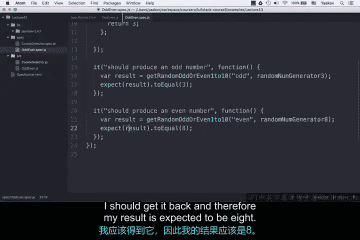

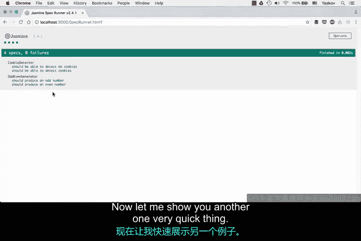

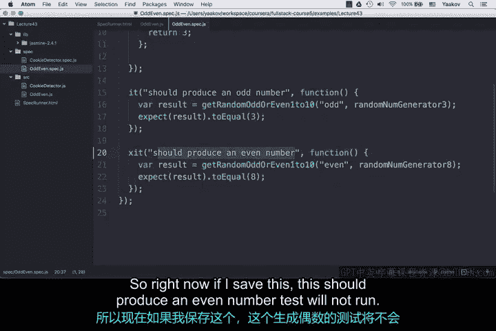

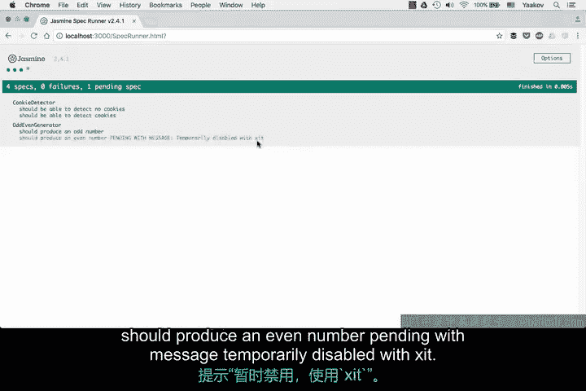

putut an X right in front of describe and save that that means the entire odd even generator suite of tests。

 all of these tests right here will be temporarily disabled so if I save that go back to my browser you could see that both of them are now kind of yellowish or beige indicating that they're both disabled and you could see up here it says that there are four specs but we have two pending specs because I dis those so I could go back and actually maybe just remove this X but leave this X right here just for your reference as to how to get that done。

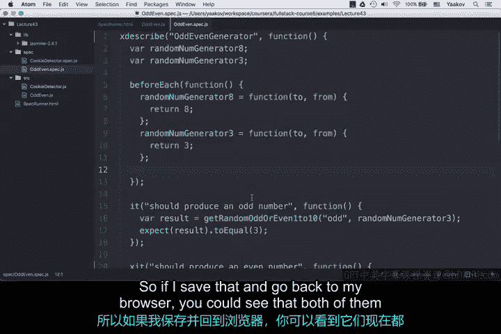

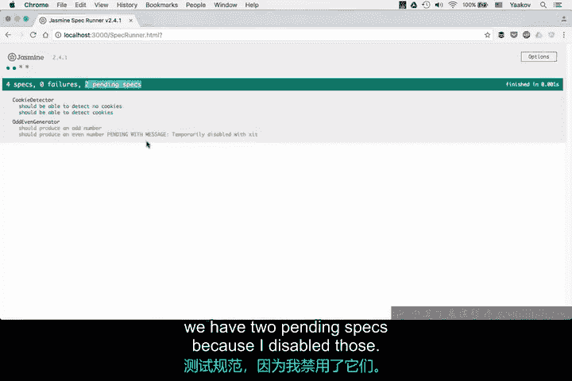

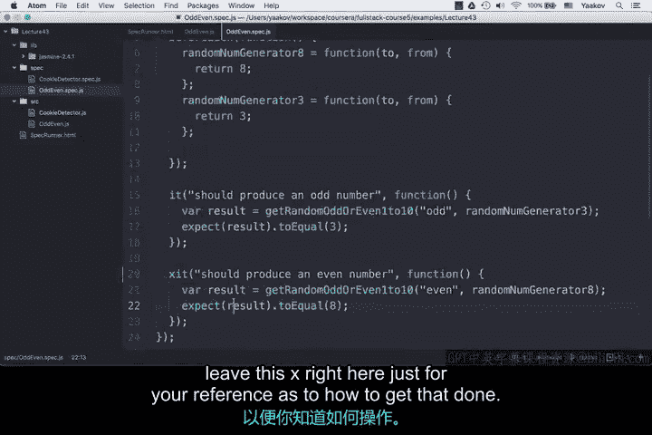

Okay， so let's summarize， remember that unit testing is an essential process in any software development and planning for unit testing changes how you write your code for the better。

 it almost forces you to be more unit oriented and therefore write smaller chunks of code and smaller pieces of functionality that only are responsible to do one focused thing and that's always a good software development practice。

Now mocks are used to fake the dependencies of our target code and that's so we don't have to bring the entire car so to speak just to test one tire Now the way you define tests is by starting to group them together using the describe function that takes a message and a function that contains the rest of the guts of the entire specification Now inside of describe function。

 you could call the before each function also providing it yet another function as the value of it。

 and that's used to initialize state before running each test therefore making sure that you have a well-known and established state of your system so to speak before you run any tests that assume that that state is intact the actual test is performed with a it function it takes a message and a function where the actual testing and verification code is contained。

😊。

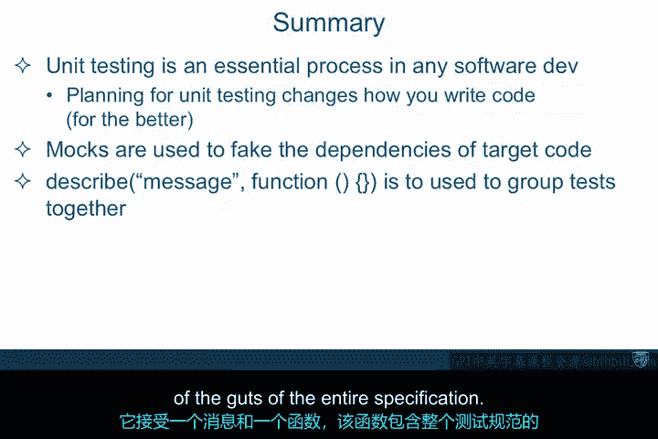

