# 使用 AngularJS 开发单页 Web 应用：P92：第43讲（第2部分）：使用Jasmine测试JavaScript 🧪


在本节课中，我们将学习如何使用Jasmine框架进行JavaScript单元测试。我们将通过两个具体的例子来理解如何编写测试、使用模拟对象以及如何组织测试代码。单元测试是软件开发中确保代码质量的关键环节。

## 项目结构与测试运行器

我们回到代码编辑器，位于`lecture 43`文件夹中。该文件夹包含了从Jasmine压缩包解压出的内容。我们移除了原有的示例文件，并添加了自己的源代码和测试文件。

以下是`specrunner.html`文件的内容，它作为测试运行器，导入了Jasmine库以及我们的源代码和测试文件。

```html
<script src="cookieDetector.js"></script>
<script src="oddEven.js"></script>
<script src="cookieDetectorSpec.js"></script>
<script src="oddEvenSpec.js"></script>
```

## 第一个示例：Cookie检测器 🍪

上一节我们介绍了测试运行器，本节中我们来看看第一个测试示例。我们将编写一个函数，用于检测一个数组中是否包含“cookie”字符串。

### 源代码分析

以下是`cookieDetector.js`中的函数。它接收一个数组，遍历每个元素，检查是否包含“cookie”字符串（不区分大小写）。

```javascript
function detectCookie(items) {
  for (var i = 0; i < items.length; i++) {
    var item = items[i];
    if (item.toLowerCase().indexOf("cookie") !== -1) {
      return true;
    }
  }
  return false;
}
```

### 编写测试规范

接下来，我们为这个函数编写测试。测试文件是`cookieDetectorSpec.js`。

我们使用`describe`函数来组织一组相关的测试，这里我们描述为“Cookie Detector”。在运行每个具体测试之前，我们使用`beforeEach`函数来初始化测试数据。

以下是测试的初始化部分：

```javascript
describe("Cookie Detector", function() {
  var itemsWithoutCookie;
  var itemsWithCookie;

  beforeEach(function() {
    itemsWithoutCookie = ['apple', 'banana', 'orange'];
    itemsWithCookie = ['apple', 'cookie', 'banana'];
  });
});
```

初始化完成后，我们开始编写具体的测试用例。每个测试用例使用`it`函数定义，包含一个描述和一个执行测试的函数。

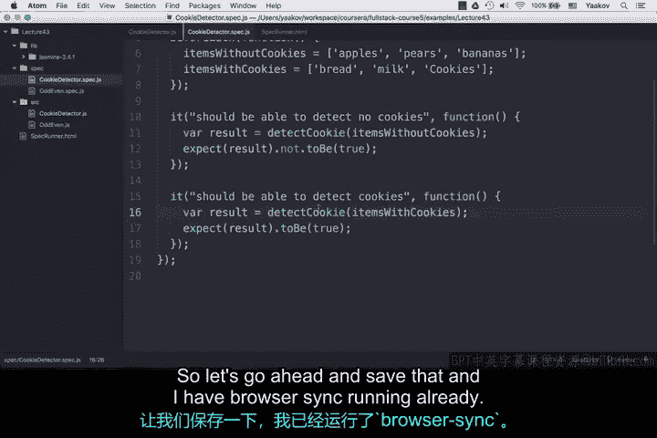

以下是具体的测试用例：

1.  **测试无Cookie的情况**：我们期望当传入不包含“cookie”的数组时，函数返回`false`。
2.  **测试有Cookie的情况**：我们期望当传入包含“cookie”的数组时，函数返回`true`。

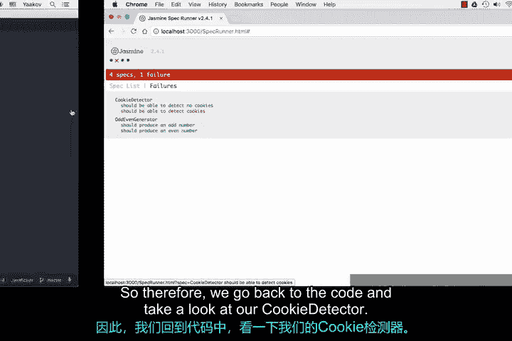

```javascript
it("should be able to detect no cookies", function() {
  var result = detectCookie(itemsWithoutCookie);
  expect(result).not.toBe(true);
});

it("should be able to detect cookies", function() {
  var result = detectCookie(itemsWithCookie);
  expect(result).toBe(true);
});
```

### 运行测试与调试

保存文件后，在浏览器中打开`specrunner.html`运行测试。最初，我们发现“检测有Cookie”的测试失败了。


检查代码发现，最初的函数版本有一个逻辑错误：`return false`语句错误地放在了`for`循环内部。这导致函数在检查第一个元素后，无论结果如何都会立即返回`false`。

```javascript
// 错误版本
for (var i = 0; i < items.length; i++) {
  // ... 检查逻辑 ...
  return false; // 错误位置
}
```

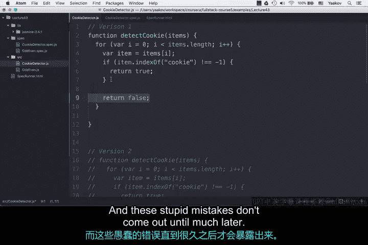

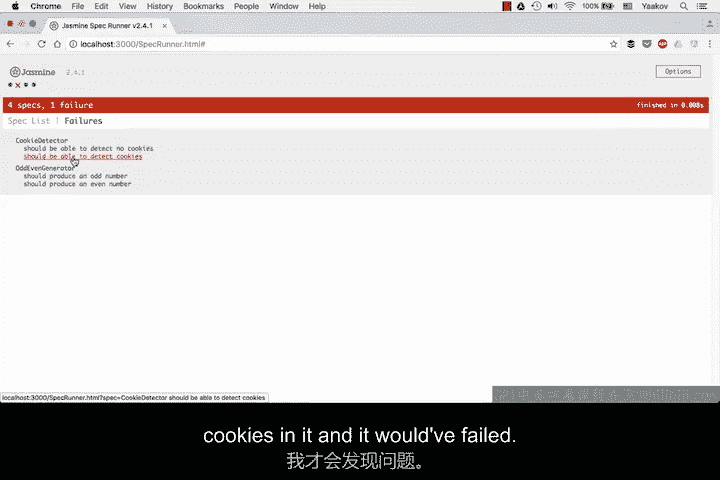

我们修正了这个问题，将`return false`移到循环外部。但测试仍然失败，因为测试数据中的“Cookie”是大写字母开头。

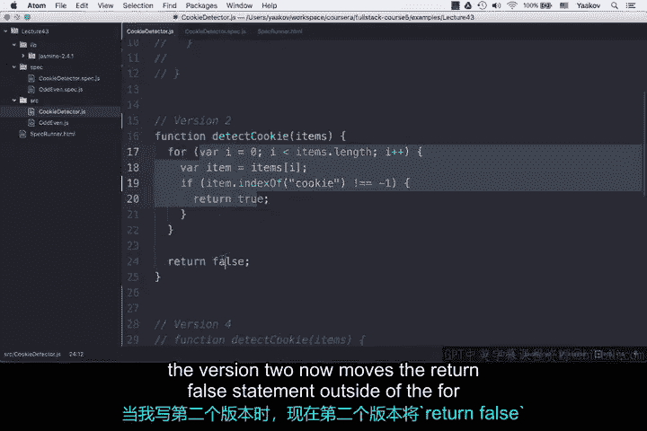

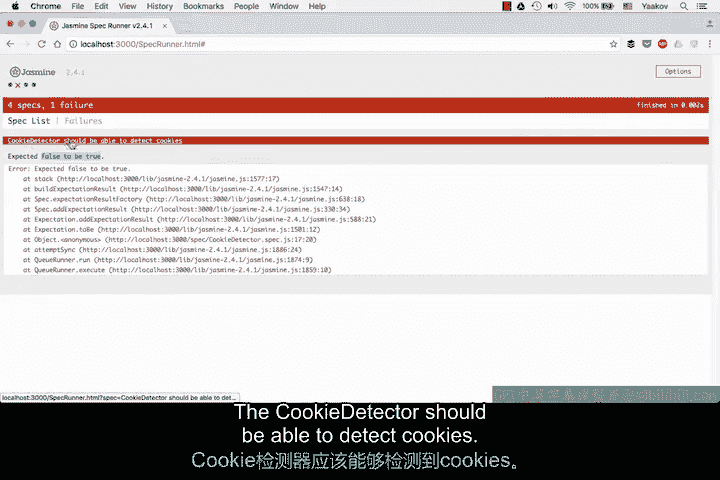


我们修改了函数，在比较前先将字符串转换为小写，最终两个测试都通过了。

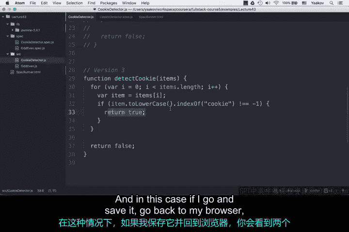

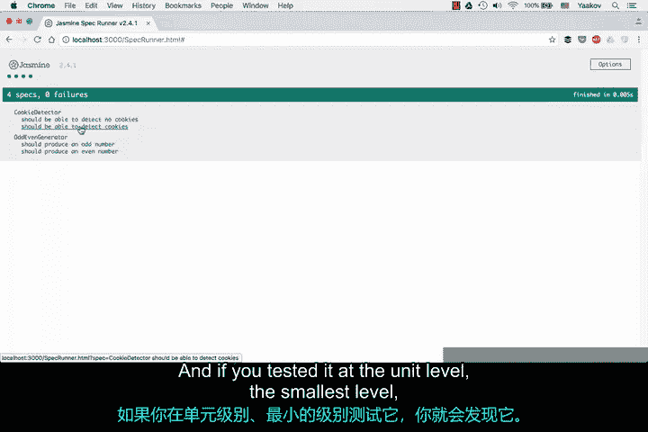

这个例子完美展示了单元测试的价值：即使是有经验的开发者，也可能写出有细微错误的代码。单元测试能及早发现这些错误，避免它们在后期引发更大的问题。

## 第二个示例：奇偶数生成器与模拟对象 🔢


现在，我们来看一个更复杂的例子，它涉及依赖项和模拟对象的使用。我们将测试一个函数，它根据类型（奇数或偶数）返回一个1到10之间的随机数。


### 源代码与依赖分离

`oddEven.js`中的`getRandomOddEven1To10`函数接受一个类型参数（‘odd’或‘even’）和一个随机数生成器函数作为依赖。

```javascript
function getRandomOddEven1To10(type, randomNumberGenerator) {
  var randomNumber = randomNumberGenerator(1, 10);
  var isOdd = randomNumber % 2 !== 0;

  if ((type === 'odd' && isOdd) || (type === 'even' && !isOdd)) {
    return randomNumber;
  } else {
    // 逻辑：如果生成的数字不符合类型要求，这里可能需要处理，本例中我们假设模拟对象总是返回符合要求的数字。
    return -1; // 或者进行递归调用等
  }
}
```

我们不希望测试受到真正随机数的影响，因此需要“模拟”这个依赖项。

### 使用模拟对象进行测试

在`oddEvenSpec.js`中，我们使用`beforeEach`来创建模拟的随机数生成器。

以下是模拟对象的设置：

```javascript
describe("Odd Even Generator", function() {
  var randomNumberGenerator8;
  var randomNumberGenerator3;

  beforeEach(function() {
    randomNumberGenerator8 = jasmine.createSpy('Random Generator 8').and.returnValue(8);
    randomNumberGenerator3 = jasmine.createSpy('Random Generator 3').and.returnValue(3);
  });
});
```

`jasmine.createSpy`创建了一个模拟函数。`and.returnValue(8)`确保无论传入什么参数，这个函数总是返回`8`（一个偶数）。同理，另一个模拟函数总是返回`3`（一个奇数）。

现在我们可以编写不依赖于随机性的确定性测试了。

以下是具体的测试用例：

1.  **测试生成奇数**：我们传入类型‘odd’和总是返回奇数3的模拟生成器，期望函数返回3。
2.  **测试生成偶数**：我们传入类型‘even’和总是返回偶数8的模拟生成器，期望函数返回8。

```javascript
it("should produce an odd number", function() {
  var result = getRandomOddEven1To10('odd', randomNumberGenerator3);
  expect(result).toEqual(3);
});

it("should produce an even number", function() {
  var result = getRandomOddEven1To10('even', randomNumberGenerator8);
  expect(result).toEqual(8);
});
```

运行测试，两者都顺利通过。模拟对象让我们能够独立地测试核心逻辑，而无需关心其依赖项的复杂性和不确定性。

### 临时禁用测试

有时，某个测试可能尚未完成或需要暂时跳过。Jasmine允许在`describe`或`it`前添加`x`来禁用它们。

```javascript
// 禁用单个测试
xit("should produce an even number", function() { ... });

// 禁用整个测试套件
xdescribe("Odd Even Generator", function() { ... });
```

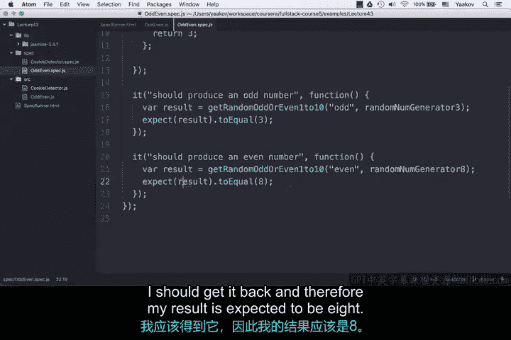

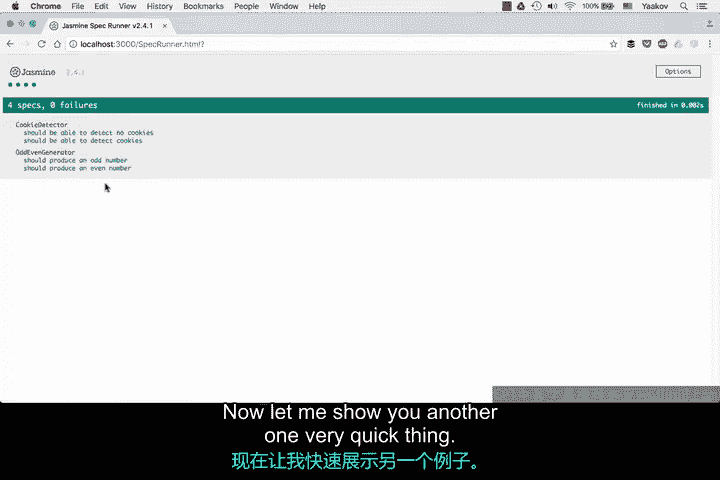

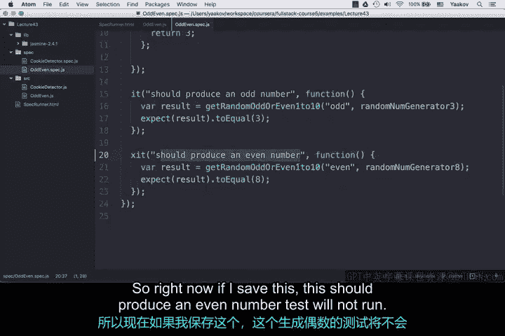

被禁用的测试在报告中会显示为“待定”（pending）状态。

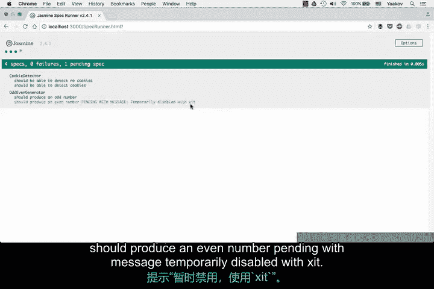

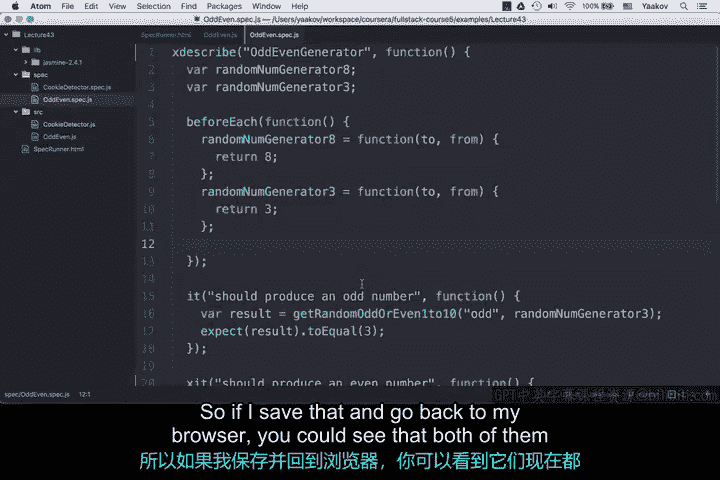

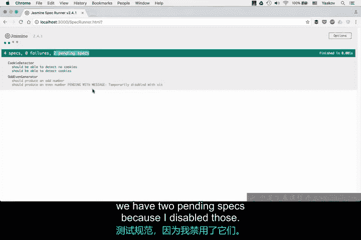

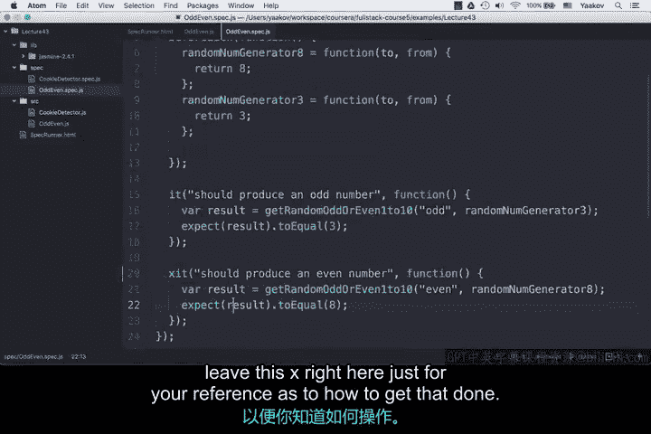


## 总结 📝

本节课中我们一起学习了使用Jasmine进行JavaScript单元测试的核心概念。

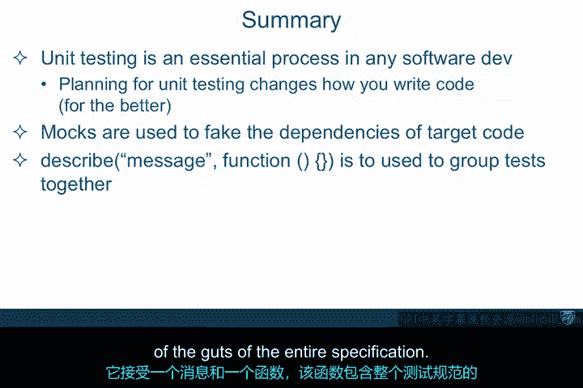


我们了解到，单元测试是软件开发中必不可少的过程。为单元测试做规划，会促使你编写更具模块化、功能更单一的代码，这本身就是优秀的开发实践。

我们学习了**模拟对象（Mocks）**的用途，即伪造目标代码的依赖项，从而可以独立测试特定单元，而无需构建整个系统。

在Jasmine中，我们通过以下方式组织测试：
*   `describe(string, function)`：用于将一组相关的测试用例组织成一个测试套件。
*   `beforeEach(function)`：在每个`it`测试用例运行前执行，用于初始化测试状态，确保测试起点一致。
*   `it(string, function)`：定义一个具体的测试用例，其中包含执行代码和断言验证。


通过实际编写和运行测试，我们看到了即使简单的代码也可能隐藏错误，而单元测试是快速发现并修复这些错误的最有效手段。