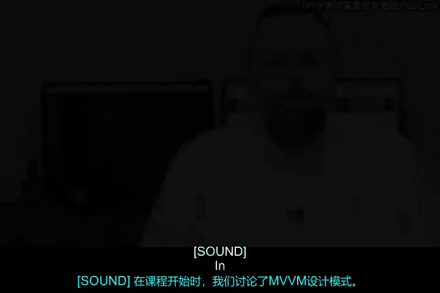
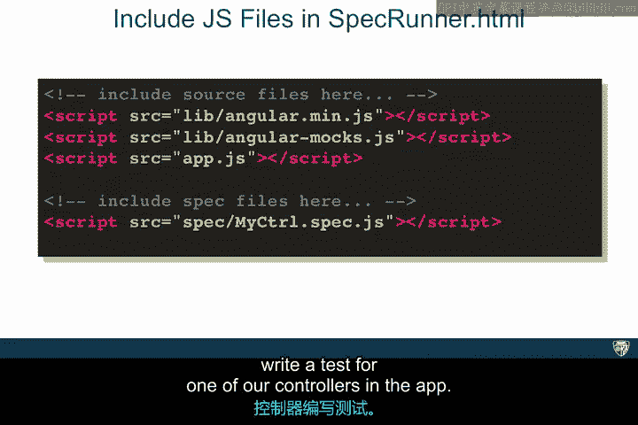

# 约翰霍普金斯大学《使用 AngularJS 开发单页 Web 应用｜Single Page Web Applications with AngularJS》中英 - P93：92_第44讲（第1部分）：测试AngularJS控制器.zh_en - GPT中英字幕课程资源 - BV1dsFDeZEQr

🎼。

In the beginning of the course， we spoke about the MVVM design pattern。

 the view model which we implemented as a controller in Angular。

 was not allowed to have code that directly asks the view to display something it is only to represent the data or state that the view is in。

This fact makes the controller much easier to test without having to include the browser's document。

 object model or the D。Angular GS on top of providing a framework to develop web applications in。

 also provides a helper module to help us test Angular applications。

The module's name is NGM and it's a separate JavaScript file download Let's take a look at the structure of our spec or the test to see how we could test a controller in our application。

The first step is to use the angular dotmt module function for which the shorter version module is just an alias for the angular dotm dot module you provide the name of the module on which you want to execute the test as the argument to the module function。

 for example， the control that we want to test should be declared on that module in our application。

You can pass the module directly into the before each function， or as you can see in this slide。

 you can wrap it in an anonymous function first This is useful when you have more than one thing you want to do in the before each function。

 For example， besides the module loading， you may want to configure some mock object for later used in the tests。

 you can also have multiple before each calls。 Each one will be executed before any of the declared tests。

 I couldn't fit all of it on one slide， So let's see what goes here in the next slide。😊。

Usually you have another before each that uses the Angular MAx library inject method to inject some objects that we need to have available for the test The inject method is an alias for the angular that MA that inject method Once injected we can save them off for later use in our tests。

Note the weird argument we're injecting Usually angular services start with a dollar sign。

 For example， in this case， we're injecting the dollar sign controller or the controller service This is an internal angular service that instantiates controllers and well need to use it to instantiate our own controller manually while these adjust references to the same object and once it's the correct object reference you can save off the controller service instance in a variable with any name。

 we would like to refer to the controller service by its recognizable name which is the dollar sign controller。

 but how can we save off an argument that's named exactly like our variable if we just say dollar sign controller equals dollar sign controller we would be simply assigning the argument reference to itself Angular came up with a solution for us that's based on a convention surround the service with underscore and the angular inject method will automatically strip off the under。

😊，Scores in order to look for the service and then inject the right one。Meanwhile。

 we can use the underscored variable to save off the reference in a regularly looking dollar sign controller variable。

The next thing we're doing in this before each method is setting up a mock service called mock service our controller depends on a service that has a method called a method。

They returned some value。 and here we're setting up that service。

 Our controller will not know the difference and will blissfully call our mock service treating it as a real one。

 Then we instantiate our controller using the controller service by passing it the string name the controller was registered with in our real application module。

 we also pass any dependencies that our controller would usually get injected with by passing in an object where each property is the name of whatever the controller would be injected with。

 here， our real controllers clearly declared to be injected with this service called my service。

 However， instead of trying to create a real instance of my service service。

 we pass the mock instance。 This way， were in control of what this mock service will provide our controller。

 and therefore we're able to isolate just the behavior of the controller to test without having my service logic get in the away。

😊，Finally， we save our controller instance in a variable that's going to be accessible to our itT test functions below。

Let's take a look at the actual test method， which would be right below the before each method。

The last step in our code is to exercise some function attached to the controller instance。

 as you might have guessed， this means that our controller is declared with a controller as syntax If not。

 we would have to pass in the dollarine scope into the controller much like we passed in the fake service and then call the method add item on the Doine scope as well as check that the value is set to what we think it should be said to in this case the string fake dash value。

The last step is for you to include the core angular， the Angular dash mark。

 and your application JavaScript code in the specrunner。htm。

 then include your spec and you're ready to launch the spec runner HTMLt and see if the test passes。

Let's take one of the projects we've developed in a previous lecture and write a test for one of our controllers in the app。

See you in the code editor。

