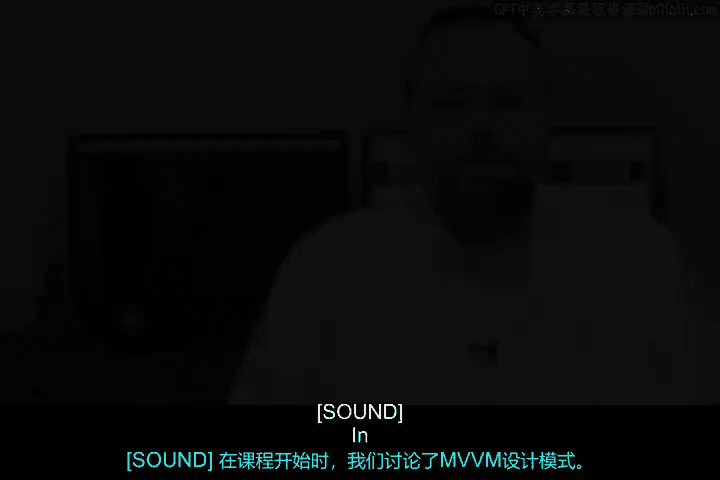
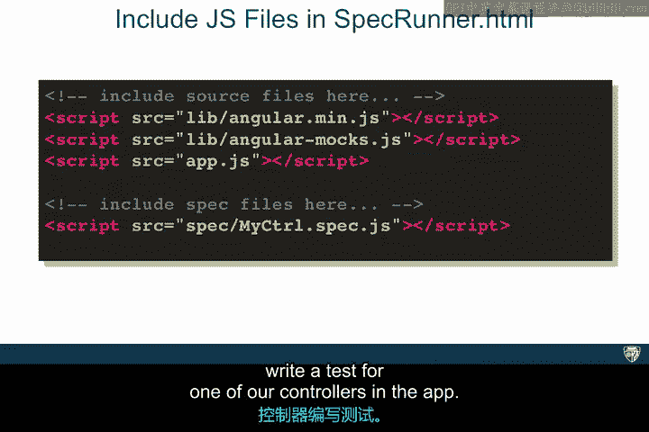

# 使用 AngularJS 开发单页 Web 应用：P93：测试 AngularJS 控制器（第1部分）

在本节课中，我们将要学习如何测试 AngularJS 中的控制器。控制器是 MVVM 模式中的视图模型，其职责是管理视图的数据和状态，这使得它易于进行单元测试。

## 概述：为何控制器易于测试

在课程开始时，我们讨论了 MVVM 设计模式。在 Angular 中，我们使用控制器来实现视图模型。控制器不允许包含直接要求视图显示内容的代码，它只负责表示视图的数据或状态。这一特性使得控制器更容易测试，而无需依赖浏览器的文档对象模型（DOM）。

AngularJS 不仅提供了一个开发 Web 应用的框架，还提供了一个名为 `ngMock` 的辅助模块来帮助我们测试 Angular 应用。`ngMock` 是一个独立的 JavaScript 文件。

## 测试规范的结构

让我们看一下测试规范（spec）的结构，了解如何测试应用程序中的控制器。

### 第一步：加载模块

第一步是使用 `angular.mock.module` 函数（其简写 `module` 是 `angular.mock.module` 的别名）。你需要将要测试的模块名称作为参数传递给 `module` 函数。例如，我们想要测试的控制器应该声明在该模块中。

你可以直接将模块传递给 `beforeEach` 函数，或者如本幻灯片所示，先将其包装在一个匿名函数中。当你在 `beforeEach` 函数中有多个操作时，这很有用。例如，除了加载模块，你可能还想配置一些模拟对象以供后续测试使用。你也可以有多个 `beforeEach` 调用，每个都会在任何声明的测试之前执行。

由于内容无法全部放在一张幻灯片上，让我们在下一部分看看具体内容。

### 第二步：注入依赖

通常，你会有另一个 `beforeEach` 块，它使用 Angular Mocks 库的 `inject` 方法来注入测试所需的对象。`inject` 方法是 `angular.mock.inject` 的别名。注入后，我们可以将它们保存下来，以便在测试中后续使用。

请注意我们注入的参数名称有些特殊。通常，Angular 服务以美元符号 `$` 开头。例如，这里我们注入了 `$controller` 服务。这是一个 Angular 内部服务，用于实例化控制器。我们需要手动使用它来实例化我们自己的控制器。

虽然这些参数引用的是同一个对象，但为了获得正确的对象引用，我们可以将控制器服务实例保存在任意名称的变量中。我们希望使用其可识别的名称 `$controller` 来引用该服务。但是，如果参数名和我们的变量名完全相同，我们该如何保存呢？如果我们直接写 `$controller = $controller`，那只是将参数引用赋值给它自己。

Angular 为我们提供了一个基于约定的解决方案：用下划线包围服务名，`angular.mock.inject` 方法会自动去除下划线以查找正确的服务并注入。同时，我们可以使用带下划线的变量将引用保存到一个看起来正常的 `$controller` 变量中。

### 第三步：设置模拟服务

在这个 `beforeEach` 方法中，我们接下来要设置一个名为 `mockService` 的模拟服务。我们的控制器依赖于一个拥有 `aMethod` 方法的服务，该方法会返回某个值。在这里，我们设置这个模拟服务。我们的控制器将无法区分，并会愉快地调用我们的模拟服务，将其视为真实的服务。

然后，我们使用控制器服务来实例化我们的控制器，方法是传递控制器在真实应用模块中注册时使用的字符串名称。我们还需要传入控制器通常会被注入的依赖项，通过传递一个对象来实现，该对象的每个属性都是控制器将被注入的依赖项的名称。

这里，我们的真实控制器明确声明要注入一个名为 `myService` 的服务。然而，我们不是尝试创建 `myService` 的真实实例，而是传递模拟实例。这样，我们就能控制这个模拟服务为控制器提供什么，从而能够隔离并仅测试控制器的行为，而不会受到 `myService` 逻辑的干扰。

最后，我们将控制器实例保存在一个变量中，该变量可以被下面 `it` 测试函数访问。

## 编写实际的测试方法

让我们看一下实际的测试方法，它应该位于 `beforeEach` 方法之后。

我们代码的最后一步是执行附加在控制器实例上的某个函数。你可能已经猜到，这意味着我们的控制器是使用 `controller as` 语法声明的。如果不是，我们将需要像传入模拟服务一样，将 `$scope` 传入控制器，然后在 `$scope` 上调用 `addItem` 方法，并检查其值是否被设置为我们认为应该设置的值（在本例中是字符串 `‘fake-value’`）。

最后一步是，你需要在 `specrunner.html` 中包含核心 Angular 库、Angular Mocks 库以及你的应用程序 JavaScript 代码。然后包含你的测试规范文件，你就可以启动 `specrunner.html` 并查看测试是否通过了。

让我们选取之前在讲座中开发的一个项目，为应用中的一个控制器编写测试。

## 总结

本节课中，我们一起学习了如何为 AngularJS 控制器编写单元测试。我们了解了 `ngMock` 模块的作用，掌握了测试规范的基本结构，包括加载模块、注入依赖、设置模拟服务以及编写断言测试。通过隔离控制器的逻辑并使用模拟依赖，我们可以有效地验证其行为是否符合预期。