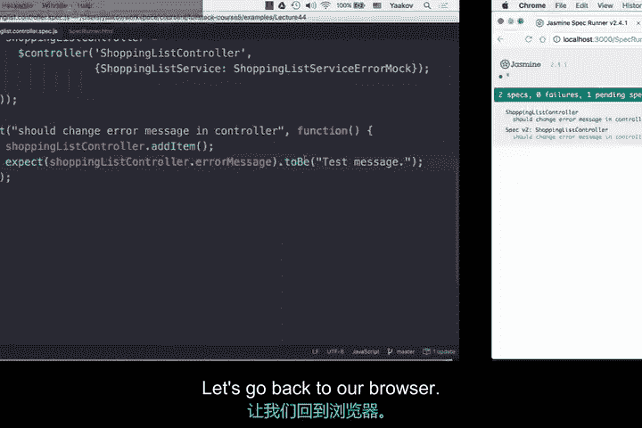
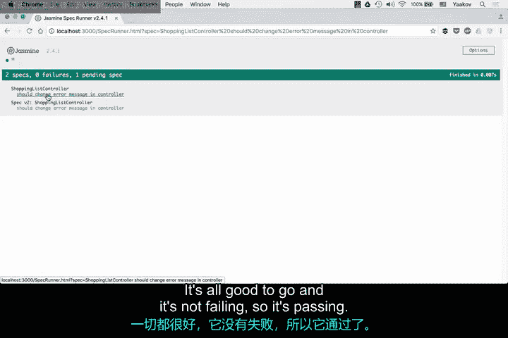
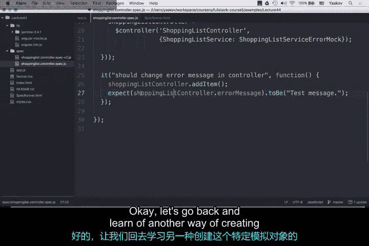

# 约翰霍普金斯大学《使用 AngularJS 开发单页 Web 应用｜Single Page Web Applications with AngularJS》中英 - P94：93_第44讲（第2部分）：测试AngularJS控制器.zh_en - GPT中英字幕课程资源 - BV1dsFDeZEQr

🎼。

Okay so we're back in the code editor and I'm located in lecture 44。

 which is located in full stack course 5 examples folder and here we have an application that directly copied actually if you look at readme that TxD it says all the code was copied from lecture 22 So it's a direct copy from lecture 22 and here what we have is a controller if we scroll down here called shopping list controller that uses a shopping list service and the shopping list service throws an error if you try to add too many items to it that it doesn't allow so this shopping list service is configurable and we could put some number of minimum or maximum number of items that you're allowed to put into it and if you try to put more it will throw an error I'm not really interested in the service so I'm gonna mock that out and instead what I'm interested in testing is to make sure that our shopping list controller updates that error message property on our instance of the actual controller properly and when it's supposed to be。

😊，Get updated so therefore what I'm going do is I'm going to mock the shopping list service and no matter what happens。

 I'm going to go ahead and make it through an exception so then when I call add item on my controller an exception will occur from this service and we'll see if the error message gets updated to the proper error message that I want okay so let's go to our spec which is called shopping list controller specgs there it is we have a version two that we're going to discuss in a future lecture but for now we're looking in the shopping list controller spec dos as you can see here I'm just declaring a string here and I describe method describe function called shopping list controller and I have before each that goes ahead and loads the shopping list app and if we take a look at app dogs that is that shopping list app right there So this is the shopping list app that is loaded using our mock module function So here we declare a couple。

The our assigned controller that's the service we're going to create our controller and our shopping list controller we're going to reuse that at least at this point we don't really need to do it that way we could have just put it inside of one of these methods and created directly in the test but if we want to write more tests then we would like to reuse the same controller over and over again all that really depends on what you're trying to achieve with your particular test suite or your set of tests。

Okay so the first thing is the before each here we inject using the angular mock inject method and we inject the underscore dollar sign controller underscore and what that allows us to do is since angular is smart enough to strip out these underscores it really is just injecting the dollar sign controller what that allows us to do is actually to save it as kind of a local variable as dollar sign controller so we could reuse it as dollar sign controller without having this weirdness of having the dollar sign controller standard service be named something other than what the standard service should be named Next what we're going to do is we're going to create a mock version of our shopping list service and in this case I'm calling it shopping list service error mock so we're mocking out an error So in this case this just an object literal and I'm just going to fake this add item function and it's going to be a function takes a name and a quantity really I really didn't need this at all could just。

😊，Easese it if I wanted to that's also fine， but we could just leave it just for show really and this method will always throw an error and we'll always throw an error with a message test message The other one that we need which is going to get called by our controller is get items it's just going to get call automatically if you take a look at our controller here and you take a look when it gets initialized one of the first things is going do is going to go ahead and call get items so we don't really care about that method but we don't want it to error out so we're just going to go ahead and return no that's not really going to affect our test at least it shouldn't affect our test。

The next step is to create our controller， we call the controller service and then we're passing it the shopping list controller。

 that's the name of the controller that was declared on the original module。

 we could go ahead and go back and verify that the controller shopping list controller right there。😊。

You want to make sure to pull out the right one and we specify the injection into that controller。

 which is expecting a shopping list service and we're giving it an instance of shopping list service error mock instead so since this is like an object literal or an object really that we're passing in it's property shopping list service will get matched with whatever it is that our controller is supposed to be injected with which in this case is shopping list service so that's the right property name。

😊，And we're giving it the mock object， the fake object， instead of a real shopping list service。

Okay the last thing is to actually create the test method or our spec and it says should change error message in controller and what we're doing is we're calling shopping list controller。

ed item and when we call that we expect that the shopping list service will throw an error and therefore the shopping list controller error message should be test message and that's how it's going to be let's go ahead and say that let's go back to our browser already have it started and pointing to spec runner and you could see our first one should change error message in controller is actually green it's all good to go and it's not failing so it's passing so our test succeeded。

😊。

Okay， let's go back and learn of another way of creating this particular mock object that we're creating manually。

 let's go back to the slides and learn how to create it using Angular instead of creating it manually right here。

😊。

