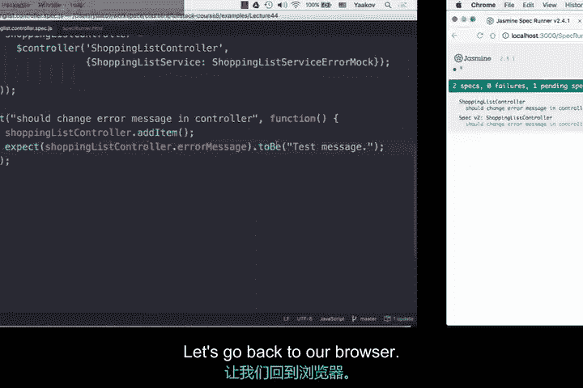
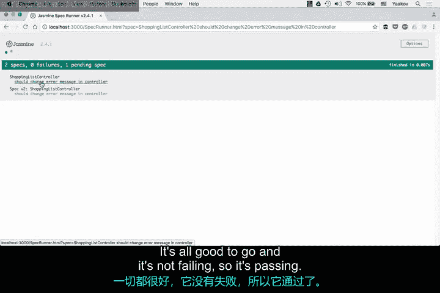
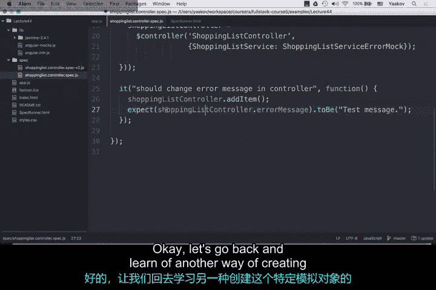

# 使用 AngularJS 开发单页 Web 应用：44：测试 AngularJS 控制器（第二部分）


在本节课中，我们将学习如何为 AngularJS 控制器编写单元测试，特别是如何模拟（Mock）依赖的服务，以测试控制器在特定情况下的行为。

## 概述

我们将测试一个名为 `ShoppingListController` 的控制器。该控制器依赖于一个 `ShoppingListService` 服务。此服务有一个特性：如果尝试添加超过允许数量的商品，它会抛出一个错误。我们的测试目标是验证当服务抛出错误时，控制器是否能正确更新其内部的错误信息属性。

为了隔离测试控制器，我们将模拟（Mock）掉 `ShoppingListService`，使其无论何时被调用都抛出错误，然后检查控制器的错误信息是否被正确设置。

## 测试环境搭建

首先，我们来看测试文件的结构。测试文件位于 `shoppingListController.spec.js` 中。我们使用 Jasmine 测试框架和 Angular Mocks 库。

以下是测试套件的基本设置：

```javascript
describe(‘Shopping List Controller‘, function() {
  var $controller;
  var shoppingListController;

  beforeEach(module(‘ShoppingListApp‘));

  beforeEach(inject(function(_$controller_) {
    $controller = _$controller_;
  }));
});
```

在上面的代码中：
*   `describe` 函数定义了一个测试套件。
*   `beforeEach(module(…))` 确保在每个测试用例运行前，加载我们的 `ShoppingListApp` 模块。
*   另一个 `beforeEach` 块使用 `inject` 函数来注入 AngularJS 的 `$controller` 服务。我们使用下划线包裹（`_$controller_`）的技巧，以便将注入的服务赋值给一个名为 `$controller` 的局部变量，方便后续使用。

## 创建模拟服务

上一节我们介绍了测试的基本设置，本节中我们来看看如何创建模拟的 `ShoppingListService`。我们不希望测试依赖于真实的、可能行为复杂的服务，因此需要创建一个模拟对象来替代它。

以下是创建模拟服务对象的代码：

```javascript
var shoppingListServiceErrorMock = {};
shoppingListServiceErrorMock.addItem = function(name, quantity) {
  throw new Error(‘Test message‘);
};
shoppingListServiceErrorMock.getItems = function() {
  return null;
};
```

这个模拟对象很简单：
*   `addItem` 方法被重写，使其总是抛出一个带有特定信息 `“Test message”` 的 `Error`。
*   `getItems` 方法被重写，返回 `null`。这是因为控制器在初始化时会调用此方法，我们只需确保它不会导致测试失败即可。

## 实例化控制器并注入模拟服务

创建好模拟服务后，下一步是使用它来实例化我们要测试的控制器。

以下是实例化控制器并注入依赖的代码：

```javascript
beforeEach(function() {
  shoppingListController = $controller(‘ShoppingListController‘,
                                        {$scope: {},
                                         ShoppingListService: shoppingListServiceErrorMock
                                        });
});
```

在这段代码中：
*   我们调用 `$controller` 服务来创建 `ShoppingListController` 的实例。
*   第二个参数是一个对象，用于指定控制器的依赖注入。控制器期望一个名为 `ShoppingListService` 的依赖项，我们在这里提供了之前创建的模拟对象 `shoppingListServiceErrorMock`。AngularJS 的依赖注入系统会根据属性名进行匹配。

## 编写并执行测试用例

现在，控制器已经准备好，并且注入了会抛出错误的模拟服务。我们可以编写具体的测试用例了。

以下是测试用例的代码：

```javascript
it(‘should change error message in controller‘, function() {
  shoppingListController.addItem();
  expect(shoppingListController.errorMessage).toBe(‘Test message‘);
});
```

这个测试用例的逻辑是：
1.  调用控制器的 `addItem` 方法。
2.  由于模拟服务的 `addItem` 会抛出错误，我们期望控制器的 `errorMessage` 属性会被设置为错误信息 `“Test message”`。
3.  `expect(...).toBe(...)` 是 Jasmine 的断言语句，用于验证实际结果是否符合预期。

运行这个测试，它应该显示为通过（绿色），证明我们的控制器在服务出错时能正确更新错误信息。

## 使用 Angular Mocks 创建模拟对象

之前我们手动创建了一个简单的对象字面量作为模拟服务。Angular Mocks 库提供了更强大的工具来创建模拟对象。

让我们回到代码，学习另一种方法。我们可以使用 `angular.mock` 提供的方法来创建更逼真、功能更全的模拟对象，例如模拟一个完整的服务，包括其所有方法。这在进行复杂集成测试时非常有用。不过对于当前这个简单的错误测试，我们手动创建的对象已经足够。



## 总结



本节课中我们一起学习了如何为 AngularJS 控制器编写单元测试。核心步骤包括：
1.  **设置测试模块**：加载包含待测试控制器的应用模块。
2.  **注入依赖**：获取创建控制器所需的 `$controller` 等服务。
3.  **模拟依赖项**：创建模拟对象来替代控制器所依赖的真实服务，以控制测试环境并隔离被测单元。
4.  **实例化控制器**：使用模拟的依赖项来创建控制器实例。
5.  **编写测试断言**：调用控制器方法，并验证其状态或行为是否符合预期。




通过模拟依赖项，我们可以专注于测试控制器本身的逻辑，确保其在不同场景下（如服务成功、服务出错等）都能正确工作。这是编写可靠、可维护前端代码的重要实践。