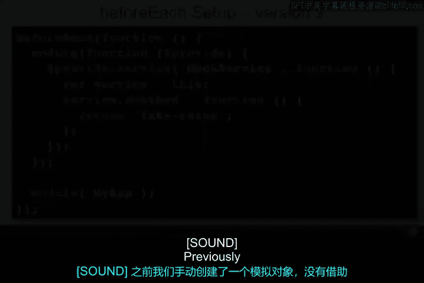
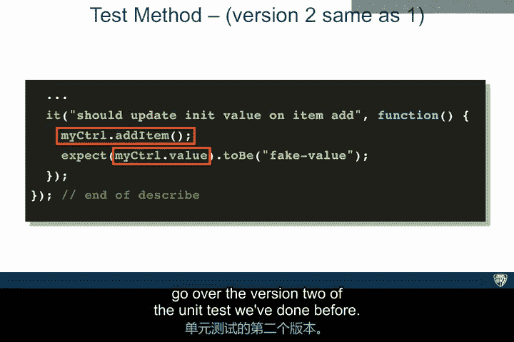

# 约翰霍普金斯大学《使用 AngularJS 开发单页 Web 应用｜Single Page Web Applications with AngularJS》中英 - P95：94_第44讲（第3部分）：测试AngularJS控制器.zh_en - GPT中英字幕课程资源 - BV1dsFDeZEQr

🎼。

Previously， we manually created a mock object without any help from Angular however。

 there's another way for us to create services factories， etc ce。

 and that is by using the provide service we are used to creating services factories directives with the service factory directive methods that we executed directly on the angular module instance In reality。

 however， those methods were just shortcut methods for the real API that creates those things for us That API is the provide service Here you could see that we're injecting the provide service using the Angular mod module or simply the module function Think of the module function as the dot config function we injected providers into previously just like the dotconfig method you cannot inject nonprovider artifacts like a real service using the module method For that you have to use a separate angular mod that inject or simply。

😊，We'll see that in just a second。Here we use the Pro service to define a service called Mac service for our module。

As you could see we're defining it right in line once the service is defined。

 we can use its declared string name Mac service as something we can inject into other calls also in such a setup。

 we're not using a local variable to store the newly created service reference so we could share it with the code that creates our controller we simply don't need to since we made this mock service as part of our module now we can have Angular look for it later and inject it where it's needed。

😊，The next step is to use the Mac inject method to inject our newly created Mac service and then use it in instantiating our controller note that depending on what it is you're trying to test。

 you may not want to create the controller in the central place like before each there's nothing wrong with creating the controller directly in the test itself it all depends on what is the common starting state between the tests you're running it's a good idea to take out of the tests。

 whatever it is that's common between them That way you're not writing the same code in multiple places。

😊，Okay， all that's left now is to create the test and it's exactly the same code as before。

 so let's go back to the code editor and go over the version 2 of the unit test we've done before。😊。

